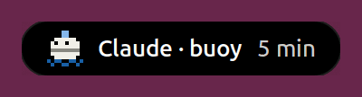
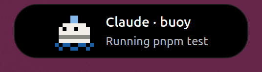
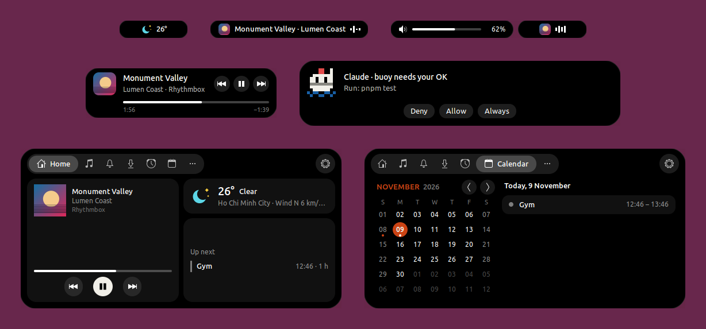

<p align="center">
  
</p>

<h1 align="center">Buoy</h1>

<p align="center"><strong>A living pill for the GNOME top bar.</strong></p>

<p align="center">Say it "BOO-ee" (or "boy", if you're British). The mascot is <strong>Bu</strong>, the first half of the name.</p>

<p align="center">
  <a href="https://github.com/murilegus/buoy/actions/workflows/ci.yml"></a>
  
  <a href="LICENSE"></a>
  <a href="https://github.com/murilegus/buoy/releases/latest"></a>
  
</p>

Islands sit still and wait for you to visit. A buoy floats, stays quiet, and lights
up only when something is happening on the water. Buoy turns the centre of your top
bar into exactly that: a small black pill that grows when music plays, a file copies,
a charger connects or a coding agent asks for permission — and shrinks back the
moment it's over. You never open a buoy; there is nothing inside. Glance at it and
you know whether something is up. Come closer, and hover, to read what it is. Click,
and you look at the water under it: a single home panel with what's going on, no
assistant to talk to, no setup. Just a mark on the surface telling you what's
happening underneath.

<p align="center">
  
  &nbsp;&nbsp;
  
</p>

## What's in 0.1

<p align="center">
  
</p>

- **In the pill:** music from any player, file copies and browser downloads, volume,
  brightness and Caps Lock, notifications, and your Claude Code sessions — permission
  prompts answered right from the pill.
- **When nothing is going on:** the next event, the weather or the time of day, whichever
  matters most.
- **Home** (click the pill): what you missed, what's running, Now playing, the weather and
  the rest of today; tabs for media, notifications, transfers and the calendar.
- **The top bar:** the app and the system menu on rounded backgrounds that follow your
  wallpaper, and rounded corners on maximized windows.

Everything in it: [release notes](https://github.com/murilegus/buoy/releases/latest).

## Requirements

- **GNOME Shell 50** — tested on Ubuntu 26.04. Older or newer Shells are refused by the
  installer (`--force` tries anyway).
- Nothing else to install: Buoy is a plain GNOME Shell extension, with no daemon and no
  background program.

## Install

### From extensions.gnome.org

Buoy has been submitted to [extensions.gnome.org](https://extensions.gnome.org) and is
**waiting for review**. Its page, `extensions.gnome.org/extension/11684/buoy`, opens to
everyone once it is accepted; then it installs from there or from the Extensions app, with
updates from there too. Until then, use one of the ways below.

### With one command

```bash
curl -fsSL https://murilegus.dev/buoy/install.sh | bash
```

It downloads the latest release from GitHub and installs it for your user only — no sudo,
nothing outside `~/.local/share/gnome-shell/extensions` and GNOME's settings. Then **log
out and back in**: GNOME on Wayland loads new extensions at login.

The script is [`install.sh`](install.sh) in this repository; read it first if you like, or
run it with `--help`. A given version: `… | bash -s -- --version 0.1`.

### From a zip

Download `buoy@murilegus.shell-extension.zip` from the
[latest release](https://github.com/murilegus/buoy/releases/latest), then:

```bash
gnome-extensions install --force buoy@murilegus.shell-extension.zip
gnome-extensions enable buoy@murilegus
```

and log out and back in. (`./install.sh --zip buoy@murilegus.shell-extension.zip` does the
same and checks your GNOME version.)

### From source

```bash
git clone https://github.com/murilegus/buoy.git
cd buoy
./install.sh --from-source
```

It builds the zip with `gnome-extensions pack` and installs it. To work on Buoy instead, see
[CONTRIBUTING.md](CONTRIBUTING.md).

## Update

```bash
curl -fsSL https://murilegus.dev/buoy/install.sh | bash -s -- --update
```

It installs the latest release only if it is newer than yours, then asks you to log out and
back in. Once Buoy is on extensions.gnome.org, the Extensions app keeps it up to date — the
same extension, so nothing to reinstall.

## First run

Bu says hello in the pill the first time and walks you through the basics: hover the pill
to read more, click it for Home, scroll on it when idle to flip through what it can show.
After an update, Bu tells you what's new — once.

## Settings

Click the pill, then **⚙** in Home — or run `gnome-extensions prefs buoy@murilegus`.

- **Island** — what the pill shows when nothing is going on, and how it behaves.
- **Modules** — turn each part on or off (music, transfers, notifications, Claude Code…)
  and tune it.
- **Apps** — per-app tweaks: an app's icon, name, priority or what it shows.
- **Panel** — the left and right clusters of the top bar.
- **Windows** — maximized windows under the top bar, and the Dock and Clock settings (the
  same ones as Ubuntu's Dock and GNOME's Date & Time, synced both ways).
- **About** — the version, Bu, links, and "Support Buoy" when donations are set.

### Claude Code

Buoy shows each Claude Code session in the pill — what it is doing and for how long — and
lets you answer its permission prompts (Deny · Allow · Always) from the pill or the
keyboard.

Turn it on in **Settings → Modules → Claude Code → Show my Claude Code sessions**. That
adds Buoy's hooks to `~/.claude/settings.json` (or `$CLAUDE_CONFIG_DIR/settings.json`),
keeps everything else in the file, and saves the old one as `settings.json.bak`. Turning
it off removes exactly Buoy's hooks. Running sessions pick the change up by themselves.

If Buoy is off or removed, the hooks do nothing and Claude Code carries on as without it.

## Privacy

- **Nothing is sent anywhere by Buoy itself.** No account, no telemetry, no server.
- **The weather** comes from GNOME's own weather service (GWeather, the same one as the
  date menu and GNOME Weather).
- **"Use my location"** (on by default, Settings → Island → Weather) asks GNOME's location
  service, Geoclue, for your city when the weather refreshes. Turn it off and pick a city
  to keep your location to yourself. Geoclue only answers when Location Services is on in
  GNOME Settings.
- **Album covers** are loaded from the address the music player gives, as GNOME's own media
  controls do.
- **The clipboard**: when you copy, Buoy reads it (text, file names or an image thumbnail)
  to show it briefly. Turn "Show what was copied" off and it only says Copied, without
  reading. Nothing is stored.
- **Claude Code** talks to Buoy over your session's local D-Bus. The prompt you type is
  never shown, and Buoy keeps no transcript or permission of its own; "Always" writes the
  rule Claude Code suggested into Claude Code's own settings.

## GNOME settings Buoy sets

The first time it runs, Buoy writes a few defaults into GNOME's own settings — **only the
ones you never changed yourself**, and only once:

| Where | Setting | Buoy's value |
|---|---|---|
| Date & Time (top bar clock) | weekday, date, seconds | off |
| | clock format | 24-hour |
| Ubuntu Dock | auto-hide | on |
| | panel mode (edge to edge) | off |
| | icon size | 32 px |
| | position | bottom |
| | show on | primary display only |
| | trash, volumes and devices | hidden |
| GNOME Weather units | temperature, wind speed | °C, km/h |

Change any of them back in GNOME Settings (or in Buoy's settings, which show the same
values). Removing Buoy leaves them as they are; the uninstaller prints the
`gsettings reset` commands for the ones still at Buoy's value.

## Uninstall

```bash
curl -fsSL https://murilegus.dev/buoy/install.sh | bash -s -- --uninstall
```

(or `./install.sh --uninstall` in a clone). It switches Buoy off, removes it and its Claude
Code hooks, and lists the GNOME settings above that are still at Buoy's value with the
command to reset each. Buoy's own settings are kept for a reinstall; add `--purge` to
reset them too.

Installed from extensions.gnome.org? Remove it in the Extensions app — turn off
**Show my Claude Code sessions** first if you use it (left behind, the hooks just do
nothing).

## Troubleshooting

- **Nothing in the top bar after installing** — log out and back in. Then check it is on:
  `gnome-extensions info buoy@murilegus` should say `State: ACTIVE`; if it says
  `DISABLED`, run `gnome-extensions enable buoy@murilegus`. Also check that the Extensions
  app's **Use Extensions** switch is on.
- **"needs GNOME Shell 50"** — `gnome-shell --version` shows yours. Buoy 0.1 is made for 50
  only.
- **Claude Code sessions don't show** — the switch in Settings → Modules → Claude Code says
  what it found: hooks installed, Claude Code not found, or a `settings.json` that is not
  valid JSON (Buoy never writes into a file it cannot read).
- **Something looks wrong** — look for Buoy's lines in GNOME Shell's log and attach them to
  an [issue](https://github.com/murilegus/buoy/issues):

  ```bash
  journalctl -b -o cat /usr/bin/gnome-shell | grep -i buoy
  ```

## Known limits

- **GNOME Shell 50 only.**
- **The pill lives on the primary display.**
- **Installing or updating needs a new login** (GNOME on Wayland loads extensions at login).
- **Downloads** from Chrome and Firefox show their size and speed but no percentage —
  browsers don't tell the desktop how big a download will be. Buoy watches your Downloads
  folder (more folders in Settings → Modules → Transfers).
- **Fn Lock** shows only where the laptop's driver reports it: today Lenovo IdeaPads
  (`ideapad-laptop`, tested on an IdeaPad Slim 3). Caps Lock and Num Lock work everywhere.
- **Calendar colours** are not shown: GNOME's calendar service doesn't pass them on.
- **Coding agents:** Claude Code only, for now.

## Contributing

Bug reports and ideas are welcome in [issues](https://github.com/murilegus/buoy/issues).
To build and change Buoy, see [CONTRIBUTING.md](CONTRIBUTING.md). Security problems:
[SECURITY.md](SECURITY.md). Accessibility: [ACCESSIBILITY.md](ACCESSIBILITY.md). Everyone
taking part follows the [code of conduct](CODE_OF_CONDUCT.md).

Inspired by Dynamic Island, Notchy and Islet. Licensed under [GPL-2.0](LICENSE).
