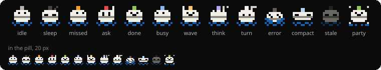
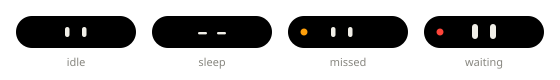

# Bu — Buoy's mascot (decided 2026-11-03)

Bu, the first syllable of Buoy ("boo"; the name is said "BOO-ee", 2026-11-06), is the
buoy itself: a small pixel float with a lamp on its head. The lamp shows the pose; the
buoy light stays the pill's edge dot (SPEC §2a-i, INDICATORS; until 2026-11-08 the lamp
was the light). Bu adds no new idea.

Bu is not an assistant face. It never talks, never follows the pointer, never glows, and
never moves while the island is idle (SPEC §0, §8; ARCHITECTURE rule 8). Its job is to
make state readable at a glance and to give Buoy a recognisable identity.



Two forms, one family:

- **Bu** — the pixel buoy, 13 poses (below). Used by the brand, by agent activities and by
  the greeting.
- **Bu's eyes** — only the two eyes, drawn inside the black pill; the idle plan `mascot`
  (§ Eyes). Same lamp colours, same rules.

## Where Bu appears

Bu is the only pixel art in Buoy (2026-11-04, Ethan): it is a character, seen seldom and
on purpose. Data icons — the clock's dayparts, weather, calendar — are vectors, quiet
and in GNOME's icon language, so a pill that switches between plans never changes style.

| Place | What | Since |
|---|---|---|
| Brand | extension icon, README, EGO screenshots, prefs About page (M3 About, waving, 2026-11-04); empty states — every empty tab, Bu over its line (kit `EmptyState` `pose`, 2026-11-07, Ethan): Home "Nothing going on", Media "Nothing playing", Claude Code, a stub kind tab ("No timer"), the not-yet-built Clipboard ("Coming soon") and Calendar's "No calendars" `idle`; Notifications "All caught up" and a picked day with no events in the Calendar tab ("No events", "Nothing else today", 2026-11-08) `sleep`; Transfers "No transfers" `done` | M3 release |
| Agents | the **leading** of every agent activity (Claude Code, Codex, any D-Bus caller that sends `{mascot}`); the pose follows the agent's lifecycle (§ Agents). The agent's name is always the first word of the text, since Bu does not say which agent it is | M3 "Claude Code: ask + agent activity" (merged 2026-11-07) |
| Greeting | leading of every greeting (GREETING.md §6): `wave` for 5 s at start, wake, welcome back and leaving; `party` on a birthday or celebration; `done` for a good weekend; `sleep` for good night; `busy` while updating | M4 greeting |
| Idle plan `mascot` | Bu's eyes in the idle pill (§ Eyes), module off by default | M4 |

Not: the pills of other modules (app icons and art stay), and not as a
replacement for the light in every state.

## Drawing rules

- **Grid 10 × 10.** Sizes are multiples of 10 so every cell is whole logical px: **20 px**
  in minimal (cell 2, APPLE §B5.3 leading ≤ 20), **40 px** in compact (cell 4, ≤ 40,
  2026-11-05), **50 px** in expanded headers (≤ 56), 40 px in Home and prefs. HiDPI multiplies whole px; nothing blurs.
- **A fixed palette, always on dark** (corrected 2026-11-03 to match the reviewed design:
  this table had said "foreground at 35 / 55 / 70 %", which drew grey water and a faded
  stripe). Every cell is a solid colour, no partial opacity, so the edges stay crisp at
  20 px. Bu sits only on black: inside the always-black pill, and elsewhere (prefs, Home
  cards, README, EGO) on its own `#0b0b0b` tile — never on a light background. Cell
  letters:

  | Cell | Meaning | Colour |
  |---|---|---|
  | `.` | empty | transparent |
  | `B` `A` | body, arm | `#F1EFE8` |
  | `S` | stripe | `#888780` |
  | `D` | dots, bubble, sparkles | `#D3D1C7` |
  | `Z` | sleep "z" | `#444441` |
  | `W` | water | `#185FA5` |
  | `E` | eye — a hole, the black shows through | transparent |
  | `L` | lamp, 2 × 2 cells (4 × 4 px in compact) | the pose's lamp colour (INDICATORS § Bu's lamp); `foreground` = the body colour |

- **The lamp is 2 × 2 cells** in every pose (2026-11-04, Ethan): at 2 × 1 it was 4 × 2 px in
  the pill, too small to tell amber from green. It sits straight on the round body where
  the neck was; the grids below, `kit/mascot.js` and every preview in `docs/mascot/`
  changed together.
- **The lamp is the pose's.** It shows the pose's own colour, always; the stack's
  amber/red is the pill's edge dot, drawn on a pill Bu leads as on any other (2026-11-08,
  Ethan: the lamp is too small to read as the light — before, it took the light's colour
  and the edge slot was not drawn). Amber and red appear in the lamp only as the `missed`
  and `ask` poses' own colours.
- **Motion, only with an activity.** Four poses move: `busy` and `think` loop while their
  activity is visible; `wave` and `party` play once (~2 s) and settle on `done` / `idle`.
  Every move is **two frames swapped every 500 ms** — two repaints a second of a 20 px
  area, no frame clock, no easing. The swap timer lives in `present.js`, exists only while
  a moving pose is mapped, and is removed on pose change, destroy and disable; the frame
  holds still while the user is away (Mutter idle monitor, a signal) and when
  `org.gnome.desktop.interface enable-animations` is off. The lamp never blinks.
  - **Away** (2026-11-04) is the same as for the eyes (§ Eyes): no input for
    `mascot-rest-after` seconds (10–600, default 60, Ethan; out of prefs until something draws Bu on the pill, 2026-11-06) on the core
    idle monitor, an UNINHIBITABLE watch, back on the user-active watch. The watches and
    the settings signal exist only while a moving Bu is mapped; a new value applies at
    once.
  - **Held still**, a loop shows its first frame; a once pose shows its first frame and
    still settles on time (one change, no swaps).
  - **Rebuilt content carries on** (2026-11-04): a pill's content is rebuilt on every
    update, light change and hover, so `present.js` keeps when each pose was first shown
    per activity surface (id + surface, last 32). An update mid-wave continues the wave; a
    new `Surface` with the same id starts it again.
- **Stale** is drawn by the renderer as for any stale activity (dimmed, APPLE §B1): the
  text greys in CSS and Bu, whose palette is fixed, is drawn at 40 % opacity, as the
  `stale` preview; the `stale` pose is what Bu looks like while dimmed.

## Rendering (decided 2026-11-03)

- `kit/mascot.js` holds the grids below as data: pure, no `St`, unit-tested. Pose names
  are a closed set; an unknown pose falls back to the element's `icon`, or `idle`.
- `present.js` paints a grid with one `St.DrawingArea` (cairo rectangles) in the palette
  above. No image files ship in the extension, so HiDPI comes free and there is nothing to
  keep in sync but this file.
- `tests/mascot.test.js` parses the grid blocks of **this file** and compares them with
  `kit/mascot.js`, so the doc stays the source of truth. It also checks the Poses table
  (every pose, its motion), the lamp rule and the frame timing (`frameAt`).
- Sizes (2026-11-04): 20 px in minimal (and Home's rows, which are minimal views), 40 px
  in compact (2026-11-05), 50 px in the expanded leading; the cells are painted without antialiasing.
- The SVGs in `docs/mascot/` are previews for review and the README, made from the same
  grids and the palette above (regenerated 2026-11-03 when the palette was corrected, and
  2026-11-04 for the 2 × 2 lamp: `sheet.svg`, the 13 pose files and `hello.svg`; `eyes.svg`
  has no lamp); they are not loaded at runtime. `tests/mascot.test.js` checks each pose
  file cell by cell against its grid and lamp colour. The `stale` preview is dimmed to 40 %, as the renderer
  dims a stale activity.
  `hello.svg` (README, 2026-11-03) waves `wave.1`/`wave.2` for 5 s at 500 ms (3 s until
  2026-11-04, Ethan), then
  rests on `idle` (CSS, once per page load; `prefers-reduced-motion` shows `idle` only).
- Contract: an adapter (or a D-Bus caller) sets `leading: {mascot: '<pose>', icon?}`
  (APPLE §B3). Data only — no actor, no timer, no size (rules 2, 3, 11).

## Poses

| Pose | Name | When | Lamp | Moves |
|---|---|---|---|---|
| `idle` | normal | default; brand; agent session open, nothing running | `#B4B2A9` | — |
| `sleep` | asleep | brand at night; empty states after `night` | `#444441` | — |
| `missed` | looking | something was missed (brand, Home empty state with history) | amber `#EF9F27` | — |
| `ask` | hand up | an agent asks for permission (`ask()`) | red `#E24B4A` | — |
| `done` | pleased | the agent finished | `#97C459` | — |
| `busy` | working | a tool is running | `#85B7EB` | loop, bobs into the water |
| `wave` | waving | greeting | `#FAC775` | once, then `idle`; a greeting holds it 5 s (GREETING.md §6, 2026-11-06) |
| `think` | thinking | prompt received, no tool yet | `#AFA9EC` | loop, thought dots |
| `turn` | your turn | the agent waits for you to type | foreground | — |
| `error` | sinking | a tool or the turn failed | `#5F5E5A` | — |
| `compact` | squeezed | the agent compacts its context | `#B5D4F4` | — |
| `stale` | faded | no update for `staleAfter` (drawn dimmed) | `#444441` | — |
| `party` | celebrating | done after a run longer than 10 min | `#97C459` | once, then `done` |

Every block is one frame: `<pose>[.<frame>]  lamp <colour>`. Moving poses have frames
`.1` and `.2`.

```bu
idle  lamp #B4B2A9
....LL....
....LL....
..BBBBBB..
.BBEBBEBB.
.BBBBBBBB.
.SSSSSSSS.
.BBBBBBBB.
..BBBBBB..
W.WW..WW.W
.W..WW..W.
```

```bu
sleep  lamp #444441
....LL..Z.
....LL.Z..
..BBBBBB..
.BBBBBBBB.
.BEEBBEEB.
.SSSSSSSS.
.BBBBBBBB.
..BBBBBB..
W.WW..WW.W
.W..WW..W.
```

```bu
missed  lamp #EF9F27
....LL....
....LL....
..BBBBBB..
.BBBEBBEB.
.BBBBBBBB.
.SSSSSSSS.
.BBBBBBBB.
..BBBBBB..
W.WW..WW.W
.W..WW..W.
```

```bu
ask  lamp #E24B4A
....LL..A.
....LL..A.
..BBBBBBA.
.BBEBBEBB.
.BBEBBEBB.
.SSSSSSSS.
.BBBBBBBB.
..BBBBBB..
W.WW..WW.W
.W..WW..W.
```

```bu
done  lamp #97C459
....LL....
....LL....
..BBBBBB..
.BBEBBEBB.
.BBBEEBBB.
.SSSSSSSS.
.BBBBBBBB.
..BBBBBB..
W.WW..WW.W
.W..WW..W.
```

```bu
busy.1  lamp #85B7EB
....LL....
....LL....
..BBBBBB..
.BEBBEBBB.
.BBBBBBBB.
.SSSSSSSS.
.BBBBBBBB.
..BBBBBB..
W.WW..WW.W
.W..WW..W.
```

```bu
busy.2  lamp #85B7EB
..........
....LL....
....LL....
..BBBBBB..
.BEBBEBBB.
.BBBBBBBB.
.SSSSSSSS.
.BBBBBBBB.
W.WW..WW.W
.W..WW..W.
```

```bu
wave.1  lamp #FAC775
.A..LL....
.A..LL....
.ABBBBBB..
.BBEBBEBB.
.BBBEEBBB.
.SSSSSSSS.
.BBBBBBBB.
..BBBBBB..
W.WW..WW.W
.W..WW..W.
```

```bu
wave.2  lamp #FAC775
A...LL....
.A..LL....
..BBBBBB..
.BBEBBEBB.
.BBBEEBBB.
.SSSSSSSS.
.BBBBBBBB.
..BBBBBB..
W.WW..WW.W
.W..WW..W.
```

```bu
think.1  lamp #AFA9EC
....LL.D.D
....LL.D..
..BEBBEB..
.BBBBBBBB.
.BBBBBBBB.
.SSSSSSSS.
.BBBBBBBB.
..BBBBBB..
W.WW..WW.W
.W..WW..W.
```

```bu
think.2  lamp #AFA9EC
....LL.D..
....LL.D..
..BEBBEB..
.BBBBBBBB.
.BBBBBBBB.
.SSSSSSSS.
.BBBBBBBB.
..BBBBBB..
W.WW..WW.W
.W..WW..W.
```

```bu
turn  lamp foreground
....LL.DDD
....LL.D..
..BBBBBB..
.BBBBBBBB.
.BBEBBEBB.
.SSSSSSSS.
.BBBBBBBB.
..BBBBBB..
W.WW..WW.W
.W..WW..W.
```

```bu
error  lamp #5F5E5A
..........
....LL....
....LL....
..BBBBBB..
.BEBBBEBB.
.BBEBBBEB.
WWSSSSSSWW
.WWWBBWWW.
W.WW..WW.W
.W..WW..W.
```

```bu
compact  lamp #B5D4F4
..........
....LL....
....LL....
BBBBBBBBBB
BEEBBBBEEB
SSSSSSSSSS
.BBBBBBBB.
..........
W.WW..WW.W
.W..WW..W.
```

```bu
stale  lamp #444441
....LL....
....LL....
..BBBBBB..
.BBBBBBBB.
.BEEBBEEB.
.SSSSSSSS.
.BBBBBBBB.
..BBBBBB..
W.WW..WW.W
.W..WW..W.
```

```bu
party.1  lamp #97C459
D...LL...D
....LL....
..BBBBBB..
.BBEBBEBB.
.BBBEEBBB.
.SSSSSSSS.
.BBBBBBBB.
..BBBBBB..
D........D
WW.W..W.WW
```

```bu
party.2  lamp #97C459
....LL....
....LL....
..BBBBBB..
.BBEBBEBB.
.BBBEEBBB.
.SSSSSSSS.
.BBBBBBBB.
..BBBBBB..
W.WW..WW.W
.W..WW..W.
```

## Agents

An agent activity (kind `agent`, M3 with `ask` since 2026-11-07: one module, FEATURES "Claude Code") maps its
source's events to poses in the adapter — pure, so every mapping is unit-tested. The
event → pose table for Claude Code's hooks is [CODING-AGENTS.md](CODING-AGENTS.md) §3
(2026-11-07; it replaced the table that was here): `think` on a prompt, `busy` on tools
and subagents, `error` on a failure, `ask` on a permission prompt, `turn` when it waits
for you, `compact` while compacting, `done` (or `party` after > 10 min) when it stops,
`stale` without news.

Codex (later, CODING-AGENTS.md §10): `notify` (turn complete) → `done`, or `turn` when it waits for input. A D-Bus
caller may send `{mascot}` directly and skip the adapter.

## Eyes — idle plan `mascot`

Only the eyes, centred in the 120 × 32 idle pill, in the foreground colour; the light
stays in its edge slot and the eyes react to it. **Four modes, not thirteen**: idle means
no activity, so the moving and activity poses (`busy`, `think`, `done`, `party`, `wave`,
`turn`, `error`, `compact`, `ask` as an activity) never occur here.



| Mode | When | Eyes (in the 120 × 32 pill) |
|---|---|---|
| `waiting` | light red (an `ask` waiting under DND) | two bars 6 × 15, r 3 |
| `missed` | light amber | the bars shifted 6 px toward the light |
| `sleep` | daypart `night`; 60 s without input; power profile `power-saver`; `enable-animations` off | two lines 9 × 2.4 at y 16 |
| `idle` | otherwise | two bars 4.5 × 10, r 2.2, at x 49 and 66; strolls (below) |

- The first row that holds wins: a light always shows through (`waiting`, `missed`), so
  coming back to the desk finds the eyes looking at what was missed, not asleep.
- `sleep` replaces open eyes wherever Bu must hold still — nobody at the desk, power
  saving, animations off — so stillness reads as Bu resting, not as a frozen pill
  (Ethan, 2026-11-03). `idle-mascot-stroll = false` is the one case of open eyes that
  never move.
- A mode changes only on an event (light change, daypart boundary, no input / input
  again, power profile change, `enable-animations` change), in one frame.
  `idle-content = mascot` picks the plan; in `auto` it scores 10 like `clock` (ties take
  turns) when it is in `idle-auto-plans`.
- **60 s without input** means no keyboard, mouse, touchpad, touch or tablet event (and
  no lid open, power plug change or resume): the core idle monitor,
  `global.backend.get_core_idle_monitor()`, the one `ui/messageTray.js` and
  `ui/screenShield.js` use. The watch is
  `add_idle_watch_full(60000, cb, Meta.IdleMonitorWatchFlags.UNINHIBITABLE)`: a default
  watch never fires while an app inhibits idle, so a windowed video would keep Bu
  strolling all evening (mutter `src/backends/meta-idle-monitor.c`,
  `update_inhibited_watch`; resets in `src/core/events.c`,
  `handle_idletime_for_event`). `add_user_active_watch()` brings `idle` back. Both
  watches exist only while the plan is shown and are removed with it.
- The power profile is read from the Shell's own toggle (`ui/status/powerProfiles.js`,
  `PowerProfilesToggle._proxy.ActiveProfile`, and its `g-properties-changed`); no new
  proxy, no daemon = not saving. `_proxy` is private Shell state: check it on every
  Shell release.

### The stroll (decided 2026-11-03)

In mode `idle` only, the eyes follow a fixed script so the pill feels alive. Motion is
**stepped**, like the pixel Bu: each change is one or a few single frames, never an
eased slide, so the cost does not grow with the refresh rate. Each beat is one content
change, then stillness until the next — not a loop (ARCHITECTURE rule 8).

| # | Beat | Eyes | Frames | Hold |
|---|---|---|---|---|
| 1 | rest | bars, centred | — | 4.5 s |
| 2 | look left | bars to dx −9 px | 3 steps of 3 px, 90 ms apart | 1.25 s |
| 3 | stroll right | bars to dx +9 px | 6 steps of 3 px, 90 ms apart | 1.5 s |
| 4 | back | bars to dx 0 | 3 steps | 2.5 s |
| 5 | blink | bars at 12 % height for 110 ms, then open | 2 | 3 s |
| 6 | smile | `^ ^`: two arcs, stroke 2.4, round caps, (46.5, 18)–(56, 18) and (63.5, 18)–(73, 18), control y 11.5 | 1 | 1.25 s |
| 7 | long rest | bars, centred | 1 | 7 s |

- Then beat 1 again. Each hold is jittered uniformly by ±25 %, so it reads as alive but
  stays predictable and testable. Holds are 2× faster than the first demo (Ethan,
  2026-11-03).
- Cost: 16 frames per ~21 s cycle, under 1 frame/s at any refresh rate, each a
  ~30 × 16 px redraw (an eased 600 ms slide would be ~7 frames/s at 60 Hz, ~16 at
  144 Hz). For comparison a blinking GTK cursor is ~2 frames/s.
- The script never uses `missed`, `waiting` or `sleep`: those eyes say something real.
- It runs only while the mode is `idle`, the pill is idle and mapped, and
  `idle-mascot-stroll` is true (default). Anything else — a mode change, an activity
  surfacing, the plan replaced, destroy, disable — removes the beat timer and the
  pending steps at once; back in `idle`, the script restarts at beat 1.
- Code: `kit/mascot.js` exports `STROLL` (the beats above as data: `{eyes, dx, steps,
  hold}`), a pure `nextBeat(i, rand) → {beat, next, holdMs}` and a pure
  `eyesMode({light, daypart, idleInput, powerSaver, animations})`. `present.js` owns the
  single `GLib.timeout_add` (steps and beats share it; removed on every stop above) and
  the two idle-monitor watches, and moves the two eye actors without easing.
  `tests/mascot.test.js`: script order and wrap-around, hold bounds with `rand` 0 and 1,
  no `missed`/`waiting`/`sleep` beat, step counts, and every `eyesMode` row including
  precedence (amber beats 60 s idle, red beats amber).

## Name

**Bu**. A quick web search on 2026-11-03 found no app or GNOME extension mascot called
Bu; the nearest are Pizza 4P's cheese mascot "BUU" and Gnomelets (pixel pets on the
GNOME desktop). Not a trademark check — do one before the EGO release. In Vietnamese
"bu" without tone marks is neutral.
