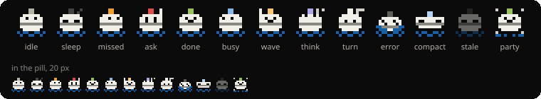
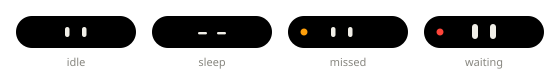

# Bu — Buoy's mascot

*Decided 2026-11-03.*

Bu, the first syllable of Buoy (said "BOO-ee", 2026-11-06), is the buoy itself: a small pixel
float with a lamp on its head. The lamp shows the pose; the buoy light stays the pill's edge
dot (SPEC §2a-i, INDICATORS; 2026-11-08). Bu is not an assistant face: it never talks, follows
the pointer, glows, or moves while the island is idle (SPEC §0, §8; ARCHITECTURE rule 8).



Two forms: **Bu**, the pixel buoy in 13 poses (brand, agents, greeting), and **Bu's eyes**,
only the eyes inside the black pill, the idle plan `mascot` (§ Eyes). Same lamps, same rules.

## Where Bu appears

The only pixel art in Buoy (2026-11-04, Ethan); data icons (dayparts, weather, calendar) stay
GNOME-style vectors. Not in other modules' pills, and never instead of the light.

| Place | What | Since |
|---|---|---|
| Brand | extension icon, README, EGO screenshots, prefs About (drawn from `kit/model/mascot.js`; waves 5 s the first time, then `idle`; still with GTK animations off). Empty states (kit `EmptyState` `pose`, 2026-11-07, Ethan): `idle` — Home "Nothing going on", Media "Nothing playing", Claude Code, Timer and Clipboard "Coming soon", Calendar "No calendars"; `sleep` — Notifications "All caught up", a day with no events ("No events", "Nothing else today"); `done` — Transfers "No transfers" | M3 release |
| Agents | the **leading** of every agent activity (Claude Code, Codex, a D-Bus caller sending `{mascot}`), pose per § Agents. The agent's name is the first word of the text: Bu does not say which agent | M3 (2026-11-07) |
| Greeting | leading of every greeting, poses in GREETING.md §6 | M3 first run (`wave`); rest M4 |
| Idle plan `mascot` | Bu's eyes (§ Eyes), on by default (2026-11-14, Ethan) | M4 |

## Drawing rules

- **Grid 10 × 10**, sizes in multiples of 10 so cells are whole px: **20 px** minimal
  (CONTRACT.md §5.3 leading ≤ 20), **40 px** compact (≤ 40, 2026-11-05) and in Home and prefs,
  **50 px** expanded headers (≤ 56). Painted without antialiasing; nothing blurs.
- **Fixed palette, solid cells, always on black**: in the pill, elsewhere (prefs, Home, README,
  EGO) on its own `#000` tile (2026-11-11) — never on light.

  | Cell | Meaning | Colour |
  |---|---|---|
  | `.` | empty | transparent |
  | `B` `A` | body, arm | `#F1EFE8` |
  | `S` | stripe | `#888780` |
  | `D` | dots, bubble, sparkles | `#D3D1C7` |
  | `Z` | sleep "z" | `#444441` |
  | `W` | water | `#185FA5` |
  | `E` | eye — a hole, the black shows through | transparent |
  | `L` | lamp, 2 × 2 cells (4 × 4 px in compact) | the pose's lamp colour (INDICATORS § Bu's lamp); `foreground` = the body colour |

- **Lamp: 2 × 2 cells**, on the body, in every pose (2026-11-04, Ethan). Always **the pose's
  own colour**; the stack's amber/red is the pill's edge dot (2026-11-08, Ethan). Amber and red
  appear in the lamp only as `missed` and `ask`. Hues near full saturation, clear of the lights
  and privacy dots: `think` pink (purple is the mic), `error` a lighter grey, never red (2026-11-11,
  design/colours "Minh hoạ"). The lamp never blinks.
- **Motion, only with an activity.** `busy`, `think` loop while visible; `wave`, `party` play
  once (~2 s). Two frames swapped every 500 ms, no easing. The timer is in
  `kit/ui/present/motion.js`, only while a moving pose is mapped; removed on pose change,
  destroy, disable. Held still (a loop on frame 1; a once pose on frame 1, still settling on
  time) when `enable-animations` is off or the user is away:
  no input for `mascot-rest-after` s (10–600, default 60; Island page, Pill group; 2026-11-04)
  on the core idle monitor (UNINHIBITABLE watch, back on the user-active watch; both only while
  a moving Bu is mapped).
- **Rebuilt content carries on** (2026-11-04): `motion.js` keeps when each pose was first shown
  per activity surface (id + surface, last 32), so an update mid-wave continues it; a new
  `Surface` with the same id restarts it.
- **Stale** (CONTRACT.md §1): text `fg-subtle`, Bu at 50 % opacity (2026-11-11); the `stale`
  pose is how Bu looks dimmed.

## Rendering

*Decided 2026-11-03.*

- `kit/model/mascot.js`: the grids below as data, pure. Pose names are a closed set; an
  unknown pose falls back to the element's `icon`, or `idle`. `motion.js` paints a grid on one
  `St.DrawingArea`. No image files ship.
- `tests/mascot.test.js` parses this file's grids, the Poses table, the lamp rule and
  `frameAt`, and compares them with `kit/model/mascot.js` and `docs/mascot/`: **this doc is the
  source of truth**.
- `docs/mascot/` (previews, not loaded): `sheet.svg`, 13 pose SVGs (`stale` at 50 %),
  `eyes.svg`; `hello-icon.png` (480 px `wave.1` on `#000`, the EGO icon, 2026-11-09);
  `hello.svg` (README) waves 5 s, then `idle` (`prefers-reduced-motion`: `idle` only).
- Contract: `leading: {mascot: '<pose>', icon?}` (CONTRACT.md §3). Data only (rules 2, 3, 11).

## Poses

| Pose | Name | When | Lamp | Moves |
|---|---|---|---|---|
| `idle` | normal | default; brand; agent session open, nothing running | `#C8C6BD` | — |
| `sleep` | asleep | brand at night; empty states after `night` | `#444441` | — |
| `missed` | looking | something was missed (brand, Home empty state with history) | amber `#FF9F0A` | — |
| `ask` | hand up | an agent asks for permission (`ask()`) | red `#FF453A` | — |
| `done` | pleased | the agent finished | `#B4E33D` | — |
| `busy` | working | a tool is running | `#3D9BFF` | loop, bobs into the water |
| `wave` | waving | greeting | `#FFE14D` | once, then `idle`; a greeting holds it 5 s (GREETING.md §6, 2026-11-06) |
| `think` | thinking | prompt received, no tool yet | `#FF7EB6` | loop, thought dots |
| `turn` | your turn | the agent waits for you to type | foreground | — |
| `error` | sinking | a tool or the turn failed | `#8A8880` | — |
| `compact` | squeezed | the agent compacts its context | `#5AD8F5` | — |
| `stale` | faded | no update for `staleAfter` (drawn dimmed) | `#444441` | — |
| `party` | celebrating | done after a run longer than 10 min | `#B4E33D` | once, then `done` |

Every block is one frame: `<pose>[.<frame>]  lamp <colour>`. Moving poses have frames
`.1` and `.2`.

```bu
idle  lamp #C8C6BD
....LL....
....LL....
..BBBBBB..
.BBEBBEBB.
.BBBBBBBB.
.SSSSSSSS.
.BBBBBBBB.
..BBBBBB..
W.WW..WW.W
.W..WW..W.
```

```bu
sleep  lamp #444441
....LL..Z.
....LL.Z..
..BBBBBB..
.BBBBBBBB.
.BEEBBEEB.
.SSSSSSSS.
.BBBBBBBB.
..BBBBBB..
W.WW..WW.W
.W..WW..W.
```

```bu
missed  lamp #FF9F0A
....LL....
....LL....
..BBBBBB..
.BBBEBBEB.
.BBBBBBBB.
.SSSSSSSS.
.BBBBBBBB.
..BBBBBB..
W.WW..WW.W
.W..WW..W.
```

```bu
ask  lamp #FF453A
....LL..A.
....LL..A.
..BBBBBBA.
.BBEBBEBB.
.BBEBBEBB.
.SSSSSSSS.
.BBBBBBBB.
..BBBBBB..
W.WW..WW.W
.W..WW..W.
```

```bu
done  lamp #B4E33D
....LL....
....LL....
..BBBBBB..
.BBEBBEBB.
.BBBEEBBB.
.SSSSSSSS.
.BBBBBBBB.
..BBBBBB..
W.WW..WW.W
.W..WW..W.
```

```bu
busy.1  lamp #3D9BFF
....LL....
....LL....
..BBBBBB..
.BEBBEBBB.
.BBBBBBBB.
.SSSSSSSS.
.BBBBBBBB.
..BBBBBB..
W.WW..WW.W
.W..WW..W.
```

```bu
busy.2  lamp #3D9BFF
..........
....LL....
....LL....
..BBBBBB..
.BEBBEBBB.
.BBBBBBBB.
.SSSSSSSS.
.BBBBBBBB.
W.WW..WW.W
.W..WW..W.
```

```bu
wave.1  lamp #FFE14D
.A..LL....
.A..LL....
.ABBBBBB..
.BBEBBEBB.
.BBBEEBBB.
.SSSSSSSS.
.BBBBBBBB.
..BBBBBB..
W.WW..WW.W
.W..WW..W.
```

```bu
wave.2  lamp #FFE14D
A...LL....
.A..LL....
..BBBBBB..
.BBEBBEBB.
.BBBEEBBB.
.SSSSSSSS.
.BBBBBBBB.
..BBBBBB..
W.WW..WW.W
.W..WW..W.
```

```bu
think.1  lamp #FF7EB6
....LL.D.D
....LL.D..
..BEBBEB..
.BBBBBBBB.
.BBBBBBBB.
.SSSSSSSS.
.BBBBBBBB.
..BBBBBB..
W.WW..WW.W
.W..WW..W.
```

```bu
think.2  lamp #FF7EB6
....LL.D..
....LL.D..
..BEBBEB..
.BBBBBBBB.
.BBBBBBBB.
.SSSSSSSS.
.BBBBBBBB.
..BBBBBB..
W.WW..WW.W
.W..WW..W.
```

```bu
turn  lamp foreground
....LL.DDD
....LL.D..
..BBBBBB..
.BBBBBBBB.
.BBEBBEBB.
.SSSSSSSS.
.BBBBBBBB.
..BBBBBB..
W.WW..WW.W
.W..WW..W.
```

```bu
error  lamp #8A8880
..........
....LL....
....LL....
..BBBBBB..
.BEBBBEBB.
.BBEBBBEB.
WWSSSSSSWW
.WWWBBWWW.
W.WW..WW.W
.W..WW..W.
```

```bu
compact  lamp #5AD8F5
..........
....LL....
....LL....
BBBBBBBBBB
BEEBBBBEEB
SSSSSSSSSS
.BBBBBBBB.
..........
W.WW..WW.W
.W..WW..W.
```

```bu
stale  lamp #444441
....LL....
....LL....
..BBBBBB..
.BBBBBBBB.
.BEEBBEEB.
.SSSSSSSS.
.BBBBBBBB.
..BBBBBB..
W.WW..WW.W
.W..WW..W.
```

```bu
party.1  lamp #B4E33D
D...LL...D
....LL....
..BBBBBB..
.BBEBBEBB.
.BBBEEBBB.
.SSSSSSSS.
.BBBBBBBB.
..BBBBBB..
D........D
WW.W..W.WW
```

```bu
party.2  lamp #B4E33D
....LL....
....LL....
..BBBBBB..
.BBEBBEBB.
.BBBEEBBB.
.SSSSSSSS.
.BBBBBBBB.
..BBBBBB..
W.WW..WW.W
.W..WW..W.
```

## Agents

An agent activity (kind `agent`, FEATURES "Claude Code", 2026-11-07) maps its source's events
to poses in the pure, unit-tested adapter. Claude Code's table is
[CODING-AGENTS.md](CODING-AGENTS.md) §3: `think` on a prompt, `busy` on tools and subagents,
`error` on a failure, `ask` on a permission prompt, `turn` when it waits for you, `compact`
while compacting, `done` (or `party` after > 10 min) when it stops, `stale` without news.
Codex (later, §10 there): `notify` → `done`, or `turn` when it waits for input. A D-Bus caller
may send `{mascot}` directly.

## Eyes — idle plan `mascot`

Only the eyes, centred in the 120 × 32 idle pill, in the foreground colour; the light stays in
its edge slot and the eyes react to it. Four modes; the first row that holds wins, so a light
always shows through.



| Mode | When | Eyes (in the 120 × 32 pill) |
|---|---|---|
| `waiting` | light red (an `ask` waiting under DND) | two bars 6 × 15, r 3 |
| `missed` | light amber | the bars shifted 6 px toward the light |
| `sleep` | daypart `night`; 60 s without input; power profile `power-saver`; `enable-animations` off | two lines 9 × 2.4 at y 16 |
| `idle` | otherwise | two bars 4.5 × 10, r 2.2, at x 49 and 66; strolls (below) |

- `sleep` stands for every case where Bu must hold still, so stillness reads as rest (Ethan,
  2026-11-03); `idle-mascot-stroll = false` is the one case of open eyes that never move.
- A mode changes only on an event, in one frame. `idle-content = mascot` picks the plan; in
  `auto` it scores 10 like `clock` (ties take turns) when in `idle-auto-plans`.
- **60 s without input** (keyboard, mouse, touchpad, touch, tablet; lid, plug, resume):
  `global.backend.get_core_idle_monitor()` as `ui/messageTray.js` uses it,
  `add_idle_watch_full(60000, cb, Meta.IdleMonitorWatchFlags.UNINHIBITABLE)` — a default watch
  never fires while an app inhibits idle (mutter `meta-idle-monitor.c`
  `update_inhibited_watch`); `add_user_active_watch()` brings `idle` back. Both only while the
  plan is shown.
- Power profile: the Shell's toggle (`ui/status/powerProfiles.js`
  `PowerProfilesToggle._proxy.ActiveProfile`, `g-properties-changed`); no daemon = not saving.
  `_proxy` is private: check it every Shell release.

### The stroll

*Decided 2026-11-03.*

In mode `idle` only, a fixed script of **stepped** single frames (never an eased slide); each
beat is one change, then stillness (ARCHITECTURE rule 8).

| # | Beat | Eyes | Frames | Hold |
|---|---|---|---|---|
| 1 | rest | bars, centred | — | 4.5 s |
| 2 | look left | bars to dx −9 px | 3 steps of 3 px, 90 ms apart | 1.25 s |
| 3 | stroll right | bars to dx +9 px | 6 steps of 3 px, 90 ms apart | 1.5 s |
| 4 | back | bars to dx 0 | 3 steps | 2.5 s |
| 5 | blink | bars at 12 % height for 110 ms, then open | 2 | 3 s |
| 6 | smile | `^ ^`: two arcs, stroke 2.4, round caps, (46.5, 18)–(56, 18) and (63.5, 18)–(73, 18), control y 11.5 | 1 | 1.25 s |
| 7 | long rest | bars, centred | 1 | 7 s |

- Then beat 1 again; each hold jittered uniformly by ±25 % (Ethan, 2026-11-03). Cost: 16
  frames per ~21 s cycle, under 1 frame/s, each a ~30 × 16 px redraw.
- Never uses `missed`, `waiting` or `sleep`: those eyes say something real.
- Runs only while the mode is `idle`, the pill idle and mapped, and `idle-mascot-stroll` true
  (default). Anything else removes the timer and pending steps at once; back in `idle` it
  restarts at beat 1.
- Code (2026-11-14): `kit/model/mascot.js` `STROLL` (`{name, eyes, dx, steps, hold}`; `rest`
  is `still`), `nextBeat(i, rand) → {beat, next, holdMs}`, `beatFrames(beat, fromDx)`,
  `eyesMode({light, daypart, idleInput, powerSaver, animations})`, `eyesShapes(mode, frame)`
  (px about the centre at 1em, drawn ×em). `modules/mascot/idle.js` gives
  `leading: {eyes: mode, stroll}`; the kit puts the light's mode over it (`presentation.js`
  planIdle). `motion.js` `eyes()` draws on one St.DrawingArea with one `GLib.timeout_add`.
  The watches, power profile and `enable-animations` are `modules/mascot/feed.js`. The idle
  pill keeps its actors while the plan's data is the same (`island.setIdle`).
- **On by default** (Ethan, 2026-11-14): `modules-mascot` true and last in `idle-auto-plans`,
  alternating with the clock. Picking it in Show or switching its row on turns the module on.

### Expressions

*Decided and built 2026-11-14 (Ethan), FEATURES M4 "Bu's eyes: expressions".* Drawn as in
design/mascot "Biểu cảm của mắt" (`docs/design/mascot/render/eyes.js`): rounded bars, arcs and
polylines only.

| Expression | When | For |
|---|---|---|
| `\| ^` wink | beat 6 of the stroll, in turn with `^ ^` | 1.25 s |
| `u u` content | the amber light goes out (the missed list was read) | 1.25 s |
| `_ _` drowsy (a half lid) | just before `sleep` (60 s without input, or night) | 1 s, then `- -` |
| `o o` startled | input again after the 60 s sleep | 0.6 s |
| `> <` squeeze | pressing the pill | while held |
| `@ @` dizzy | held 1.5 s | until 3 s |
| `x x` knocked out | held 3 s | until released, then 1 s |

- A reaction cuts the stroll; the stroll then restarts at beat 1. A light still wins. Asleep
  (night, saver, animations off) or `idle-mascot-stroll` off: no reaction.
- **Press and hold** (2026-11-14, Ethan; eyes first, later every idle pill): in mode `idle`
  Home opens on the release, not the press (`kit/ui/pill.js` → `island._onPillPress`): within
  0.5 s a click; longer is poking Bu and opens nothing. Other modes: the release opens Home.
  One timer, while held and 1 s after. Released off the pill or lost to another grab: no click.
- Code: `kit/model/mascot.js` `EXPRESSIONS`, `eyesShapes` (`bars` with `lid`, `arcs`,
  `lines`, `rings`), `eyesRest` (still › saver › away › night, the plan's `rest`),
  `eyesEnter(was, now)`, `ENTER_MS`, `HOLD`, `HOLD_FRAMES`, `holdPlays`, `releaseEyes`; the wink
  is the smile beat's `alt` (`nextBeat` wraps over two cycles). `motion.js` `eyes()` carries a
  reaction across a rebuild and runs the hold; `eyesHold(actor)` finds it. `island.js`
  `_onPillPress` holds under `global.stage.grab` (as ui/slider.js).

## Name

**Bu**. A web search (2026-11-03) found no app or GNOME mascot called Bu (nearest: Pizza 4P's
"BUU", Gnomelets). Do a trademark check before the EGO release. "Bu" is neutral in Vietnamese.
