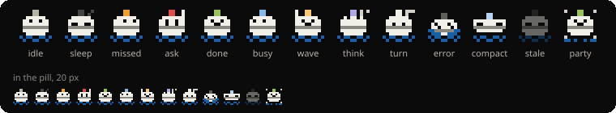

# Bu — linh vật của Buoy

*Quyết 2026-11-03.*

Bu, âm tiết đầu của Buoy (đọc "BOO-ee", 2026-11-06), chính là cái phao: một chiếc phao pixel nhỏ
có đèn trên đầu. Đèn của Bu cho biết dáng; đèn phao vẫn là chấm ở mép pill (SPEC §2a-i,
INDICATORS; 2026-11-08). Bu không phải gương mặt của một trợ lý: nó không bao giờ nói, đi theo con
trỏ, phát sáng, hay cử động khi island idle (SPEC §0, §8; ARCHITECTURE luật 8).



Hai dạng: **Bu**, chiếc phao pixel với 13 dáng (thương hiệu, agent, lời chào), và **mắt Bu**, chỉ
đôi mắt trong pill đen, plan idle `mascot` (§ Eyes). Cùng đèn, cùng luật.

## Bu xuất hiện ở đâu

Hình pixel duy nhất trong Buoy (2026-11-04, Ethan); icon dữ liệu (buổi trong ngày, thời tiết, lịch)
vẫn là hình vector kiểu GNOME. Không có trong pill của module khác, và không bao giờ thay cho đèn.

| Chỗ | Cái gì | Từ khi |
|---|---|---|
| Thương hiệu | icon extension, README, ảnh chụp trên EGO, prefs About (vẽ từ `kit/model/mascot.js`; vẫy tay 5 s lần đầu, rồi `idle`; đứng yên khi tắt hiệu ứng GTK). Trạng thái trống (kit `EmptyState` `pose`, 2026-11-07, Ethan): `idle` — Home "Nothing going on", Media "Nothing playing", Claude Code, Timer và Clipboard "Coming soon", Calendar "No calendars"; `sleep` — Notifications "All caught up", một ngày không có sự kiện ("No events", "Nothing else today"); `done` — Transfers "No transfers" | bản M3 |
| Agent | **leading** của mọi activity agent (Claude Code, Codex, một bên gọi D-Bus gửi `{mascot}`), dáng theo § Agents. Tên agent là chữ đầu của dòng chữ: Bu không cho biết agent nào | M3 (2026-11-07) |
| Lời chào | leading của mọi lời chào, dáng ở GREETING.md §6 | M3 lần chạy đầu (`wave`); phần còn lại M4 |
| Plan idle `mascot` | mắt Bu (§ Eyes), bật sẵn (2026-11-14, Ethan) | M4 |

## Luật vẽ

- **Lưới 10 × 10**, cỡ là bội số của 10 để mỗi ô tròn px: **20 px** ở minimal
  (CONTRACT.md §5.3 leading ≤ 20), **40 px** ở compact (≤ 40, 2026-11-05) và trong Home, prefs,
  **50 px** ở phần đầu expanded (≤ 56). Vẽ không khử răng cưa; không gì bị nhoè.
- **Bảng màu cố định, ô đặc, luôn trên nền đen**: trong pill; ở chỗ khác (prefs, Home, README,
  EGO) trên ô `#000` riêng (2026-11-11) — không bao giờ trên nền sáng.

  | Ô | Nghĩa | Màu |
  |---|---|---|
  | `.` | trống | trong suốt |
  | `B` `A` | thân, tay | `#F1EFE8` |
  | `S` | sọc | `#888780` |
  | `D` | chấm, bong bóng, lấp lánh | `#D3D1C7` |
  | `Z` | chữ "z" khi ngủ | `#444441` |
  | `W` | nước | `#185FA5` |
  | `E` | mắt — một lỗ, nền đen lộ ra | trong suốt |
  | `L` | đèn của Bu, 2 × 2 ô (4 × 4 px ở compact) | màu đèn của dáng (INDICATORS § Bu's lamp); `foreground` = màu thân |

- **Đèn của Bu: 2 × 2 ô**, trên thân, ở mọi dáng (2026-11-04, Ethan). Luôn là **màu riêng của
  dáng**; vàng/đỏ của stack là chấm ở mép pill (2026-11-08, Ethan). Vàng và đỏ chỉ xuất hiện ở đèn
  của Bu khi là `missed` và `ask`. Sắc gần bão hoà hẳn, tránh xa màu đèn và chấm riêng tư: `think`
  hồng (tím là mic), `error` xám nhạt hơn, không bao giờ đỏ (2026-11-11, design/colours "Minh
  hoạ"). Đèn của Bu không bao giờ nhấp nháy.
- **Chỉ cử động khi có activity.** `busy`, `think` lặp khi đang hiện; `wave`, `party` chạy một
  lần (~2 s). Hai frame đổi nhau mỗi 500 ms, không easing. Timer nằm trong
  `kit/ui/present/motion.js`, chỉ khi một dáng cử động đang được map; gỡ khi đổi dáng, destroy,
  disable. Đứng yên (dáng lặp ở frame 1; dáng một lần ở frame 1, vẫn hết lượt theo thời gian) khi
  `enable-animations` tắt hoặc người dùng vắng mặt:
  không có input trong `mascot-rest-after` s (10–600, mặc định 60; trang Island, nhóm Pill;
  2026-11-04) theo core idle monitor (watch UNINHIBITABLE, quay lại bằng watch user-active; cả hai
  chỉ khi một Bu cử động đang được map).
- **Nội dung dựng lại thì chạy tiếp** (2026-11-04): `motion.js` nhớ lúc mỗi dáng được hiện lần đầu
  theo từng surface của activity (id + surface, 32 cái gần nhất), nên một cập nhật giữa lúc vẫy
  tay vẫn vẫy tiếp; một `Surface` mới cùng id thì chạy lại từ đầu.
- **Stale** (CONTRACT.md §1): chữ `fg-subtle`, Bu ở độ mờ 50 % (2026-11-11); dáng `stale` là Bu
  trông thế nào khi bị làm mờ.

## Cách vẽ

*Quyết 2026-11-03.*

- `kit/model/mascot.js`: các lưới bên dưới dưới dạng dữ liệu, thuần. Tên dáng là một tập đóng;
  dáng lạ thì lùi về `icon` của element, hoặc `idle`. `motion.js` vẽ một lưới lên một
  `St.DrawingArea`. Không kèm file ảnh nào.
- `tests/mascot.test.js` đọc các lưới, bảng Poses, luật đèn và `frameAt` của file này (bản tiếng
  Anh), rồi so với `kit/model/mascot.js` và `docs/mascot/`: **doc này là nguồn chuẩn**.
- `docs/mascot/` (ảnh xem trước, không được nạp): `sheet.svg`, 13 SVG cho từng dáng (`stale` ở
  50 %), `eyes.svg`; `hello-icon.png` (`wave.1` 480 px trên `#000`, icon trên EGO, 2026-11-09);
  `hello.svg` (README) vẫy tay 5 s, rồi `idle` (`prefers-reduced-motion`: chỉ `idle`).
- Contract: `leading: {mascot: '<pose>', icon?}` (CONTRACT.md §3). Chỉ là dữ liệu (luật 2, 3, 11).

## Các dáng

| Dáng | Tên | Khi nào | Đèn | Cử động |
|---|---|---|---|---|
| `idle` | bình thường | mặc định; thương hiệu; phiên agent đang mở, không có gì chạy | `#C8C6BD` | — |
| `sleep` | ngủ | thương hiệu ban đêm; trạng thái trống sau `night` | `#444441` | — |
| `missed` | ngó nhìn | có gì đó bị nhỡ (thương hiệu, trạng thái trống của Home khi có lịch sử) | amber `#FF9F0A` | — |
| `ask` | giơ tay | agent xin quyền (`ask()`) | red `#FF453A` | — |
| `done` | hài lòng | agent làm xong | `#B4E33D` | — |
| `busy` | đang làm | một tool đang chạy | `#3D9BFF` | lặp, nhấp nhô xuống nước |
| `wave` | vẫy tay | lời chào | `#FFE14D` | một lần, rồi `idle`; lời chào giữ nó 5 s (GREETING.md §6, 2026-11-06) |
| `think` | đang nghĩ | đã nhận prompt, chưa có tool | `#FF7EB6` | lặp, chấm suy nghĩ |
| `turn` | tới lượt bạn | agent chờ bạn gõ | foreground | — |
| `error` | đang chìm | một tool hoặc lượt chạy bị lỗi | `#8A8880` | — |
| `compact` | bị ép | agent nén context của nó | `#5AD8F5` | — |
| `stale` | phai | không có cập nhật trong `staleAfter` (vẽ mờ) | `#444441` | — |
| `party` | ăn mừng | xong sau một lượt chạy dài hơn 10 min | `#B4E33D` | một lần, rồi `done` |

Mỗi khối là một frame: `<pose>[.<frame>]  lamp <colour>`. Dáng cử động có các frame
`.1` và `.2`.

```bu
idle  lamp #C8C6BD
....LL....
....LL....
..BBBBBB..
.BBEBBEBB.
.BBBBBBBB.
.SSSSSSSS.
.BBBBBBBB.
..BBBBBB..
W.WW..WW.W
.W..WW..W.
```

```bu
sleep  lamp #444441
....LL..Z.
....LL.Z..
..BBBBBB..
.BBBBBBBB.
.BEEBBEEB.
.SSSSSSSS.
.BBBBBBBB.
..BBBBBB..
W.WW..WW.W
.W..WW..W.
```

```bu
missed  lamp #FF9F0A
....LL....
....LL....
..BBBBBB..
.BBBEBBEB.
.BBBBBBBB.
.SSSSSSSS.
.BBBBBBBB.
..BBBBBB..
W.WW..WW.W
.W..WW..W.
```

```bu
ask  lamp #FF453A
....LL..A.
....LL..A.
..BBBBBBA.
.BBEBBEBB.
.BBEBBEBB.
.SSSSSSSS.
.BBBBBBBB.
..BBBBBB..
W.WW..WW.W
.W..WW..W.
```

```bu
done  lamp #B4E33D
....LL....
....LL....
..BBBBBB..
.BBEBBEBB.
.BBBEEBBB.
.SSSSSSSS.
.BBBBBBBB.
..BBBBBB..
W.WW..WW.W
.W..WW..W.
```

```bu
busy.1  lamp #3D9BFF
....LL....
....LL....
..BBBBBB..
.BEBBEBBB.
.BBBBBBBB.
.SSSSSSSS.
.BBBBBBBB.
..BBBBBB..
W.WW..WW.W
.W..WW..W.
```

```bu
busy.2  lamp #3D9BFF
..........
....LL....
....LL....
..BBBBBB..
.BEBBEBBB.
.BBBBBBBB.
.SSSSSSSS.
.BBBBBBBB.
W.WW..WW.W
.W..WW..W.
```

```bu
wave.1  lamp #FFE14D
.A..LL....
.A..LL....
.ABBBBBB..
.BBEBBEBB.
.BBBEEBBB.
.SSSSSSSS.
.BBBBBBBB.
..BBBBBB..
W.WW..WW.W
.W..WW..W.
```

```bu
wave.2  lamp #FFE14D
A...LL....
.A..LL....
..BBBBBB..
.BBEBBEBB.
.BBBEEBBB.
.SSSSSSSS.
.BBBBBBBB.
..BBBBBB..
W.WW..WW.W
.W..WW..W.
```

```bu
think.1  lamp #FF7EB6
....LL.D.D
....LL.D..
..BEBBEB..
.BBBBBBBB.
.BBBBBBBB.
.SSSSSSSS.
.BBBBBBBB.
..BBBBBB..
W.WW..WW.W
.W..WW..W.
```

```bu
think.2  lamp #FF7EB6
....LL.D..
....LL.D..
..BEBBEB..
.BBBBBBBB.
.BBBBBBBB.
.SSSSSSSS.
.BBBBBBBB.
..BBBBBB..
W.WW..WW.W
.W..WW..W.
```

```bu
turn  lamp foreground
....LL.DDD
....LL.D..
..BBBBBB..
.BBBBBBBB.
.BBEBBEBB.
.SSSSSSSS.
.BBBBBBBB.
..BBBBBB..
W.WW..WW.W
.W..WW..W.
```

```bu
error  lamp #8A8880
..........
....LL....
....LL....
..BBBBBB..
.BEBBBEBB.
.BBEBBBEB.
WWSSSSSSWW
.WWWBBWWW.
W.WW..WW.W
.W..WW..W.
```

```bu
compact  lamp #5AD8F5
..........
....LL....
....LL....
BBBBBBBBBB
BEEBBBBEEB
SSSSSSSSSS
.BBBBBBBB.
..........
W.WW..WW.W
.W..WW..W.
```

```bu
stale  lamp #444441
....LL....
....LL....
..BBBBBB..
.BBBBBBBB.
.BEEBBEEB.
.SSSSSSSS.
.BBBBBBBB.
..BBBBBB..
W.WW..WW.W
.W..WW..W.
```

```bu
party.1  lamp #B4E33D
D...LL...D
....LL....
..BBBBBB..
.BBEBBEBB.
.BBBEEBBB.
.SSSSSSSS.
.BBBBBBBB.
..BBBBBB..
D........D
WW.W..W.WW
```

```bu
party.2  lamp #B4E33D
....LL....
....LL....
..BBBBBB..
.BBEBBEBB.
.BBBEEBBB.
.SSSSSSSS.
.BBBBBBBB.
..BBBBBB..
W.WW..WW.W
.W..WW..W.
```

## Agent

Một activity agent (kind `agent`, FEATURES "Claude Code", 2026-11-07) ánh xạ các sự kiện của
source sang dáng trong adapter thuần, có unit test. Bảng của Claude Code ở
[CODING-AGENTS.md](CODING-AGENTS.vi.md) §3: `think` khi có prompt, `busy` khi chạy tool và
subagent, `error` khi thất bại, `ask` khi xin quyền, `turn` khi chờ bạn, `compact` trong lúc nén,
`done` (hoặc `party` sau > 10 min) khi dừng, `stale` khi không có tin. Codex (sau, §10 ở đó):
`notify` → `done`, hoặc `turn` khi chờ input. Một bên gọi D-Bus có thể gửi thẳng `{mascot}`.

## Mắt — plan idle `mascot`

Chỉ đôi mắt, ở giữa pill idle 120 × 32, màu foreground; đèn vẫn ở slot mép của nó và đôi mắt phản
ứng theo đèn. Bốn chế độ; dòng đầu tiên thoả thì thắng, nên đèn luôn lộ ra.


| Chế độ | Khi nào | Mắt (trong pill 120 × 32) |
|---|---|---|
| `waiting` | đèn đỏ (một `ask` đang chờ dưới DND) | hai vạch 6 × 15, r 3 |
| `missed` | đèn vàng | hai vạch dịch 6 px về phía đèn |
| `sleep` | buổi `night`; 60 s không có input; power profile `power-saver`; `enable-animations` tắt | hai nét 9 × 2.4 ở y 16 |
| `idle` | còn lại | hai vạch 4.5 × 10, r 2.2, ở x 49 và 66; đi dạo (dưới) |

- `sleep` đại diện cho mọi trường hợp Bu phải đứng yên, để sự đứng yên được hiểu là nghỉ (Ethan,
  2026-11-03); `idle-mascot-stroll = false` là trường hợp duy nhất mắt mở mà không bao giờ cử động.
- Chế độ chỉ đổi khi có sự kiện, trong một frame. `idle-content = mascot` chọn plan này; ở
  `auto` nó được 10 điểm như `clock` (bằng điểm thì thay phiên) khi nằm trong `idle-auto-plans`.
- **60 s không có input** (bàn phím, chuột, touchpad, cảm ứng, bút vẽ; nắp máy, cắm sạc, thức
  dậy): `global.backend.get_core_idle_monitor()` như `ui/messageTray.js` dùng,
  `add_idle_watch_full(60000, cb, Meta.IdleMonitorWatchFlags.UNINHIBITABLE)` — một watch mặc định
  không bao giờ chạy khi có app chặn idle (mutter `meta-idle-monitor.c`
  `update_inhibited_watch`); `add_user_active_watch()` đưa `idle` trở lại. Cả hai chỉ khi plan
  đang hiện.
- Power profile: nút bật của Shell (`ui/status/powerProfiles.js`
  `PowerProfilesToggle._proxy.ActiveProfile`, `g-properties-changed`); không có daemon = không tiết
  kiệm. `_proxy` là private: kiểm tra lại mỗi bản Shell.

### Đi dạo

*Quyết 2026-11-03.*

Chỉ ở chế độ `idle`, một kịch bản cố định gồm các frame đơn **nhảy bậc** (không bao giờ trượt có
easing); mỗi nhịp là một thay đổi, rồi đứng yên (ARCHITECTURE luật 8).

| # | Nhịp | Mắt | Frame | Giữ |
|---|---|---|---|---|
| 1 | nghỉ | hai vạch, ở giữa | — | 4.5 s |
| 2 | nhìn trái | hai vạch tới dx −9 px | 3 bước 3 px, cách nhau 90 ms | 1.25 s |
| 3 | dạo sang phải | hai vạch tới dx +9 px | 6 bước 3 px, cách nhau 90 ms | 1.5 s |
| 4 | quay về | hai vạch tới dx 0 | 3 bước | 2.5 s |
| 5 | chớp mắt | hai vạch ở 12 % chiều cao trong 110 ms, rồi mở | 2 | 3 s |
| 6 | cười | `^ ^`: hai cung, nét 2.4, đầu tròn, (46.5, 18)–(56, 18) và (63.5, 18)–(73, 18), điểm điều khiển y 11.5 | 1 | 1.25 s |
| 7 | nghỉ dài | hai vạch, ở giữa | 1 | 7 s |

- Rồi lại nhịp 1; mỗi lần giữ được xê dịch đều ngẫu nhiên ±25 % (Ethan, 2026-11-03). Chi phí: 16
  frame mỗi vòng ~21 s, dưới 1 frame/s, mỗi frame vẽ lại ~30 × 16 px.
- Không bao giờ dùng `missed`, `waiting` hay `sleep`: những đôi mắt đó nói một điều có thật.
- Chỉ chạy khi chế độ là `idle`, pill idle và đang được map, và `idle-mascot-stroll` là true
  (mặc định). Bất cứ gì khác gỡ timer và các bước đang chờ ngay lập tức; quay lại `idle` thì chạy
  lại từ nhịp 1.
- Code (2026-11-14): `kit/model/mascot.js` `STROLL` (`{name, eyes, dx, steps, hold}`; `rest`
  là `still`), `nextBeat(i, rand) → {beat, next, holdMs}`, `beatFrames(beat, fromDx)`,
  `eyesMode({light, daypart, idleInput, powerSaver, animations})`, `eyesShapes(mode, frame)`
  (px quanh tâm ở 1em, vẽ ×em). `modules/mascot/idle.js` trả
  `leading: {eyes: mode, stroll}`; kit đặt chế độ của đèn đè lên (`presentation.js`
  planIdle). `motion.js` `eyes()` vẽ trên một St.DrawingArea với một `GLib.timeout_add`.
  Các watch, power profile và `enable-animations` nằm ở `modules/mascot/feed.js`. Pill idle
  giữ nguyên các actor khi dữ liệu của plan không đổi (`island.setIdle`).
- **Bật sẵn** (Ethan, 2026-11-14): `modules-mascot` true và đứng cuối trong `idle-auto-plans`,
  thay phiên với đồng hồ. Chọn nó ở Show hoặc bật hàng của nó thì module được bật.

### Biểu cảm

*Quyết và làm xong 2026-11-14 (Ethan), FEATURES M4 "Bu's eyes: expressions".* Vẽ như ở
design/mascot "Biểu cảm của mắt" (`docs/design/mascot/render/eyes.js`): chỉ có vạch bo tròn, cung
và đường gấp khúc.

| Biểu cảm | Khi nào | Bao lâu |
|---|---|---|
| `\| ^` nháy mắt | nhịp 6 của đi dạo, thay phiên với `^ ^` | 1.25 s |
| `u u` hài lòng | đèn vàng tắt (danh sách nhỡ đã được xem) | 1.25 s |
| `_ _` lim dim (mí sụp nửa chừng) | ngay trước `sleep` (60 s không có input, hoặc đêm) | 1 s, rồi `- -` |
| `o o` giật mình | có input lại sau giấc ngủ 60 s | 0.6 s |
| `> <` nheo | nhấn vào pill | trong lúc giữ |
| `@ @` chóng mặt | giữ 1.5 s | đến 3 s |
| `x x` choáng | giữ 3 s | đến khi thả, rồi 1 s |

- Một phản ứng cắt ngang đi dạo; sau đó đi dạo lại từ nhịp 1. Đèn vẫn thắng. Đang ngủ
  (đêm, tiết kiệm pin, tắt hiệu ứng) hoặc `idle-mascot-stroll` tắt: không phản ứng.
- **Nhấn và giữ** (2026-11-14, Ethan; mắt trước, sau này mọi pill idle): ở chế độ `idle`
  Home mở khi thả, không phải khi nhấn (`kit/ui/pill.js` → `island._onPillPress`): trong
  0.5 s là một cú bấm; lâu hơn là chọc Bu và không mở gì. Chế độ khác: thả thì mở Home.
  Một timer, trong lúc giữ và 1 s sau đó. Thả ra ngoài pill hoặc bị một grab khác lấy mất: không
  tính là bấm.
- Code: `kit/model/mascot.js` `EXPRESSIONS`, `eyesShapes` (`bars` với `lid`, `arcs`,
  `lines`, `rings`), `eyesRest` (still › saver › away › night, `rest` của plan),
  `eyesEnter(was, now)`, `ENTER_MS`, `HOLD`, `HOLD_FRAMES`, `holdPlays`, `releaseEyes`; nháy mắt
  là `alt` của nhịp cười (`nextBeat` quay vòng qua hai chu kỳ). `motion.js` `eyes()` mang một
  phản ứng qua lần dựng lại và chạy phần giữ; `eyesHold(actor)` tìm nó. `island.js`
  `_onPillPress` giữ dưới `global.stage.grab` (như ui/slider.js).

## Tên

**Bu**. Một lần tìm trên web (2026-11-03) không thấy app hay linh vật GNOME nào tên Bu (gần nhất:
"BUU" của Pizza 4P's, Gnomelets). Cần kiểm tra nhãn hiệu trước bản phát hành trên EGO. "Bu" trung
tính trong tiếng Việt.
