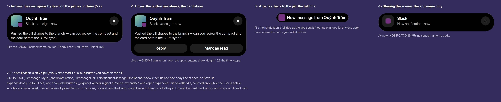
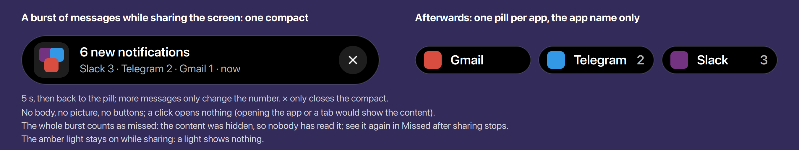
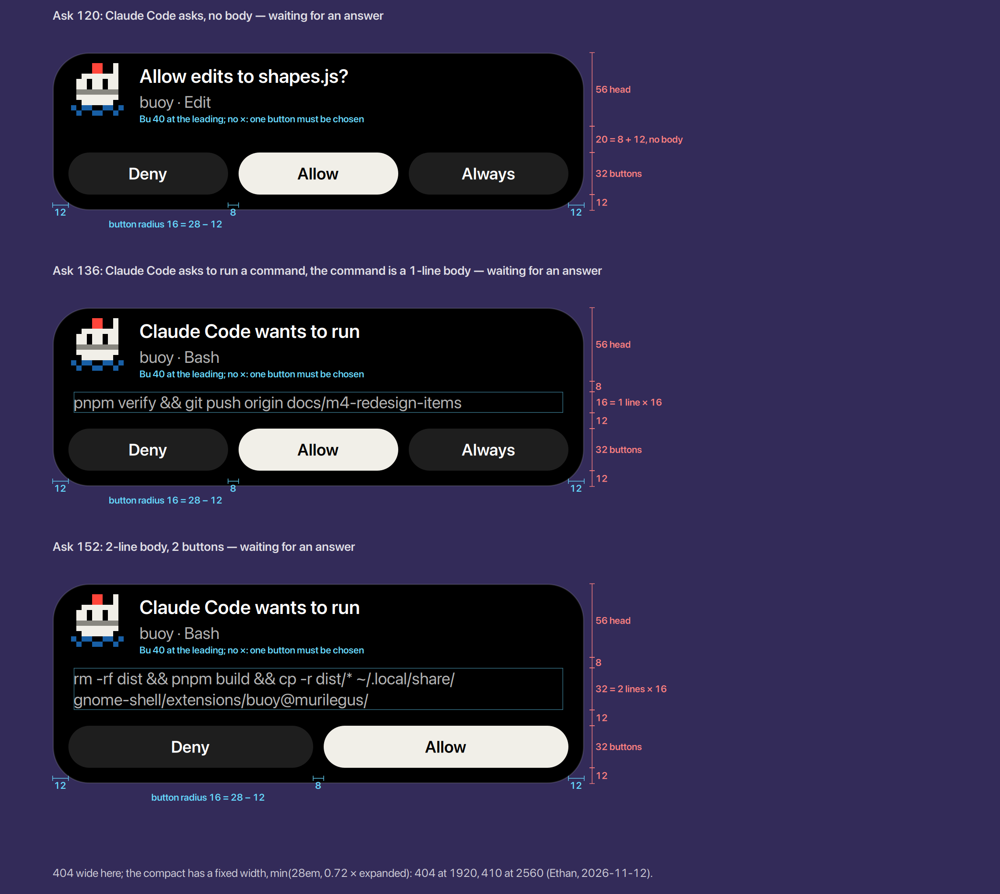
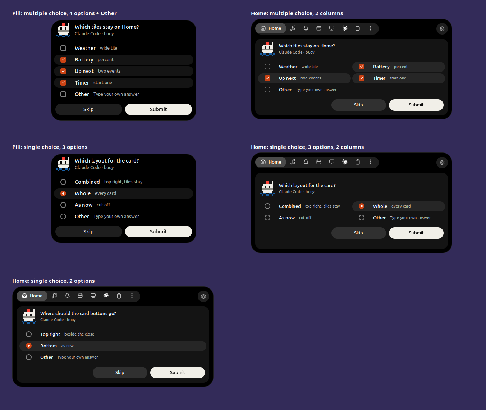
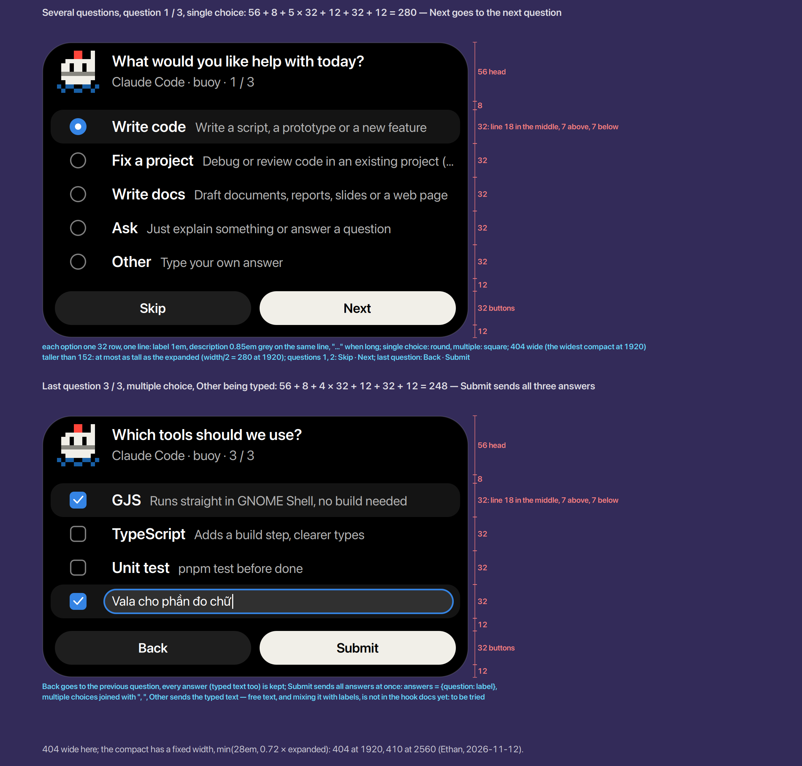

# Alerts and asks

Two ways an activity opens on its own, without a click: an **alert** only tells, an **ask** waits for
your answer. Both are compact size and do not open expanded (an alert used to open expanded, 560
wide — bigger than a notification card, though an alert is lighter than a new message). Shared
numbers are in [Tokens](../tokens.md).

## Alert

- Shows the activity's compact, exactly what hover shows, **right on its own pill** (not moved to
  the centre, no tab strip, does not take the keyboard); the pills beside it dim in place as on
  hover (SPEC §2c). Shown for **5 s**, then hides; hovering keeps it. An activity with no compact
  swells for one beat as before. **Decided** (Ethan, 2026-11-10)
- Music **does not alert**, not even on a track change. **Decided** (Ethan, 2026-11-10)

## Notifications

As GNOME 50's banner: the banner shows the title and one line of body at once, and the app's buttons
only appear on hover (`ui/messageTray.js` `_showNotification`, `_expandBanner`; `ui/messageList.js`
`NotificationMessage`). Before (v0.1) a notification was only a pill with its title; to read the
body or click a button you had to hover the pill.

- An incoming notification is an **alert**: its card opens on its own right on the pill, **with no
  row of buttons**: head 56 (picture, sender or title, source and time, ×) and up to 2 lines of
  body; 104 high. **Decided** (Ethan, 2026-11-12)
- **Hover** the card: the app's row of buttons appears (136 / 152 high, as the card) and the card
  stays. **Decided** (Ethan, 2026-11-12)
- After **5 s** (as every alert) the card shrinks back to the pill. The pill shows the **full
  title** as the app sent it, not edited for any one app (Slack: "New message from …"). Hovering the
  pill opens the card again, with buttons. **Decided** (Ethan, 2026-11-12)
- **Critical** (`Urgency.CRITICAL`): the card has its buttons at once and stays until dealt with, as
  GNOME opens a critical banner already expanded. **Decided** (Ethan, 2026-11-12)
- While **sharing or recording the screen**: one notification is as in v0.1 (NOTIFICATIONS §5): the
  card shows only the app's name and "New notification", no body, no picture; buttons stay.
  **Decided** Several notifications: see [While sharing the screen](#while-sharing-the-screen).

### When it counts as seen, when it is missed

One rule: **a notification counts as seen only when its card has shown for the full 5 s while you
are present, or when you hover or click it.** Everything else is **missed**: it goes to Missed
([Home](../home/index.md)) and the amber light turns on. **Decided** (Ethan, 2026-11-12)

| When the notification arrives | What Buoy does | Missed, amber light? |
|---|---|---|
| Using the computer | alert 5 s → pill → tab | No |
| Just looked away, not touching the computer | the card **waits**; the 5 s start when you touch the mouse or keyboard again | No |
| The card is waiting and GNOME's `idle-delay` comes (away, screen blank) or the screen locks | the card closes | **Yes** |
| Away or screen locked | no alert | **Yes** |
| Fullscreen | no alert; leaving fullscreen does not pop the cards one by one either | **Yes** |
| Do Not Disturb | no alert, as GNOME | **Yes**; the light stays still (the light still shows in DnD, 2026-11-08) |
| Critical | always alerts, with buttons, stays until dealt with; if you are away the card waits | No |
| Home or the Notifications tab is open | shows in the tab at once | No |
| Sharing or recording the screen | card without body; several messages make one compact | **Yes**: the content is hidden |

- **Present** = mouse or keyboard input in the last 1 s, as GNOME (`IDLE_TIME`, `ui/messageTray.js`).
  **Away** = the GNOME session's idle state, that is after `idle-delay` (Settings → Power → Screen
  Blank), or the screen locked. The card waits until you come back, but no longer than that.
  **Decided** (Ethan, 2026-11-12)
- **A running task ends** (download done, timer up, Claude Code finished) by the same table: ending
  while away, screen locked, fullscreen or in DnD goes to Missed. (v0.1 only counted fullscreen.)
  **Decided** (Ethan, 2026-11-12)
- **The amber light and the Missed tile:** opening Home turns the light off; the Missed tile stays
  until **every row** in the list has been opened or cleared. Opening the "Notifications · N" row,
  the Notifications tab (its Missed while away section) or GNOME's list counts those notifications
  as seen and they leave Missed. **Decided** (Ethan, 2026-11-12)

### Several notifications at once

GNOME 50 shows one banner at a time, each for the full 4 s, with a queue of at most 3 counting the
banner on screen; beyond that there is no banner, only the dot on the bar
(`_onNotificationRequestBanner`, `MAX_NOTIFICATIONS_IN_QUEUE`). Buoy keeps that limit but does not
make each message wait the full 4 s.

- Cards show **in the order messages arrive**. **Consecutive messages from the same app** merge into
  **one turn**: the card changes to the newest message, the secondary line gives the count ("Slack ·
  #design · 4 messages · now"). Messages from the same app that are not consecutive get their own
  turn, to keep the order. **Decided** (Ethan, 2026-11-12)
- Each turn shows for **at least 1 s**, then gives way to the next; the **last turn** runs as if
  there were only one notification (5 s, hover shows the buttons). **Decided** (Ethan, 2026-11-12)
- Besides the card on screen, at most **2 waiting turns** (as GNOME's queue of 3). A message that
  arrives when it is full gets no card: it only updates the app's pill and goes straight to Missed.
  A critical message always jumps to the front; while a critical card is showing, an ordinary
  message cannot replace it. **Decided** (Ethan, 2026-11-12)
- By the seen rule: a message whose card showed less than 5 s (replaced by the next turn), and the
  earlier messages merged into the same app's card, are all **missed**. Example Slack ×4, Zalo,
  Gmail: Slack "4 messages" 1 s → Zalo 1 s → Gmail 5 s; Gmail is seen, the four Slack messages and
  the Zalo one go to Missed. **Decided** (Ethan, 2026-11-12)
- **Pills after the burst:** one pill per app as in v0.1 (NOTIFICATIONS §2), the tail giving the
  count of the app's messages still in GNOME's list from 2. Ordered by PRIORITY (on a tie the later
  message first): pill 1 is the last card's app, then two secondary pills, the rest `+N`. In the
  example above: Gmail · Zalo · Slack 4. **Decided** (Ethan, 2026-11-12)
- **Motion:** first message: the pill grows into the card as an alert (morph 460 ms). Later
  messages, same app or another: the card **stays open**, only the content changes (fades out
  100 ms, back in 200 ms; avatar, name, body, count), the height eases over 240 ms if the number of
  lines differs (SPEC §5). It does not close and reopen every second. End of the burst: the card
  shrinks back to the last app's pill; the other pills come back in place. **Decided** (Ethan,
  2026-11-12)

### While sharing the screen

The card has no body, so going through the apps one by one only adds flicker, not information.

- The whole burst is **one compact**, head 56 only: the leading is the apps' logos stacked, the title
  "N new notifications", the secondary line each app's count ("Slack 3 · Telegram 2 · Gmail 1 ·
  now"). Shown 5 s, then back to the pill; messages arriving meanwhile only change the counts.
  **Decided** (Ethan, 2026-11-12)
- **No buttons** (a compact for several apps has no shared buttons). **A click opens nothing**:
  opening the app or the Notifications tab on a shared screen would reveal the content. **×** only
  closes the compact; the notifications stay in GNOME's list and in Missed. **Decided** (Ethan,
  2026-11-12)
- Then one pill per app, the app's name only, the tail giving the count from 2 (NOTIFICATIONS §2,
  §5). **Decided**
- The whole burst counts as **missed**: the content was hidden, so no one has read it; look again in
  Missed after sharing stops. The amber light still shows while sharing: the light reveals nothing.
  **Decided** (Ethan, 2026-11-12)

### Hovering during a burst

- Hovering **pauses the whole burst**: the card holds still, shows its row of buttons, and **does not
  change content** while the pointer is on it (no misclicks). The message on screen counts as seen.
  **Decided** (Ethan, 2026-11-12)
- A new message while hovering: same app, the body stays, only the count goes up; another app, it
  joins the waiting turns (at most 2), beyond that straight to Missed. The 1 s and 5 s clocks only
  run while the pointer is off the card. **Decided** (Ethan, 2026-11-12)
- Pointer leaves: wait 200 ms as GNOME (`HIDE_TIMEOUT`) in case it comes back, then go on with the
  next waiting turn; with no turn left, shrink back to the pill. **Decided** (Ethan, 2026-11-12)
- Click the card: opens the app at the message's place (as GNOME's banner), the card closes, the
  burst goes on. Click ×: drops that message, the burst goes on. **Decided** (Ethan, 2026-11-12)
- A card that pops up **right under the pointer** does not count as hover: the pointer has to leave
  and come back, as GNOME (`_onNotificationHoverChanged`). **Decided** (Ethan, 2026-11-12)
- The same app's earlier messages (only seen through the "4 messages" count) are still missed:
  hover only marks the message on screen as seen. **Decided** (Ethan, 2026-11-12)

## Ask

- Also compact size, and **stays until answered** (or `timeoutMs` runs out and `fallback` is used).
  **Decided** (Ethan, 2026-11-10)
- Laid out as a card: head 56 (Bu in the 40 leading, the question 1em, "app · what to do" 0.85em),
  optional body (command, details) on 16 lines, row of buttons 12 from the edge; no × button: you
  have to pick a button. **Height follows the content**, same formula as the card: 56 + 8 + 16 ×
  lines + 12 + 32 + 12 = **120** without body, **136** with one line, **152** with two. Body at most
  2 lines as a message card, longer is cut with "…". Number of buttons by question (3: Deny · Allow
  · Always, 2: Deny · Allow), spread evenly across. **Decided** (Ethan, 2026-11-10)

## Multiple-choice questions

**Decided** (Ethan, 2026-11-11; proposed 2026-11-10). Claude Code AskUserQuestion: today Buoy only
shows "Needs your answer" and leaves you to choose in Claude's own box. This decision lets Buoy
answer, so it changes the decision "A question is not a permission" (CODING-AGENTS.md, 2026-11-08).

- Head 56 (Bu, the question 1em, "Claude Code · project · 1 / 3" 0.85em). A question longer than the
  space **scrolls like a song title** (holds 2 s at the start, then slides left, `marquee`), not cut
  with "…": the question is the whole content. The same for an Allow / Deny question. A
  notification's sender name still stays still, cut with "…". **Decided** (Ethan, 2026-11-13)
- Each choice is **one 32 row, one line**: label 1em bold, description 0.85em grey on the same line,
  cut with "…" when long. Two lines of 1em + 0.85em need 18 + 16 = 34, which does not fit 32;
  smaller would go under GNOME's smallest size, 9pt ≈ 0.82em (`%caption` in gnome-shell-sass
  `_common.scss`). (Ethan, 2026-11-10)
- Rows are **28 high, 4 apart** (the step is still 32): two chosen options side by side do not merge
  into one block of background. Single choice and multiple choice, rows and columns alike (Home 2
  columns). **Decided** (Ethan, 2026-11-13)

- A 16 check mark in the leading column: round for single choice, square for multiple choice.
- **Other** is the last row: unchosen it reads "Type your own answer" in grey; chosen, the row becomes
  a text field right in the card (accent-coloured border like GNOME's text fields). Clicking the
  field gives Buoy the keyboard (clicking the island is yours, SPEC §2); Enter or Submit sends.
  (Ethan, 2026-11-10)
  The field has only **one border**: the theme's focus ring (Buoy drops its own border, since the
  two stacked into two lines), and a **blinking cursor** like GNOME's text fields, following your
  `cursor-blink`, `cursor-blink-time` and `cursor-blink-timeout`; Shell's text fields do not blink,
  so Buoy does it itself. **Decided** (Ethan, 2026-11-13)
- Height 56 + 8 + 32 × rows − 4 + 12 + 32 + 12: 2 choices + Other = 212, 4 + Other = **276** — more
  than the compact's 152, at most expanded's (width/2); as wide as the largest compact (404 at 1920).
- Several questions go one at a time, "1 / 3" on the secondary line: the questions before the last
  have Skip · **Next**, the last has **Back** · **Submit**.
- **Keeping**: the answers live only in the card, in memory, until sent or the ask ends (Buoy stores
  nothing, CODING-AGENTS rule 3): each question keeps its chosen labels and the text typed in Other;
  Next and Back only change the question on screen, nothing is lost.
- **Sending**: once, on Submit at the last question — the hook returns `allow` with `updatedInput` =
  the old input plus `answers` = {question text: answer} for every question: single choice is the
  label; multiple choice is the labels joined with ", "; Other is the typed text (multiple choice
  with Other too puts that text after the labels). Questions cannot be sent one by one: the docs
  have only one `answers` for the whole call
  ([hooks reference](https://code.claude.com/docs/en/hooks.md)).
- **While sharing or recording the screen**: no card. The questions and choices are the session's
  content, hidden like commands and notifications; the session's pill raises its hand "Needs your
  answer", answer in Claude Code. If a card is open when sharing starts, the card closes, whatever
  was chosen is dropped, the question goes back to Claude. **Decided** (Ethan, 2026-11-13)
- **Skip**: Buoy does not answer, the question stays in Claude Code as today. If Claude does not
  take free text through the path Buoy uses: when a question has Other chosen, Buoy does not answer
  the whole call but brings Claude Code forward to type there.

### Tried

2026-11-10, Claude Code 2.1.319, Haiku, an isolated `-p` session (only a temporary settings file
loaded; a small MCP server as permission host, since without a host `-p` does not give the model
this tool):

- A **PreToolUse** hook returning `allow` + `updatedInput.answers` reaches Claude correctly,
  including free text and labels mixed with text ("GJS, TypeScript, Vala cho phần đo chữ"), two
  questions in one call. Claude receives the string
  `The user answered: "question 1"="answer 1", "question 2"="answer 2". Read the answers carefully…`.
- `allow` without `answers`: Claude receives "The user did not answer the questions."
- Commas in the text are not escaped: Claude only sees one string.
- In `-p`, the **PermissionRequest** hook's decision is overridden by the permission host (the host
  returns deny and Claude receives "HOST DENIED" even though the hook answered), so it was tried
  again in an interactive session.

2026-11-13, Claude Code 2.1.319, Haiku, **interactive session** (pty, only a temporary settings file
with Buoy's hook loaded, the hook calling a headless Shell on a test bus): AskUserQuestion has a
PermissionRequest; the terminal shows Claude's box at the same time as Buoy's card. Answered in the
card (Blue; Apple + Other "Durian, ripe"), Submit: Claude's box closes, Claude receives
`"Which colour?"="Blue"`, `"Which fruits?"="Apple, Durian, ripe"`. A question missing from
`answers` is not tried yet.

## In the code

- `lib/kit/ui/island.js` — an alert opens the pill's compact (no `_openPill` to the centre); an ask
  is a card at compact size, held until answered.
- `lib/modules/media/adapter.js` — drop `expanded` (never shown: music does not alert or ask, and
  has `tab.js`).
- `lib/modules/agent/adapter.js` — the ask becomes a card; multiple-choice questions (decided).
- SPEC §2 (the table of forms: alerts and asks at compact size).
- `lib/modules/notification/source.js`, `adapter.js` — an incoming notification asks for an alert
  (card open on the pill 5 s) instead of a 6 s pill; card without buttons until hover; critical has
  buttons at once, no ttl; bursts (turns, same-app merge, 2 waiting turns, 1 s per turn);
  `acknowledged` set only when seen by the rule above, not when shown. NOTIFICATIONS §1–§3
  rewritten to match.
- `lib/kit/` (new: presence tracking) — Mutter's idle monitor (`get_core_idle_monitor`,
  `add_user_active_watch`, as `ui/messageTray.js`) and the GNOME session's presence state; screen
  lock; DnD. Fullscreen → `stack.setUnseen()`; away, DnD → `stack.setAway()`: what ends then goes to
  Missed, while alerts and asks still reach the island, and the island decides (2026-11-13). Screen
  lock needs no call: Shell disables Buoy on lock (no `session-modes`, `js/ui/extensionSystem.js`).
- `lib/kit/ui/present/compact.js` (card) — the row of buttons is hidden when the card opens as an
  alert, shown on hover; the height changes 104 → 136 / 152 in steps of 16.
