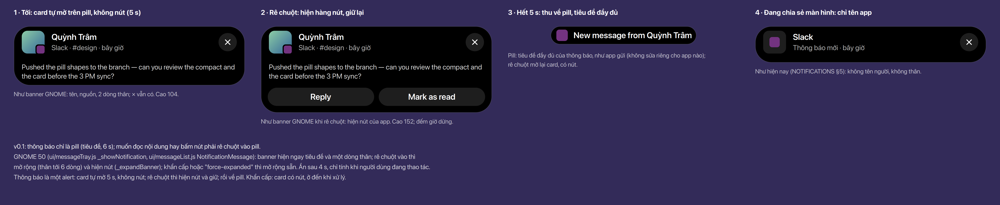
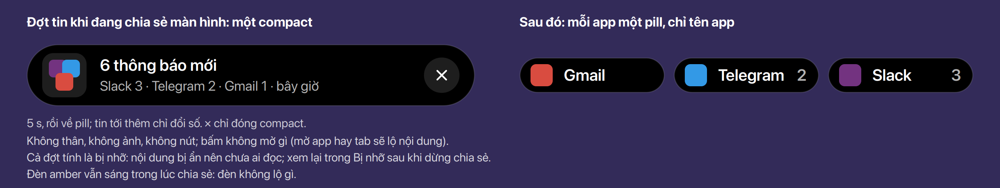
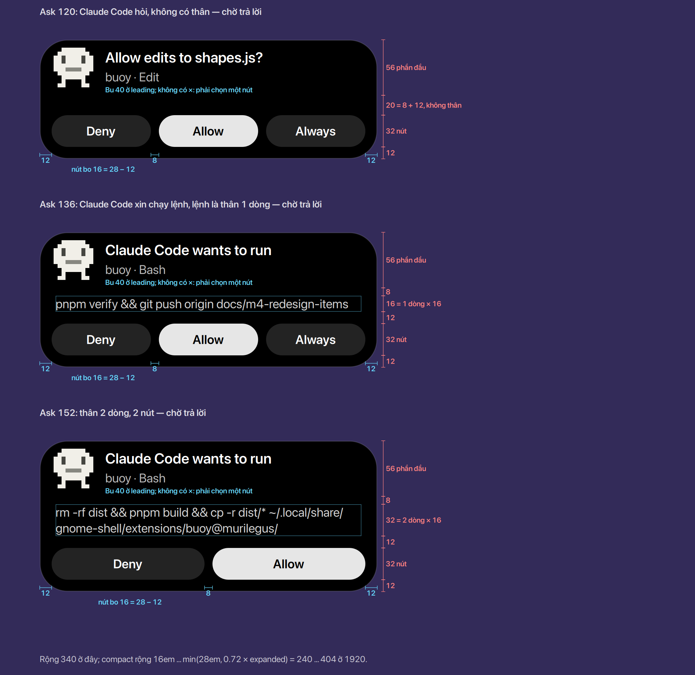
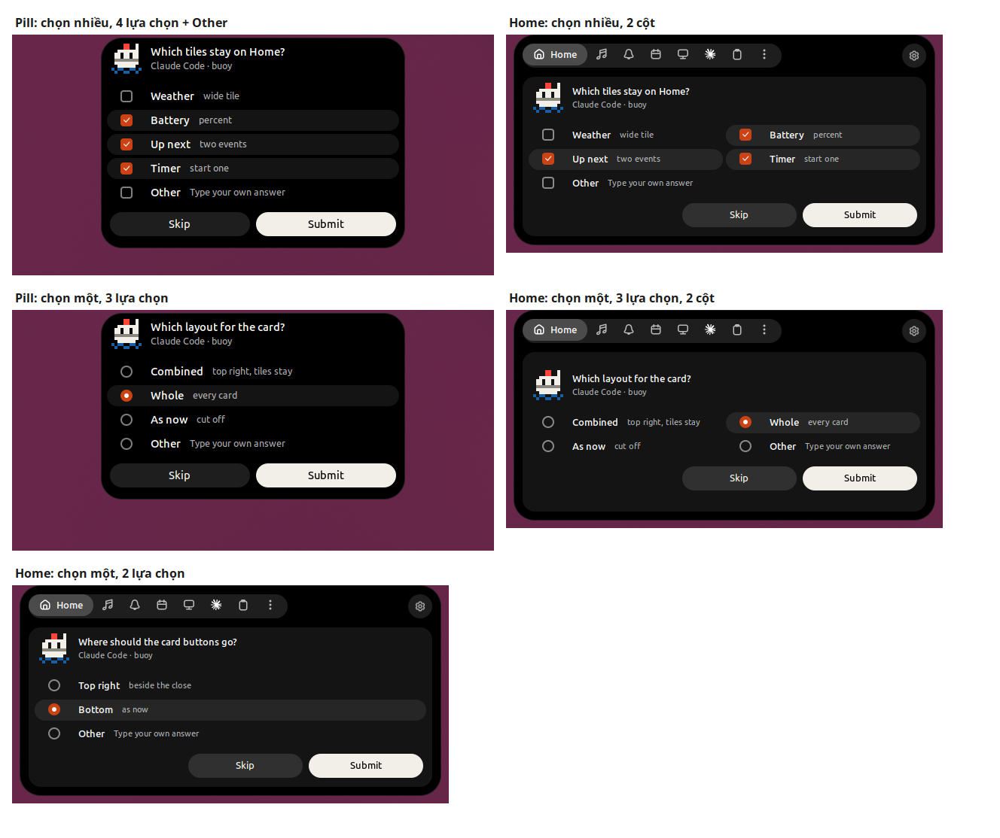
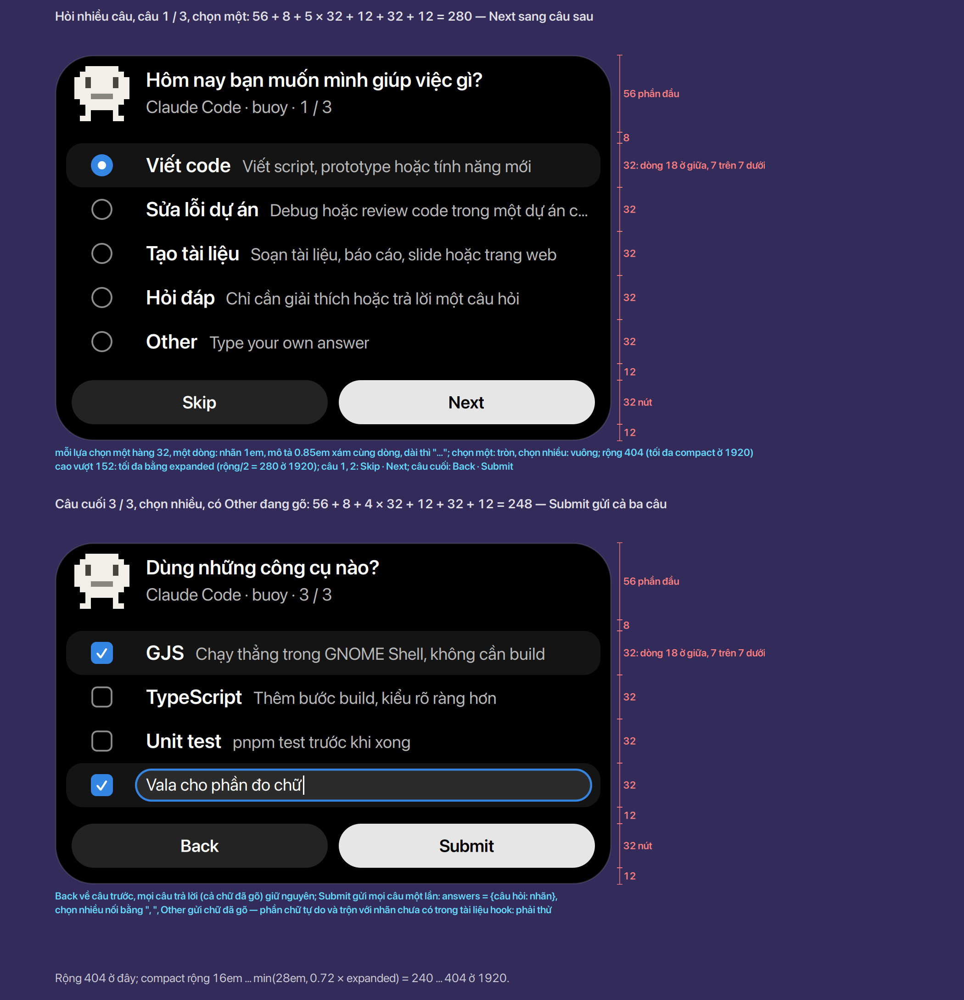

# Alert và ask

Hai cách một activity tự mở ra mà không cần bấm: **alert** chỉ báo, **ask** chờ bạn trả lời. Cả
hai ở cỡ compact, không mở expanded (trước đây alert mở expanded rộng 560 — to hơn cả card thông
báo, trong khi alert nhẹ hơn một tin mới). Số dùng chung ở [Bảng số](../tokens.vi.md).

## Alert

- Hiện compact của activity, đúng cái thấy khi rê chuột, **ngay trên pill của nó** (không dời ra
  giữa, không có thanh tab, không giành bàn phím); các pill bên cạnh mờ đi tại chỗ như khi rê chuột
  (SPEC §2c). Hiện **5 s** rồi tự ẩn; rê chuột vào thì giữ lại. Activity không có compact thì phồng
  lên một nhịp như trước. **Chốt** (Ethan, 2026-11-10)
- Nhạc **không alert**, kể cả khi đổi bài. **Chốt** (Ethan, 2026-11-10)

## Thông báo

Như banner của GNOME 50: banner hiện ngay tiêu đề và một dòng thân, nút của app chỉ hiện khi rê
chuột vào (`ui/messageTray.js` `_showNotification`, `_expandBanner`; `ui/messageList.js`
`NotificationMessage`). Trước đây (v0.1) thông báo chỉ là pill ghi tiêu đề; muốn đọc thân hay bấm
nút phải rê chuột vào pill.

- Thông báo tới là một **alert**: card của nó tự mở ngay trên pill, **không có hàng nút**: phần đầu
  56 (ảnh, tên người gửi hay tiêu đề, nguồn và giờ, ×) và tối đa 2 dòng thân; cao 104. **Chốt**
  (Ethan, 2026-11-12)
- **Rê chuột** vào card: hiện hàng nút của app (cao 136 / 152 như card) và giữ card lại. **Chốt**
  (Ethan, 2026-11-12)
- Sau **5 s** (như mọi alert) card thu về pill. Pill ghi **tiêu đề đầy đủ** như app gửi, không sửa
  riêng cho app nào (Slack: "New message from …"). Rê chuột vào pill thì card mở lại, có nút.
  **Chốt** (Ethan, 2026-11-12)
- **Khẩn cấp** (`Urgency.CRITICAL`): card có nút ngay, ở lại đến khi xử lý, như GNOME mở rộng sẵn
  banner khẩn cấp. **Chốt** (Ethan, 2026-11-12)
- Đang **chia sẻ hoặc quay màn hình**: một thông báo thì như v0.1 (NOTIFICATIONS §5): card chỉ ghi
  tên app và "Thông báo mới", không thân, không ảnh; nút giữ. **Chốt** Nhiều thông báo: xem
  [Khi chia sẻ màn hình](#khi-chia-sẻ-màn-hình).

### Khi nào đã xem, khi nào bị nhỡ

Một quy tắc: **thông báo chỉ tính là đã xem khi card của nó hiện đủ 5 s lúc bạn có mặt, hoặc khi
bạn rê chuột hay bấm vào nó.** Còn lại là **bị nhỡ**: vào Bị nhỡ ([Home](../home/index.vi.md)) và
đèn amber sáng. **Chốt** (Ethan, 2026-11-12)

| Lúc thông báo tới | Buoy làm gì | Bị nhỡ, đèn amber? |
|---|---|---|
| Đang dùng máy | alert 5 s → pill → tab | Không |
| Vừa rời mắt, không chạm máy | card **đứng chờ**; 5 s bắt đầu khi bạn chạm chuột hay phím lại | Không |
| Card đang chờ mà tới `idle-delay` của GNOME (vắng, màn tối) hoặc màn hình khoá | card đóng | **Có** |
| Đang vắng hoặc màn hình khoá | không alert | **Có** |
| Đang toàn màn hình | không alert; ra khỏi toàn màn hình cũng không bung lần lượt từng card | **Có** |
| Do Not Disturb | không alert, như GNOME | **Có**; đèn đứng yên (đèn vẫn sáng trong DnD, 2026-11-08) |
| Khẩn cấp | luôn alert, có nút, ở đến khi xử lý; bạn vắng thì card chờ | Không |
| Đang mở Home hoặc tab Thông báo | hiện ngay trong tab | Không |
| Đang chia sẻ hoặc quay màn hình | card không thân; nhiều tin thì một compact | **Có**: nội dung bị ẩn |

- **Có mặt** = có chuột hay phím trong 1 s gần nhất, như GNOME (`IDLE_TIME`, `ui/messageTray.js`).
  **Vắng** = trạng thái idle của GNOME session, tức sau `idle-delay` (Cài đặt → Nguồn điện → Tắt màn
  hình), hoặc màn hình khoá. Card đứng chờ cho tới khi bạn quay lại, nhưng không quá lúc đó.
  **Chốt** (Ethan, 2026-11-12)
- **Việc đang chạy kết thúc** (tải xong, hẹn giờ hết, Claude Code xong) theo cùng bảng: kết thúc lúc
  vắng, khoá màn hình, toàn màn hình hoặc DnD thì vào Bị nhỡ. (v0.1 chỉ tính toàn màn hình.)
  **Chốt** (Ethan, 2026-11-12)
- **Đèn amber và ô Bị nhỡ:** mở Home thì đèn tắt; ô Bị nhỡ ở đó tới khi **mọi hàng** trong danh sách
  đã mở hoặc bị xoá. Mở hàng "Thông báo · N", tab Thông báo (mục Nhỡ khi vắng) hay danh sách của
  GNOME thì các thông báo đó tính là đã xem và rời Bị nhỡ. **Chốt** (Ethan, 2026-11-12)

### Nhiều thông báo cùng lúc

GNOME 50 hiện từng banner một, mỗi cái đủ 4 s, hàng đợi tối đa 3 tính cả banner đang hiện; dư thì
không có banner, chỉ còn chấm trên thanh (`_onNotificationRequestBanner`,
`MAX_NOTIFICATIONS_IN_QUEUE`). Buoy giữ giới hạn đó nhưng không bắt chờ đủ 4 s mỗi tin.

- Card hiện **theo thứ tự tin tới**. Tin **liền nhau của cùng một app** gộp vào **một lượt**: card
  đổi sang tin mới nhất, dòng phụ ghi số tin ("Slack · #design · 4 tin · bây giờ"). Tin cùng app mà
  không liền nhau thì có lượt riêng, để giữ thứ tự. **Chốt** (Ethan, 2026-11-12)
- Mỗi lượt hiện **ít nhất 1 s** rồi nhường lượt sau; **lượt cuối** chạy như khi chỉ có một thông
  báo (5 s, rê chuột hiện nút). **Chốt** (Ethan, 2026-11-12)
- Ngoài card đang hiện, tối đa **2 lượt chờ** (như hàng đợi 3 của GNOME). Tin tới khi đã đủ chỗ
  không có card: chỉ cập nhật pill của app và vào thẳng Bị nhỡ. Tin khẩn cấp luôn chen lên đầu; khi
  card khẩn cấp đang hiện, tin thường không thay được nó. **Chốt** (Ethan, 2026-11-12)
- Theo quy tắc đã xem: tin có card chưa đủ 5 s (bị lượt sau thay), và các tin trước đã gộp vào card
  của cùng app, đều **bị nhỡ**. Ví dụ Slack ×4, Zalo, Gmail: Slack "4 tin" 1 s → Zalo 1 s → Gmail
  5 s; Gmail đã xem, bốn tin Slack và tin Zalo vào Bị nhỡ. **Chốt** (Ethan, 2026-11-12)
- **Pill sau đợt:** mỗi app một pill như v0.1 (NOTIFICATIONS §2), đuôi ghi số tin của app còn trong
  danh sách GNOME từ 2. Xếp theo PRIORITY (cùng mức thì tin tới sau đứng trước): pill 1 là app của
  card cuối, rồi hai pill phụ, còn lại `+N`. Ví dụ trên: Gmail · Zalo · Slack 4. **Chốt** (Ethan,
  2026-11-12)
- **Hiệu ứng:** tin đầu: pill nở thành card như alert (morph 460 ms). Tin sau, cùng app hay app
  khác: card **vẫn mở**, chỉ nội dung đổi (mờ đi 100 ms, hiện lại 200 ms; avatar, tên, thân, số
  tin), chiều cao co giãn 240 ms nếu số dòng khác (SPEC §5). Không đóng rồi mở lại mỗi giây. Hết
  đợt: card thu về pill của app cuối; các pill khác hiện lại tại chỗ. **Chốt** (Ethan, 2026-11-12)

### Khi chia sẻ màn hình

Card không có thân nên chạy lần lượt từng app chỉ thêm nhấp nháy mà không thêm thông tin.

- Cả đợt là **một compact**, chỉ phần đầu 56: leading là logo các app xếp chồng, tiêu đề "N thông
  báo mới", dòng phụ số tin từng app ("Slack 3 · Telegram 2 · Gmail 1 · bây giờ"). Hiện 5 s rồi về
  pill; tin tới thêm trong lúc đó chỉ đổi số. **Chốt** (Ethan, 2026-11-12)
- **Không nút** (một compact nhiều app không có nút chung). **Bấm không mở gì**: mở app hay tab
  Thông báo trên màn hình đang chia sẻ sẽ lộ nội dung. **×** chỉ đóng compact; thông báo vẫn trong
  danh sách GNOME và Bị nhỡ. **Chốt** (Ethan, 2026-11-12)
- Sau đó mỗi app một pill, chỉ tên app, đuôi ghi số tin từ 2 (NOTIFICATIONS §2, §5). **Chốt**
- Cả đợt tính là **bị nhỡ**: nội dung bị ẩn nên chưa ai đọc; xem lại trong Bị nhỡ sau khi dừng chia
  sẻ. Đèn amber vẫn sáng trong lúc chia sẻ: đèn không lộ gì. **Chốt** (Ethan, 2026-11-12)

### Rê chuột giữa một đợt tin

- Rê chuột vào là **cả đợt dừng**: card đứng yên, hiện hàng nút, **không đổi nội dung** khi con trỏ
  còn trên nó (không bấm nhầm). Tin đang hiện tính là đã xem. **Chốt** (Ethan, 2026-11-12)
- Tin mới tới khi đang rê chuột: cùng app thì thân giữ nguyên, chỉ số tin tăng; app khác thì vào
  lượt chờ (tối đa 2), dư thì vào thẳng Bị nhỡ. Đồng hồ 1 s và 5 s chỉ chạy khi con trỏ không ở trên
  card. **Chốt** (Ethan, 2026-11-12)
- Rời chuột: đợi 200 ms như GNOME (`HIDE_TIMEOUT`) phòng khi rê vào lại, rồi chạy tiếp lượt chờ kế;
  không còn lượt thì thu về pill. **Chốt** (Ethan, 2026-11-12)
- Bấm card: mở app đúng chỗ của tin (như banner GNOME), card đóng, đợt chạy tiếp. Bấm ×: bỏ tin đó,
  đợt chạy tiếp. **Chốt** (Ethan, 2026-11-12)
- Card bật lên **ngay dưới con trỏ** chưa tính là rê chuột: con trỏ phải rời ra rồi vào lại, như
  GNOME (`_onNotificationHoverChanged`). **Chốt** (Ethan, 2026-11-12)
- Các tin trước của cùng app (chỉ thấy qua số "4 tin") vẫn bị nhỡ: rê chuột chỉ đánh dấu đã xem tin
  đang hiện. **Chốt** (Ethan, 2026-11-12)

## Ask

- Cũng ở cỡ compact, và **đứng đó đến khi có câu trả lời** (hoặc hết `timeoutMs` thì dùng
  `fallback`). **Chốt** (Ethan, 2026-11-10)
- Bố cục như card: phần đầu 56 (Bu ở leading 40, câu hỏi 1em, "app · việc cần làm" 0.85em), thân
  tùy có (lệnh, chi tiết) theo dòng 16, hàng nút cách mép 12; không có nút ×: phải chọn một nút.
  **Cao theo nội dung**, cùng công thức với card: 56 + 8 + 16 × số dòng + 12 + 32 + 12 = **120**
  không có thân, **136** một dòng, **152** hai dòng. Thân tối đa 2 dòng như card tin nhắn, dài hơn
  thì cắt bằng "…". Số nút theo câu hỏi (3: Deny · Allow · Always, 2: Deny · Allow), trải đều bề
  ngang. **Chốt** (Ethan, 2026-11-10)

## Hỏi nhiều lựa chọn

**Chốt** (Ethan, 2026-11-11; đề xuất 2026-11-10). Claude Code AskUserQuestion: hiện Buoy chỉ hiện "Needs your answer" và
để bạn chọn trong card của Claude. Quyết định này cho Buoy trả lời được, nên đổi quyết định "A question
is not a permission" (CODING-AGENTS.md, 2026-11-08).

- Phần đầu 56 (Bu, câu hỏi 1em, "Claude Code · dự án · 1 / 3" 0.85em). Câu hỏi dài hơn chỗ trống thì
  **chạy chữ như tên bài hát** (đứng yên 2 s ở đầu, rồi trượt sang trái, `marquee`), không cắt "…":
  câu hỏi là cả nội dung. Cũng vậy với câu hỏi Cho phép / Từ chối. Tên người gửi của thông báo vẫn
  đứng yên, cắt "…". **Chốt** (Ethan, 2026-11-13)
- Mỗi lựa chọn một **hàng 32, một dòng**: nhãn 1em đậm, mô tả 0.85em xám cùng dòng, dài thì cắt
  "…". Hai dòng 1em + 0.85em cần 18 + 16 = 34, không vừa 32; nhỏ hơn thì xuống dưới cỡ nhỏ nhất của
  GNOME, 9pt ≈ 0.82em (`%caption` trong gnome-shell-sass `_common.scss`). (Ethan, 2026-11-10)
- Hàng cao **28, cách nhau 4** (bước vẫn 32): hai lựa chọn đã chọn cạnh nhau không liền nền thành
  một khối. Cả chọn một lẫn chọn nhiều, cả hàng lẫn cột (Home 2 cột). **Chốt** (Ethan, 2026-11-13)

- Dấu chọn 16 ở cột leading: tròn khi chọn một, vuông khi chọn nhiều.
- **Other** là hàng cuối: chưa chọn thì ghi "Type your own answer" màu xám; chọn rồi thì hàng thành
  ô nhập ngay trong card (viền màu nhấn như ô nhập của GNOME). Bấm vào ô thì Buoy nhận bàn phím (bấm
  vào island là của bạn, SPEC §2); Enter hoặc Submit gửi đi. (Ethan, 2026-11-10)
  Ô chỉ có **một viền**: vòng focus của theme (Buoy bỏ viền riêng của mình, vì hai cái chồng thành
  hai đường), và **con trỏ nhấp nháy** như ô nhập của GNOME, theo `cursor-blink`, `cursor-blink-time`
  và `cursor-blink-timeout` của bạn; ô nhập của Shell không nhấp nháy nên Buoy tự làm. **Chốt**
  (Ethan, 2026-11-13)
- Cao 56 + 8 + 32 × số hàng − 4 + 12 + 32 + 12: 2 lựa chọn + Other = 212, 4 + Other = **276** — vượt
  152 của compact, tối đa bằng expanded (rộng/2); rộng như compact lớn nhất (404 ở 1920).
- Nhiều câu hỏi thì lần lượt từng câu, "1 / 3" ở dòng phụ: các câu trước câu cuối có Skip · **Next**,
  câu cuối có **Back** · **Submit**.
- **Lưu**: câu trả lời chỉ nằm trong card, trong bộ nhớ, đến khi gửi hoặc ask kết thúc (Buoy không
  lưu gì, CODING-AGENTS quy tắc 3): mỗi câu giữ các nhãn đã chọn và chữ đã gõ ở Other; Next và Back
  chỉ đổi câu đang hiện, không mất gì.
- **Gửi**: một lần, khi Submit ở câu cuối — hook trả `allow` với `updatedInput` = input cũ cộng
  `answers` = {nội dung câu hỏi: câu trả lời} cho mọi câu: chọn một là nhãn; chọn nhiều là các nhãn
  nối bằng ", "; Other là chữ đã gõ (chọn nhiều có cả Other thì chữ đó nối sau các nhãn). Không gửi
  từng câu được: tài liệu chỉ có một `answers` cho cả lần gọi
  ([hooks reference](https://code.claude.com/docs/en/hooks.md)).
- **Khi chia sẻ hoặc quay màn hình**: không có card. Câu hỏi và lựa chọn là nội dung của phiên,
  giấu như lệnh và thông báo; pill của phiên giơ tay "Needs your answer", trả lời trong Claude Code.
  Đang có card mà bắt đầu chia sẻ thì card đóng, những gì đã chọn bỏ đi, câu hỏi về lại Claude.
  **Chốt** (Ethan, 2026-11-13)
- **Skip**: Buoy không trả lời, câu hỏi ở lại trong Claude Code như hiện nay. Nếu Claude không nhận
  chữ tự do qua đường Buoy dùng: câu nào chọn Other thì Buoy không trả lời cả lần gọi mà đưa Claude
  Code lên để gõ ở đó.

### Đã thử

2026-11-10, Claude Code 2.1.319, Haiku, phiên `-p` cô lập (chỉ nạp settings tạm; một MCP server nhỏ
làm permission host, vì không có host thì `-p` không đưa tool này cho mô hình):

- Hook **PreToolUse** trả `allow` + `updatedInput.answers` thì Claude nhận đúng, gồm cả chữ tự do và
  nhãn trộn chữ ("GJS, TypeScript, Vala cho phần đo chữ"), hai câu trong một lần. Claude nhận chuỗi
  `The user answered: "câu 1"="trả lời 1", "câu 2"="trả lời 2". Read the answers carefully…`.
- `allow` mà không có `answers`: Claude nhận "The user did not answer the questions."
- Dấu phẩy trong chữ không được thoát: Claude chỉ thấy một chuỗi.
- Trong `-p`, quyết định của hook **PermissionRequest** bị permission host lấn (host trả deny thì
  Claude nhận "HOST DENIED" dù hook đã trả lời), nên thử tiếp trong phiên tương tác.

2026-11-13, Claude Code 2.1.319, Haiku, **phiên tương tác** (pty, chỉ nạp settings tạm có hook của
Buoy, hook gọi Shell headless trên bus thử): AskUserQuestion có PermissionRequest; terminal hiện hộp
của Claude cùng lúc với card của Buoy. Trả lời ở card (Blue; Apple + Other "Durian, ripe"), Submit:
hộp của Claude đóng, Claude nhận `"Which colour?"="Blue"`, `"Which fruits?"="Apple, Durian, ripe"`.
Thiếu một câu trong `answers` vẫn chưa thử.

## Chỗ trong code

- `lib/kit/ui/island.js` — alert mở compact của pill (không `_openPill` ra giữa); ask là card ở cỡ
  compact, giữ đến khi trả lời.
- `lib/modules/media/adapter.js` — bỏ `expanded` (không bao giờ hiện: nhạc không alert, không ask,
  đã có `tab.js`).
- `lib/modules/agent/adapter.js` — ask thành card; câu hỏi nhiều lựa chọn (đã chốt).
- SPEC §2 (bảng các dạng: alert và ask ở cỡ compact).
- `lib/modules/notification/source.js`, `adapter.js` — thông báo tới thì xin alert (card mở trên
  pill 5 s) thay cho pill 6 s; card không nút cho tới khi rê chuột; khẩn cấp có nút ngay, không ttl;
  đợt tin (lượt, gộp cùng app, 2 lượt chờ, 1 s mỗi lượt); `acknowledged` chỉ đặt khi đã xem theo
  quy tắc trên, không phải lúc hiện. NOTIFICATIONS §1–§3 viết lại theo đây.
- `lib/kit/` (mới: theo dõi có mặt) — idle monitor của Mutter (`get_core_idle_monitor`,
  `add_user_active_watch`, như `ui/messageTray.js`) và trạng thái presence của GNOME session; khoá
  màn hình; DnD. Vắng, khoá, toàn màn hình, DnD → `stack.setUnseen()` (INDICATORS, FEATURES "Buoy
  light, the rest").
- `lib/kit/ui/present/compact.js` (card) — hàng nút ẩn khi card mở bằng alert, hiện khi rê chuột; chiều cao đổi
  104 → 136 / 152 theo nhịp 16.
