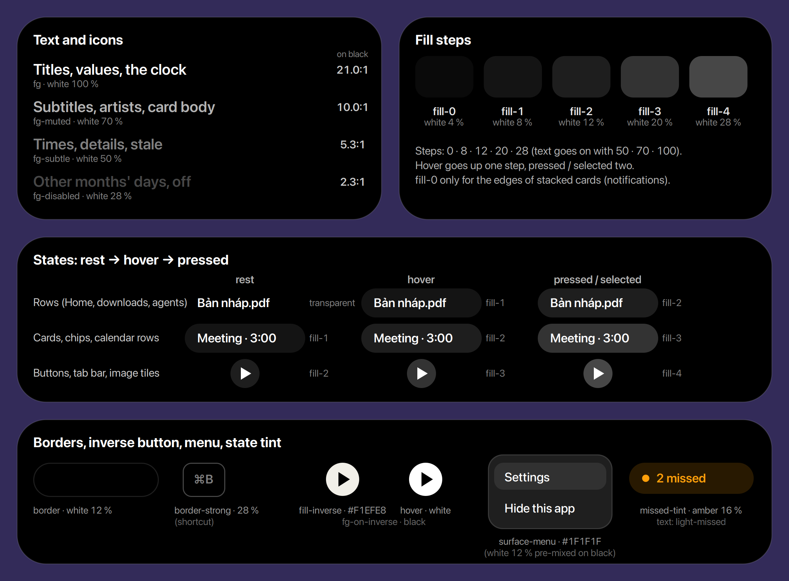
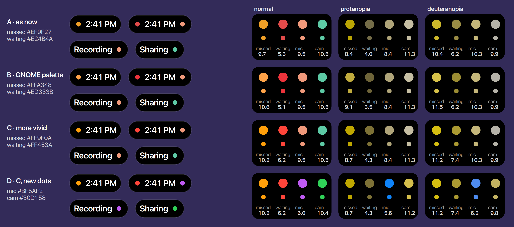
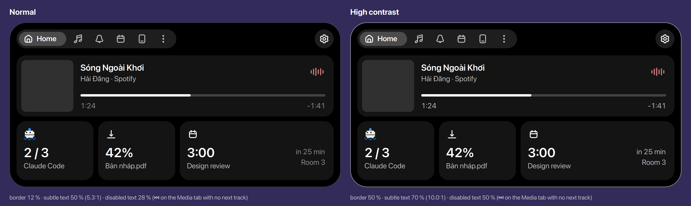
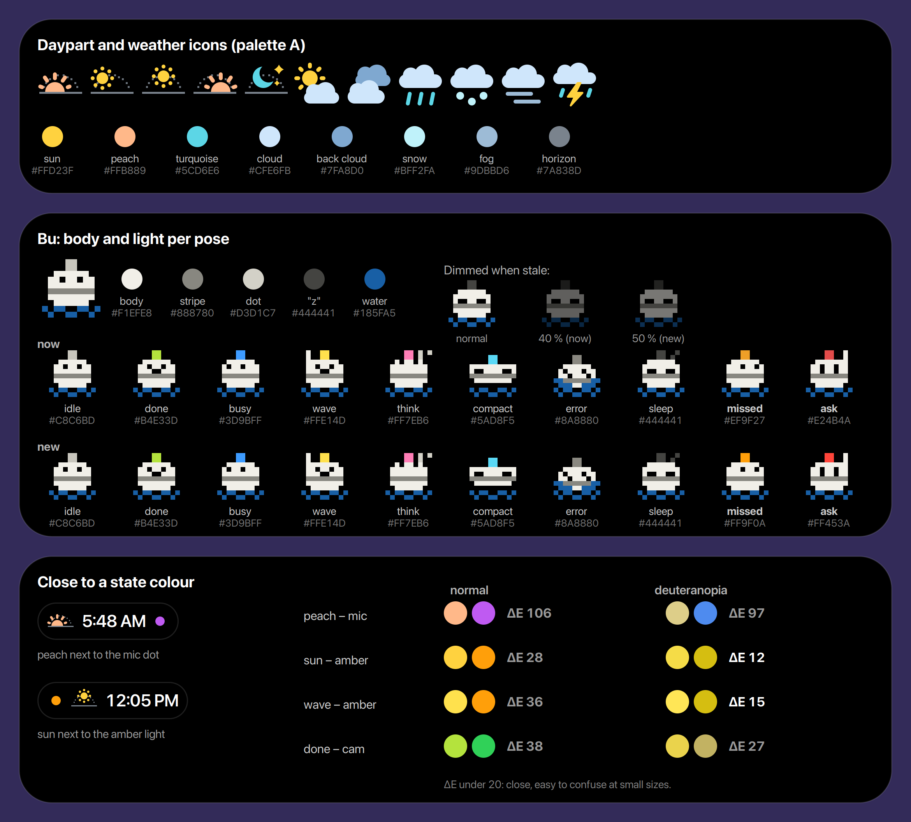

# Colours

Buoy's CSS uses only the colours named on this page. Each colour has a role; no colour is picked
for one spot alone.

## Principles

- **Two layers.** *Base values* are the colour codes; *roles* are the names the CSS uses
  (`fg-muted`, `fill-2`…). Named by what the colour does, not by how it looks, so a value can change
  without a rename. **Decided** (Ethan, 2026-11-10)
- **One scale of translucent white** for both text and backgrounds: 4 · 8 · 12 · 20 · 28 · 50 · 70 · 100 %.
  The island is always black, so translucent white gives the same result as solid grey and still
  holds when nested. Solid grey only for raised surfaces that must cover what is below (menus).
  **Decided** (Ethan, 2026-11-10)
- **States step up:** hover one step, pressed or selected two steps. **Decided** (Ethan, 2026-11-10)
- **Contrast (WCAG 2.2):** text ≥ 4.5:1 on its background, meaningful dots and icons ≥ 3:1.
  Disabled text need not pass. **Decided** (Ethan, 2026-11-10)
- **Colour never alone:** the light and the dots differ by both place (light on the left, dot on
  the right) and brightness, so red–green colour-blind people can still read them. **Decided** (Ethan, 2026-11-10)
- **One colour, one meaning:** status colours are only for the light and the dots
  ([INDICATORS](../../INDICATORS.md)), never a keyline, never decoration. **Decided**
  Exception: red on the left and on the right carries two meanings ([Privacy dot](#privacy-dot)).
- **Colour borrowed from content:** only the music equaliser takes a colour from outside the
  palette, the cover art's dominant colour, brightened to 4.5:1 ([Pill](../pill/index.md),
  "Equaliser"). Code sets it at runtime; it is not in the stylesheet. A cover matching a light's
  colour keeps its colour: the equaliser is six bars, the light is one dot. **Decided** (Ethan, 2026-11-13)

## Roles

*Decided (Ethan, 2026-11-10).*

| Role | Value | Used for | Replaces |
|---|---|---|---|
| `surface` | black `#000` | the island, every shape. **Decided** | |
| `surface-menu` | `#1F1F1F` (white 12 % pre-mixed on black) | the gear menu | `#242424` |
| `border` | white 12 % | island and menu border; default keyline. **Decided** | |
| `border-strong` | white 28 % | shortcut key border | .25 |
| `fg` | white | titles, values, the clock, icons | `#fff` |
| `fg-muted` | white 70 % | subtitles, artist, card body, chip text | `#ddd` `#d0d0d0` `#cfcfcf` `#ccc` `#b8b8b8` `#b0b0b5` .75 .7 |
| `fg-subtle` | white 50 % | times, details, section titles, secondary button icons, **stale**, the volume level when muted | .55 .5 .45 .4 `#8e8e93` `#8a8a8a` |
| `fg-disabled` | white 28 % | days of another month, days turned off | .28 |
| `fill-0` | white 4 % | the edge of stacked cards (notifications) | `#141416` `#0e0e10` |
| `fill-1` | white 8 % | cards, chips, calendar rows at rest; rows on hover | .07 .08 `#1c1c1e` |
| `fill-2` | white 12 % | buttons, the tab strip, image tiles at rest; cards on hover | .10 .11 .12 .13 `#1f1f1f` |
| `fill-3` | white 20 % | buttons on hover, the selected tab, the selected day, badges, scrollbars | .16 .17 .18 .20 .24 `#2c2c2e` `#2a2a2d` `#3a3a3c` |
| `fill-4` | white 28 % | buttons pressed, scrollbars on hover | `#48484a` |
| `fill-inverse` | cream `#F1EFE8` (Bu's body), white on hover | the play button, chips turned on | |
| `fg-on-inverse` | black | text and icons on `fill-inverse` | |
| `accent` | GNOME's `-st-accent-color` | what is selected or happening now: an active filter chip, today, the month name, the dot for a day with events, an event in progress; never picked by Buoy. **Decided** | |
| `accent-fg` | `-st-accent-fg-color` | text on an `accent` background. **Decided** | |
| `focus-ring` | `accent` 80 %, 2 px drawn inside | keyboard focus on every button; a focused island's border is `accent` 100 %. **Decided** | |
| `light-off` | white 20 % | the light off (idle `none`) | `#3a3a3a` |
| `light-missed` | `#FF9F0A` ([Lights and dots](#lights-and-dots)) | the missed light | `#EF9F27` |
| `light-waiting` | `#FF453A` | the waiting light | `#E24B4A` |
| `dot-mic` | `#BF5AF2` ([Privacy](#privacy-dot)) | the mic dot | `#F0997B` |
| `dot-cam` | `#30D158` | the camera dot | `#5DCAA5` |
| `dot-screen` | `#FF453A`, as `light-waiting` | the screen sharing or recording dot | `#5DCAA5` |
| `missed-tint` | `light-missed` 16 % | the "Missed" chip background | `#2a1f0c` |

Stale has no colour of its own: the bars and the music wave columns of a stale activity use `fg-subtle`.

No colour for error or done (a failed download bar, a finished download): red and green already
belong to the light and the dots; the result is told by an icon and `fg` text. **Decided** (Ethan, 2026-11-11)

**Derived values** are not new colours: the border of the dot on a tab (`.buoy-tab-dot`) must
equal the background right under it, so it takes that background pre-mixed on black. The table
records the rule, not a code.

## Lights and dots

*Each row: two pills at real size (dot 8), then the four status colours as seen with normal
vision, red-blind and green-blind (Machado 2009). The number under a dot is its contrast on black.*

- **Amber is not dim:** `#EF9F27` is bright, 9.7:1, much brighter than red. The dim feel comes
  from its saturation (86 %) and a slightly brown hue; at an 8 px dot a colour looks paler than in
  a large patch.
- **The current red is a little pink** (`#E24B4A`, saturation 72 %) and the darkest (5.3:1).
- **B (GNOME's palette)** makes red darker (5.1:1) and amber paler: it solves neither.
- **C** is near full saturation: amber `#FF9F0A` 10.2:1, red `#FF453A` 6.2:1. The brightness gap
  between the two lights stays (10.2 against 6.2), so red-blind people still see amber bright, red dark.

**C** chosen: amber `#FF9F0A`, red `#FF453A`. **Decided** (Ethan, 2026-11-10)

### Privacy dot

*Row D of the image above. In the code since 2026-11-14: the `privacy` module, classes
`.buoy-dot-mic`, `-cam`, `-screen` (`stylesheet.css`), drawn by pill 1 at its right end (`kit/ui/pill.js`).*

| | Camera | Mic | Screen sharing | Screen recording | Location |
|---|---|---|---|---|---|
| GNOME 50 | orange icon `#FF7800` | orange icon `#FF7800` (when not muted) | orange button `#FF7800` | red button `#C01C28` | plain icon, no colour |
| Apple | green dot | orange dot | — | purple dot (macOS, system audio recording too) | arrow, no dot |
| Buoy | `dot-cam` dot | `dot-mic` dot | `dot-screen` dot | `dot-screen` dot | no dot |

GNOME: `$privacy_indicator_color` is `$orange_3` in dark mode (gnome-shell-sass
`widgets/_panel.scss`), set on the camera (`status/camera.js`), the mic (`status/volume.js`) and
remote access (`status/remoteAccess.js`); screen recording uses `$recording_indicator_color` = `$red_4`.
Location (`status/location.js`) does not have this class. Apple does not publish colour codes for these dots.

- Orange (GNOME, Apple) matches amber, red matches `light-waiting`: Buoy cannot use them, because
  of one colour, one meaning.
- **Mic purple `#BF5AF2`**: a free hue, far from red, amber and the icons' peach (ΔE ≥ 97, for
  colour-blind people too); 6.0:1 on black. Considered amber (like Apple's orange) and a blinking
  dot: amber makes the right side repeat the left exactly, blinking breaks the still-light rule
  (INDICATORS principle 2). **Decided** (Ethan, 2026-11-11)
- **Camera green `#30D158`**, replacing the pale teal `#5DCAA5`; 10.4:1. Compared with `#68CE67`
  (measured from the iPhone 16 camera dot): `#30D158` stands out more at 8 px. For colour-blind
  people it is close to amber (red-blind, ΔE 15) and red (green-blind, 15); the dot is on the
  right, the light on the left. **Decided** (Ethan, 2026-11-11)
- **Screen sharing or recording: a red dot** `#FF453A` on the right, as GNOME uses red for screen
  recording. Red has two meanings by side: left is waiting for your answer, right is the screen
  being shared or recorded. **Decided** (Ethan, 2026-11-11)
- Location has no dot, as in GNOME and Apple. **Decided** (Ethan, 2026-11-11)
- Order when several dots are on at once, only one drawn: red (screen) › green (camera) › purple (mic). **Decided** (Ethan, 2026-11-11)
- Screen sharing and recording become an activity in the pill, with a Stop button, in place of
  GNOME's button on the bar ([Compact](../compact/index.md#screen-sharing-and-recording)). **Decided** (Ethan, 2026-11-11)

## High contrast

With GNOME's high contrast on (`org.gnome.desktop.a11y.interface high-contrast`): border 12 % →
**50 %**, as GNOME (gnome-shell-sass `_default-colors.scss`, the `$contrast == 'high'` branch:
`$border_opacity: .5`); `fg-subtle` 50 % → **70 %** (equal to `fg-muted`, 10:1); `fg-disabled` 28 % →
**50 %**; `border-strong` 28 % → 70 %. Backgrounds stay. **Decided** (Ethan, 2026-11-11)

## Following GNOME

Inside the island is Buoy's palette; everything around it follows GNOME. **Decided** (Ethan, 2026-11-10)

- **Accent** stays GNOME's, not replaced by a Buoy colour: the user picked it, and the focus ring
  must look like the rest of the Shell.
- **On the bar** (text, icons, cluster background, tray button highlight): the theme's text
  colour, or `#1a1a1a` by `cluster-contrast`, with GNOME's .17 / .28 / .32 / .75 levels (SPEC §1). Not merged.
- **What GNOME draws** keeps GNOME's colours: Quick Settings, tray menus, the calendar menu, dialogs.
- **Prefs** (libadwaita) follow the system's light/dark and accent. Only Bu's background tile is
  `surface` `#000` (was `#0b0b0b`), to match the island.
- **Light-style Shell** (GNOME 47+): the island stays black; the gear menu is Buoy's, so it stays dark too.
- Icons and Bu: see [Illustration](#illustration-icons-and-bu).

## Illustration: icons and Bu

The time-of-day icons, weather icons and Bu have their own palette, not roles: solid colours, not
translucent, always on black. This palette is not merged into the white scale, but it avoids the
status colours. **Decided** (Ethan, 2026-11-11)

| Palette | Colours | Source |
|---|---|---|
| Icons (palette A) | sun `#FFD23F`, peach `#FFB889`, turquoise `#5CD6E6`, cloud `#CFE6FB` `#7FA8D0`, snow `#BFF2FA`, fog `#9DBBD6`, horizon `#7A838D` | `scripts/icons.js`, [Icons](../icons/index.md) |
| Bu's body | cream `#F1EFE8`, stripes `#888780`, dots `#D3D1C7`, "z" `#444441`, water `#185FA5` | [MASCOT](../../MASCOT.md) |
| Bu's lamp | by pose, see below; missed and ask are the light colours | INDICATORS § Bu's lamp |

- **One colour, one meaning applies to Bu's lamp too:** the `missed` and `ask` poses use exactly
  `light-missed` `#FF9F0A` and `light-waiting` `#FF453A`, and change with the light. **Decided** (Ethan, 2026-11-11)
- **Stale at one level:** stale Bu is dimmed to 40 %, stale text is `fg-subtle` 50 %. Bring Bu to 50 %.
  **Decided** (Ethan, 2026-11-11)
- **Bu's background tile** (prefs, README, EGO): `#0b0b0b` → `surface` `#000`. **Decided** (Ethan, 2026-11-11)
- **Cream `#F1EFE8`** is Bu's body and also `fill-inverse`: one colour, two places, on purpose.

**Bu's lamp is more saturated.** The lamp is only 4 × 4 px; pastel colours look grey at that
size. Keep each pose's hue, push the saturation up, and avoid both the status colours and the
privacy dots. **Decided** (Ethan, 2026-11-11)

| Pose | Now | New | Contrast on black |
|---|---|---|---|
| idle | `#B4B2A9` | `#C8C6BD` | 12.3:1 |
| done, party | `#97C459` | `#B4E33D` | 14.0:1 |
| busy | `#85B7EB` | `#3D9BFF` | 7.3:1 |
| wave | `#FAC775` | `#FFE14D` | 16.1:1 |
| think | `#AFA9EC` | `#FF7EB6` (pink, since purple is the mic) | 8.9:1 |
| compact | `#B5D4F4` | `#5AD8F5` | 12.6:1 |
| error | `#5F5E5A` | `#8A8880`, not red: red is ask (Ethan, 2026-11-11) | 5.9:1 |
| sleep, stale | `#444441` | kept | |

Distance (ΔE; under 20 is close, easy to confuse at small sizes):

- With normal vision, every pair among Bu's lamp, the light and the dots is ≥ 23.
- The icons' sun and amber: 28 (green-blind 12). A 24 px icon beside an 8 px dot, different
  shapes, so it still reads.
- For colour-blind people, a few pairs of Bu's lamp are close (done and wave 5–8). Accepted: Bu's
  pose is what carries the meaning, the lamp only adds to it.

## One source

St does not read CSS variables (Shell 50's `st-theme-node.c` does not handle `var()`), and Buoy
has no build step. A test (`tests/palette.test.js`) reads `stylesheet.css` and
`lib/modules/*/stylesheet.css` (each module's CSS, since 2026-11-12), and fails on a
colour not in the palette, naming the nearest role. The CSS holds the real values, a comment names the role.
**Decided** (Ethan, 2026-11-11)

## Current state

*`stylesheet.css`, `main` 2026-11-10: 54 values in 497 lines.*

- 20 levels of translucent white, many only 1 % apart (.10 / .11, .12 / .13, .16 / .17 / .18) for
  the same job.
- 21 solid grey codes. The notifications tab uses its own series (`#1c1c1e` `#2c2c2e` `#3a3a3c` `#48484a`).
- Text at .40 at 11 px (`.buoy-home-meta`) reaches only 3.7:1, under 4.5:1.
- Chips use .07, .10, `#1f1f1f`, `#3a3a3c` at rest, one after another.

The roles table above merges these 54 values into 16 (not counting the colours on the bar and Bu).

Since 2026-11-12 (M4 "Colours by role") the CSS inside the island holds only the roles, from
`lib/kit/model/palette.js`; `tests/palette.test.js` keeps it that way, and checks that every use
of the four roles high contrast raises has a matching `.buoy-hc` rule.
