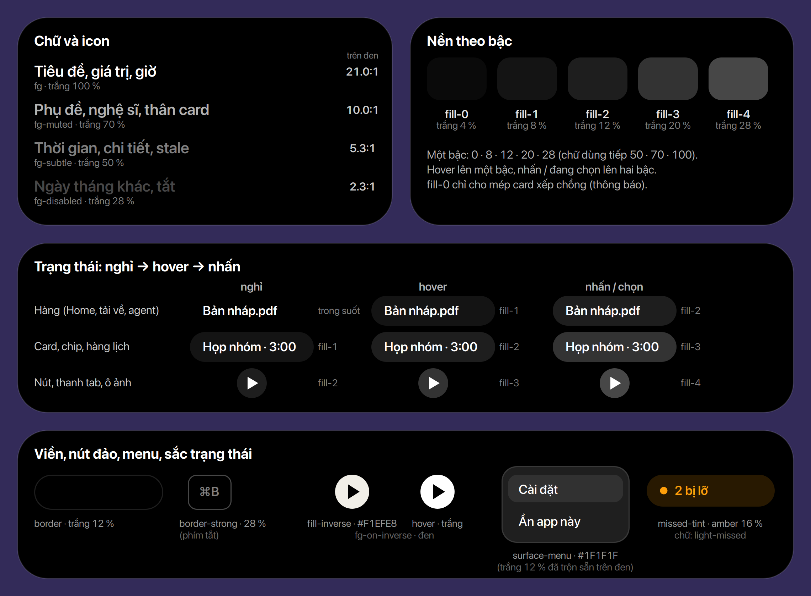
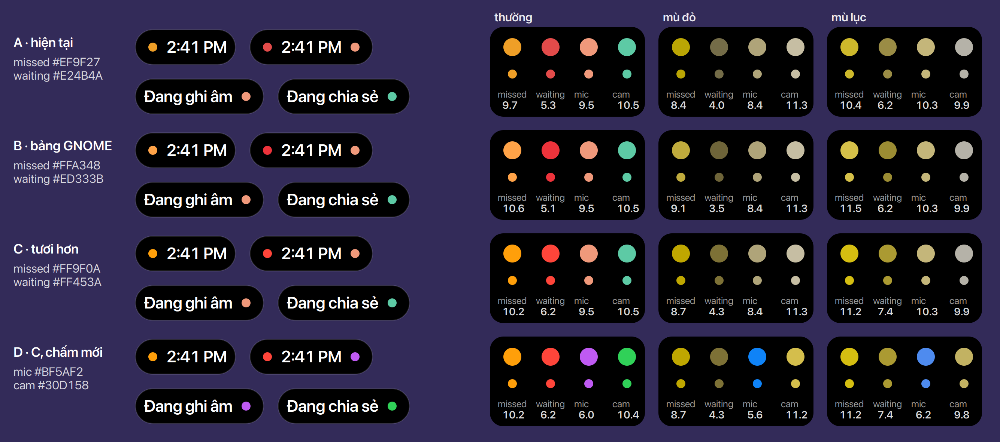
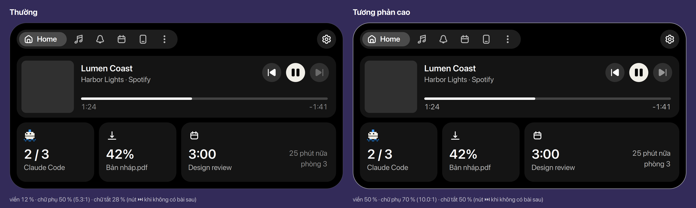
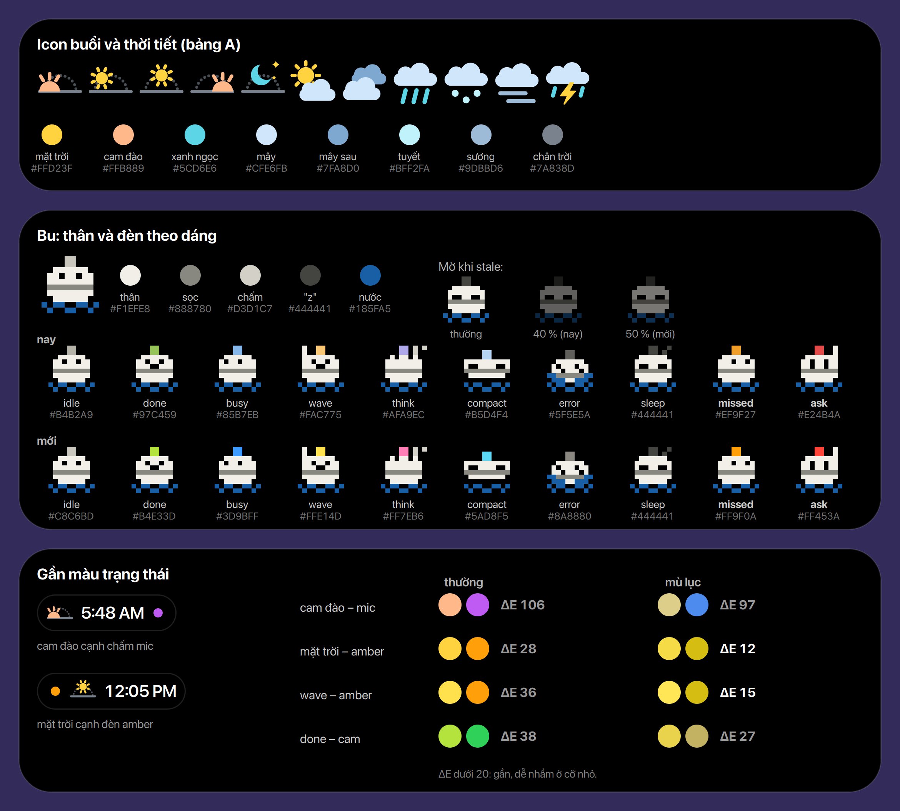

# Bảng màu

CSS của Buoy chỉ dùng các màu có tên ở trang này. Mỗi màu có một vai trò, không có màu chọn riêng
cho một chỗ.

## Nguyên tắc

- **Hai lớp.** *Giá trị gốc* là các mã màu; *vai trò* là tên mà CSS dùng (`fg-muted`,
  `fill-2`…). Đặt tên theo việc màu làm, không theo hình dáng của nó, để đổi giá trị mà không phải
  đổi tên. **Chốt** (Ethan, 2026-11-10)
- **Một thang trắng trong suốt** cho cả chữ và nền: 4 · 8 · 12 · 20 · 28 · 50 · 70 · 100 %. Island
  luôn đen, nên trắng trong suốt cho kết quả giống xám đặc mà lồng nhau vẫn đúng. Màu xám đặc chỉ
  dùng cho bề mặt nổi phải che thứ bên dưới (menu). **Chốt** (Ethan, 2026-11-10)
- **Trạng thái leo bậc:** hover lên một bậc, nhấn hoặc đang chọn lên hai bậc. **Chốt** (Ethan, 2026-11-10)
- **Tương phản (WCAG 2.2):** chữ ≥ 4.5:1 trên nền của nó, chấm và icon có nghĩa ≥ 3:1. Chữ tắt
  (disabled) không cần đạt. **Chốt** (Ethan, 2026-11-10)
- **Màu không đứng một mình:** đèn và chấm phân biệt bằng cả vị trí (đèn bên trái, chấm bên phải)
  và độ sáng, để người mù màu đỏ–lục vẫn đọc được. **Chốt** (Ethan, 2026-11-10)
- **Một màu một nghĩa:** màu trạng thái chỉ dành cho đèn và chấm ([INDICATORS](../../INDICATORS.md)),
  không làm keyline, không làm trang trí. **Chốt**
  Ngoại lệ: đỏ ở bên trái và bên phải mang hai nghĩa ([Chấm riêng tư](#chấm-riêng-tư)).

## Vai trò

*Chốt (Ethan, 2026-11-10).*

| Vai trò | Giá trị | Dùng cho | Thay cho |
|---|---|---|---|
| `surface` | đen `#000` | island, mọi dạng. **Chốt** | |
| `surface-menu` | `#1F1F1F` (trắng 12 % trộn sẵn trên đen) | menu bánh răng | `#242424` |
| `border` | trắng 12 % | viền island, menu; keyline mặc định. **Chốt** | |
| `border-strong` | trắng 28 % | viền phím tắt | .25 |
| `fg` | trắng | tiêu đề, giá trị, giờ, icon | `#fff` |
| `fg-muted` | trắng 70 % | phụ đề, nghệ sĩ, thân card, chữ trong chip | `#ddd` `#d0d0d0` `#cfcfcf` `#ccc` `#b8b8b8` `#b0b0b5` .75 .7 |
| `fg-subtle` | trắng 50 % | thời gian, chi tiết, tiêu đề mục, icon nút phụ, **stale**, mức âm lượng khi tắt tiếng | .55 .5 .45 .4 `#8e8e93` `#8a8a8a` |
| `fg-disabled` | trắng 28 % | ngày của tháng khác, thứ đã tắt | .28 |
| `fill-0` | trắng 4 % | mép card xếp chồng (thông báo) | `#141416` `#0e0e10` |
| `fill-1` | trắng 8 % | card, chip, hàng lịch lúc nghỉ; hàng lúc hover | .07 .08 `#1c1c1e` |
| `fill-2` | trắng 12 % | nút, thanh tab, ô ảnh lúc nghỉ; card lúc hover | .10 .11 .12 .13 `#1f1f1f` |
| `fill-3` | trắng 20 % | nút lúc hover, tab đang chọn, ngày đang chọn, badge | .16 .17 .18 .20 .24 `#2c2c2e` `#2a2a2d` `#3a3a3c` |
| `fill-4` | trắng 28 % | nút lúc nhấn | `#48484a` |
| `fill-inverse` | kem `#F1EFE8` (thân Bu), hover trắng | nút phát, chip đang bật | |
| `fg-on-inverse` | đen | chữ, icon trên `fill-inverse` | |
| `accent` | `-st-accent-color` của GNOME | cái đang chọn hoặc đang diễn ra: chip lọc đang bật, hôm nay, tên tháng, chấm có sự kiện, sự kiện đang diễn ra; không tự chọn. **Chốt** | |
| `accent-fg` | `-st-accent-fg-color` | chữ trên nền `accent`. **Chốt** | |
| `focus-ring` | `accent` 80 %, 2 px vẽ vào trong | focus bàn phím của mọi nút; island đang focus thì viền là `accent` 100 %. **Chốt** | |
| `light-off` | trắng 20 % | đèn tắt (idle `none`) | `#3a3a3a` |
| `light-missed` | `#FF9F0A` ([Đèn và chấm](#đèn-và-chấm)) | đèn bị nhỡ | `#EF9F27` |
| `light-waiting` | `#FF453A` | đèn đang chờ | `#E24B4A` |
| `dot-mic` | `#BF5AF2` ([Riêng tư](#chấm-riêng-tư)) | chấm mic | `#F0997B` |
| `dot-cam` | `#30D158` | chấm camera | `#5DCAA5` |
| `dot-screen` | `#FF453A`, như `light-waiting` | chấm chia sẻ hay quay màn hình | `#5DCAA5` |
| `missed-tint` | `light-missed` 16 % | nền chip "bị nhỡ" | `#2a1f0c` |

Stale không có màu riêng: thanh và cột sóng nhạc của một hoạt động stale dùng `fg-subtle`.

Không có màu cho lỗi hay xong (thanh tải về lỗi, tải xong): đỏ và xanh đã thuộc đèn và chấm; kết
quả nói bằng icon và chữ `fg`. **Chốt** (Ethan, 2026-11-11)

**Giá trị suy ra** không phải màu mới: viền của chấm trên tab (`.buoy-tab-dot`) phải bằng đúng nền
bên dưới nó, nên lấy nền đó trộn sẵn trên đen. Bảng chỉ ghi quy tắc, không ghi mã.

## Đèn và chấm

*Mỗi hàng: hai pill ở cỡ thật (chấm 8), rồi bốn màu trạng thái như người thường, người mù đỏ và
mù lục thấy (Machado 2009). Số dưới chấm là tương phản trên đen.*

- **Amber không mờ:** `#EF9F27` sáng 9.7:1, sáng hơn đỏ nhiều. Cảm giác mờ đến từ độ bão hoà
  (86 %) và sắc hơi ngả nâu; ở chấm 8 px màu trông nhạt hơn ở mảng lớn.
- **Đỏ hiện tại hơi hồng** (`#E24B4A`, bão hoà 72 %) và tối nhất (5.3:1).
- **B (bảng GNOME)** làm đỏ tối hơn (5.1:1) và amber nhạt hơn: không giải được cả hai.
- **C** bão hoà gần tối đa: amber `#FF9F0A` 10.2:1, đỏ `#FF453A` 6.2:1. Khoảng cách độ sáng giữa
  hai đèn vẫn giữ (10.2 so với 6.2), nên người mù đỏ vẫn thấy amber sáng, đỏ tối.

Chọn **C**: amber `#FF9F0A`, đỏ `#FF453A`. **Chốt** (Ethan, 2026-11-10)

### Chấm riêng tư

*Hàng D của hình trên. Module `privacy` chưa có (M4 "Privacy dot"), nên màu chấm chưa có trong code.*

| | Camera | Mic | Chia sẻ màn hình | Quay màn hình | Vị trí |
|---|---|---|---|---|---|
| GNOME 50 | icon cam `#FF7800` | icon cam `#FF7800` (khi không tắt tiếng) | nút nền cam `#FF7800` | nút nền đỏ `#C01C28` | icon thường, không màu |
| Apple | chấm xanh lá | chấm cam | — | chấm tím (macOS, cả ghi âm hệ thống) | mũi tên, không chấm |
| Buoy | chấm `dot-cam` | chấm `dot-mic` | chấm `dot-screen` | chấm `dot-screen` | không chấm |

GNOME: `$privacy_indicator_color` là `$orange_3` ở chế độ tối (gnome-shell-sass
`widgets/_panel.scss`), gắn vào camera (`status/camera.js`), mic (`status/volume.js`) và truy cập
từ xa (`status/remoteAccess.js`); quay màn hình dùng `$recording_indicator_color` = `$red_4`. Vị trí
(`status/location.js`) không có class này. Apple không công bố mã màu cho các chấm này.

- Cam (GNOME, Apple) trùng amber, đỏ trùng `light-waiting`: Buoy không dùng được, vì một màu một
  nghĩa.
- **Mic tím `#BF5AF2`**: sắc còn trống, xa đỏ, amber và cam đào của icon (ΔE ≥ 97, cả với người mù
  màu); 6.0:1 trên đen. Đã cân nhắc amber (như cam của Apple) và chấm nhấp nháy: amber làm bên phải
  lặp y bên trái, nhấp nháy phá luật đèn đứng yên (INDICATORS nguyên tắc 2). **Chốt** (Ethan,
  2026-11-11)
- **Camera xanh lá `#30D158`**, thay xanh ngọc `#5DCAA5` đang nhạt; 10.4:1. Đã so với `#68CE67`
  (đo từ chấm camera của iPhone 16): `#30D158` nổi hơn ở 8 px. Với người mù màu nó gần amber
  (mù đỏ, ΔE 15) và đỏ (mù lục, 15); chấm ở bên phải, đèn ở bên trái. **Chốt** (Ethan, 2026-11-11)
- **Chia sẻ hoặc quay màn hình: chấm đỏ** `#FF453A` bên phải, như GNOME dùng đỏ cho quay màn hình.
  Đỏ có hai nghĩa theo bên: trái là đang chờ anh trả lời, phải là màn hình đang bị chia sẻ hay
  quay. **Chốt** (Ethan, 2026-11-11)
- Vị trí không có chấm, như GNOME và Apple. **Chốt** (Ethan, 2026-11-11)
- Thứ tự khi nhiều chấm cùng lúc, chỉ vẽ một: đỏ (màn hình) › xanh (camera) › tím (mic). **Chốt** (Ethan, 2026-11-11)
- Chia sẻ và quay màn hình thành activity trong pill, có nút Dừng, thay cho nút của GNOME trên
  thanh ([Compact](../compact/index.vi.md#chia-sẻ-và-quay-màn-hình)). **Chốt** (Ethan, 2026-11-11)

## Tương phản cao

Khi bật tương phản cao của GNOME (`org.gnome.desktop.a11y.interface high-contrast`): viền 12 % →
**50 %**, như GNOME (gnome-shell-sass `_default-colors.scss`, nhánh `$contrast == 'high'`:
`$border_opacity: .5`); `fg-subtle` 50 % → **70 %** (bằng `fg-muted`, 10:1); `fg-disabled` 28 % →
**50 %**; `border-strong` 28 % → 70 %. Nền giữ nguyên. **Chốt** (Ethan, 2026-11-11)

## Theo GNOME

Bên trong island là bảng màu của Buoy; mọi thứ quanh nó theo GNOME. **Chốt** (Ethan, 2026-11-10)

- **Accent** giữ của GNOME, không thay bằng màu riêng của Buoy: đó là màu người dùng tự chọn, và
  vòng focus phải giống phần còn lại của Shell.
- **Trên thanh** (chữ, icon, nền cụm, highlight nút tray): màu chữ của theme, hoặc `#1a1a1a` theo
  `cluster-contrast`, với các mức .17 / .28 / .32 / .75 của GNOME (SPEC §1). Không gom.
- **Thứ GNOME vẽ** giữ nguyên màu GNOME: quick settings, menu của tray, menu lịch, hộp thoại.
- **Prefs** (libadwaita) theo sáng/tối và accent của hệ thống. Riêng ô nền của Bu là `surface`
  `#000` (trước là `#0b0b0b`), cho giống island.
- **Shell kiểu sáng** (GNOME 47+): island vẫn đen; menu bánh răng là của Buoy nên cũng tối.
- Icon và Bu: xem [Minh hoạ](#minh-hoạ-icon-và-bu).

## Minh hoạ: icon và Bu

Icon buổi, thời tiết và Bu có bảng màu riêng, không dùng vai trò: màu đặc, không trong suốt, luôn
trên nền đen. Bảng này không gom vào thang trắng, nhưng tránh màu trạng thái. **Chốt** (Ethan, 2026-11-11)

| Bảng | Màu | Nguồn |
|---|---|---|
| Icon (bảng A) | mặt trời `#FFD23F`, cam đào `#FFB889`, xanh ngọc `#5CD6E6`, mây `#CFE6FB` `#7FA8D0`, tuyết `#BFF2FA`, sương `#9DBBD6`, chân trời `#7A838D` | `scripts/icons.js`, [Icon](../icons/index.vi.md) |
| Thân Bu | kem `#F1EFE8`, sọc `#888780`, chấm `#D3D1C7`, "z" `#444441`, nước `#185FA5` | [MASCOT](../../MASCOT.md) |
| Đèn của Bu | theo dáng, xem dưới; missed và ask là màu đèn | INDICATORS § Bu's lamp |

- **Một màu một nghĩa áp cả vào đèn của Bu:** dáng `missed` và `ask` dùng đúng `light-missed`
  `#FF9F0A` và `light-waiting` `#FF453A`, đổi cùng đèn. **Chốt** (Ethan, 2026-11-11)
- **Stale một mức:** Bu stale đang mờ còn 40 %, chữ stale là `fg-subtle` 50 %. Đưa Bu về 50 %.
  **Chốt** (Ethan, 2026-11-11)
- **Ô nền của Bu** (prefs, README, EGO): `#0b0b0b` → `surface` `#000`. **Chốt** (Ethan, 2026-11-11)
- **Kem `#F1EFE8`** là thân Bu và cũng là `fill-inverse`: một màu, hai chỗ, cố ý.

**Đèn của Bu đậm hơn.** Đèn chỉ 4 × 4 px; màu pastel ở cỡ đó trông xám. Giữ sắc của từng dáng,
đẩy độ bão hoà lên, và tránh màu trạng thái lẫn chấm riêng tư. **Chốt** (Ethan, 2026-11-11)

| Dáng | Nay | Mới | Tương phản trên đen |
|---|---|---|---|
| idle | `#B4B2A9` | `#C8C6BD` | 12.3:1 |
| done, party | `#97C459` | `#B4E33D` | 14.0:1 |
| busy | `#85B7EB` | `#3D9BFF` | 7.3:1 |
| wave | `#FAC775` | `#FFE14D` | 16.1:1 |
| think | `#AFA9EC` | `#FF7EB6` (hồng, vì tím là mic) | 8.9:1 |
| compact | `#B5D4F4` | `#5AD8F5` | 12.6:1 |
| error | `#5F5E5A` | `#8A8880`, không đỏ: đỏ là ask (Ethan, 2026-11-11) | 5.9:1 |
| sleep, stale | `#444441` | giữ | |

Khoảng cách (ΔE, dưới 20 là gần, dễ nhầm ở cỡ nhỏ):

- Với người thường, mọi cặp giữa đèn của Bu, đèn và chấm đều ≥ 23.
- Mặt trời của icon và amber: 28 (mù lục 12). Icon 24 px cạnh chấm 8 px, khác hình dạng nên vẫn
  đọc được.
- Với người mù màu, vài cặp đèn của Bu gần nhau (done và wave 5–8). Chấp nhận: dáng của Bu mới là
  thứ mang nghĩa, đèn chỉ thêm vào.

## Giữ một nguồn

St không đọc biến CSS (`st-theme-node.c` của Shell 50 không xử lý `var()`), và Buoy không có bước
build. Một test (`tests/palette.test.js`) đọc `stylesheet.css` và `lib/modules/*/stylesheet.css`
(CSS của từng module, từ 2026-11-12), và báo lỗi khi gặp một
màu không nằm trong bảng, kèm vai trò gần nhất. CSS ghi giá trị thật, comment ghi tên vai trò.
**Chốt** (Ethan, 2026-11-11)

## Hiện trạng

*`stylesheet.css`, `main` 2026-11-10: 54 giá trị trong 497 dòng.*

- 20 mức trắng trong suốt, nhiều mức chỉ cách 1 % (.10 / .11, .12 / .13, .16 / .17 / .18) cho
  cùng một việc.
- 21 mã xám đặc. Tab thông báo dùng riêng một dãy (`#1c1c1e` `#2c2c2e` `#3a3a3c` `#48484a`).
- Chữ .40 ở 11 px (`.buoy-home-meta`) chỉ đạt 3.7:1, dưới mức 4.5:1.
- Chip lần lượt dùng .07, .10, `#1f1f1f`, `#3a3a3c` lúc nghỉ.

Bảng vai trò ở trên gom 54 giá trị này còn 16 (không tính màu trên thanh và Bu).

Từ 2026-11-12 (M4 "Colours by role") CSS trong island chỉ còn các vai trò, lấy từ
`lib/kit/model/palette.js`; `tests/palette.test.js` giữ cho nó như vậy, và kiểm mọi chỗ dùng
bốn vai trò mà tương phản cao nâng lên đều có dòng `.buoy-hc` tương ứng.
