# Compact

The form shown when you hover a pill for 300 ms, and the form of a notification card. Alerts and
asks use this size too ([Alerts and asks](../alerts-and-asks/index.md)). Shared numbers are in
[Tokens](../tokens.md).

## Size

- Height **56 + 16n**, at most 152: a 56 head, then content counted in lines of 16 — one step is
  one line of text, for every compact, no exceptions (was 56 / 88 / ≤ 120, card ≤ 160). Music 56,
  music 88, Claude Code with 3 rows 120, card 136 / 152. **Decided** (Ethan, 2026-11-10; replaces
  56 + 32n: with a 32 step and 16 lines, a 1-line and a 2-line card cannot sit the same distance
  from the buttons)
- **Radius 28** for every compact, so the top corners are always the round ends of the 56 head
  (was 24). **Decided**
- The 56 head = idle pill × 1.75: leading 40, 8 top and bottom, 14 on each side. Text does not
  scale with it; the head holds two lines (title 1em, subtitle 0.85em). Buttons are 32 circles,
  centred on the head's middle line (y = 28), in line with the leading. **Decided** (Ethan,
  2026-11-11)
- **The column under the leading is never left empty**: the body (the music bar, the rows, the
  card's text and buttons) uses that column too, not indented to the text column. Indenting (left
  in the image below) was considered and dropped; for music, a 72 cover fills both rows instead of
  a bar across the full width. **Decided**

  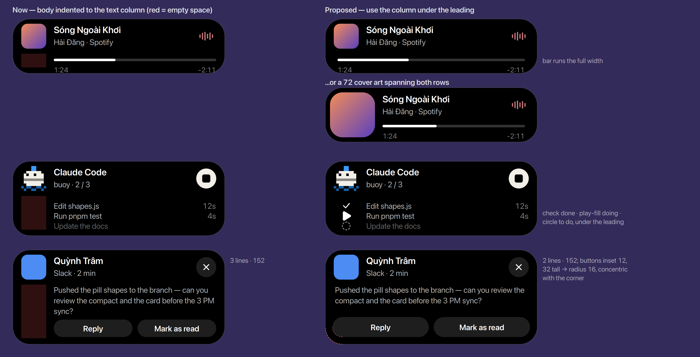

- **Fixed width** min(28em, 0.72 × expanded): 404 at 1920, 410 at 2560. It does not shrink to its
  content: shrunk, the round button sits right against the text and each compact is its own size,
  which looks bad; only the pill shrinks to its content. **Decided**
  (Ethan, 2026-11-12; was 16em … min(…), shrinking to content)
- No light in the compact ([Pill](../pill/index.md#lights-at-both-ends-buoy-light-left-privacy-dot-right)). **Decided**

## Music

- Music with a progress bar: **a 72 cover** fills both the head and the bar row (8 + 72 + 8 = 88),
  radius 20 (28 − 8, concentric with the corner). Music without a length (radio, live streams):
  the head only, a 40 picture, 56 tall. **Decided**

- **An equaliser in place of the ⏸ button** in the head: six 2 × 14 bars in the cover's colour
  ([Pill](../pill/index.md), "Equaliser"), centred in the round button's 32 slot (centre at
  y = 28, 14 from the right edge). Paused: the bars rest low, as on the pill. The compact no longer
  has ⏮ ⏯ ⏭; they are in the Media tab. **Decided** (Ethan, 2026-11-13)
- The equaliser is a **shared part** of the pill and the compact: it travels from the pill's
  trailing to this place with the background, no fade ([Motion](../motion/index.md), "Shared parts
  move to their new place"). Done, after the item "Motion: shared parts" (2026-11-13). **Decided**
  (Ethan, 2026-11-13)
- **That 32 slot is still the pause / play button, shown on hover:** at rest you see only the
  equaliser (running while playing, low while paused). Hover the slot: the equaliser turns into a
  round button like the other main buttons (`fill-inverse` background, `fill-inverse-hover` under
  the pointer; a ⏸ icon while playing, ▶ while paused), so on hover you see a white background, on
  keyboard focus a cream one; leave the slot: the equaliser comes back (Ethan, 2026-11-13: "like
  the other buttons"). Click to pause
  or play. They swap by a fade, nothing moves. The keyboard reaches the button (focus shows the
  button too); its name for screen readers: "Pause" or "Play". **Decided** (Ethan, 2026-11-13)

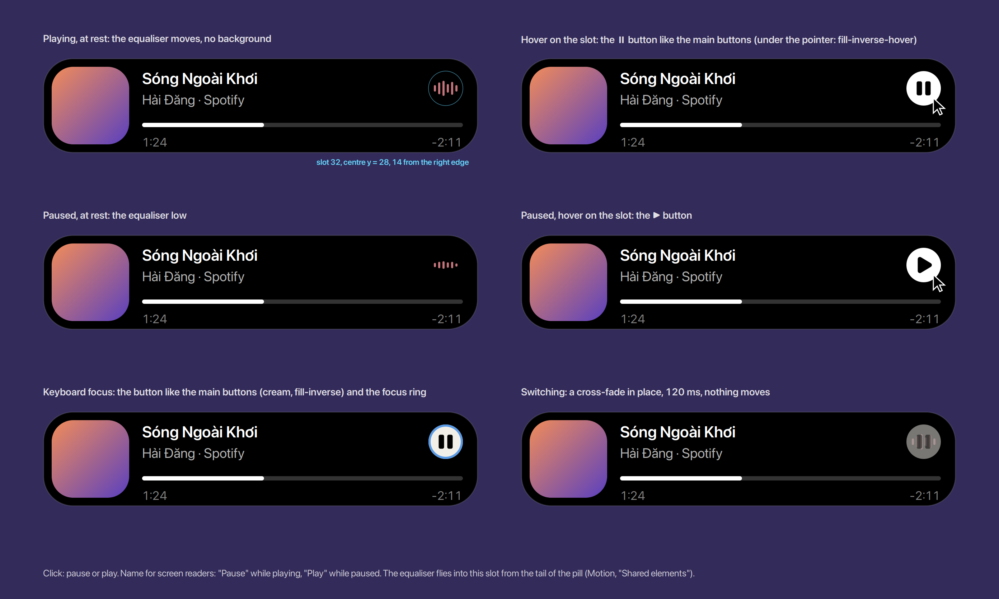

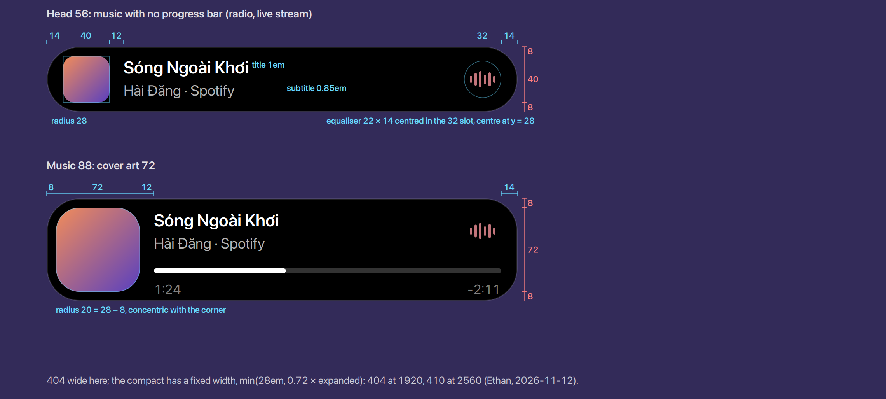

## Row list (Claude Code, missed list)

- At most 3 rows; each row has a status icon or an app icon in the column under the leading, its
  text aligned with the title. **Decided**
- 8 below the head, rows of 16 touching, 8 at the bottom: 56 + 8 + 16 × rows + 8 = 88 / 104 /
  **120**; text 0.85em centred in the row, the time right-aligned with the button. **Decided**
  (Ethan, 2026-11-10)
- Icon **16**, exactly the row's height, centred in the 40 leading column (12 from the leading's
  edge). **Decided** (Ethan, 2026-11-11; replaces the 14 icon of 2026-11-10. Considered: a gap
  between rows keeps the 56 + 16n rhythm only when it is a multiple of 16, so a gap of 4 or 8 needs
  its own make-up at the bottom; a gap of 16 makes 3 rows 152 tall)

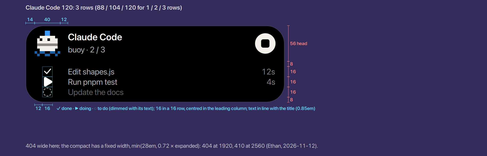

**Claude Code's rows are Claude's task list.** **Decided** (Ethan, 2026-11-11)

- Source: the `TaskCreate` tool (the task's name, `subject`) and `TaskUpdate` (`status`) through the
  `PreToolUse` / `PostToolUse` hooks; Claude also writes the list to
  `~/.claude/tasks/<session_id>/<id>.json`, so Buoy turned on mid-session can still read it. Tried
  with Claude Code 2.1.319 (2026-11-11); this version no longer has `TodoWrite`.
- Three states: **done** `check`, **in progress** `play-fill`, **pending** `circle-dashed`
  ([Icons](../icons/index.md)); pending tasks are dimmed like stale, icon and text both. White, no
  colour ([Colours](../colours/index.md)), still. **Decided** (Ethan, 2026-11-11; pending is
  `circle-dashed` instead of `circle`, 2026-11-12)
- More than 3 tasks: show the one just done, the one in progress, the next one; the line under the
  title gives the progress (`buoy · 2 / 5`).
- Claude makes no task list: the rows are the latest steps (tool calls), like today's
  "Running pnpm test" line.

## Notification card

- The head is like every compact's: a 40 avatar, the app's logo pinned at its bottom-right corner;
  no avatar: the 40 app logo, no badge. The top line is the sender, the line below
  "App · time"; a round 32 × button. **Decided**
- The message runs across the full width from the left padding, at most 2 lines (`MAX_CARD_LINES`
  stays 2), 16 per line, 8 below the head and 12 above the button row. The button row runs across
  the full width, 12 from the edges, 32 tall, radius 16 (concentric with radius 28). **Decided**
- Each button is as wide as its text, the rest shared evenly, as in GNOME's banners
  (`ui/messageList.js` `_addAction`: `x_expand`, the row not homogeneous): split into three equal
  parts, a button with long text ("Mark as Read") is cut off.
  **Decided** (Ethan, 2026-11-18)
- Height = 56 + 8 + 16 × lines + 12 + 32 + 12: **136** with 1 line, **152** with 2 — the same
  spacing in both. (Before, the body sat in the middle and the height rounded up to a 32 step, so a
  1-line card was 2 from the buttons, a 2-line card 10.) **Decided** (Ethan, 2026-11-10)
- Buttons 8 from the edge were considered and dropped: a 32-tall button can only have radius 16,
  while being concentric with the 28 corner at an 8 margin needs radius 20. **Decided** (Ethan,
  2026-11-10)

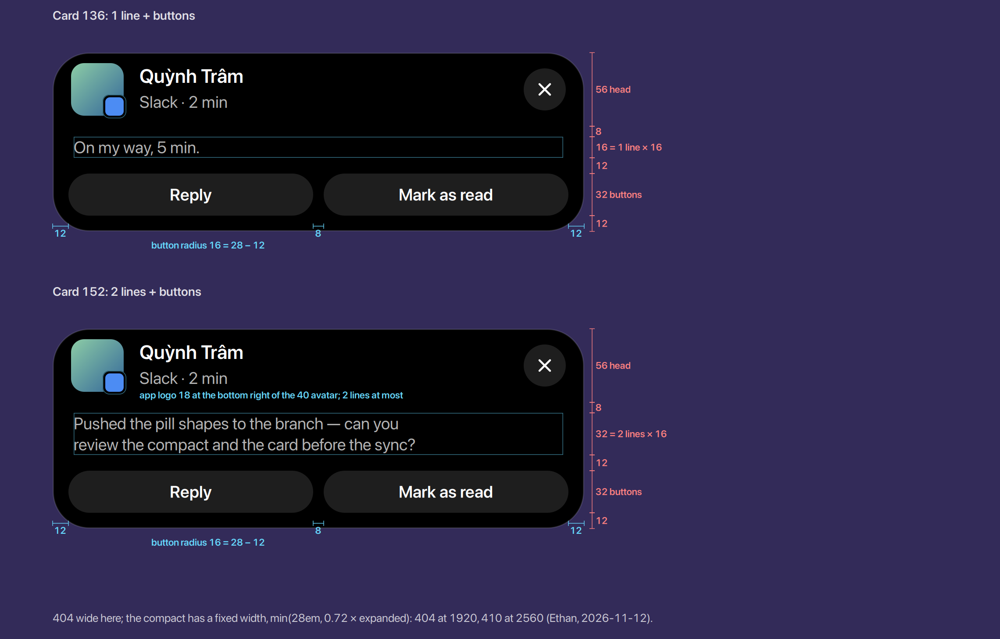

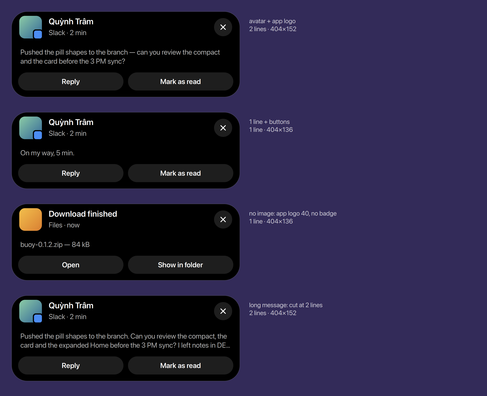

### Reply in the card

**Decided** (Ethan, 2026-11-11). Done (2026-11-18, "Phone via GSConnect" part 3): the Reply button
is there when the app on the phone allows replies (KDE Connect sends a reply id), the text goes
through GSConnect (`replyNotification`), no window opens; the Phone tab has the same entry on the
message's page. Only for sources that can take a reply: phone messages through GSConnect (M4
"Phone", Reply SMS). Desktop apps' notifications (Slack…) only have a Reply button that opens the
app: GNOME Shell does not support replying inside a notification (`notificationDaemon.js`,
`GetCapabilities` has no `inline-reply`).

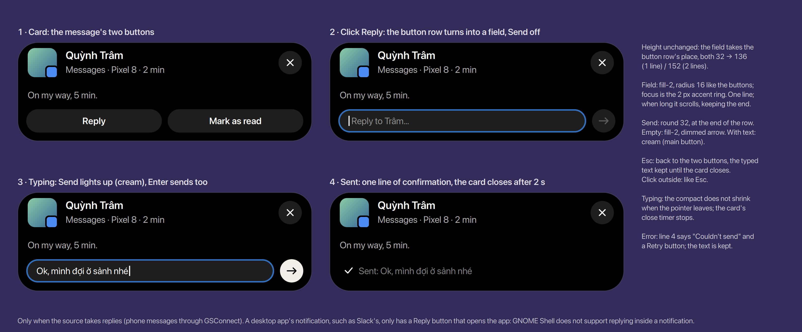

- Click Reply: the button row becomes a **one-line entry** and a **Send** button, both 32 tall, so
  the card stays 136 / 152.
- Entry `fill-2`, radius 16 like the buttons, a 2 px accent focus ring; long text scrolls, keeping
  the end in view.
- Send is a round 32 at the row's end, an arrow pointing right: empty, `fill-2` with a dim arrow;
  with text, cream (`fill-inverse`). Enter
  sends too.
- Esc or a click outside: back to the two buttons, the typed text kept until the card closes.
  While typing, the compact does not shrink back when the pointer leaves, and the card's close
  timer stops.
- Sent: a `check` line "Sent: …" (`fg-subtle`), the card closes after 2 s. Failed: "Couldn't send"
  and a Retry button, the text kept.

## Screen sharing and recording

Moved into Buoy's pill, in place of GNOME's two buttons on the bar (recording: a red button with a
clock; sharing: an orange button), with a Stop button, as below. **Decided** (Ethan, 2026-11-11)

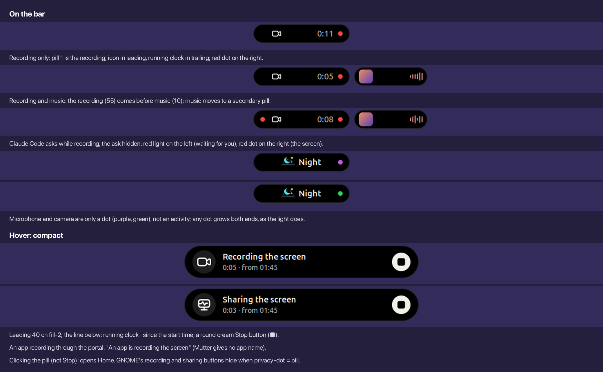

- **Two separate activities**, kind `screen`: the Shell's screen recording, and sharing (both can
  be on at once). The "running" tier, priority **55**: ahead of music, downloads, Claude Code at
  work; behind asks, calls and the short moments (osd, notifications). Not "needs you": no one
  waits for an answer.
- **The red dot is always on pill 1**, whether the screen activity is on a secondary pill or in
  `+N`: the dot speaks for the whole machine, not for one activity (like the light).
- **Pill:** the leading is an icon (recording: `video`; sharing: `display-pulse`), the text a clock
  running from the start, `0:42`. The clock ticks every second only
  while the pill is shown, like GNOME's button (`status/remoteAccess.js`, `ScreenRecordingIndicator`).
- **Compact on hover:** the 56 head only. Leading 40 on `fill-2`, a white icon; title "Recording
  the screen" / "Sharing the screen"; the line below `0:42 · from 14:03` (`fg-subtle`). A round 32
  Stop button, `fill-inverse`, a black `stop-fill`, centre y = 28.
- **Stop:** recording calls `Main.screenshotUI.stopScreencast()`; sharing calls `stop()` on every
  `MetaRemoteAccessHandle` that is not a recording, like GNOME's button. An app recording through
  the portal (a handle with `is-recording`): "An app is recording the screen". Mutter does not give
  the app's name. An app recording's Stop button stops only the app's handle: a handle born while
  the Shell is setting up its own recording (`screenshot.js` `_startScreencast`,
  `_screencastStarting`) is the Shell's.
- **Click the pill:** opens Home, where the recording is the main card or a tile
  ([Home](../home/index.md)); there is no tab of its own. Stopping is only by the button,
  so it does not happen by accident.
- Microphone and camera do not become activities: only the dot, and clicking opens Home.

Checked while coding (2026-11-14): Mutter only reports new sessions (`new-handle`), but GNOME's
sharing button and remote-access icon keep their handles (`_handles`), so Buoy turned on in the
middle of a share or a recording still sees them; the recording's clock takes the seconds GNOME's
button has counted (`_secondsPassed`).

The image above is captured from the Shell (2026-11-14), with the new pill layout: the icon in the
leading, the clock in the trailing (secondary pills too). On the pill the clock is the trailing, so
it takes the trailing's colour, not white text as in the old drawing.

## Battery and power mode

*Ethan, 2026-11-14 (M4 item "Power").* The battery is read from the UPower proxy Quick Settings
already holds (`ui/status/system.js` PowerToggle), the power mode from Quick Settings' mode button
(`ui/status/powerProfiles.js`): Buoy makes no proxy of its own.

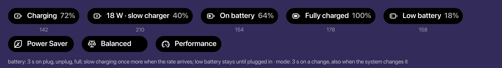

- **A 3 s flash** on the pill, as wide as its content (8 + 24 + 6 + text + 6 + trailing + 8, at
  least 131): plugged in "Charging · 72%"; unplugged "On battery · 64%"; full while plugged in
  "Fully charged · 100%", only at 100 %: UPower reporting FULL below that (the battery considers
  itself full at 96 %) or a battery held at a charge limit is "Plugged in · 96%"
  (Ethan, 2026-11-16: "Fully charged 96%" read wrong), in the flash, in the power-mode compact's
  line and in Home's battery tile. **The time once known**: UPower has an estimate 10–15 s after
  plugging in or out (`up-device-battery.c` up_device_battery_update_values: plugging in or out is
  a break, the rate is held at 0 for 10 s and then read every 5 s; a battery that does not report
  its own power needs 15 s of samples), so the flash usually says "Charging"; once it has one
  (plugged back in just after unplugging, or the estimate arrives while the flash is still up) it
  says "Full in 36 min · 65%". A new number only changes the text, **it does not extend the 3 s**
  (before, each UPower update restarted the 3 s, and the flash stayed on forever while charging).
  The time is always in Home's battery tile and the Device tab. **Decided** (Ethan, 2026-11-14;
  keeping the time: 2026-11-16)
- **Slow charger**: charging below 20 W while the battery is below 80 % (above 80 % the machine
  slows down by itself): when the rate arrives, within 30 s of plugging in, **one more flash**
  "18 W · slow charger", the time moves to the compact; once per plug-in. After 30 s, or if the
  rate cannot be read (EnergyRate), nothing. **Decided** (Ethan, 2026-11-14)
- **Low battery** (UPower: 20 % low, 5 % critical): "Low battery · 18%" (critical: "Battery almost
  empty") **stays until plugged in**, opens its compact once (and again on reaching critical); the
  compact says "25 min left" or "Plug in now". It **replaces GNOME's "Low Battery" notification**
  (gsd, the "Power" app): that notification does not become a pill. **Decided**
- **Priority**: the flash 40 (the `power` kind's level); low battery 70, the same as the
  notification it replaces, so music or an agent do not cover it. **Decided**
- **Mode change**: a 3 s pill "Balanced" (the mode's icon, no trailing) with the compact opening by
  itself, also when the machine changes it itself (low battery switching to Power Saver). No flash
  when Buoy has just been turned on. **Decided**
- Clicking the battery flash or the low-battery pill: opens Settings → Power. **Decided**

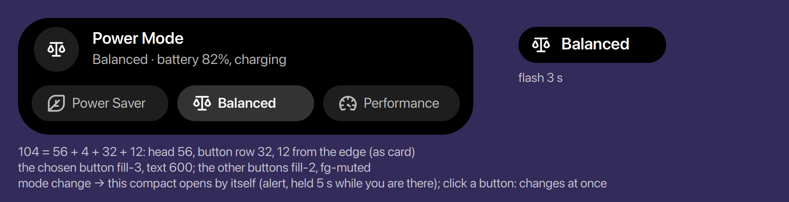

- **Mode change → a compact with 3 buttons opens by itself** (an alert, Ethan 2026-11-15; before,
  on hovering the flash; section "Displays and headphones plugged in"): the 56 head (a 40 `fill-2`
  disc like the screen-recording compact, with the mode's icon, "Power Mode", the line below by
  battery: "Balanced · battery 82%, charging", "· fully charged", "· plugged in, 80%" (held at a
  charge limit), "· battery 64%"), a 32 button row 12 from the edges like the card:
  104. The selected button `fill-3`, text 600; the others `fill-2`, `fg-muted`. Each button is as
  wide as its text, the rest shared evenly (split into three equal parts, a bold "Performance" is
  cut off). Click: changes at once, a new flash for the chosen mode. **Decided** (Ethan,
  2026-11-14: option C, together with the list in Home)

## Displays and headphones plugged in

*Ethan, 2026-11-15 (M4 item "Headphones / display plugged").* Displays are read from Mutter
(`global.backend.get_monitor_manager()`: `get_monitors()`, `monitors-changed`), headphones from the
Gvc mixer Quick Settings uses (`ui/status/volume.js`): listening to signals only, no polling.
**Decided**

- **Items with a choice open their compact by themselves** (an alert), not only a flash on the
  pill: a display plugged in (3 buttons), headphones plugged in but not used (the Use button), a
  power-mode change (3 buttons, section above). The buttons are there, no hover needed. The card
  holds 5 s **while you are there** (input, like every alert: [Alerts and
  asks](../alerts-and-asks/index.md)), so a screen going dark while plugging in does not eat it.
  Items that only tell stay flashes: a display unplugged, sound moved to headphones or back to the
  speakers, plugged in, unplugged, full. **Decided** (Ethan,
  2026-11-15: "only the items with buttons")

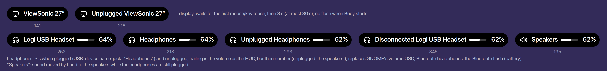

- **Display plugged in**: the compact opens by itself (below), then the pill "ViewSonic 27″" (icon
  `display`, the name Mutter gives the display, `Meta.Monitor.get_display_name()`). **Unplugged**:
  a flash "Unplugged ViewSonic 27″". Both **wait for you**: the screens go dark and come back while
  the machine sets the layout, and no signal says when they are back (3 s, then 6 s, were both over
  by then, Ethan). The pill stays until the first mouse or key touch after plugging in or out
  (Mutter's `add_user_active_watch`, as `ui/messageTray.js`), then 3 s; with no touch, 30 s. Only
  when the set of displays changes (connector, vendor, model, serial): changing how two displays
  are used does not flash. When Buoy is turned on, no flash for a display already plugged in.
  **Decided**
- **Headphones**: a 3 s flash when the sound goes out through headphones, the way GNOME recognises
  headphones (`OutputStreamSlider._findHeadphones`: a headset/headphone device, as USB; or a port
  with "headphone" in its name, as a jack). Text: the device's name for USB ("Logi USB Headset"),
  "Headphones" for a jack. The trailing is **the volume as in the HUD**: a 40 bar then the number,
  "64%"; muted, both dim. A bar so it is not misread as the battery: the battery is a battery shape
  drawn by level ([Device tab](../device/index.md),
  "Wireless"). **Decided** (Ethan, 2026-11-17) **Unplugging tells too** (Ethan, 2026-11-16): the
  headphones icon as in the display-unplugged flash, "Unplugged Headphones" for a jack,
  "Disconnected Logi USB Headset" for USB, the trailing the speakers' volume at that moment. Only
  when the headphones really go: the sink is gone, or the jack port reports nothing plugged in
  (`GvcMixerStreamPort.available`); switching to the speakers by hand in Quick Settings while the
  headphones are still plugged in: a flash "Speakers" with the volume. **Bluetooth headphones**:
  the Bluetooth flash says it, with the battery (bluetooth module); this module stays quiet when
  that one is on. **Decided**
- **Headphones plugged in but the sound still goes to the speakers** (Ethan's machine: a SOF card
  with two profiles, speakers and headphones; WirePlumber keeps the speakers profile): Gvc reports
  the headphones port just appeared (`output-added`, gvc-mixer-control.c), the compact opens by
  itself "Headphones · Sound on Speakers" with a **Use** button, which switches the output there as
  Quick Settings' output list does (`change_output`); then the headphones flash above. Pill
  "Headphones plugged in" for 3 s. Unplugged before being used: it goes. No offer in the first 3 s
  after the mixer comes up (it lists every output again). **Decided** (Ethan, 2026-11-15)
- **Replaces GNOME's volume OSD** that pops up then: when the port changes to or from headphones,
  GNOME calls `showOSD()` (`_portChanged`), as when the volume changes. With this module on, that
  OSD does not become a volume pill: the headphones flash speaks instead.
- **Priority**: 35 (the `device` kind): above music, below downloads and Claude Code.
- **Every flash that only tells is 3 s**: battery, mode, headphones, display (after the first
  touch), the pill after the headphones offer card, an app finishing its progress, the pill after a
  notification card; a finished download 4 s (clicking opens the file); feedback on an action
  (volume, copy, input method) 1.5 s. **Decided** (Ethan, 2026-11-16: was 2.5 / 3 / 4 / 6 s)
- **Clicking the pill**: a display opens Settings → Displays; headphones open Settings → Sound.
- The device picker dialog on plugging into a combo jack (gsd media-keys →
  `AudioDeviceSelection.Open`) stays GNOME's: Ethan's machine has no such jack.

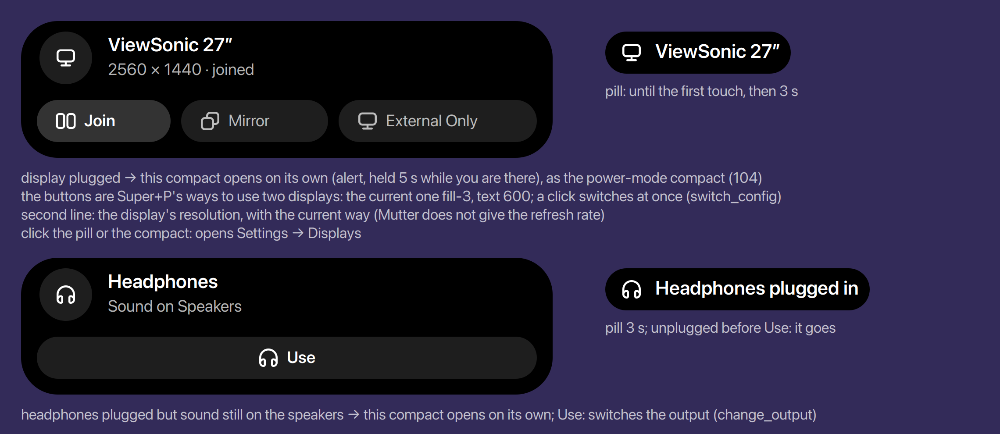

- **Display compact** (104), like the power-mode compact: a `fill-2` disc with the `display` icon,
  the display's name, the line below "2560 × 1440 · joined" (the display's resolution; Mutter does
  not expose the refresh rate). Buttons **Join / Mirror / External Only**, like GNOME's Super+P
  (`switchMonitor.js`), clicking changes at once (`switch_config`); no "Built-in Only": you plug in
  an external display to use it (Ethan). The button in use `fill-3`, text 600, by what Mutter is
  running: the laptop screen off is external only, one logical monitor with two displays is mirror,
  anything else is join (`get_switch_config()` does not know a layout set by hand in Settings). A
  machine without a laptop screen (`has_builtin_panel` false): only Join and Mirror, like GNOME.
  Cannot switch (`can_switch_config()` false): no buttons, only the flash. **Decided**
- **Headphones offer compact** (104): a disc with the `headphones` icon, "Headphones", the line
  below "Sound on Speakers"; one **Use** button with the headphones icon spanning the row (an
  ordinary button, not a choice button; a button with an icon draws the icon too, 2026-11-17).
  **Decided**
- These two items go in the Device tab's "Plugged in" group when that item is done.

## Windows that need attention

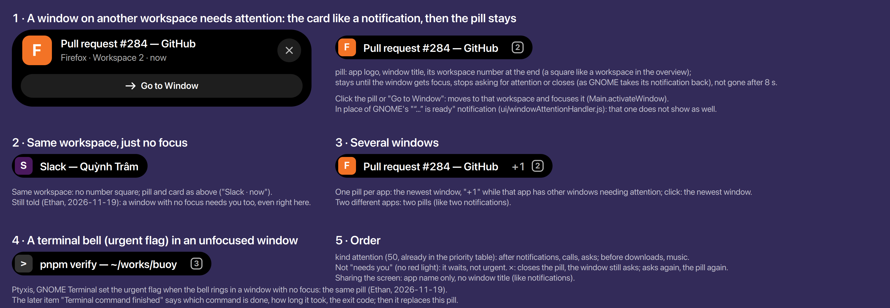

*Ethan, 2026-11-19 (M4 item "Attention on another workspace").*

- **When**: a window without focus asks for attention — Mutter `window-demands-attention`,
  `window-marked-urgent` (a link opened in a browser elsewhere, an app ready late, a terminal
  ringing its bell); not counting the focused window or windows not on the taskbar, like GNOME
  (`ui/windowAttentionHandler.js`). **Decided**
- **Pill** (kind `attention`, 50, module `attention`): the app's logo, the window title, at the end
  its workspace number in a 16 square with a 1.5 `fg-muted` border (like the workspaces in the
  Overview) when it is not the workspace in view; same workspace, no square (it still tells). It
  arrives like a notification: a 5 s card, then the pill **stays** until the window is focused,
  stops asking for attention or closes. One pill per app: the newest window, "+1" for the other
  windows. **Decided**
- **Card**: logo, title, "Firefox · Workspace 2 · now", a **Go to Window** button (`arrow-right`),
  ×. Clicking the pill or the button: switches to that workspace and focuses the window
  (`Main.activateWindow`). ×: dismisses the pill, the window still asks for attention; asking again
  brings the pill back. No tab. **Decided**
- **Replaces GNOME**: the "“…” is ready" notification does not show while the module runs (the
  Shell's handler is disconnected, reconnected when it is off). Screen sharing: only the app's
  name. A terminal ringing its bell shares the pill; a finished command has its own pill
  ([Terminal command finished](#terminal-command-finished)). **Decided**

## Meeting soon

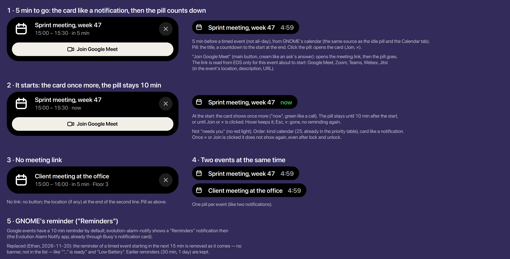

*Ethan, 2026-11-20 (M4 item "Meeting in 5 min · Join").*

- **When**: a timed event (not all-day) in GNOME's calendar — the same source as the idle pill and
  the Calendar tab (date menu) — from 5 minutes before it starts to 10 minutes after (or until it
  ends, if sooner). **Decided**
- **Pill** (kind `calendar`, 25, module `calendar`): a calendar icon, the title, at the end a
  countdown to the start; at the start "now" in green (`#30D158`, like a call in progress). One
  pill per event. Not "needs you". **Decided**
- **Card**: title, "15:00 – 15:30 · in 5 min" (· the location if any), a **Join Google Meet** button
  (Zoom, Teams, Webex, Jitsi; `video`) as the main button, cream like an ask's answer
  (`fill-inverse`, text `fg-on-inverse`: the palette has no green button), and ×. The card comes at
  5 minutes left and again at the start. No link: no button. Join opens the link and dismisses the
  pill; × dismisses the pill; neither comes back, not even after locking. **Decided**
- **Meeting link**: read from EDS only for an event about to start (`X-GOOGLE-CONFERENCE`, `URL`,
  `LOCATION`, `DESCRIPTION`), as the Shell's calendar server sends only the id, title and times.
  Screen sharing: "Event", no title, no location. **Decided**
- **Replaces GNOME**: evolution-alarm-notify's "Reminders" for an event starting in the next 15
  minutes (Google's default 10-minute reminder) are taken down as soon as they arrive: no banner,
  not in the list. Earlier reminders stay. Off with `calendar-meeting-alert` (Modules → Calendar).
  **Decided**
- **Online calendars refresh**: GNOME (EDS) refreshes Google, Microsoft and CalDAV calendars only
  every 60 minutes, so an event made on the web or a phone close to its time can arrive later than
  the meeting. Modules → Calendar → "Refresh online calendars": **As GNOME** (hourly) by default;
  at 5, 10, 15, 30 minutes Buoy asks EDS to refresh the online calendars shown
  (`Calendar.Refresh`). **Decided** (Ethan, 2026-11-20)

## Terminal command finished

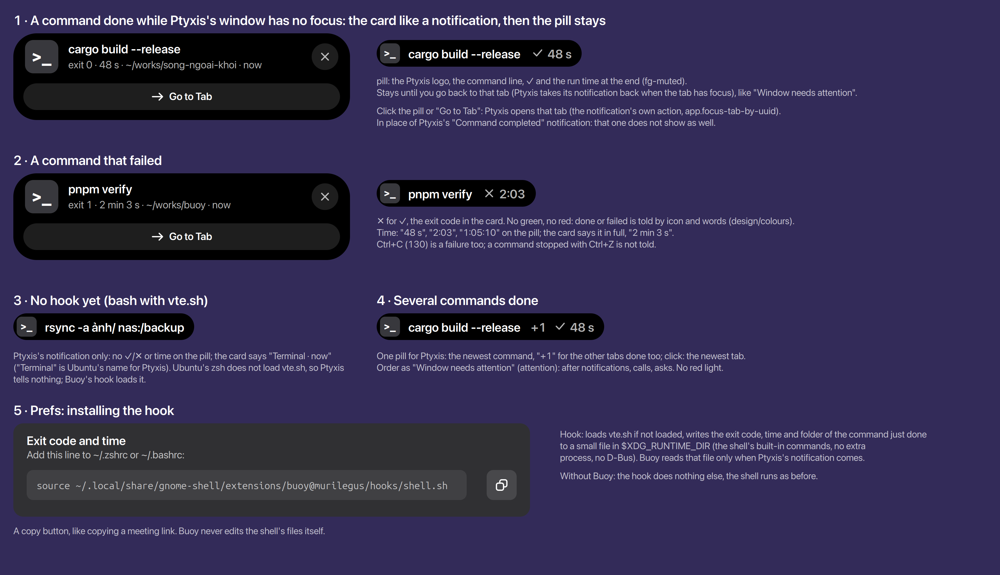

*Ethan, 2026-11-21 (M4 item "Terminal command finished in an unfocused tab").*

- **When**: Ptyxis sends "Command completed" when a command that ran 250 ms or more finishes while
  its window is not focused (ptyxis-tab-notify.h). Buoy takes that notification: no banner, and it
  does not become a notification pill. Window focused and the command finishes in another tab:
  Ptyxis sends nothing, Buoy tells nothing. **Decided**
- **Pill** (kind `terminal`, 50, module `terminal`): Ptyxis's logo, the command line, at the end ✓
  or ✕ and the run time (`fg-muted`): "48 s", "2:03", "1:05:10". No green, no red. One pill for
  Ptyxis: the newest command, "+1" for the other tabs. Not "needs you". **Decided**
- **Card**: the command line, "exit 0 · 48 s · ~/works/buoy · now", a **Go to Tab** button
  (`arrow-right`), ×. It arrives like a notification, then the pill stays until you return to that
  tab (Ptyxis takes its notification back), remove it from GNOME's list, or ×. Clicking the pill or
  the button: the notification's own action, Ptyxis opens the right tab. **Decided**
- **Shell hook** (`hooks/shell.sh`): one `source …` line in `~/.zshrc` or `~/.bashrc`, copied from
  prefs (Modules → Terminal commands → Exit code and time); Buoy does not edit the shell's files.
  The hook loads `vte.sh` if the shell has not (Ubuntu's zsh does not, so Ptyxis tells nothing) and
  sends the "preexec" that `vte.sh` sends only in bash. When a command finishes it writes the exit
  code, start time, end time, directory (and the command line, zsh) to
  `$XDG_RUNTIME_DIR/buoy-shell-<pid>` with the shell's builtins: no process, no D-Bus. Buoy reads
  it only when Ptyxis's notification arrives, taking a record that finished within 10 s with the
  same command. **Decided**
- **No hook**: the pill has only Ptyxis's command line; the card "Terminal · now" (the name Ubuntu
  gives Ptyxis). Screen sharing: "Command finished", no command, no directory. **Decided**

## Timer

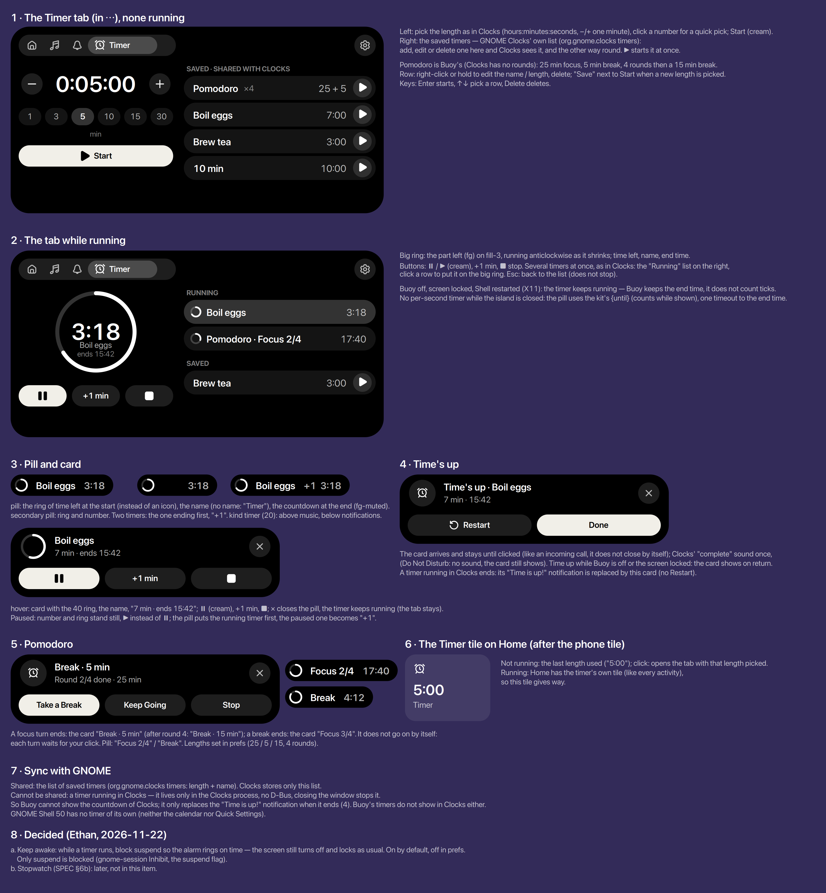

*Ethan, 2026-11-22 (M4 item "Timer").*

- **Timer tab** (in ⋯): on the left, a time picker like Clocks (h:mm:ss, −/+ one minute, 1 · 3 · 5 ·
  10 · 15 · 30 minutes), **Start** (cream), **Save** when that time is not saved yet. With a timer
  on, the left is the 116 ring of the one ending soonest (or the selected one): the time left, the
  name, the end time; ⏸ (cream), +1 minute, ■. On the right: **Running** (click to select,
  "New Timer" goes back to the time picker), then **Saved** — Pomodoro and GNOME Clocks' list; ▶
  starts at once; right-click (or the Menu key): edit the name and time (on the left), delete;
  Delete: delete. Esc: from the ring back to the time picker, then close. **Decided**
- **Pill** (kind `timer`, 20): the remaining ring at the start, the name ("Timer" when unnamed),
  the countdown; several timers: the running one ending soonest first, "+1". Card: ring,
  "7 min · ends 15:42", ⏸ / +1 min / ■, × hides the pill until the timer changes (it keeps
  running). The ring and the number redraw every second only while shown (the kit's `{ring}`,
  `{until}`); the source has only one timeout, to the nearest end. **Decided**
- **Time's up**: its own card that stays until clicked (`alertStays`), **Restart**, **Done**
  (cream), × is Done; the "complete" sound once, silent under Do Not Disturb. Time up while Buoy is
  off (locked, restarted): the card shows on return; timers survive restarts (`timer-state`, the
  end time, not a count). **Decided**
- **Pomodoro** (Buoy's own): 25 minutes of work, 5 of break, 4 rounds then a 15 break (prefs). End
  of a work round: a card **Take a Break** (cream) / **Keep Going** / **Stop**; end of a break:
  **Start Focus** / **Stop**. Nothing starts by itself. Pill "Focus 2/4" / "Break". **Decided**
- **Home tile** (after the phone tile): when nothing runs, the last time used and "Timer"; clicking
  opens the tab with that time. While a timer runs, Home has the activity's own tile, and this tile
  gives way. **Decided**
- **GNOME Clocks**: the saved list is `org.gnome.clocks timers` (time + name), shared both ways.
  Clocks' running timers live only in its process (no D-Bus), so Buoy cannot show them; its "Time
  is up!" is taken down when it arrives, replaced by a card "Time's up · Clocks" (Done only).
  **Decided**
- **Keep awake** (`timer-keep-awake`, on): while a timer runs, ask gnome-session not to sleep
  (Inhibit, suspend only); the screen still blanks and locks. Stopwatch: later. **Decided**

## Network

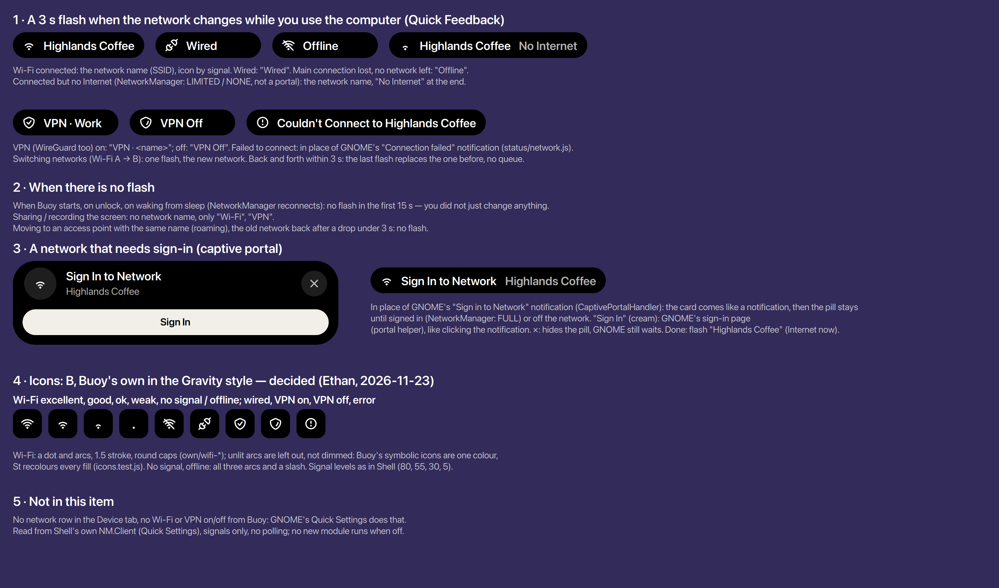

*Ethan, 2026-11-23 (M4 item "VPN / Wi-Fi / captive portal").* Read from the Shell's own `NM.Client`
(Quick Settings, `ui/status/network.js`), listening to signals only. **Decided**

- **A 3 s flash** (kind `network`, 35): Wi-Fi connected (the network's name, icon by signal), wired
  (the connection's name, unnamed: "Wired"), no network at all ("Offline", after 3 s: the old
  network reconnecting within 3 s shows nothing), VPN on ("VPN · <name>", WireGuard too) and off
  ("VPN Off"), connected without Internet after 5 s ("No Internet" at the end, once per
  connection). A later flash replaces the earlier one. Connection failed: replaces GNOME's
  "Connection failed" with "Couldn't Connect to <network being joined>". **Decided**
- **No flash** in the first 15 s after Buoy turns on (login, unlock) or the machine wakes:
  NetworkManager reconnects by itself. Roaming (same connection): no. Screen sharing: "Wi-Fi",
  "Wired", "VPN", no names. **Decided**
- **Network sign-in**: replaces GNOME's "Sign in to Network" (`CaptivePortalHandler`): a card
  arrives, then the pill stays until the Shell takes its notification down (Internet reached, left
  the network); **Sign In** (cream) acts like clicking the notification: GNOME's sign-in page. ×:
  hides the pill, the notification stays in GNOME's list. Signed in: a flash with the network's
  name. **Decided**
- **Icons B**: Wi-Fi drawn in Gravity style (`own/wifi-*`: a dot and arcs in 1.5 strokes), levels
  as in the Shell (80, 55, 30, 5); unlit arcs left out, not dimmed (a one-colour symbolic icon); no
  signal / no network has a slash. Wired `plug-connection`, VPN `shield-check` / `shield`, error
  Gravity's `circle-exclamation`. **Decided**
  (Ethan, 2026-11-23)
- No network row in the Device tab, no turning networks on or off from Buoy: Quick Settings does
  that. **Decided**

## Print jobs

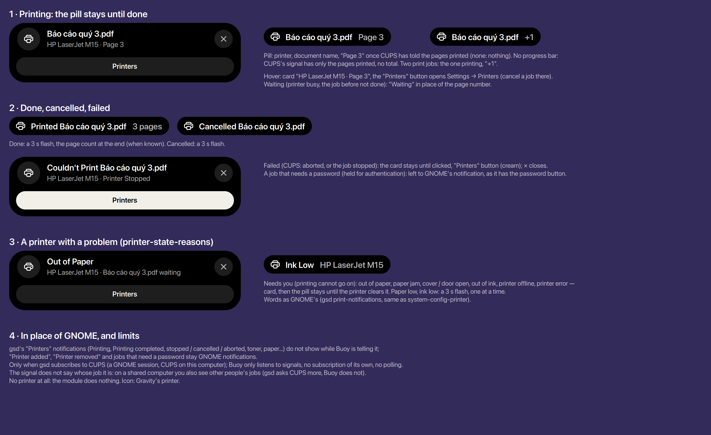

*Ethan, 2026-11-23 (M4 item "Print job progress").* Reads CUPS's own D-Bus signals
(`org.cups.cupsd.Notifier` on the system bus, cups `notifier/dbus.c`), which CUPS sends for gsd's
subscription (print-notifications `renew_subscription`); Buoy adds no subscription and does not
poll. **Decided**

- **Printing** (kind `print`, 30): the pill stays until done: the printer, the document's name,
  "Page 3" once CUPS has said so (`job-impressions-completed`, sent when the job changes state;
  there is no total, so no progress bar), "Waiting" while waiting, "+1" when there is another job.
  Card: the printer's name, a **Printers** button (Settings → Printers). **Decided**
- **Done**: a 3 s flash "Printed …" with the page count; **cancelled**: "Cancelled …"; **failed**
  (aborted, stopped): a card that stays until ×, Printers (cream). A job that needs a password:
  left to GNOME's notification (it has a button). **Decided**
- **Printer with a problem** (`printer-state-reasons`), only while that printer has a job: out of
  paper, paper jam, cover / door open, out of ink, offline, configuration error: a card, then a pill
  until the error clears; paper / ink low: a flash, once until it clears. Wording as GNOME's.
  **Decided**
- **Replaces GNOME**: gsd's "Printers" notifications about the very job or printer Buoy is showing
  do not become a notification pill (`printShows`); "Printer added" and jobs needing a password stay
  GNOME's. The signal does not say whose job it is: on a shared machine you see other people's jobs
  too. **Decided**

## In a call

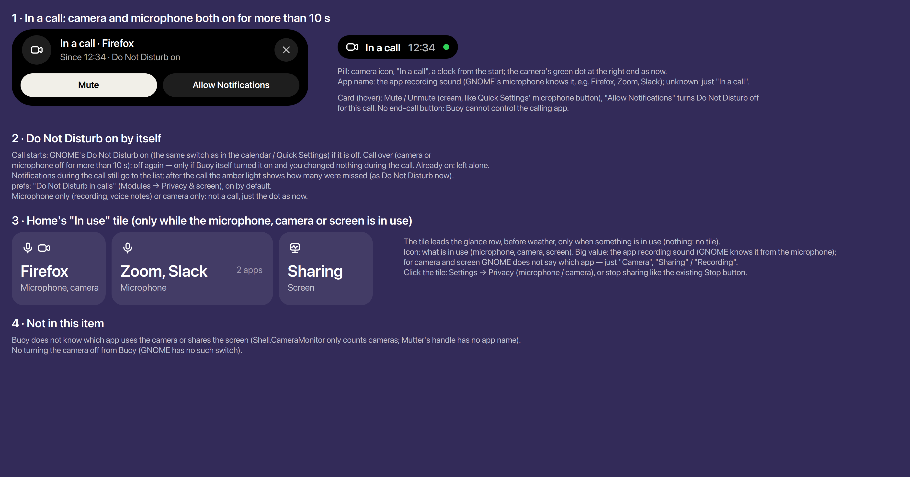

*Ethan, 2026-11-27 (M4 item "Privacy dot", the rest).* Camera and microphone both on for more than
10 s is a call; only one of the two (a voice recording, a voice note) gives just the dot, as now.
**Decided**

- **Pill** (kind `screen`, `what: 'call'`): a camera icon, "In a call", a clock from the start
  (counting the 10 s wait), a green dot at the right end. The call ends when the camera or the
  microphone is off for more than 10 s. **Decided**
- **Card** (hover): "In a call · Firefox" — the app recording, whose name GNOME's mixer knows
  (`get_source_outputs`); unknown, just "In a call". The line below **"Since 10:35"**, no running
  clock (unlike the drawing: the pill already runs one), adding "· Do Not Disturb on" when Buoy
  turned it on. A **Mute** / **Unmute** button (cream) toggles the microphone like Quick Settings'
  button; **Allow Notifications** turns Do Not Disturb off for this call. No end button: Buoy cannot
  control the calling app. **Decided**
- **Do Not Disturb**: at the call's start, turn off `show-banners` (the same switch as in the
  calendar) if it is on; at its end turn it back on, only if Buoy itself turned it off and you
  changed nothing during the call. prefs: "Do Not Disturb in calls" (`privacy-call-dnd`, on by
  default). **Decided**
- **The "In use" tile in Home**: first among the glances, only while the microphone or the camera
  is in use. One icon (the camera if on, else the microphone — unlike the drawing's two icons, a 128
  tile has no room), the big text is the recording app's name or "Camera", the line below
  "Microphone, camera", "2 apps" when several. Click: Settings → Privacy. The screen has no such
  tile: sharing and recording already have their activity's tile, with Stop. **Decided**

## In the code

- `lib/kit/model/shapes.js` — `COMPACT_H` → 56 + 16n by content; `CARD_MAX_H` 160 → 152; compact
  `r` 24 → 28.
- `lib/kit/ui/present/compact.js` — drop `lightDot` in `compactBox` and `cardBox`; the leading in
  its own slot; a 72 cover for the music compact; each row's icon in the leading column; the card
  shares the head (avatar + badge), body and buttons spanning the width.
- `lib/kit/model/presentation.js` — `MAX_CARD_LINES` stays 2; `MAX_ROWS` stays 3.
- `stylesheet.css` — the compact's row and card styles.
- `lib/modules/attention/` — windows that need attention (`tests/attention.test.js`); the
  `{workspace, more}` element (`kit/model/presentation.js`, drawn in `kit/ui/present/elements.js`).
- `lib/modules/print/` — print jobs (`tests/print.test.js`); `printShows` in
  `modules/notification/adapter.js`.
- `lib/modules/network/` — network (`tests/network.test.js`).
- `lib/modules/privacy/` — in a call, the "In use" tile (`call.js`, `glance.js`, `store.js`;
  `tests/call.test.js`).
- `lib/modules/timer/` — timer (`tests/timer.test.js`); the `{ring: {from, until}}` and
  `{until, more}` elements (`kit/model/presentation.js`, drawn in `kit/ui/present/elements.js`).
- `lib/modules/terminal/`, `hooks/shell.sh` — terminal command finished (`tests/terminal.test.js`);
  the `{icon, label, more}` element (`kit/model/presentation.js`, drawn in
  `kit/ui/present/elements.js`).
- SPEC §4 (size table); NOTIFICATIONS.md §3 (card).
