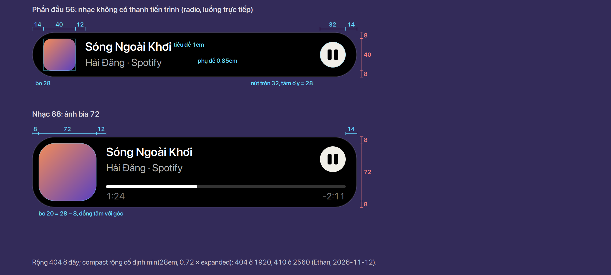
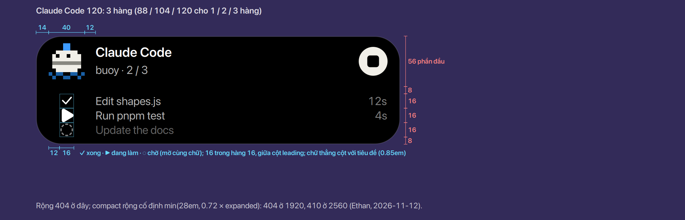
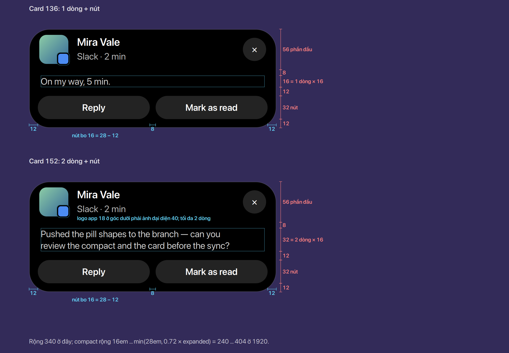
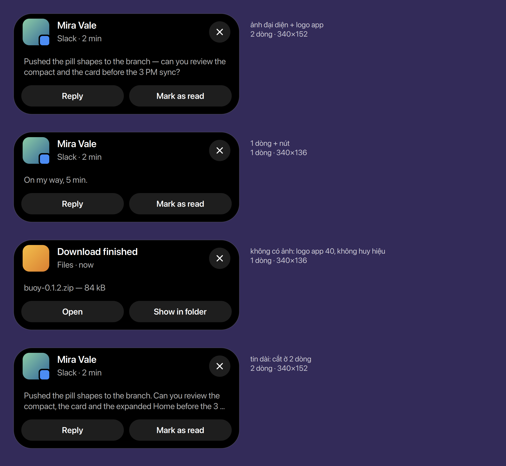
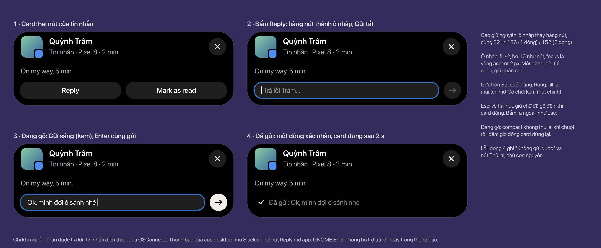
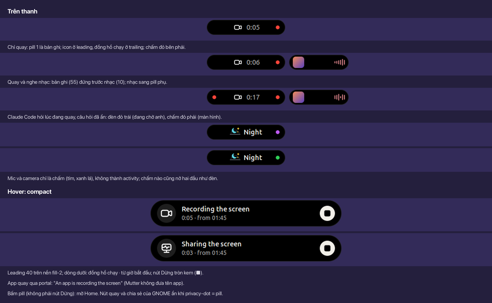
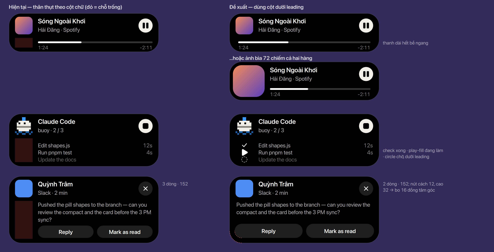

# Compact

Dạng hiện khi rê chuột vào một pill 300 ms, và dạng của card thông báo. Alert và ask cũng dùng cỡ
này ([Alert và ask](../alerts-and-asks/index.vi.md)). Số dùng chung ở [Bảng số](../tokens.vi.md).

## Kích thước

- Chiều cao **56 + 16n**, tối đa 152: phần đầu 56, rồi nội dung tính theo dòng 16 — một bậc bằng
  một dòng chữ, cho mọi compact, không ngoại lệ (trước là 56 / 88 / ≤ 120, card ≤ 160). Nhạc 56,
  nhạc 88, Claude Code 3 hàng 120, card 136 / 152. **Chốt** (Ethan, 2026-11-10; thay cho 56 + 32n:
  với bậc 32 mà dòng 16, card 1 dòng và 2 dòng không thể cách nút đều nhau)
- **Bo 28** cho mọi compact, nên góc trên luôn là hình tròn của phần đầu 56 (trước là 24). **Chốt**
- Phần đầu 56 = pill idle × 1.75: leading 40, trên dưới 8, hai bên 14. Chữ không phóng theo;
  phần đầu chứa hai dòng (tiêu đề 1em, phụ đề 0.85em). Nút là hình tròn 32, tâm nằm trên đường
  giữa phần đầu (y = 28), cùng hàng với leading. **Chốt** (Ethan, 2026-11-11)
- **Rộng cố định** min(28em, 0.72 × expanded): 404 ở 1920, 410 ở 2560. Không co theo nội dung: co
  thì nút tròn đứng sát chữ và mỗi compact một cỡ, trông xấu; co theo nội dung chỉ ở pill. **Chốt**
  (Ethan, 2026-11-12; trước là 16em … min(…), co theo nội dung)
- Không có đèn trong compact ([Pill](../pill/index.vi.md#đèn-ở-hai-đầu-buoy-light-trái-privacy-dot-phải)). **Chốt**

## Nhạc

- Cột dưới leading không bao giờ để trống. **Chốt**
- Nhạc có thanh tiến trình: **ảnh bìa 72** chiếm cả phần đầu lẫn hàng thanh (8 + 72 + 8 = 88), bo
  20 (28 − 8, đồng tâm với góc). Nhạc không có thời lượng (radio, luồng trực tiếp): chỉ phần đầu,
  ảnh 40, cao 56. **Chốt**

## Danh sách hàng (Claude Code, danh sách missed)

- Tối đa 3 hàng; mỗi hàng có icon trạng thái hoặc icon app ở cột dưới leading, chữ thẳng cột với
  tiêu đề. **Chốt**
- Cách phần đầu 8, mỗi hàng 16 sát nhau, dưới cùng 8: 56 + 8 + 16 × số hàng + 8 = 88 / 104 /
  **120**; chữ 0.85em canh giữa hàng, thời gian canh phải theo nút. **Chốt** (Ethan, 2026-11-10)
- Icon **16**, đúng bằng hàng, giữa cột leading 40 (cách mép leading 12). **Chốt** (Ethan,
  2026-11-11; thay icon 14 của 2026-11-10. Đã cân nhắc: khe giữa hàng chỉ giữ nhịp 56 + 16n khi là
  bội của 16, nên khe 4 hay 8 phải bù riêng ở dưới; khe 16 làm 3 hàng cao 152)

**Hàng của Claude Code là danh sách việc của Claude.** **Chốt** (Ethan, 2026-11-11)

- Nguồn: tool `TaskCreate` (tên việc, `subject`) và `TaskUpdate` (`status`) qua hook `PreToolUse` /
  `PostToolUse`; Claude cũng ghi danh sách ở `~/.claude/tasks/<session_id>/<id>.json`, nên Buoy
  bật lại giữa phiên vẫn đọc được. Thử với Claude Code 2.1.319 (2026-11-11); bản này không còn
  `TodoWrite`.
- Ba trạng thái: **xong** `check`, **đang làm** `play-fill`, **chờ** `circle-dashed` ([Icon](../icons/index.vi.md));
  việc chờ mờ như stale, cả icon lẫn chữ. Trắng, không màu ([Bảng màu](../colours/index.vi.md)),
  đứng yên. **Chốt** (Ethan, 2026-11-11; chờ là `circle-dashed` thay `circle`, 2026-11-12)
- Nhiều hơn 3 việc: hiện việc vừa xong, việc đang làm, việc kế tiếp; dòng dưới tiêu đề ghi tiến độ
  (`buoy · 2 / 5`).
- Claude không lập danh sách việc: hàng là các bước gần nhất (lời gọi tool), như dòng
  "Running pnpm test" hiện nay.

## Card thông báo

- Phần đầu giống mọi compact: ảnh đại diện 40, logo app gắn ở góc dưới bên phải; không có ảnh đại
  diện thì dùng logo app 40, không gắn huy hiệu. Dòng trên là người gửi, dòng dưới là
  "App · thời gian"; nút × tròn 32. **Chốt**
- Nội dung tin trải hết bề ngang từ lề trái, tối đa 2 dòng (`MAX_CARD_LINES` giữ 2), mỗi dòng 16,
  cách phần đầu 8 và cách hàng nút 12. Hàng nút trải hết bề ngang, cách mép 12, cao 32, bo 16
  (đồng tâm với bo 28). **Chốt**
- Chiều cao = 56 + 8 + 16 × số dòng + 12 + 32 + 12: **136** khi 1 dòng, **152** khi 2 dòng — cùng
  khoảng cách ở cả hai. (Trước đây thân ở giữa và chiều cao làm tròn lên bậc 32, nên card 1 dòng
  cách nút 2, card 2 dòng cách nút 10.) **Chốt** (Ethan, 2026-11-10)
- Nút cách mép 8 đã cân nhắc và bỏ: nút cao 32 chỉ bo được 16, trong khi đồng tâm với góc 28 ở lề 8
  cần bo 20. **Chốt** (Ethan, 2026-11-10)

### Trả lời ngay trong card

**Chốt** (Ethan, 2026-11-11). Chỉ cho nguồn nhận được trả lời: tin nhắn điện thoại qua GSConnect (M4
"Phone", Reply SMS). Thông báo của app desktop (Slack…) chỉ có nút Reply mở app: GNOME Shell không
hỗ trợ trả lời ngay trong thông báo (`notificationDaemon.js`, `GetCapabilities` không có
`inline-reply`).

- Bấm Reply: hàng nút thành **ô nhập một dòng** và nút **Gửi**, cùng cao 32, nên card vẫn 136 / 152.
- Ô nhập `fill-2`, bo 16 như nút, vòng focus accent 2 px; chữ dài thì cuộn, giữ phần cuối.
- Gửi tròn 32 ở cuối hàng, mũi tên sang phải: rỗng thì `fill-2`, mũi tên mờ; có chữ thì kem (`fill-inverse`). Enter
  cũng gửi.
- Esc hoặc bấm ra ngoài: về hai nút, giữ chữ đã gõ đến khi card đóng. Đang gõ thì compact không thu
  lại khi chuột rời, và đếm giờ đóng card dừng.
- Đã gửi: một dòng `check` "Đã gửi: …" (`fg-subtle`), card đóng sau 2 s. Lỗi: "Không gửi được" và nút
  Thử lại, chữ còn nguyên.

## Chia sẻ và quay màn hình

Chuyển vào pill của Buoy, thay cho hai nút của GNOME trên thanh (quay: nút đỏ có đồng hồ;
chia sẻ: nút cam), có nút Dừng, như dưới đây. **Chốt** (Ethan, 2026-11-11)

- **Hai activity riêng**, kind `screen`: quay màn hình của Shell, và chia sẻ (mỗi lúc có thể có cả
  hai). Tầng "đang chạy", priority **55**: trước nhạc, tải về, Claude Code đang làm; sau ask, cuộc gọi
  và các khoảnh khắc ngắn (osd, thông báo). Không phải "cần bạn": không ai chờ câu trả lời.
- **Chấm đỏ luôn ở pill 1**, dù activity màn hình đang ở pill phụ hay `+N`: chấm nói về cả máy,
  không thuộc activity nào (như đèn).
- **Pill:** leading là icon (quay: `video`; chia sẻ: `display-pulse`), chữ là đồng hồ chạy từ lúc bắt đầu, `0:42`. Đồng hồ nhảy mỗi giây chỉ
  khi pill đang hiện, như nút của GNOME (`status/remoteAccess.js`, `ScreenRecordingIndicator`).
- **Compact khi hover:** chỉ phần đầu 56. Leading 40 nền `fill-2`, icon trắng; tiêu đề "Đang quay
  màn hình" / "Đang chia sẻ màn hình"; dòng dưới `0:42 · từ 14:03` (`fg-subtle`). Nút Dừng tròn 32,
  `fill-inverse`, `stop-fill` đen, tâm y = 28.
- **Dừng:** quay gọi `Main.screenshotUI.stopScreencast()`; chia sẻ gọi `stop()` trên mọi
  `MetaRemoteAccessHandle` chưa phải bản ghi, như nút của GNOME. App quay qua portal (handle có
  `is-recording`): "Ứng dụng đang quay màn hình". Mutter không đưa tên app.
- **Bấm vào pill:** mở Home, nơi bản ghi là thẻ chính hoặc một ô ([Home](../home/index.vi.md));
  không có tab riêng. Dừng chỉ bằng nút,
  để không lỡ tay.
- Mic và camera không thành activity: chỉ chấm, bấm mở Home.

Cần kiểm khi code: Mutter chỉ báo phiên mới (`new-handle`), không có hàm liệt kê phiên đang có, nên
khi Buoy bật giữa lúc đang chia sẻ thì chưa biết phiên đó.

## Phương án đã cân nhắc

Phần thân thụt theo cột chữ (như hiện tại) so với tận dụng cột dưới leading; với nhạc, phương án
còn lại là thanh trải hết bề ngang.

## Chỗ trong code

- `lib/kit/model/shapes.js` — `COMPACT_H` → 56 + 16n theo nội dung; `CARD_MAX_H` 160 → 152; compact `r`
  24 → 28.
- `lib/kit/ui/present/compact.js` — bỏ `lightDot` trong `compactBox` và `cardBox`; leading trong ô của nó;
  ảnh bìa 72 cho compact nhạc; icon từng hàng ở cột leading; card dùng chung phần đầu (ảnh đại
  diện + huy hiệu), thân và nút trải ngang.
- `lib/kit/model/presentation.js` — `MAX_CARD_LINES` giữ 2; `MAX_ROWS` giữ 3.
- `stylesheet.css` — style hàng và card của compact.
- SPEC §4 (bảng kích thước); NOTIFICATIONS.md §3 (card).
