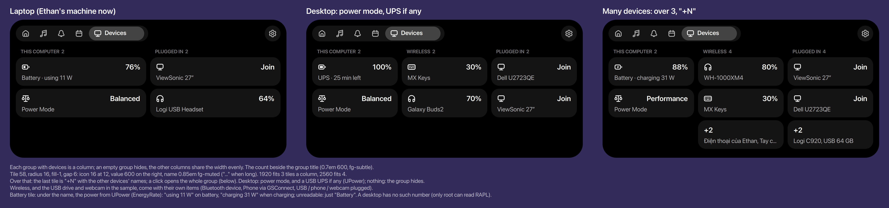
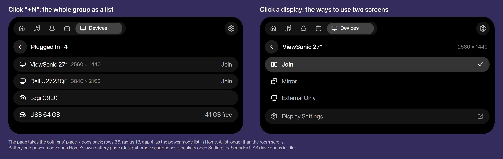
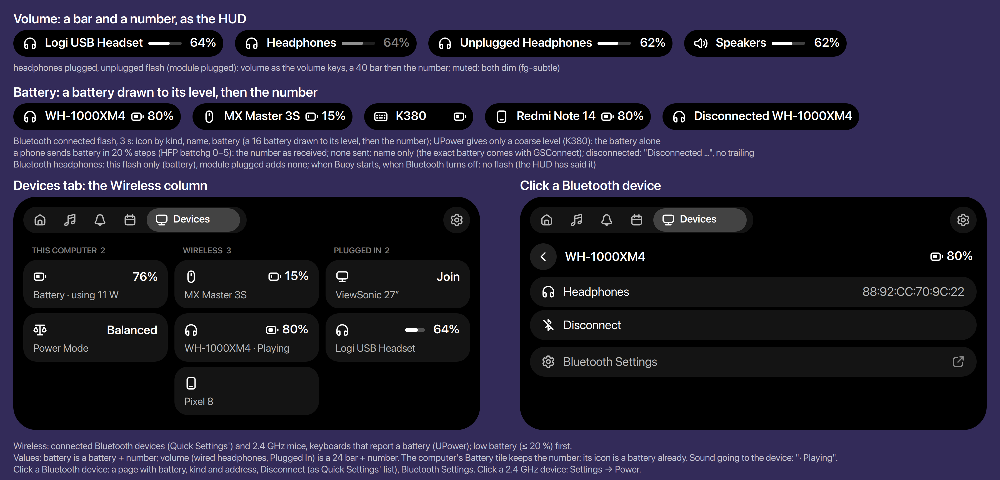
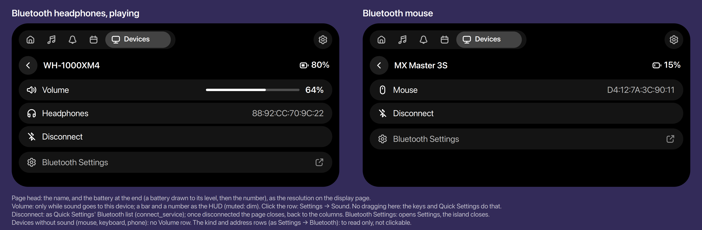
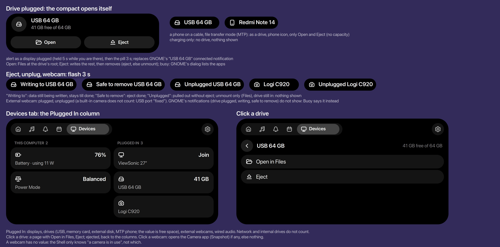
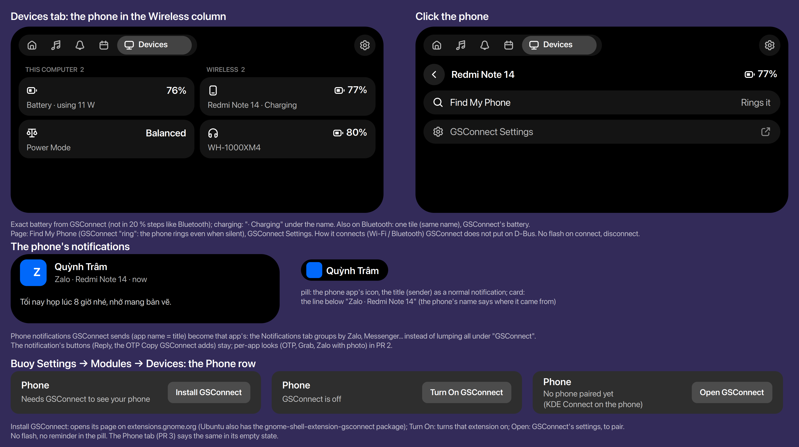
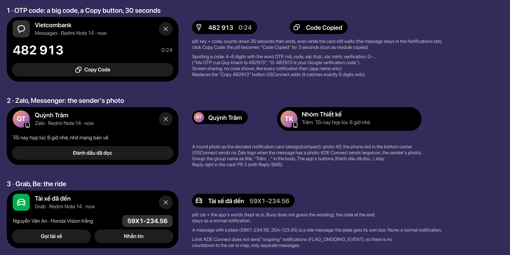
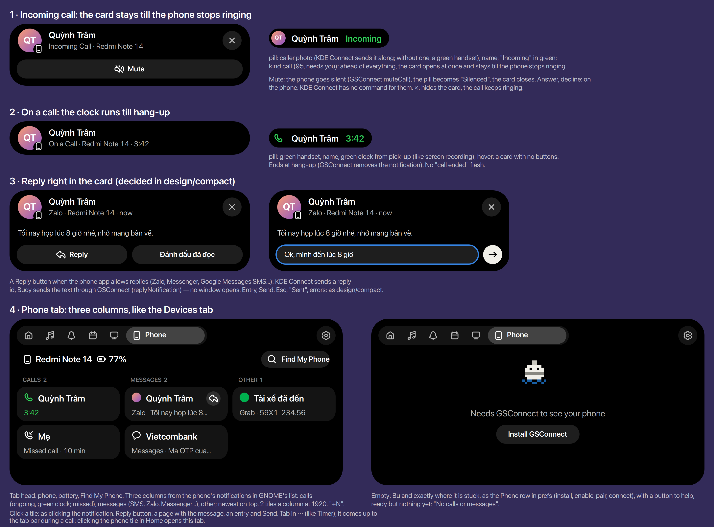

# Device tab

A tab pinned after Calendar (SPEC §2b, [Tabs](../tabs/index.md)): the computer's devices, in three
groups. The tab shows only what the modules bring; each part is built in its own item (Power, Headphones / display
plugged, Bluetooth device, USB / phone / webcam plugged, Phone via GSConnect). Shared numbers are in
[Tokens](../tokens.md). *Ethan, 2026-11-16 (M4 item "Device tab").*

## Decisions

- **One column per group** (option B, of three: a list by group, one column per group, tiles as in Home).
  Everything at a glance, no scrolling. A group with no devices is hidden; the remaining columns share
  the width equally. **Decided** (Ethan, 2026-11-16)
- **Three groups**, in order: **This Computer**, **Wireless**, **Plugged In**. **Decided**
- **This Computer** has only **Battery** and **Power Mode**. Keyboard, touchpad and laptop screen are not
  tiles: they are always there, and the HUD and Quick Settings already cover their changes (keyboard
  backlight, brightness, touchpad on/off); when the laptop screen turns off with an external display
  plugged in, the external display's tile says so ("External Only"). Desktop: Power Mode, plus a
  USB-connected **UPS** if there is one. Nothing: the group is hidden. **Decided** (Ethan, 2026-11-16)
- **The battery tile shows the power**: under the name, "using 11 W" on battery, "charging 31 W" while
  charging (UPower `EnergyRate`, the number the "slow charger" flash already uses); not read yet: just
  "Battery". A desktop has no such number: CPU power (Intel RAPL) is root-only since 2020. **Decided** (Ethan, 2026-11-16)
- **Wireless**: UPower devices that report a battery (mice, 2.4 GHz keyboards such as Logitech Unifying /
  Bolt, and Bluetooth), GNOME's connected Bluetooth devices, a phone through GSConnect (battery, find
  the phone). A 2.4 GHz receiver that reports no battery: its devices are not seen one by one. **Decided**
- **Plugged In**: external displays, wired sound (USB headphones, jack), USB drives, webcams, a phone on
  USB. Things built into the computer (built-in camera, Bluetooth adapter) don't count. **Decided**
- **Wi-Fi, Ethernet, VPN** are not in this tab: they are connections, not devices; they belong to the
  "VPN / Wi-Fi / captive portal" item, kept apart. **Decided** (Ethan, 2026-11-16)

## Sizes

- Body under the 56 head, padding 12 as in Home. Column: (content width − 8 × (n − 1)) / n; at 1920 two
  columns are 268, three are 173.
- Above each column: the group name 0.7em 600 `fg-subtle`, uppercase, with the **device count** of the group.
- **Tile 58**, radius 16 (= 28 − 12, concentric), `fill-1` background, 6 apart: icon 16 at 12, the
  **value** in 600 on the right (76%, Balanced, Join), the **name** 0.85em `fg-muted` below, cut with "…"
  when long. **Decided**
- At 1920 each column fits **3 tiles**, at 2560 4 (the body is taller). A bigger group: the last tile is
  **"+N"** with the names of the remaining devices; a click opens the whole group as a list, as Home's +K
  tile. **Decided**
- Within a group: the order the module brings (This Computer: battery, then mode); low-battery devices first.

## On click

- A click opens a **page in place of the columns**, with ‹ to go back, rows 36 with radius 18, 4 apart,
  as Home's battery page ([Home](../home/index.md), "The battery tile and power modes"). A list longer than
  the space scrolls.
- **Battery, Power Mode**: exactly Home's battery page (the modes, choosing one switches, Power Settings).
- **Display**: Join / Mirror / External Only, the one in use with ✓ (as the display-plugged compact,
  [Compact](../compact/index.md) "Displays and headphones plugged in"), then Display Settings.
- **"+N"**: the whole group, one row per device with details (resolution, free space…).
- **Headphones, speakers**: Settings → Sound. **Drive**: a page with Open in Files, Eject. Other devices: per their own item.

## Wireless

*Ethan, 2026-11-17 (M4 item "Bluetooth device").*

- **Battery and volume never read alike**: volume is always as in the HUD, a **bar** then the number
  (muted: dim); battery is a **battery shape** 16 drawn to its level (Buoy's battery icon, the inside
  filled to the level), 4 apart, then the number. UPower's coarse battery level (low, normal, high, full):
  the battery shape only. Applies in the pill and in tiles; the computer's Battery tile keeps the number,
  since its icon is already a battery. **Decided**
- **Flash when a Bluetooth device connects**, 3 s: an icon by kind (headphones, speaker, keyboard, mouse,
  gamepad, tablet, phone; anything else: Bluetooth), name, battery. The battery often comes a while
  after connecting (BlueZ, then UPower): the flash on screen takes the new number, without restarting
  its count. **Disconnect**: "Disconnected …", no trailing. No flash when Buoy starts or when Bluetooth
  is turned off (the HUD already says "Bluetooth off"); a device reconnecting by itself after it is
  turned on does flash. Click: Settings → Bluetooth. **Decided**
- **Bluetooth headphones**: only this flash, with the battery; the plugged module doesn't flash as well
  (the HUD still shows the volume when it changes). On connecting, the battery is what you need to know;
  the volume is still the old level. **Decided**
- A **phone** over Bluetooth sends its battery in **20 % steps**: only HFP's "battchg" index 0–5, which
  PipeWire turns into `value × 100 / 5` (`spa/plugins/bluez5/backend-native.c` `rfcomm_hfp_hf`,
  PipeWire 1.6.2), and BlueZ doesn't record the source (`Battery1.Source` empty). A phone at 77 % shows
  80. The number is written as received, "80%", as GNOME's Settings does ("~80%" looks odd); none sent:
  the name only. **Decided** (Ethan, 2026-11-17) The exact battery and find-the-phone come with "Phone
  via GSConnect"; then a phone that has both merges into one tile.
- **Low battery** is left to gsd's notification ("Mouse battery low"), through the notification module like every notification.
- **Wireless column**: connected Bluetooth devices (Quick Settings' list), then 2.4 GHz mice and keyboards
  that report a battery (UPower; not a Bluetooth device already listed). Low battery (≤ 20 %) first.
  Sound playing on a Bluetooth device: "· Playing" under its name. **Decided**
- **2.4 GHz mice, keyboards**: a tile only, no flash (they sleep and wake all the time). Click: Settings →
  Power, where GNOME lists device batteries. **Decided**

- **Clicking a Bluetooth device**: a page in place of the columns. Page head: name, battery at the end.
  A **Volume** row (bar and number) only while the sound plays on that device; a click opens Settings →
  Sound, to change it use the keys or Quick Settings. A **kind and address** row ("Phone ·
  F8:43:EF:98:5A:0D"), as Settings → Bluetooth, for reading only. **Disconnect** as Quick Settings'
  Bluetooth list; once disconnected, back to the columns. Then **Bluetooth Settings**. **Decided** (Ethan, 2026-11-17)

## Drives, phones, webcams plugged in

*Ethan, 2026-11-17 (M4 item "USB / phone / webcam plugged").*

- **Plugging a drive** (USB, memory card, external disk): the compact opens by itself as for a display
  (an alert, held 5 s while you are there): name, free space, two buttons **Open** (Files at the
  drive's root) and **Eject**, each with an icon (folder, eject); then the pill 3 s. Replaces GNOME's
  "“USB 64 GB” connected" notification (`ui/components/autorunManager.js`). It is a drive GNOME has just
  mounted by itself (`Gio.VolumeMonitor` `mount-added`); network drives, hidden-folder mounts and
  partitions of the internal disk don't count. **Decided**
- **A phone on a cable**, in file transfer mode (MTP, PTP): gvfs mounts it as a drive, so it is a drive
  with a phone icon, Open and Eject. Charging only: no drive, nothing shown; the phone's battery comes
  with GSConnect. **Decided**
- **Eject**: eject (powers the drive off when it can), otherwise unmount, through Shell's operation
  (`ui/shellMountOperation.js`): with a file open, GNOME's dialog lists the apps holding it. Data still
  being written: the pill "Writing to USB 64 GB" stays until done; done: the flash **"Safe to remove USB
  64 GB"**. Shell's notifications for that ("Writing data to…", "…can be safely unplugged") don't show:
  Buoy says it instead. **Decided**
- **Pulled out without ejecting**: the flash **"Unplugged USB 64 GB"**. Only unmounted (in Files), the
  drive still plugged in: nothing shown. **Decided**
- **External webcam**: a 3 s flash with its name when plugged in, "Unplugged …" when pulled out. The
  built-in camera doesn't count: its USB port is marked `fixed` by the firmware
  (`/sys/bus/usb/devices/…/removable`; on Ethan's computer the camera 3-8 is `fixed`). Shell only knows
  that some camera is in use (`Shell.CameraMonitor`), so Buoy reads the kernel's video devices: watching
  `/dev` (inotify, no polling), reading `/sys/class/video4linux` without blocking. **Decided**
- **Plugged In column**: displays, drives (the value is the free space), webcams (no value: Shell doesn't
  know which camera is in use), wired sound. Clicking a drive: a page with **Open in Files**, **Eject**,
  the space in the page head; once ejected, back to the columns. Clicking a webcam: opens the Camera
  app (Snapshot) if installed. **Decided**

## Phone via GSConnect

*Ethan, 2026-11-17 (M4 item "Phone via GSConnect", part 1; part 2 is OTP apps, Grab/Be, Zalo/Messenger;
part 3 is calls and the Phone tab).*

- **Read from GSConnect's service** on the session bus (`org.gnome.Shell.Extensions.GSConnect`), as its
  own Shell part does (`src/utils/remote.js`): an ObjectManager lists the phones (Name, Connected,
  Paired), each phone has GActions over D-Bus: `battery` (charging, level), `ring`. Only while the Device
  tab is on (and the notification module, for the phone's name); the service comes and goes as GSConnect
  is turned on and off.
- **Phone tile** in the Wireless column while it is connected: GSConnect's exact battery (not in 20 %
  steps as over Bluetooth), "· Charging" under the name while charging. Also connected over Bluetooth:
  one tile (same name), GSConnect's battery. No flash on connect or disconnect: phones come and go from
  Wi-Fi all the time. **Decided**
- **Clicking the phone**: a page with the battery in the head, **Find My Phone** (rings even when on
  silent), **GSConnect Settings**. GSConnect doesn't put the connection type (Wi-Fi / Bluetooth) on
  D-Bus, so there is no row for it. **Decided**
- **Phone notifications**: GSConnect posts every notification under its own name, the title being the
  phone app, the body "sender: text" (`plugins/notification.js` `_receiveNotification`). Buoy rearranges
  them: the app is the phone app (pill, card, Notifications tab group by Zalo, Messenger…), the title is
  the sender, the line below "Zalo · Redmi Note 14". SMS is Messages, a missed call is Phone. The
  notification's buttons stay (including the OTP "Copy" GSConnect adds). **Decided**
- **Not working yet**: Buoy's settings → Modules → Devices, the **Phone** row says where it is stuck, with
  a button that helps: GSConnect not installed (opens its page on extensions.gnome.org), installed but
  off (turns it on), not paired (opens GSConnect's settings), paired but not connected ("Redmi Note 14 ·
  not connected", open KDE Connect on the phone, same network; Ethan, 2026-11-18: before that it showed as
  ready). Connected: "· connected", no button; the row changes as soon as the phone connects or leaves.
  No flash, no reminder in the pill; the Phone tab (part 3) says the same in its empty state.
  **Decided** (Ethan, 2026-11-17)

## Apps on the phone

*Ethan, 2026-11-18 (M4 item "Phone via GSConnect", part 2).*

- **What KDE Connect sends** (`NotificationsPlugin.kt` `sendNotification`): title, text, the buttons
  (except the reply button), the notification's `largeIcon`, or the small icon without one; "ongoing"
  notifications (`FLAG_ONGOING_EVENT`) and background services are not sent. GSConnect uses that picture
  as the icon and adds a "Copy 123456" button by itself when it sees 6 digits
  (`plugins/notification.js` `_receiveNotification`).
- **OTP codes**, from any app on the phone (bank SMS, Google, Zalo): 4–8 digits next to the words OTP,
  mã, code, xác thực, xác minh, verification… (with or without diacritics); not amounts, times, dates,
  years, phone numbers. Pill: a key, the code split in two ("482 913"), a countdown. Card: the code at
  2em bold in place of the message body, the countdown at the end of the line, one **Copy Code** button
  shown at once (replacing GSConnect's). The pill ends when the countdown reaches 0 (30 s from the
  message's arrival), even while the card still waits for you; the message stays in the Notifications
  tab. Copy Code: the code to the clipboard, the pill becomes "Code Copied" for 3 s with the copied
  module's icon. Screen sharing: as every notification then, no code. Notifications from apps on the
  computer don't change. **Decided**
- **Zalo, Messenger**: the picture KDE Connect sends is the sender's (`largeIcon`), so it is drawn round:
  24 in the pill, 40 in the card with a phone dot in the corner (the notification card's badge,
  design/compact). No picture (a themed icon): as in part 1. Groups: the group name is the title,
  "Trâm: …" in the body. **Decided**
- **Grab, Be**: the app's text stays, Buoy doesn't guess at the wording (found, on the way, arrived). A
  message with a licence plate (59X1-234.56, 30A-123.45, 51F-12345) is a ride message: the pill has a
  car icon (Gravity's `car`, file `route-car-symbolic`) and the plate at the end; the card moves the plate
  into a `fill-3` tile at the end of the body line and drops it from the text. Stays as a normal
  notification. A message without a plate (a promotion…) is a normal notification. No minutes-to-arrival
  countdown or map: KDE Connect doesn't send "ongoing" notifications. **Decided** (Ethan,
  2026-11-18: the real wording, left for the app to show)
- Replying right in the card (Zalo, Messenger, SMS): part 3.

## Calls and the Phone tab

*Ethan, 2026-11-18 (M4 item "Phone via GSConnect", part 3).*

- **Calls** (module `phone`, kind `call`): GSConnect shows incoming and ongoing calls as its own
  notifications, removed on hang-up (`plugins/telephony.js` `_notifyEvent`); the id says it is a call
  ("<device>|ringing|<caller>", "|talking|"), whatever the language. The notification module lets them
  through, no pill of its own. **Decided**
- **Ringing**: the pill has the caller's picture (KDE Connect sends it along; without one a green
  handset), the name, "Incoming" in green `#30d158`; it needs you (kind call, 95): the card opens at once
  and stays until the ringing stops. **Mute**: the phone goes quiet through GSConnect's `muteCall` action
  (the notification's own button would make Shell destroy the notification, `ui/messageTray.js`
  `addAction`), the pill becomes "Silenced", the card closes. ×: the card closes, the pill stays. Answer,
  decline: on the phone (KDE Connect has no command for that). **Decided**
- **Ringing on the computer** (Ethan, 2026-11-18): GNOME plays nothing for a GTK notification
  (`ui/messageTray.js` `playSound`), so while the phone rings Buoy plays the sound theme's
  `phone-incoming-call` (1.5 s) every 3 s through Mutter (`meta-sound-player.c`, silent when system sounds
  are off), until answered, hung up, Mute or ×, at most 1 minute. Silent under Do Not Disturb, when
  GSConnect's sound is turned off in GNOME's notification settings, or with `phone-ring` off ("Ring on
  the computer", under the Phone module). **Decided**
- **On a call**: the pill a green handset, the name, a green timer from when the call is answered (seen
  here), until hang-up; the card has no buttons. **Decided**
- **Reply in the card**: as design/compact "Reply in the card". Only when the message allows replies:
  KDE Connect's reply key (a UUID) at the end of the notification id, SMS too; the text goes through
  GSConnect's `replyNotification` action. **Decided**
- **Phone tab**: in ⋯ like Timer, comes up on the tab strip by itself during a call; clicking the phone
  tile in Home opens it. Tab head: the phone, battery, **Find My Phone**. Three columns as in the Device
  tab, from the phone's notifications in GNOME's list, newest on top: **Calls** (ongoing, green timer;
  missed calls), **Messages** (SMS, messages that can be replied to, messaging apps), **Other**; 2 tiles
  per column at 1920, "+N". Clicking a tile: as clicking the notification. The Reply button on a tile: a
  page with the message, an input and Send. Empty: Bu and where it is stuck, as the Phone row in prefs,
  with a button that helps; ready but nothing yet: "No calls or messages". The Phone row in prefs sits
  under the Phone module. **Decided**
- Testing without a phone: `scripts/phone-notification.sh --call ringing|talking|end <name>`,
  `--reply <app> <name> <text>`.

## What this item does

The tab and its frame, with what already exists: **This Computer** (battery, power, power mode; UPS),
**Wireless** (Bluetooth devices, 2.4 GHz mice and keyboards; the "Bluetooth device" item) and **Plugged
In** (external displays from the plugged module; drives, phones on a cable, external webcams from the usb
module; wired sound in use); a phone through GSConnect in the Wireless column.

## In the code

- `lib/kit/model/devices.js` — the groups, the tiles (battery, UPS, mode, display, wired sound, wireless),
  tiles per column, "+N", the pages of a display, of a Bluetooth device and of "+N"; a tile's `meter`:
  battery shape or volume bar. Tested (`tests/devices.test.js`).
- `lib/kit/model/bluetooth.js` — device kind and icon (GnomeBluetooth, UPower), battery, which one just
  connected or disconnected, the Wireless column's order, dropping UPower devices that duplicate a
  Bluetooth one. Tested (`tests/bluetooth.test.js`).
- `lib/kit/services/bluetooth.js` — Quick Settings' BtClient (`ui/status/bluetooth.js`): the list,
  `devices-changed`, disconnecting (`toggleDevice`). No Bluetooth client of its own.
- `lib/kit/services/peripherals.js` — UPower devices with a battery, an async D-Bus proxy only while the
  tab is on (libupower-glib works synchronously, and `get_devices2()` hands GJS devices already freed).
- `lib/modules/bluetooth/` — connect and disconnect flashes; a battery arriving later updates the flash on screen.
- `lib/kit/model/drives.js` — which drives count, the space ("41 GB free of 64 GB"), which webcams count,
  which GNOME notifications Buoy says instead. Tested (`tests/usb.test.js`).
- `lib/kit/services/drives.js` — `Gio.VolumeMonitor`, space, open in Files, eject through
  `ShellMountOperation` (progress for the usb module).
- `lib/kit/services/cameras.js` — webcams: `/dev` watched, `/sys/class/video4linux` read through its links
  (Gio collapses "x/.." by name, not by link).
- `lib/modules/usb/` — the drive-plugged compact, the eject, unplug and webcam flashes.
- `lib/kit/model/phone.js` — where setup is stuck (for prefs), GSConnect's battery, merging the phone with
  Bluetooth, splitting a phone notification into app, sender and text. Tested (`tests/phone.test.js`).
- `lib/kit/services/gsconnect.js` — GSConnect's service: phones, battery, `ring`; opening its settings.
- `lib/modules/notification/source.js` `noteOf` — phone notifications under their own app (pill, card, tab);
  Copy Code, the OTP pill ending when the countdown reaches 0.
- `lib/kit/model/phone.js` `otpOf`, `plateOf` — OTP codes, licence plates (`tests/phone.test.js`).
- `lib/modules/notification/adapter.js` (OTP, `senderPicture`, `ride`) and `apps/zalo.js`, `messenger.js`,
  `grab.js`, `be.js` — by the app name GSConnect gives (`tests/notification.test.js`).
- `scripts/phone-notification.sh` — fakes a phone notification as GSConnect posts it (Grab, Be, OTP,
  Zalo…), no phone or real ride needed.
- `lib/modules/phone/` — calls (`source.js`, `adapter.js`) and the Phone tab (`tab.js`).
- `lib/kit/model/phone.js` `callOf`, `replyOf`, `phoneGroups` — calls, reply keys, the tab's columns
  (`tests/phone.test.js`); `kit/services/gsconnect.js` `phoneNotes`, `muteCall`, `reply`.
- Card: `reply` (input and Send, `kit/ui/present/compact.js` `replyRow`); parts with a `color`.
- Card: `code` (+ `codeEnd`) and `tag` (`kit/model/presentation.js`, drawn in `kit/ui/present/compact.js`);
  round pictures `{art, round: true}`.
- Battery shape: the `{battery, label}` part (`kit/model/presentation.js`, drawn in `kit/ui/present/parts.js`
  `batteryLevel`).
- `lib/modules/device/tab.js` — reads through `kit/services` (Quick Settings' battery and mode, Mutter's
  displays, Shell's mixer) only while the tab is on, redraws on every change; pages in place, ‹ or Esc to go back.
- Shared parts so modules don't import each other: `kit/model/displays.js` and `kit/services/displays.js`
  (displays, with the plugged module), `kit/model/audio.js` (headphones), the battery page in
  `kit/model/power.js` (with Home), `kit/ui/present/lists.js` (pages in place, with Home).
- Power: the DisplayDevice's `EnergyRate`; UPS: DisplayDevice `Type` 3 (UPower merges a UPS into it).
- `lib/modules/device/stylesheet.css` — columns, group titles, tiles (height 58 set in JS, `CELL_H`).
