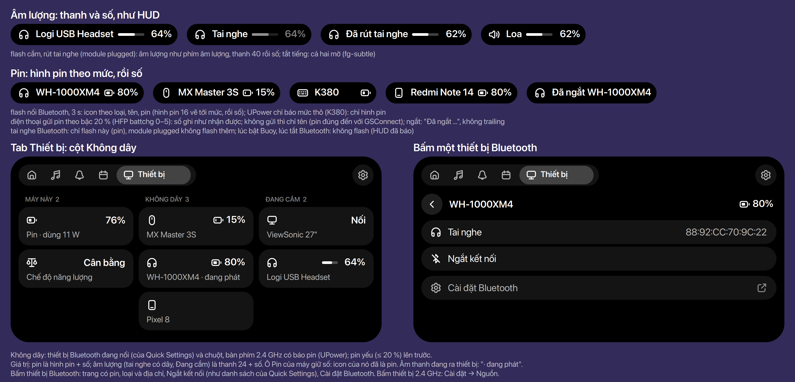
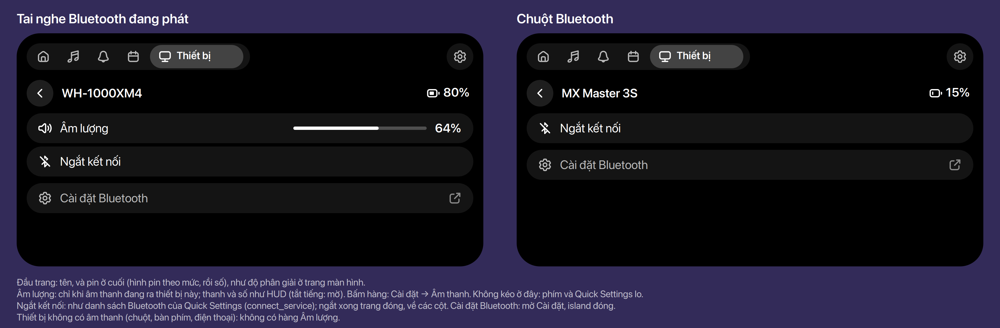
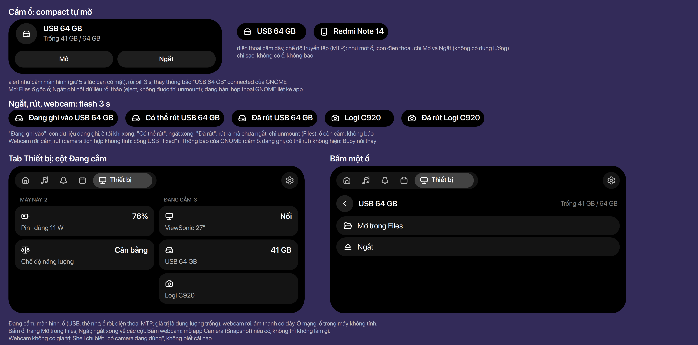
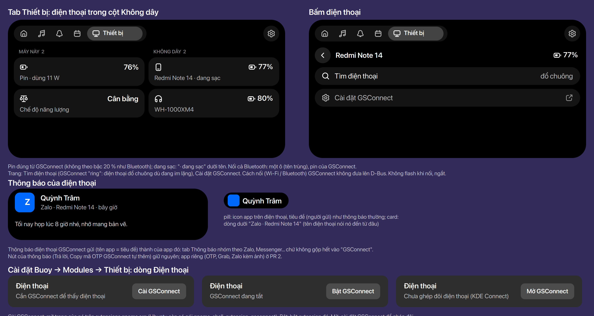
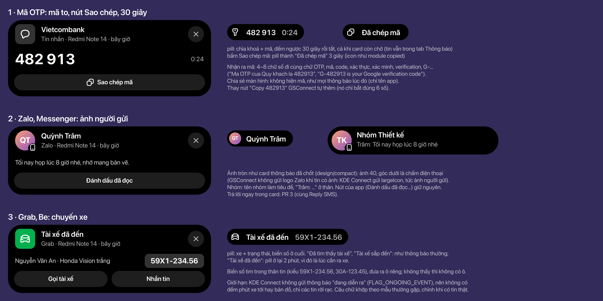
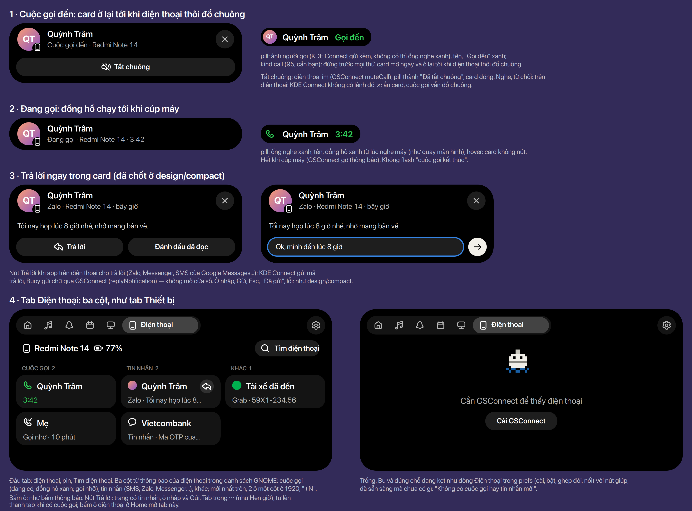

# Tab Thiết bị

Tab ghim sau Calendar (SPEC §2b, [Tab](../tabs/index.vi.md)): các thiết bị của máy, gom ba nhóm. Tab
chỉ hiện những gì các module mang đến; mỗi phần làm trong mục của nó (Power, Headphones / display
plugged, Bluetooth device, USB / phone / webcam plugged, Phone via GSConnect). Số dùng chung ở
[Bảng số](../tokens.vi.md). *Ethan, 2026-11-16 (mục M4 "Device tab").*

## Quyết định

- **Mỗi nhóm một cột** (phương án B, trong ba: danh sách theo nhóm, mỗi nhóm một cột, ô như Home).
  Nhìn một lần thấy hết, không cuộn. Nhóm không có thiết bị thì ẩn; các cột còn lại chia đều bề
  ngang. **Chốt** (Ethan, 2026-11-16)
- **Ba nhóm**, theo thứ tự: **Máy này**, **Không dây**, **Đang cắm**. **Chốt**
- **Máy này** chỉ có **Pin** và **Chế độ năng lượng**. Bàn phím, touchpad, màn hình laptop không
  thành ô: chúng luôn có mặt, HUD và Quick Settings đã lo phần thay đổi (đèn bàn phím, độ sáng,
  touchpad bật tắt); màn laptop tắt khi cắm màn ngoài thì ô màn ngoài nói ("Chỉ màn ngoài"). Máy bàn:
  Chế độ năng lượng, cùng **UPS** cắm USB nếu có. Không có gì thì nhóm ẩn. **Chốt** (Ethan, 2026-11-16)
- **Ô pin có công suất**: dưới tên, "dùng 11 W" khi chạy pin, "sạc 31 W" khi sạc (UPower
  `EnergyRate`, số flash "sạc chậm" đang dùng); chưa đọc được thì chỉ "Pin". Máy bàn không có số
  này: công suất CPU (Intel RAPL) chỉ root đọc được từ 2020. **Chốt** (Ethan, 2026-11-16)
- **Không dây**: thiết bị UPower có báo pin (chuột, bàn phím 2.4 GHz kiểu Logitech Unifying / Bolt, và
  Bluetooth), thiết bị Bluetooth đang nối của GNOME, điện thoại qua GSConnect (pin, tìm máy).
  Đầu thu 2.4 GHz không báo pin thì không thấy từng thiết bị. **Chốt**
- **Đang cắm**: màn hình ngoài, âm thanh có dây (tai nghe USB, jack), ổ USB, webcam, điện thoại cắm
  USB. Thứ gắn sẵn trong máy (camera tích hợp, adapter Bluetooth) không tính. **Chốt**
- **Wi-Fi, Ethernet, VPN** không ở tab này: là kết nối, không phải thiết bị; thuộc mục "VPN / Wi-Fi /
  captive portal", để riêng. **Chốt** (Ethan, 2026-11-16)

## Kích thước

- Thân dưới phần đầu 56, lề 12 như Home. Cột: (rộng nội dung − 8 × (n − 1)) / n; ở 1920 hai cột 268,
  ba cột 173.
- Trên mỗi cột: tên nhóm 0.7em 600 `fg-subtle`, viết hoa, cùng **số thiết bị** trong nhóm.
- **Ô 58**, bo 16 (= 28 − 12, đồng tâm), nền `fill-1`, cách nhau 6: icon 16 ở 12, **giá trị** chữ 600 bên
  phải (76%, Cân bằng, Nối), **tên** 0.85em `fg-muted` ở dưới, dài thì cắt "…". **Chốt**
- Ở 1920 mỗi cột vừa **3 ô**, ở 2560 vừa 4 (thân cao hơn). Nhóm nhiều hơn: ô cuối là **"+N"** kèm tên
  các thiết bị còn lại; bấm mở cả nhóm thành danh sách, như ô +K của Home. **Chốt**
- Trong nhóm: thứ tự của module mang đến (Máy này: pin rồi chế độ); thiết bị pin yếu lên trước.

## Bấm vào

- Bấm mở một **trang thay chỗ các cột**, có ‹ về lại, hàng 36 bo 18 cách 4, như trang pin của Home
  ([Home](../home/index.vi.md), "Ô pin và chế độ năng lượng"). Danh sách dài hơn chỗ thì cuộn.
- **Pin, Chế độ năng lượng**: đúng trang pin của Home (các chế độ, chọn là đổi, Cài đặt nguồn).
- **Màn hình**: Nối / Nhân bản / Chỉ màn ngoài, đang dùng có ✓ (như compact cắm màn,
  [Compact](../compact/index.vi.md) "Cắm màn hình và tai nghe"), rồi Cài đặt màn hình.
- **"+N"**: cả nhóm, mỗi thiết bị một hàng với chi tiết (độ phân giải, dung lượng trống…).
- **Tai nghe, loa**: Cài đặt → Âm thanh. **Ổ**: trang Mở trong Files, Ngắt. Các thiết bị khác: theo mục của chúng.

## Không dây

*Ethan, 2026-11-17 (mục M4 "Bluetooth device").*

- **Pin và âm lượng không đọc nhầm**: âm lượng luôn như HUD, **thanh** rồi số (tắt tiếng: mờ); pin là
  **hình pin** 16 vẽ tới mức (icon pin của Buoy, ruột tô theo mức), cách 4, rồi số. Mức pin thô của
  UPower (thấp, bình thường, cao, đầy): chỉ hình pin. Áp dụng ở pill và trong ô; ô Pin của máy giữ số vì
  icon của nó đã là pin. **Chốt**
- **Flash khi thiết bị Bluetooth nối**, 3 s: icon theo loại (tai nghe, loa, bàn phím, chuột, tay cầm,
  bảng vẽ, điện thoại; còn lại: Bluetooth), tên, pin. Pin thường đến sau khi nối một lúc (BlueZ, rồi
  UPower): flash đang hiện nhận số mới, không đếm lại. **Ngắt**: "Đã ngắt …", không trailing. Không flash
  lúc bật Buoy hay khi tắt Bluetooth (HUD đã báo "Bluetooth tắt"); thiết bị tự nối lại sau khi bật thì có.
  Bấm: Cài đặt → Bluetooth. **Chốt**
- **Tai nghe Bluetooth**: chỉ flash này, kèm pin; module plugged không flash thêm (âm lượng vẫn do HUD
  báo khi đổi). Lúc nối, pin là điều cần biết; âm lượng vẫn là mức cũ. **Chốt**
- **Điện thoại** qua Bluetooth gửi pin theo **bậc 20 %**: chỉ số "battchg" 0–5 của HFP, PipeWire đổi
  thành `giá trị × 100 / 5` (`spa/plugins/bluez5/backend-native.c` `rfcomm_hfp_hf`, PipeWire 1.6.2),
  BlueZ không ghi nguồn (`Battery1.Source` trống). Máy 77 % thành 80. Số ghi như nhận được, "80%", như
  Cài đặt của GNOME ("~80%" nhìn lạ); không gửi thì chỉ tên. **Chốt** (Ethan, 2026-11-17) Pin đúng
  và tìm máy đến với "Phone via GSConnect"; khi đó một máy có cả hai gộp thành một ô.
- **Pin yếu** để thông báo của gsd ("Mouse battery low"), qua module notification như mọi thông báo.
- **Cột Không dây**: thiết bị Bluetooth đang nối (danh sách của Quick Settings), rồi chuột, bàn phím
  2.4 GHz có báo pin (UPower; không phải thiết bị Bluetooth đã có). Pin yếu (≤ 20 %) lên trước.
  Âm thanh đang ra thiết bị Bluetooth: dưới tên "· đang phát". **Chốt**
- **Chuột, bàn phím 2.4 GHz**: chỉ ô, không flash (chúng ngủ, thức liên tục). Bấm: Cài đặt → Nguồn, nơi
  GNOME liệt kê pin thiết bị. **Chốt**

- **Bấm thiết bị Bluetooth**: trang thay chỗ các cột. Đầu trang: tên, pin ở cuối. Hàng **Âm lượng**
  (thanh và số) chỉ khi âm thanh đang ra thiết bị đó; bấm mở Cài đặt → Âm thanh, kéo thì dùng phím hay
  Quick Settings. Một hàng **loại và địa chỉ** ("Điện thoại · F8:43:EF:98:5A:0D"), như Cài đặt →
  Bluetooth, chỉ để xem. **Ngắt kết nối** như danh sách Bluetooth của Quick Settings; ngắt xong về các
  cột. Rồi **Cài đặt Bluetooth**. **Chốt** (Ethan, 2026-11-17)

## Ổ, điện thoại, webcam cắm vào

*Ethan, 2026-11-17 (mục M4 "USB / phone / webcam plugged").*

- **Cắm ổ** (USB, thẻ nhớ, ổ rời): compact tự mở như cắm màn hình (alert, giữ 5 s lúc bạn có mặt): tên,
  dung lượng trống, hai nút **Mở** (Files ở gốc ổ) và **Ngắt**, mỗi nút có icon (thư mục, đẩy đĩa); rồi pill 3 s. Thay thông báo "“USB 64 GB”
  connected" của GNOME (`ui/components/autorunManager.js`). Đó là ổ GNOME vừa tự gắn (`mount-added` của
  `Gio.VolumeMonitor`); ổ mạng, ổ thư mục ẩn, phân vùng của đĩa trong máy không tính. **Chốt**
- **Điện thoại cắm dây**, chế độ truyền tệp (MTP, PTP): gvfs gắn như một ổ, nên là một ổ với icon điện
  thoại, Mở và Ngắt. Chỉ sạc thì không có ổ, không báo; pin điện thoại đến với GSConnect. **Chốt**
- **Ngắt**: eject (tắt nguồn ổ khi được), không được thì unmount, qua thao tác của Shell
  (`ui/shellMountOperation.js`): file đang mở thì hộp thoại của GNOME liệt kê app đang giữ. Còn dữ liệu
  đang ghi: pill "Đang ghi vào USB 64 GB" ở tới khi xong; xong: flash **"Có thể rút USB 64 GB"**. Thông báo
  của Shell cho việc đó ("Writing data to…", "…can be safely unplugged") không hiện: Buoy nói thay. **Chốt**
- **Rút ra mà chưa ngắt**: flash **"Đã rút USB 64 GB"**. Chỉ unmount (trong Files), ổ còn cắm: không báo.
  **Chốt**
- **Webcam rời**: flash 3 s tên nó khi cắm, "Đã rút …" khi rút. Camera tích hợp không tính: cổng USB của
  nó được firmware đánh dấu `fixed` (`/sys/bus/usb/devices/…/removable`; máy Ethan: camera 3-8 là
  `fixed`). Shell chỉ biết có camera đang dùng (`Shell.CameraMonitor`), nên đọc thiết bị video của
  kernel: theo dõi `/dev` (inotify, không hỏi định kỳ), đọc `/sys/class/video4linux` không chặn. **Chốt**
- **Cột Đang cắm**: màn hình, ổ (giá trị là dung lượng trống), webcam (không giá trị: Shell không biết
  camera nào đang dùng), âm thanh có dây. Bấm ổ: trang **Mở trong Files**, **Ngắt**, dung lượng ở đầu
  trang; ngắt xong về các cột. Bấm webcam: mở app Camera (Snapshot) nếu máy có. **Chốt**

## Điện thoại qua GSConnect

*Ethan, 2026-11-17 (mục M4 "Phone via GSConnect", phần 1; phần 2 là app OTP, Grab/Be, Zalo/Messenger;
phần 3 là cuộc gọi và tab Điện thoại).*

- **Đọc từ dịch vụ của GSConnect** trên session bus (`org.gnome.Shell.Extensions.GSConnect`), như phần
  Shell của chính nó (`src/utils/remote.js`): ObjectManager liệt kê điện thoại (Name, Connected,
  Paired), mỗi điện thoại có GAction qua D-Bus: `battery` (đang sạc, mức), `ring`. Chỉ khi tab Thiết bị
  còn (và module notification để lấy tên điện thoại); dịch vụ đến và đi theo GSConnect bật, tắt.
- **Ô điện thoại** trong cột Không dây khi nó đang nối: pin đúng của GSConnect (không theo bậc 20 % như
  Bluetooth), "· đang sạc" dưới tên khi sạc. Nối cả Bluetooth: một ô (tên trùng), pin của GSConnect.
  Không flash khi nối, ngắt: điện thoại ra vào Wi-Fi liên tục. **Chốt**
- **Bấm điện thoại**: trang có pin ở đầu, **Tìm điện thoại** (đổ chuông dù đang im lặng), **Cài đặt
  GSConnect**. Cách nối (Wi-Fi / Bluetooth) GSConnect không đưa lên D-Bus, nên không có hàng đó. **Chốt**
- **Thông báo điện thoại**: GSConnect đưa mọi thông báo lên dưới tên nó, tiêu đề là app trên điện thoại,
  nội dung "người gửi: chữ" (`plugins/notification.js` `_receiveNotification`). Buoy đặt lại: app là app
  trên điện thoại (pill, card, tab Thông báo nhóm theo Zalo, Messenger…), tiêu đề là người gửi, dòng
  dưới "Zalo · Redmi Note 14". SMS là Messages, cuộc gọi nhỡ là Phone. Nút của thông báo giữ nguyên
  (kể cả "Copy" mã OTP GSConnect tự thêm). **Chốt**
- **Chưa dùng được**: Cài đặt Buoy → Modules → Thiết bị, dòng **Điện thoại** nói chỗ đang kẹt và nút
  giúp: chưa cài GSConnect (mở trang của nó trên extensions.gnome.org), đã cài mà tắt (bật nó), chưa
  ghép đôi (mở cài đặt GSConnect), đã ghép mà chưa nối ("Redmi Note 14 · not connected", mở KDE Connect
  trên điện thoại, cùng mạng; Ethan, 2026-11-18: trước đó nó hiện như đã sẵn sàng). Nối rồi: "· connected",
  không nút; dòng đổi ngay khi điện thoại nối hay rời. Không flash, không nhắc trong pill; tab Điện thoại (phần 3) nói cùng
  điều đó trong khung trống của nó. **Chốt** (Ethan, 2026-11-17)

## Ứng dụng trên điện thoại

*Ethan, 2026-11-18 (mục M4 "Phone via GSConnect", phần 2).*

- **KDE Connect gửi gì** (`NotificationsPlugin.kt` `sendNotification`): tiêu đề, chữ, các nút (trừ nút
  trả lời), `largeIcon` của thông báo, không có thì icon nhỏ; thông báo "đang diễn ra"
  (`FLAG_ONGOING_EVENT`) và dịch vụ chạy nền thì không gửi. GSConnect đưa ảnh đó lên làm icon và tự thêm
  nút "Copy 123456" khi thấy 6 chữ số (`plugins/notification.js` `_receiveNotification`).
- **Mã OTP**, từ bất kỳ app nào trên điện thoại (SMS ngân hàng, Google, Zalo): 4–8 chữ số đi cùng chữ
  OTP, mã, code, xác thực, xác minh, verification… (có dấu hay không); không phải số tiền, giờ, ngày,
  năm, số điện thoại. Pill: chìa khoá, mã chia đôi ("482 913"), đếm ngược. Card: mã 2em đậm thay thân
  tin, đếm ngược ở cuối dòng, một nút **Copy Code** hiện ngay (thay nút của GSConnect). Pill tắt khi
  đếm về 0 (30 s từ lúc tin đến), cả khi card còn chờ bạn; tin vẫn trong tab Thông báo. Copy Code: mã vào
  clipboard, pill thành "Code Copied" 3 s với icon của module copied. Chia sẻ màn hình: như mọi thông
  báo lúc đó, không có mã. Thông báo của app trên máy tính không đổi. **Chốt**
- **Zalo, Messenger**: ảnh KDE Connect gửi là ảnh người gửi (`largeIcon`), nên vẽ tròn: 24 trong pill,
  40 trong card với chấm điện thoại ở góc (huy hiệu của card thông báo, design/compact). Không có ảnh
  (icon theo theme): như phần 1. Nhóm: tên nhóm là tiêu đề, "Trâm: …" ở thân. **Chốt**
- **Grab, Be**: chữ của app giữ nguyên, Buoy không đoán câu chữ (tìm thấy, đang đến, đã đến). Tin có
  biển số (59X1-234.56, 30A-123.45, 51F-12345) là tin chuyến xe: pill có icon xe (`car` của Gravity, file
  `route-car-symbolic`) và biển số ở cuối; card đưa biển số ra một ô `fill-3` cuối dòng thân tin và bỏ
  nó khỏi chữ. Ở lại như thông báo thường. Tin không có biển số (khuyến mãi…) như thông báo thường.
  Không có đếm phút xe tới hay bản đồ: KDE Connect không gửi tin "đang diễn ra". **Chốt** (Ethan,
  2026-11-18: câu chữ thật để app tự hiển thị)
- Trả lời ngay trong card (Zalo, Messenger, SMS): phần 3.

## Cuộc gọi và tab Điện thoại

*Ethan, 2026-11-18 (mục M4 "Phone via GSConnect", phần 3).*

- **Cuộc gọi** (module `phone`, kind `call`): GSConnect hiện cuộc gọi đến và đang gọi thành thông báo của
  nó, gỡ khi cúp máy (`plugins/telephony.js` `_notifyEvent`); id cho biết là cuộc gọi
  ("<máy>|ringing|<người gọi>", "|talking|"), không phụ thuộc ngôn ngữ. Module notification để chúng
  qua, không pill riêng. **Chốt**
- **Đổ chuông**: pill có ảnh người gọi (KDE Connect gửi kèm; không có thì ống nghe xanh), tên, "Incoming"
  xanh `#30d158`; cần bạn (kind call, 95): card mở ngay, ở lại tới khi thôi đổ chuông. **Mute**: điện thoại
  im qua action `muteCall` của GSConnect (nút của chính thông báo thì Shell huỷ thông báo,
  `ui/messageTray.js` `addAction`), pill thành "Silenced", card đóng. ×: card đóng, pill ở lại. Nghe, từ
  chối: trên điện thoại (KDE Connect không có lệnh đó). **Chốt**
- **Đang gọi**: pill ống nghe xanh, tên, đồng hồ xanh từ lúc nghe máy (thấy ở đây), tới khi cúp máy;
  card không nút. **Chốt**
- **Trả lời trong card**: như design/compact "Trả lời ngay trong card". Chỉ khi tin cho trả lời: mã trả lời
  (UUID) của KDE Connect ở cuối id thông báo, cả SMS; chữ đi qua action `replyNotification` của GSConnect.
  **Chốt**
- **Tab Điện thoại**: trong ⋯ như Hẹn giờ, tự lên thanh tab khi có cuộc gọi; bấm ô điện thoại ở Home mở nó.
  Đầu tab: điện thoại, pin, **Find My Phone**. Ba cột như tab Thiết bị, từ thông báo của điện thoại trong
  danh sách GNOME, mới nhất trên: **Calls** (đang có, đồng hồ xanh; gọi nhỡ), **Messages** (SMS, tin trả lời
  được, app nhắn tin), **Other**; 2 ô một cột ở 1920, "+N". Bấm ô: như bấm thông báo. Nút Trả lời trên ô: trang
  có tin, ô nhập và Gửi. Trống: Bu và chỗ đang kẹt như dòng Điện thoại trong prefs, với nút giúp; đã sẵn
  sàng mà chưa có gì: "No calls or messages". Dòng Điện thoại trong prefs nằm dưới module Phone. **Chốt**
- Thử không cần điện thoại: `scripts/phone-notification.sh --call ringing|talking|end <tên>`,
  `--reply <app> <tên> <chữ>`.

## Mục này làm gì

Tab và khuôn của nó, với những gì đã có: **Máy này** (pin, công suất, chế độ năng lượng; UPS),
**Không dây** (thiết bị Bluetooth, chuột và bàn phím 2.4 GHz; mục "Bluetooth device") và **Đang cắm**
(màn hình ngoài từ module plugged; ổ, điện thoại cắm dây, webcam rời từ module usb; âm thanh có dây
đang dùng); điện thoại qua GSConnect trong cột Không dây.

## Chỗ trong code

- `lib/kit/model/devices.js` — các nhóm, ô (pin, UPS, chế độ, màn hình, âm thanh có dây, không dây), số
  ô một cột, "+N", trang của màn hình, của thiết bị Bluetooth và của "+N"; `meter` của ô: hình pin hay
  thanh âm lượng. Có test (`tests/devices.test.js`).
- `lib/kit/model/bluetooth.js` — loại thiết bị và icon (GnomeBluetooth, UPower), pin, cái nào vừa nối hay
  ngắt, thứ tự cột Không dây, bỏ thiết bị UPower trùng Bluetooth. Có test (`tests/bluetooth.test.js`).
- `lib/kit/services/bluetooth.js` — BtClient của Quick Settings (`ui/status/bluetooth.js`): danh sách,
  `devices-changed`, ngắt kết nối (`toggleDevice`). Không có client Bluetooth riêng.
- `lib/kit/services/peripherals.js` — thiết bị UPower có pin, proxy D-Bus async chỉ khi tab còn
  (libupower-glib làm đồng bộ, và `get_devices2()` trả cho GJS thiết bị đã bị huỷ).
- `lib/modules/bluetooth/` — flash nối, ngắt; pin đến sau cập nhật flash đang hiện.
- `lib/kit/model/drives.js` — ổ nào tính, dung lượng ("41 GB free of 64 GB"), webcam nào tính, thông
  báo nào của GNOME Buoy nói thay. Có test (`tests/usb.test.js`).
- `lib/kit/services/drives.js` — `Gio.VolumeMonitor`, dung lượng, mở trong Files, ngắt qua
  `ShellMountOperation` (tiến trình cho module usb).
- `lib/kit/services/cameras.js` — webcam: `/dev` theo dõi, `/sys/class/video4linux` đọc qua link của nó
  (Gio gộp "x/.." theo tên, không theo link).
- `lib/modules/usb/` — compact cắm ổ, các flash ngắt, rút, webcam.
- `lib/kit/model/phone.js` — chỗ đang kẹt khi cài (cho prefs), pin của GSConnect, gộp điện thoại với
  Bluetooth, tách thông báo điện thoại thành app, người gửi, chữ. Có test (`tests/phone.test.js`).
- `lib/kit/services/gsconnect.js` — dịch vụ của GSConnect: điện thoại, pin, `ring`; mở cài đặt của nó.
- `lib/modules/notification/source.js` `noteOf` — thông báo điện thoại dưới app của nó (pill, card, tab);
  Copy Code, pill OTP tắt khi đếm về 0.
- `lib/kit/model/phone.js` `otpOf`, `plateOf` — mã OTP, biển số (`tests/phone.test.js`).
- `lib/modules/notification/adapter.js` (OTP, `senderPicture`, `ride`) và `apps/zalo.js`, `messenger.js`,
  `grab.js`, `be.js` — theo tên app GSConnect đưa (`tests/notification.test.js`).
- `scripts/phone-notification.sh` — giả một thông báo điện thoại như GSConnect đưa lên (Grab, Be, OTP,
  Zalo…), không cần điện thoại hay chuyến xe thật.
- `lib/modules/phone/` — cuộc gọi (`source.js`, `adapter.js`) và tab Điện thoại (`tab.js`).
- `lib/kit/model/phone.js` `callOf`, `replyOf`, `phoneGroups` — cuộc gọi, mã trả lời, cột của tab
  (`tests/phone.test.js`); `kit/services/gsconnect.js` `phoneNotes`, `muteCall`, `reply`.
- Card: `reply` (ô nhập và Gửi, `kit/ui/present/compact.js` `replyRow`); phần tử có `color`.
- Card: `code` (+ `codeEnd`) và `tag` (`kit/model/presentation.js`, vẽ ở `kit/ui/present/compact.js`);
  ảnh tròn `{art, round: true}`.
- Hình pin: phần tử `{battery, label}` (`kit/model/presentation.js`, vẽ ở `kit/ui/present/parts.js`
  `batteryLevel`).
- `lib/modules/device/tab.js` — đọc qua `kit/services` (pin và chế độ của Quick Settings, màn hình của
  Mutter, bộ trộn âm của Shell) chỉ khi tab còn, vẽ lại mỗi lần đổi; trang thay chỗ, ‹ hay Esc về.
- Phần dùng chung để module không import nhau: `kit/model/displays.js` và `kit/services/displays.js`
  (màn hình, cùng module plugged), `kit/model/audio.js` (tai nghe), trang pin trong
  `kit/model/power.js` (cùng Home), `kit/ui/present/lists.js` (trang thay chỗ, cùng Home).
- Công suất: `EnergyRate` của DisplayDevice; UPS: DisplayDevice `Type` 3 (UPower gộp UPS vào đó).
- `lib/modules/device/stylesheet.css` — cột, tiêu đề nhóm, ô (cao 58 đặt bằng JS, `CELL_H`).
