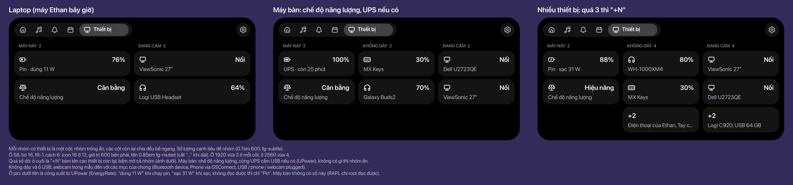
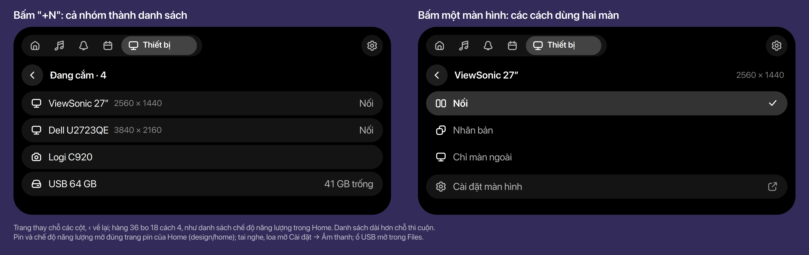

# Tab Thiết bị

Tab ghim sau Calendar (SPEC §2b, [Tab](../tabs/index.vi.md)): các thiết bị của máy, gom ba nhóm. Tab
chỉ hiện những gì các module mang đến; mỗi phần làm trong mục của nó (Power, Headphones / display
plugged, Bluetooth device, USB / phone / webcam plugged, Phone via GSConnect). Số dùng chung ở
[Bảng số](../tokens.vi.md). *Ethan, 2026-11-16 (mục M4 "Device tab").*

## Quyết định

- **Mỗi nhóm một cột** (phương án B, trong ba: danh sách theo nhóm, mỗi nhóm một cột, ô như Home).
  Nhìn một lần thấy hết, không cuộn. Nhóm không có thiết bị thì ẩn; các cột còn lại chia đều bề
  ngang. **Chốt** (Ethan, 2026-11-16)
- **Ba nhóm**, theo thứ tự: **Máy này**, **Không dây**, **Đang cắm**. **Chốt**
- **Máy này** chỉ có **Pin** và **Chế độ năng lượng**. Bàn phím, touchpad, màn hình laptop không
  thành ô: chúng luôn có mặt, HUD và Quick Settings đã lo phần thay đổi (đèn bàn phím, độ sáng,
  touchpad bật tắt); màn laptop tắt khi cắm màn ngoài thì ô màn ngoài nói ("Chỉ màn ngoài"). Máy bàn:
  Chế độ năng lượng, cùng **UPS** cắm USB nếu có. Không có gì thì nhóm ẩn. **Chốt** (Ethan, 2026-11-16)
- **Ô pin có công suất**: dưới tên, "dùng 11 W" khi chạy pin, "sạc 31 W" khi sạc (UPower
  `EnergyRate`, số flash "sạc chậm" đang dùng); chưa đọc được thì chỉ "Pin". Máy bàn không có số
  này: công suất CPU (Intel RAPL) chỉ root đọc được từ 2020. **Chốt** (Ethan, 2026-11-16)
- **Không dây**: thiết bị UPower có báo pin (chuột, bàn phím 2.4 GHz kiểu Logitech Unifying / Bolt, và
  Bluetooth), thiết bị Bluetooth đang nối của GNOME, điện thoại qua GSConnect (pin, tìm máy).
  Đầu thu 2.4 GHz không báo pin thì không thấy từng thiết bị. **Chốt**
- **Đang cắm**: màn hình ngoài, âm thanh có dây (tai nghe USB, jack), ổ USB, webcam, điện thoại cắm
  USB. Thứ gắn sẵn trong máy (camera tích hợp, adapter Bluetooth) không tính. **Chốt**
- **Wi-Fi, Ethernet, VPN** không ở tab này: là kết nối, không phải thiết bị; thuộc mục "VPN / Wi-Fi /
  captive portal", để riêng. **Chốt** (Ethan, 2026-11-16)

## Kích thước

- Thân dưới phần đầu 56, lề 12 như Home. Cột: (rộng nội dung − 8 × (n − 1)) / n; ở 1920 hai cột 268,
  ba cột 173.
- Trên mỗi cột: tên nhóm 0.7em 600 `fg-subtle`, viết hoa, cùng **số thiết bị** trong nhóm.
- **Ô 58**, bo 16 (= 28 − 12, đồng tâm), nền `fill-1`, cách nhau 6: icon 16 ở 12, **giá trị** chữ 600 bên
  phải (76%, Cân bằng, Nối), **tên** 0.85em `fg-muted` ở dưới, dài thì cắt "…". **Chốt**
- Ở 1920 mỗi cột vừa **3 ô**, ở 2560 vừa 4 (thân cao hơn). Nhóm nhiều hơn: ô cuối là **"+N"** kèm tên
  các thiết bị còn lại; bấm mở cả nhóm thành danh sách, như ô +K của Home. **Chốt**
- Trong nhóm: thứ tự của module mang đến (Máy này: pin rồi chế độ); thiết bị pin yếu lên trước.

## Bấm vào

- Bấm mở một **trang thay chỗ các cột**, có ‹ về lại, hàng 36 bo 18 cách 4, như trang pin của Home
  ([Home](../home/index.vi.md), "Ô pin và chế độ năng lượng"). Danh sách dài hơn chỗ thì cuộn.
- **Pin, Chế độ năng lượng**: đúng trang pin của Home (các chế độ, chọn là đổi, Cài đặt nguồn).
- **Màn hình**: Nối / Nhân bản / Chỉ màn ngoài, đang dùng có ✓ (như compact cắm màn,
  [Compact](../compact/index.vi.md) "Cắm màn hình và tai nghe"), rồi Cài đặt màn hình.
- **"+N"**: cả nhóm, mỗi thiết bị một hàng với chi tiết (độ phân giải, dung lượng trống…).
- **Tai nghe, loa**: Cài đặt → Âm thanh. **Ổ USB**: mở trong Files. Các thiết bị khác: theo mục của chúng.

## Không dây

*Ethan, 2026-11-17 (mục M4 "Bluetooth device").*

- **Pin và âm lượng không đọc nhầm**: âm lượng luôn như HUD, **thanh** rồi số (tắt tiếng: mờ); pin là
  **hình pin** 16 vẽ tới mức (icon pin của Buoy, ruột tô theo mức), cách 4, rồi số. Mức pin thô của
  UPower (thấp, bình thường, cao, đầy): chỉ hình pin. Áp dụng ở pill và trong ô; ô Pin của máy giữ số vì
  icon của nó đã là pin. **Chốt**
- **Flash khi thiết bị Bluetooth nối**, 3 s: icon theo loại (tai nghe, loa, bàn phím, chuột, tay cầm,
  bảng vẽ, điện thoại; còn lại: Bluetooth), tên, pin. Pin thường đến sau khi nối một lúc (BlueZ, rồi
  UPower): flash đang hiện nhận số mới, không đếm lại. **Ngắt**: "Đã ngắt …", không trailing. Không flash
  lúc bật Buoy hay khi tắt Bluetooth (HUD đã báo "Bluetooth tắt"); thiết bị tự nối lại sau khi bật thì có.
  Bấm: Cài đặt → Bluetooth. **Chốt**
- **Tai nghe Bluetooth**: chỉ flash này, kèm pin; module plugged không flash thêm (âm lượng vẫn do HUD
  báo khi đổi). Lúc nối, pin là điều cần biết; âm lượng vẫn là mức cũ. **Chốt**
- **Điện thoại** qua Bluetooth thường không gửi pin: chỉ tên. Pin và tìm máy đến với "Phone via
  GSConnect"; khi đó một máy có cả hai gộp thành một ô.
- **Pin yếu** để thông báo của gsd ("Mouse battery low"), qua module notification như mọi thông báo.
- **Cột Không dây**: thiết bị Bluetooth đang nối (danh sách của Quick Settings), rồi chuột, bàn phím
  2.4 GHz có báo pin (UPower; không phải thiết bị Bluetooth đã có). Pin yếu (≤ 20 %) lên trước.
  Âm thanh đang ra thiết bị Bluetooth: dưới tên "· đang phát". **Chốt**
- **Chuột, bàn phím 2.4 GHz**: chỉ ô, không flash (chúng ngủ, thức liên tục). Bấm: Cài đặt → Nguồn, nơi
  GNOME liệt kê pin thiết bị. **Chốt**

- **Bấm thiết bị Bluetooth**: trang thay chỗ các cột. Đầu trang: tên, pin ở cuối. Hàng **Âm lượng**
  (thanh và số) chỉ khi âm thanh đang ra thiết bị đó; bấm mở Cài đặt → Âm thanh, kéo thì dùng phím hay
  Quick Settings. **Ngắt kết nối** như danh sách Bluetooth của Quick Settings; ngắt xong về các cột.
  Rồi **Cài đặt Bluetooth**. **Chốt** (Ethan, 2026-11-17)

## Mục này làm gì

Tab và khuôn của nó, với những gì đã có: **Máy này** (pin, công suất, chế độ năng lượng; UPS),
**Không dây** (thiết bị Bluetooth, chuột và bàn phím 2.4 GHz; mục "Bluetooth device") và **Đang cắm**
(màn hình ngoài từ module plugged; âm thanh có dây đang dùng). Ổ USB, webcam, điện thoại đến với mục
của chúng và chỉ cần thêm ô vào nhóm.

## Chỗ trong code

- `lib/kit/model/devices.js` — các nhóm, ô (pin, UPS, chế độ, màn hình, âm thanh có dây, không dây), số
  ô một cột, "+N", trang của màn hình, của thiết bị Bluetooth và của "+N"; `meter` của ô: hình pin hay
  thanh âm lượng. Có test (`tests/devices.test.js`).
- `lib/kit/model/bluetooth.js` — loại thiết bị và icon (GnomeBluetooth, UPower), pin, cái nào vừa nối hay
  ngắt, thứ tự cột Không dây, bỏ thiết bị UPower trùng Bluetooth. Có test (`tests/bluetooth.test.js`).
- `lib/kit/services/bluetooth.js` — BtClient của Quick Settings (`ui/status/bluetooth.js`): danh sách,
  `devices-changed`, ngắt kết nối (`toggleDevice`). Không có client Bluetooth riêng.
- `lib/kit/services/peripherals.js` — thiết bị UPower có pin, proxy D-Bus async chỉ khi tab còn
  (libupower-glib làm đồng bộ, và `get_devices2()` trả cho GJS thiết bị đã bị huỷ).
- `lib/modules/bluetooth/` — flash nối, ngắt; pin đến sau cập nhật flash đang hiện.
- Hình pin: phần tử `{battery, label}` (`kit/model/presentation.js`, vẽ ở `kit/ui/present/parts.js`
  `batteryLevel`).
- `lib/modules/device/tab.js` — đọc qua `kit/services` (pin và chế độ của Quick Settings, màn hình của
  Mutter, bộ trộn âm của Shell) chỉ khi tab còn, vẽ lại mỗi lần đổi; trang thay chỗ, ‹ hay Esc về.
- Phần dùng chung để module không import nhau: `kit/model/displays.js` và `kit/services/displays.js`
  (màn hình, cùng module plugged), `kit/model/audio.js` (tai nghe), trang pin trong
  `kit/model/power.js` (cùng Home), `kit/ui/present/lists.js` (trang thay chỗ, cùng Home).
- Công suất: `EnergyRate` của DisplayDevice; UPS: DisplayDevice `Type` 3 (UPower gộp UPS vào đó).
- `lib/modules/device/stylesheet.css` — cột, tiêu đề nhóm, ô (cao 58 đặt bằng JS, `CELL_H`).
