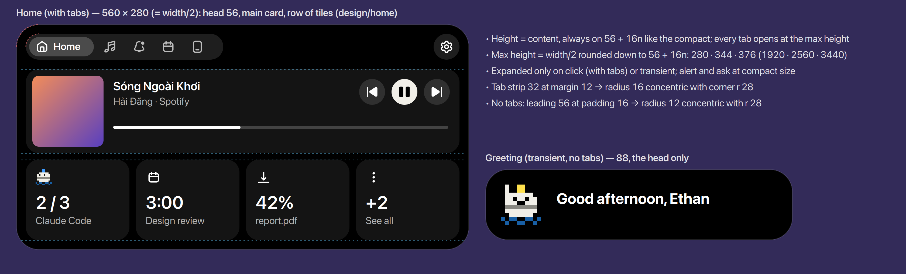
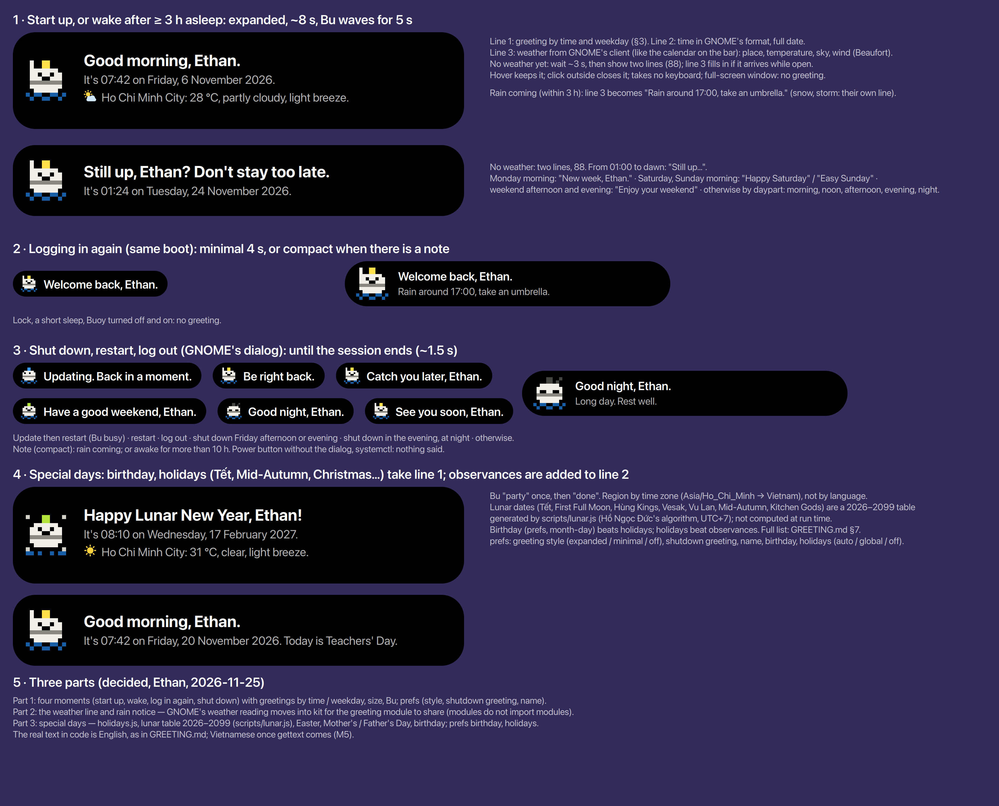

# Expanded

The panel that opens on a **click** on the pill (with the tab strip), or for a **transient** (the
greeting). Alerts and asks do not open expanded ([Alerts and asks](../alerts-and-asks/index.md)).
Shared numbers in [Tokens](../tokens.md).

## Size

- The width stays: clamp(0.28 × screen, 560, 760). The height follows the content and is always
  **56 + 16n**, as compact; at most width/2 rounded down by that rule: 280 / 344 / 376 at
  1920 / 2560 / 3440 (was 280 / 358 / 380 on an 8 step). Radius 28, as compact. **Decided**
  (56 + 16n: Ethan, 2026-11-10)
- With tabs: the 56 head holds the tab strip, 32 tall, 12 from the top edge (concentric: 28 − 12 =
  16, exactly the tab strip's radius). **Decided** The lower part of Home is in [Home](../home/index.md).
- Without tabs (the greeting): head 88 = 16 + leading 56 + 16, leading radius 12 (concentric); the
  greeting = 88. Bu in the leading stands straight on the island's black, with no tile behind it;
  the radius-12 tile is only for images (avatar, app logo). **Decided** (Ethan, 2026-11-10)
- No light in expanded. **Decided**

## Greeting

*Ethan, 2026-11-25 (M4 item "Greeting"); text and rules in [GREETING.md](../../GREETING.md) (2026-11-06, 11-16).*

- **Power on, waking after sleeping ≥ 3 hours**: expanded without tabs, Bu waves for 5 s, line 1 a
  greeting by time of day and weekday, line 2 the time (GNOME's format) and date, typed out; ~8 s,
  hover holds it. No greeting over a fullscreen window. `greeting-style` "In the pill": line 1 in
  the pill for 4 s; "Off": no greeting. **Decided**
- **Logging in again** in the same boot: minimal for 4 s. **Shutting down, restarting, logging
  out** through GNOME's dialog: one sentence (update, restart, log out, Friday evening, evening,
  the rest), compact with "Long day. Rest well." when awake for more than 10 hours; turned off with
  `greeting-farewell`. **Decided**
- **Three parts**: (1) the four moments, the greeting sentences, sizes, prefs style / farewell
  greeting / name — done 2026-11-25; (2) the weather line and the rain warning — done 2026-11-26:
  line 3 is text only, without the sky's colour icon (the middle area of expanded has no icon per
  line); (3) special days and birthdays — done 2026-11-26. **Decided** (Ethan, 2026-11-25)
- **Special days** (part 3): a birthday (prefs: month and day) then holidays (the three days of Tết,
  Mid-Autumn, Christmas…) replace line 1, Bu celebrates; an anniversary adds "Today is …" to line 2,
  dropping to line 3 in place of the weather when too long. Logging in again says it too; shutting
  down on a holiday evening: the holiday's sentence. Region from the time zone
  (`Asia/Ho_Chi_Minh` → Vietnam); prefs "Holidays": Local and global / Global / Off. The lunar
  calendar is a 2026–2099 table generated by `scripts/lunar.js` (Hồ Ngọc Đức's algorithm, UTC+7).
  **Decided**
- **Weather** (part 2): read through the kit's weather feed, shared with the weather plan (same
  place, same units). Power on, waking up: asks for fresh data when it is old, waits up to ~3 s;
  arriving late, it fills line 3 in place. Rain in the next 3 hours (while it is dry now): "Rain
  around 17:00, take an umbrella." replaces line 3, is the note when logging in again, and when
  shutting down / logging out if it rains before evening. **Decided**

## In the code

- `lib/kit/model/shapes.js` — expanded height on 56 + 16n, at most width/2.
- `lib/kit/ui/island.js` — expanded opens only on a click or for a transient.
- SPEC §2 (table of shapes), §2b (tab strip), §4 (table of sizes).
