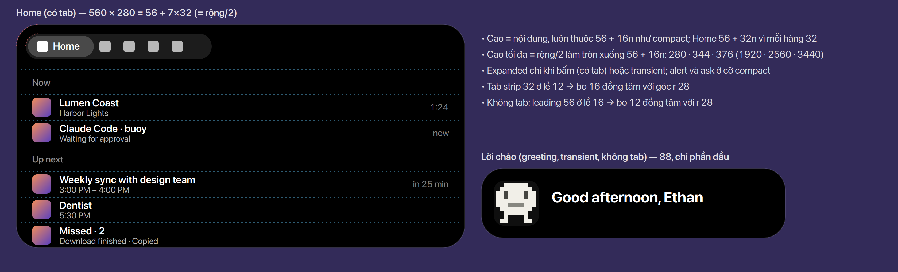

# Expanded

Bảng mở khi **bấm** vào pill (có thanh tab), hoặc cho một **transient** (lời chào). Alert và ask
không mở expanded ([Alert và ask](../alerts-and-asks/index.vi.md)). Số dùng chung ở
[Bảng số](../tokens.vi.md).

## Kích thước

- Độ rộng giữ nguyên: clamp(0.28 × màn, 560, 760). Chiều cao theo nội dung và luôn thuộc
  **56 + 16n** như compact; tối đa rộng/2 làm tròn xuống theo quy tắc đó: 280 / 344 / 376 ở
  1920 / 2560 / 3440 (trước là 280 / 358 / 380 theo nhịp 8). Bo 28, như compact. **Chốt**
  (56 + 16n: Ethan, 2026-11-10)
- Home: phần đầu 56 chứa thanh tab cao 32, cách mép trên 12 (đồng tâm: 28 − 12 = 16, đúng bán kính
  của thanh tab); mỗi hàng 32, nên Home cao 56 + 32n; ở 1920 vừa 7 hàng trong 280. **Chốt**
- Không có tab (lời chào): phần đầu 88 = 16 + leading 56 + 16, leading bo 12 (đồng tâm); lời
  chào = 88. **Chốt** (Ethan, 2026-11-10)
- Không có đèn trong expanded. **Chốt**

## Còn mở

- Các hàng của Home trong ảnh đang xếp hai dòng trong hàng 32 (tiêu đề và dòng phụ), chữ nhỏ hơn cỡ
  nhỏ nhất của GNOME — cùng vấn đề với hàng lựa chọn của câu hỏi, nơi đã chọn một dòng. Thiết kế
  chi tiết của Home và từng tab là phần [Tab](../tabs/index.vi.md).

## Chỗ trong code

- `lib/kit/shapes.js` — chiều cao expanded theo 56 + 16n, tối đa rộng/2.
- `lib/kit/island.js` — expanded chỉ mở khi bấm hoặc cho transient.
- SPEC §2 (bảng các dạng), §2b (thanh tab), §4 (bảng kích thước).
