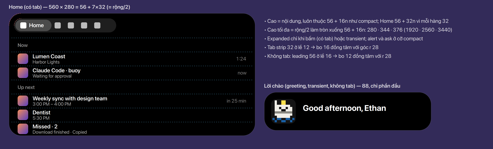
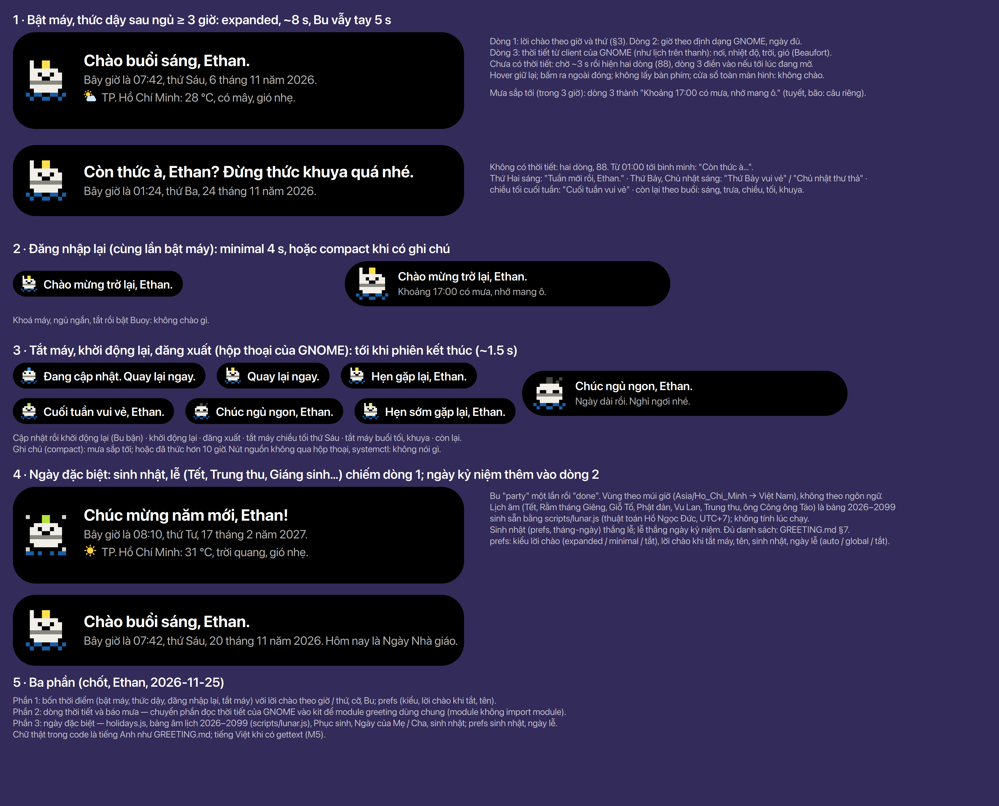

# Expanded

Bảng mở khi **bấm** vào pill (có thanh tab), hoặc cho một **transient** (lời chào). Alert và ask
không mở expanded ([Alert và ask](../alerts-and-asks/index.vi.md)). Số dùng chung ở
[Bảng số](../tokens.vi.md).

## Kích thước

- Độ rộng giữ nguyên: clamp(0.28 × màn, 560, 760). Chiều cao theo nội dung và luôn thuộc
  **56 + 16n** như compact; tối đa rộng/2 làm tròn xuống theo quy tắc đó: 280 / 344 / 376 ở
  1920 / 2560 / 3440 (trước là 280 / 358 / 380 theo nhịp 8). Bo 28, như compact. **Chốt**
  (56 + 16n: Ethan, 2026-11-10)
- Có tab: phần đầu 56 chứa thanh tab cao 32, cách mép trên 12 (đồng tâm: 28 − 12 = 16, đúng bán
  kính của thanh tab). **Chốt** Phần dưới của Home ở [Home](../home/index.vi.md).
- Không có tab (lời chào): phần đầu 88 = 16 + leading 56 + 16, leading bo 12 (đồng tâm); lời
  chào = 88. Bu ở leading đứng thẳng trên nền đen của island, không có ô nền; ô bo 12 chỉ
  cho ảnh (avatar, logo app). **Chốt** (Ethan, 2026-11-10)
- Không có đèn trong expanded. **Chốt**

## Lời chào

*Ethan, 2026-11-25 (mục M4 "Greeting"); chữ và luật ở [GREETING.md](../../GREETING.md) (2026-11-06, 11-16).*

- **Bật máy, thức dậy sau ngủ ≥ 3 giờ**: expanded không tab, Bu vẫy tay 5 s, dòng 1 lời chào theo giờ và thứ,
  dòng 2 giờ (định dạng của GNOME) và ngày, gõ dần; ~8 s, hover giữ lại. Không chào trên cửa sổ toàn màn
  hình. `greeting-style` "In the pill": dòng 1 trong pill 4 s; "Off": không chào. **Chốt**
- **Đăng nhập lại** cùng lần bật máy: minimal 4 s. **Tắt máy, khởi động lại, đăng xuất** qua hộp thoại của
  GNOME: một câu (cập nhật, khởi động lại, đăng xuất, tối thứ Sáu, buổi tối, còn lại), compact với "Long day.
  Rest well." khi đã thức hơn 10 giờ; tắt bằng `greeting-farewell`. **Chốt**
- **Ba phần**: (1) bốn thời điểm, câu chào, cỡ, prefs kiểu / lời chào khi tắt / tên — xong 2026-11-25; (2)
  dòng thời tiết và báo mưa; (3) ngày đặc biệt và sinh nhật. **Chốt** (Ethan, 2026-11-25)

## Chỗ trong code

- `lib/kit/model/shapes.js` — chiều cao expanded theo 56 + 16n, tối đa rộng/2.
- `lib/kit/ui/island.js` — expanded chỉ mở khi bấm hoặc cho transient.
- SPEC §2 (bảng các dạng), §2b (thanh tab), §4 (bảng kích thước).
