# Home

Expanded's first tab: a **main card** on top and a **row of tiles** below (style H5). The layout is
worked out again each time Home opens and whenever the stack changes, so Home is never empty and
never scrolls. Shared numbers are in [Tokens](../tokens.md); the tab strip and the other tabs are in
[Tabs](../tabs/index.md).

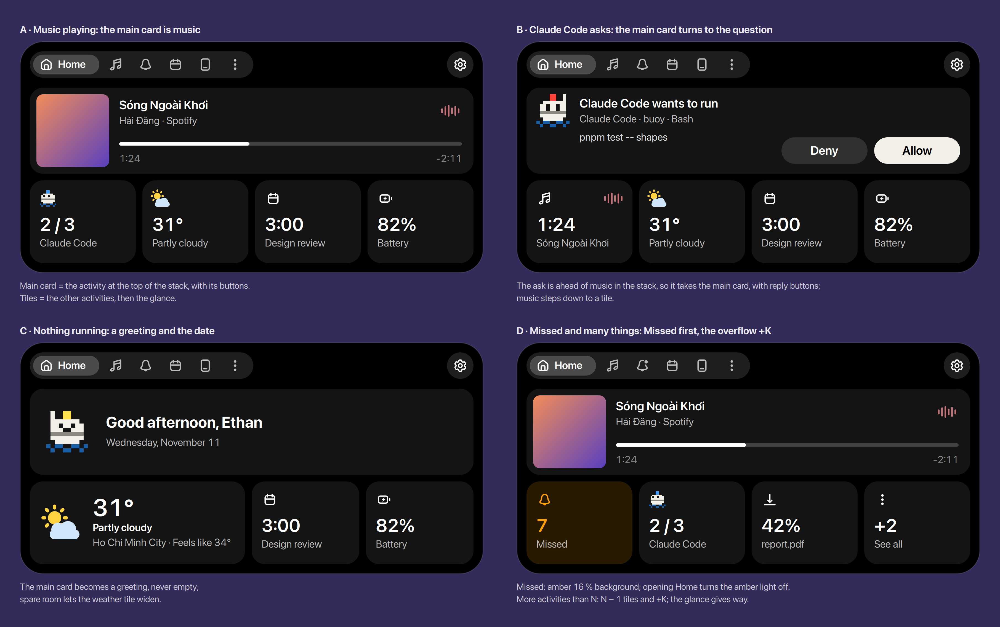

*The tab strip in the picture is only an illustration; which tabs always show is in [Tabs](../tabs/index.md).*

## Decisions

- Home = main card + one row of tiles (H5), replacing SPEC §3's Missed section, chips and two
  columns of blocks. Chosen among H1–H8. **Decided** (Ethan, 2026-11-11)
- The **main card** is the activity at the top of the stack, with its buttons; with no activity it
  is the **greeting** (Bu waving, the date). There is always a main card. **Decided** (Ethan,
  2026-11-11)
- The **tiles** are the other activities, then the **glances** (weather, upcoming, battery, phone,
  timer…). Clicking the card or a tile opens its tab. **Decided** (Ethan, 2026-11-11)
- Weather and upcoming have a **wide tile** (2 parts): weather uses Buoy's colour icon at 48,
  upcoming shows 2 events in their calendar's colour. **Decided** (Ethan, 2026-11-11)
- The weather tile says how old the reading is ("now", "12 min ago"), small `fg-subtle` text in the
  empty **top right corner**, on the wide tile (beside the temperature) and the narrow one (beside
  the icon) alike; the lines below keep their width. Updated every minute while Home is open.
  **Decided** (Ethan, 2026-11-13: the bottom right corner, like "1 notification", left the tile
  empty while the text was crowded; a shared layout for every tile would be emptier still)

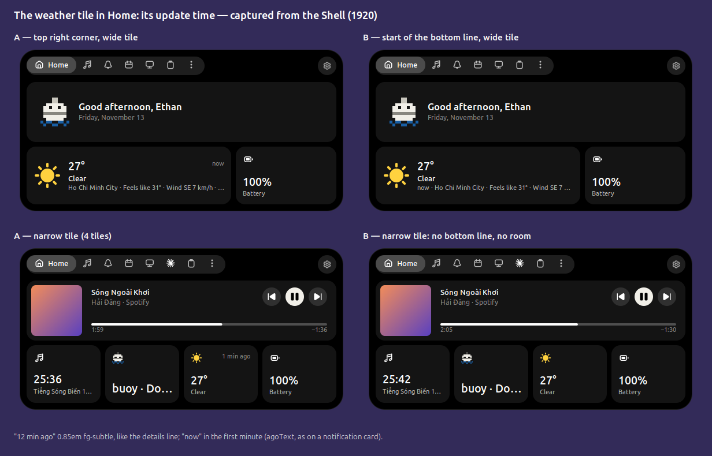
- The timer has a glance tile to start one, even when none is running. **Decided** (Ethan,
  2026-11-11). Built 2026-11-22 ([Timer](../compact/index.md#timer)): the last duration and
  "Timer", a click opens the tab; while one runs, the activity's own tile replaces it.
- An activity without a main card of its own uses its compact (head 56 and body) inside the card, so
  only music, Claude Code's question, a call and the greeting need their own design. **Decided**
  (Ethan, 2026-11-12)
- A compact inside the card draws as many rows as fit the card's height (56 + 8 + 16n + 8; if no row
  fits, only the head 56), fewer or more than the compact's 3 rows, and the card clips to its frame.
  Which rows come first is the adapter's order (`rank`): Claude's tasks keep the one just finished,
  the one in progress, the next, then the ones after, then the most recently finished. At 1920 in
  the short form (104): 2 rows; at 2560 (168): 6. Clicking the card opens the tab, where every row
  is. **Decided** (Ethan, 2026-11-13, #216: "too much empty space in the card" at 2560)
- A card with buttons (a notification, Claude asking permission) in the short form: **buttons go to
  the top right corner**, before ×, each as wide as its text; the body under the head at most 2
  lines (56 + 8 + 32 + 8 = 104), the row of tiles unchanged. Buttons at the bottom need 136 / 152 so
  they would be cut at 104. The tall form keeps the buttons at the bottom.
  **Decided** (Ethan, 2026-11-13)
- **A multiple-choice question takes all of Home**: the row of tiles (Missed too) gives way when it
  is the main card, the card 212 high at 1920. From 3 choices: **2 columns**, Other in the grid too
  (one column would need 244 for 3 choices, Other and the buttons). Skip / Submit buttons at the
  bottom. A question behind the main card is a tile like any activity. **Decided** (Ethan,
  2026-11-13)

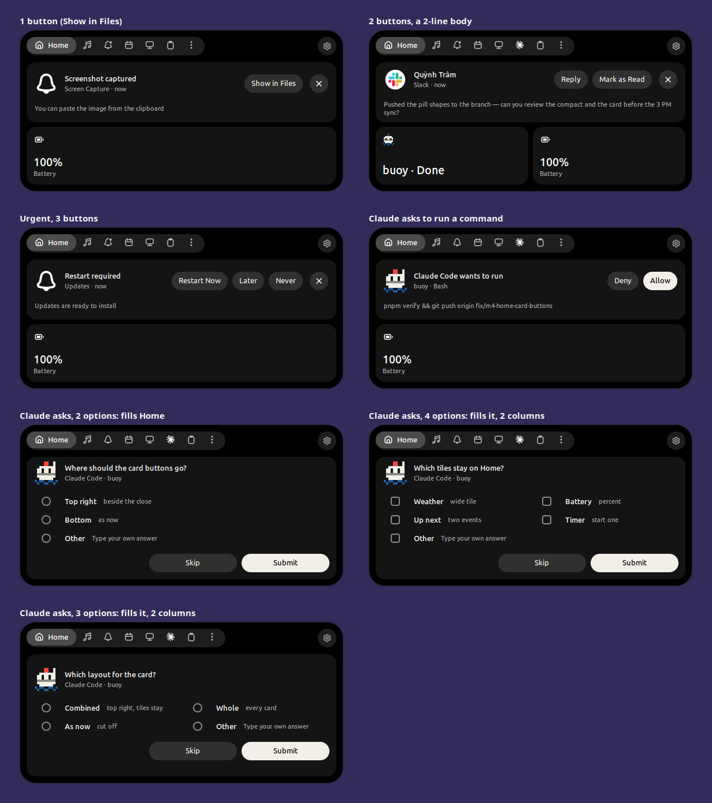

## Sizes

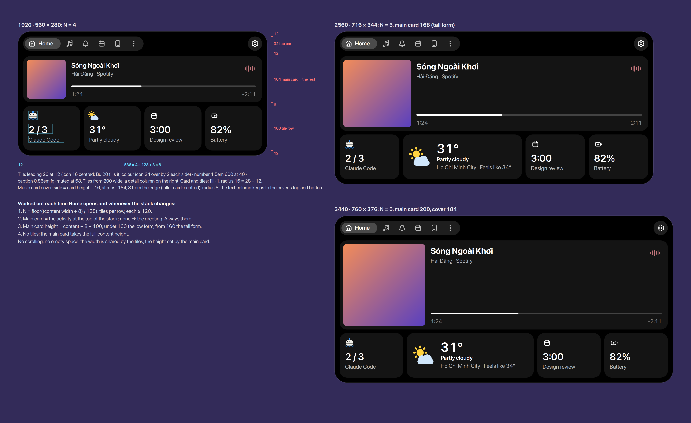

- Head **56**: tab strip 32 high, 12 from the top edge; a round ⚙ 32 on its own on the right, opens
  Settings. **Decided**
- Under the head: the main card, a gap of **8**, the row of tiles **100** high, bottom padding
  **12**; side padding 12. The main card's height = what is left: **104 / 168 / 200** at 1920 /
  2560 / 3440. With no tiles the main card takes all the height. **Decided** (Ethan, 2026-11-11)
- Card and tiles: background `fill-1`, radius **16** (= 28 − 12, concentric). **Decided** (Ethan,
  2026-11-11)
- The main card has two forms: **short** under 160 (buttons top right, progress bar at the foot),
  **tall** from 160 (like the short form, only the cover art and the name, 1.27em 700, are bigger).
  Cover art: side = card height − 16, at most **184** (the full card height of 200 at 3440; only a
  card with no row of tiles is taller: the art centred, the text column aligned to the art's top
  and bottom edges), 8 from the edge, radius 8. **Decided** (Ethan, 2026-11-11; 184 and the tall
  form like the short one: 2026-11-13)
- Tile: leading slot **20** at 12 (icon 16 centred; Bu 20 fills it; colour icon 24 overhangs 2 on
  each side), number 1.5em 600, caption 0.85em `fg-muted`. A wide tile from **200** adds a detail
  column on the right (0.85em `fg-subtle`). **Decided** (Ethan, 2026-11-11)
- Missed tile: amber background at 16 %, amber icon and number ([Colours](../colours/index.md)).
  **Decided**

## How the row of tiles fills

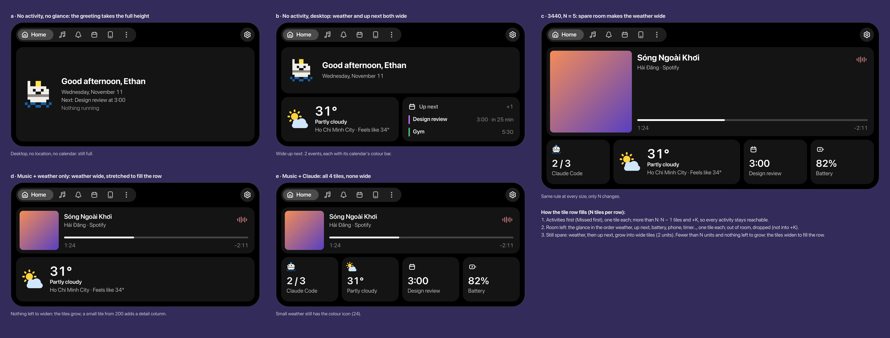

1. **N** = floor((content width + 8) / 128): tiles per row, each at least 120 wide. N = 4 at 1920,
   5 at 2560 and 3440.
2. **Activities first**, Missed at the front, one tile each. More than N: N − 1 tiles and a **+K**
   tile (click to see all), so every activity can be reached.
3. **Room left:** the glances in order: in use (microphone, camera; design/compact "In a call"),
   weather, upcoming, battery, phone, timer…, one tile each. When there is no room they are dropped;
   glances do not go into +K.
4. **Space left over:** weather then upcoming grow into wide tiles. Fewer than N parts and nothing
   left to grow: the tiles widen to fill the row.

All four steps are **Decided** (Ethan, 2026-11-11). The width always divides among the tiles, the
height is taken by the main card from what is left: no scrolling, no empty space.

## Missed and +K

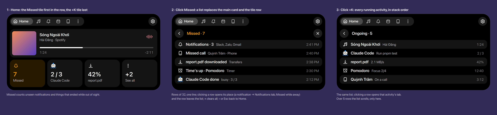

- **Missed gathers everything unseen**, not only notifications: tasks that ended while they could not
  be seen (download done, timer up, Claude Code finished, missed call) and unseen notifications.
  Using notifications alone would lose those tasks, since Buoy does not post notifications of its
  own (SPEC §3). **Decided** (Ethan, 2026-11-12)
- The Missed tile counts everything (notifications plus tasks). Notifications merge into **one row**
  ("Notifications · 3", the apps' names), which opens the Notifications tab at its "Missed while
  away" section; the notifications' details live in that tab. **Decided** (Ethan, 2026-11-12)
- The Missed tile's top right corner: **icons of the apps with truly unseen notifications** (each app
  once, newest first), 16, 4 apart, then "+N" for the remaining apps; only apps with notifications,
  tasks have no icon here. A narrow tile (128) holds 2 icons and "+N", a wider tile 3. Replaces "3
  notifications · 4 tasks" in the bottom right corner. **Decided** (Ethan, 2026-11-13: icons chosen
  over app names; long names got cut)

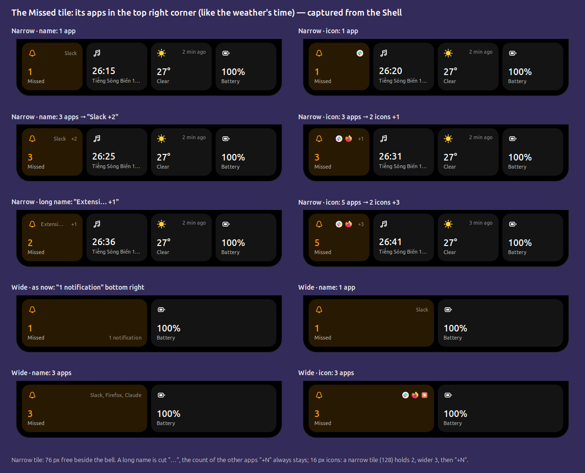
- Clicking the Missed tile or +K: Home **replaces the main card and the row of tiles with a list**,
  no new window. First row: ‹ (back to Home, Esc too), name and count, an action button. Then 32
  rows of one line: leading 20, name 1em 600, detail 0.85em `fg-muted`, time or value at the end.
  **Decided** (Ethan, 2026-11-12)
- The Missed list: newest first; clicking a row opens its place (its kind's tab, notifications → the
  Notifications tab) and the row leaves the list; × clears all. Opening Home turns the amber light
  off; the Missed tile stays until every row has been opened or cleared. When something counts as
  missed: [Alerts and asks](../alerts-and-asks/index.md). **Decided** (Ethan, 2026-11-12)
- The +K list ("Ongoing"): every activity in stack order; clicking a row opens its tab. Longer than
  5 rows it scrolls, only in this list. **Decided** (Ethan, 2026-11-12)

## The music card and tile

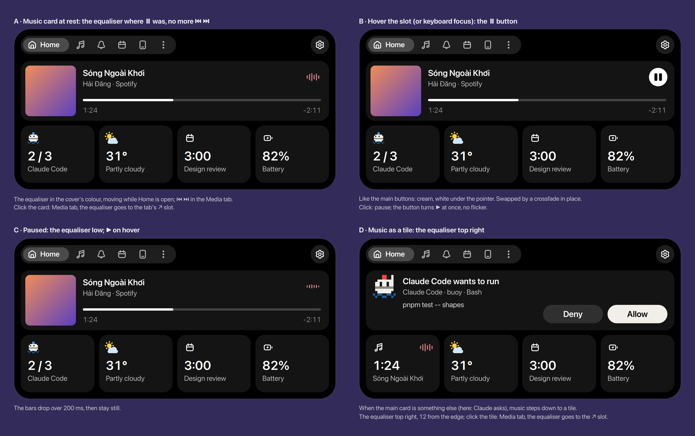

- **Music card (main card): ⏮ ⏭ dropped, only ⏸ / ▶ left, working like the compact's ⏸ slot**: at
  rest it is the equaliser (running, or low when paused), on hover or keyboard focus the cream ⏸ / ▶
  button; ⏮ ⏭ are in the Media tab. Clicking the card opens the Media tab: the equaliser moves to the
  tab's ↗ slot, the cover art and the name to their places (Motion, "Shared parts"). **Decided**
  (Ethan, 2026-11-13)

- **The tall form (from 160, 2560 and 3440 screens) is the short form, only bigger**: the same slot
  in the top right corner, the bar at the bottom; the cover art and the name bigger. Nothing moves
  between the two forms. **Decided** (Ethan, 2026-11-13: "like 1920, only bigger")

- **Equaliser in the music tile's top right corner**, where the weather tile shows the reading's age
  and the Missed tile puts its app icons: six 2 × 14 bars in the cover's colour
  ([Pill](../pill/index.md), "Equaliser"), centred on the leading slot 20. Running while playing
  (only while Home is open, rule 8), low when paused. Several players: a glance at the corner tells
  which tile is playing. **Decided** (Ethan, 2026-11-13)

## Screen recording in Home

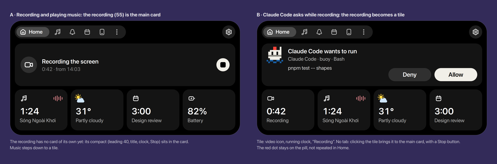

- The recording (priority 55) comes before music so it is usually the **main card**: its compact
  inside the card (leading 40, "Recording the screen", the clock, a cream Stop button). When
  something comes before it (an ask) it is **a tile**: icon `video`, the clock running, "Recording".
  **Decided** (Ethan, 2026-11-12)
- The tile of an activity with no tab (recording, screen sharing): clicking it brings it up as the
  main card, with its buttons. **Decided** (Ethan, 2026-11-12)
- The red dot is only on the pill, not repeated in Home ([Compact](../compact/index.md)).
  **Decided**

## The battery tile and power modes

*Ethan, 2026-11-14 (M4 item "Power").*

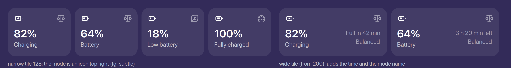

- The battery tile keeps the shared tile layout: the % large, under it "Charging", "Battery", "Low battery", "Fully charged" (only at 100 %) or "Plugged in" (plugged in but not charging: full below 100 %, held at the charge limit; 2026-11-16). **Decided**
- **The power mode in the top right corner**, a 16 icon in `fg-subtle`, exactly where the weather
  tile shows the reading's age and the music tile puts its equaliser. A wide tile (from 200) adds a
  detail column: the time (full in / left) and the mode's name. **Decided**
- A computer without power modes (no power-profiles-daemon): no corner icon, no list below; clicking
  the tile opens Settings → Power as before.

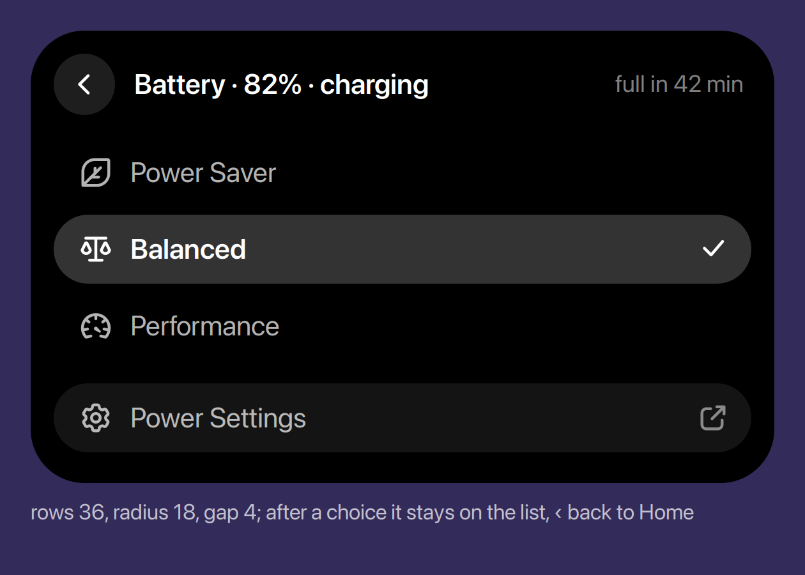

- **Clicking the battery tile → a list replaces the main card and the row of tiles**, as clicking
  Missed: the head is ‹, "Battery · 82% · charging" and the time at the end; three rows Power Saver /
  Balanced / Performance, the chosen row on `fill-3`, text 600 and a ✓; the last row "Power Settings
  ↗" opens Settings → Power. Rows 36, radius 18, 4 apart. **Decided**
  (Ethan, 2026-11-14: option A)
- Choosing a mode: changes at once, the list stays open, the mode-change flash does not show (you are
  already looking at Home); ‹ or Esc goes back to Home. **Decided**

## The phone tile

*Ethan, 2026-11-17 (M4 item "Phone via GSConnect", part 1).*

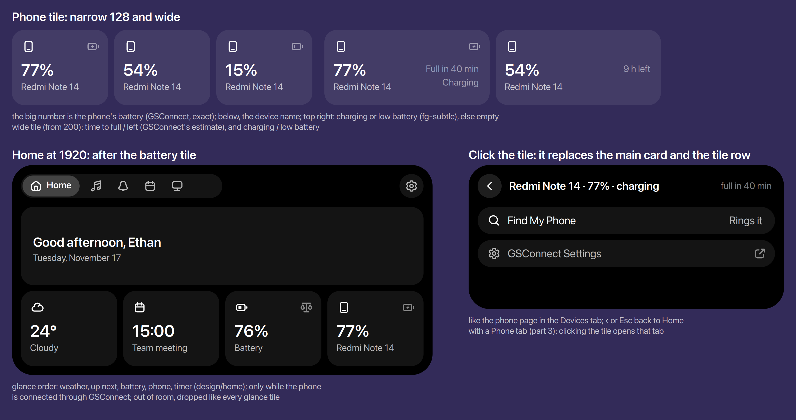

- A glance tile for the connected GSConnect phone, **after the battery tile** (order weather,
  upcoming, battery, phone, timer): the large number is the phone's battery (GSConnect's exact
  number), under it the device's name. With no phone connected there is no tile, no reminder.
  **Decided**
- **Top right corner** (`fg-subtle`, where the battery tile puts the mode): a charging or low
  battery (under 20 %) icon; otherwise empty. A wide tile (from 200): the time to full / left
  (GSConnect's estimate) and "Charging" / "Low battery". **Decided**
- **Clicking the tile**: a list replaces the main card and the row of tiles, as the battery tile's:
  "Redmi Note 14 · 77% · charging", the time at the end; **Find My Phone** (rings it), **GSConnect
  Settings**. With the Phone tab (part 3) the click opens that tab, Find My Phone at the top of the
  tab (2026-11-18); with the Phone module off the list is as above. **Decided**
- Code: `lib/modules/device/glance.js` (`PhoneGlance`, order 40), `kit/model/phone.js` `phoneTile`,
  `phoneHomePage`.

## In the code

- `lib/kit/ui/home.js` — rewritten to this layout: main card, row of tiles, fill rule, wide tiles;
  the Missed section, chips and two columns of blocks dropped.
- `CONTRACT.md`, `lib/kit/model/activity.js` — an activity's tile comes from its minimal (leading →
  icon, label → number); a new field for the glances (weather, calendar, battery, phone, timer).
- `lib/modules/weather/`, `lib/modules/calendar/` — wide tiles; weather uses colour icons at 24 and
  48.
- `lib/kit/model/stack.js` — Missed also counts unseen notifications (from the notifications
  module's `flagMissed`).
- SPEC §3 rewritten (replacing "Missed", chips and the blocks), §4 (Home is no longer 56 + 32n).
