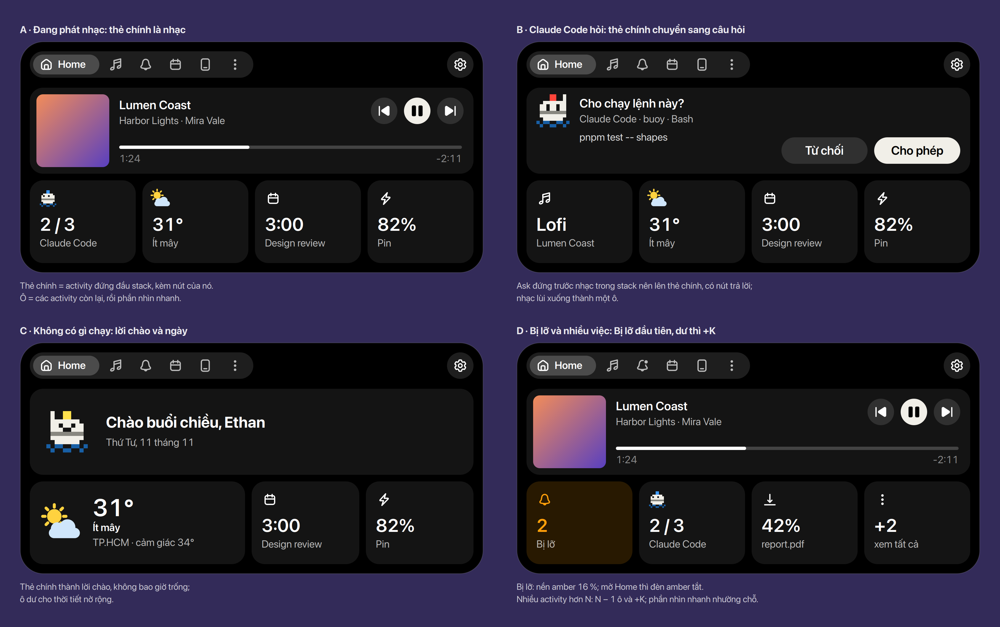
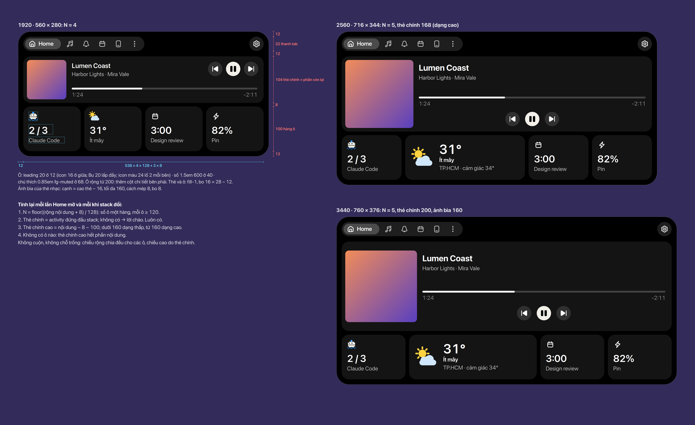
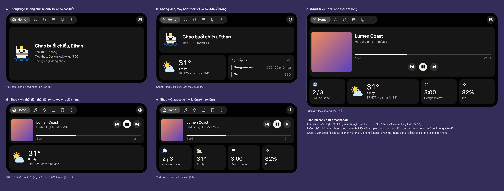

# Home

Tab đầu tiên của expanded: một **thẻ chính** ở trên và một **hàng ô** ở dưới (kiểu H5). Bố cục tính
lại mỗi lần Home mở và mỗi khi stack đổi, nên Home không bao giờ trống và không cuộn. Số dùng chung ở
[Bảng số](../tokens.vi.md); thanh tab và các tab khác ở [Tab](../tabs/index.vi.md).

*Thanh tab trong hình chỉ để minh hoạ; tab nào luôn hiện là phần [Tab](../tabs/index.vi.md).*

## Quyết định

- Home = thẻ chính + một hàng ô (H5), thay cho mục Bị lỡ, chip và hai cột khối của SPEC §3.
  Chọn giữa H1–H8. **Chốt** (Ethan, 2026-11-11)
- **Thẻ chính** là activity đứng đầu stack, kèm nút của nó; không có activity nào thì là **lời
  chào** (Bu vẫy tay, ngày). Thẻ chính luôn có. **Chốt** (Ethan, 2026-11-11)
- **Ô** là các activity còn lại, rồi phần **nhìn nhanh** (thời tiết, sắp tới, pin, điện thoại,
  hẹn giờ…). Bấm thẻ hoặc ô: mở tab của nó. **Chốt** (Ethan, 2026-11-11)
- Thời tiết và sắp tới có **ô rộng** (2 phần): thời tiết dùng icon màu của Buoy ở 48, sắp tới hiện 2
  sự kiện với màu của lịch. **Chốt** (Ethan, 2026-11-11)
- Hẹn giờ có một ô nhìn nhanh để bắt đầu, cả khi không chạy; thêm khi làm mục Timer. **Chốt**
  (Ethan, 2026-11-11)
- Activity chưa có thẻ chính riêng dùng compact của nó (phần đầu 56 và thân) đặt trong thẻ, nên chỉ
  nhạc, câu hỏi của Claude Code, cuộc gọi và lời chào cần thiết kế riêng. **Đề xuất**

## Kích thước

- Phần đầu **56**: thanh tab cao 32, cách mép trên 12; ⚙ tròn 32 đứng riêng bên phải, mở Cài
  đặt. **Chốt**
- Dưới phần đầu: thẻ chính, cách **8**, hàng ô cao **100**, lề dưới **12**; lề hai bên 12. Thẻ chính
  cao = phần còn lại: **104 / 168 / 200** ở 1920 / 2560 / 3440. Không có ô nào thì thẻ chính cao hết.
  **Chốt** (Ethan, 2026-11-11)
- Thẻ và ô: nền `fill-1`, bo **16** (= 28 − 12, đồng tâm). **Chốt** (Ethan, 2026-11-11)
- Thẻ chính hai dạng: **thấp** dưới 160 (nút góc phải trên, thanh tiến trình ở chân), **cao** từ 160
  (tên 1.27em 700, nút giữa dưới thanh). Ảnh bìa: cạnh = cao thẻ − 16, tối đa **160**, cách mép 8,
  bo 8. **Chốt** (Ethan, 2026-11-11)
- Ô: ô leading **20** ở 12 (icon 16 ở giữa; Bu 20 lấp đầy; icon màu 24 lố 2 mỗi bên), số 1.5em 600,
  chú thích 0.85em `fg-muted`. Ô rộng từ **200** thêm cột chi tiết bên phải (0.85em `fg-subtle`).
  **Chốt** (Ethan, 2026-11-11)
- Ô Bị lỡ: nền amber 16 %, icon và số amber ([Bảng màu](../colours/index.vi.md)). **Chốt**

## Cách lấp hàng ô

1. **N** = floor((rộng nội dung + 8) / 128): số ô một hàng, mỗi ô rộng ít nhất 120. N = 4 ở 1920,
   5 ở 2560 và 3440.
2. **Activity trước**, Bị lỡ đứng đầu, mỗi cái một ô. Nhiều hơn N: N − 1 ô và ô **+K** (bấm xem
   tất cả), nên activity nào cũng tới được.
3. **Còn chỗ:** phần nhìn nhanh theo thứ tự thời tiết, sắp tới, pin, điện thoại, hẹn giờ…, mỗi cái
   một ô. Hết chỗ thì bỏ; phần nhìn nhanh không vào +K.
4. **Còn dư:** thời tiết rồi sắp tới nở thành ô rộng. Còn ít hơn N phần mà không còn gì để nở: các
   ô rộng ra cho đầy hàng.

Cả bốn bước là **Chốt** (Ethan, 2026-11-11). Chiều rộng luôn chia hết cho các ô, chiều cao do thẻ
chính lấy phần còn lại: không cuộn, không chỗ trống.

## Còn mở

- Bấm **+K** và bấm ô **Bị lỡ** mở gì: thẻ chính tạm thành danh sách (có nút quay lại), hay một
  tab. Tab Thông báo không hợp cho Bị lỡ: danh sách bị lỡ có cả tải về, đã chép…
- Icon **pin** và **Bluetooth**: Gravity UI không có ([Icon](../icons/index.vi.md)); trong hình
  pin tạm dùng `thunderbolt`.

## Chỗ trong code

- `lib/kit/home.js` — viết lại theo bố cục này: thẻ chính, hàng ô, quy tắc lấp, ô rộng; bỏ mục
  Bị lỡ, chip và hai cột khối.
- `CONTRACT.md`, `lib/kit/activity.js` — ô của một activity lấy từ minimal của nó (leading → icon,
  nhãn → số); một trường mới cho phần nhìn nhanh (thời tiết, lịch, pin, điện thoại, hẹn giờ).
- `lib/modules/weather/`, `lib/modules/calendar/` — ô rộng; thời tiết dùng icon màu ở 24 và 48.
- SPEC §3 viết lại (thay "Missed", chip và các khối), §4 (Home không còn 56 + 32n).
