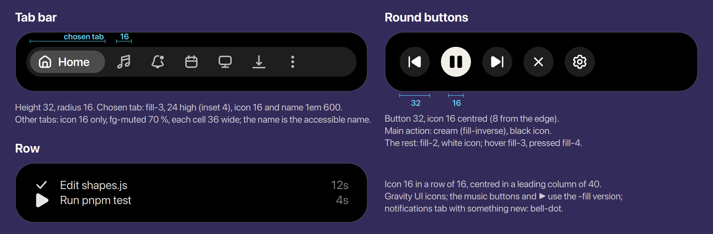
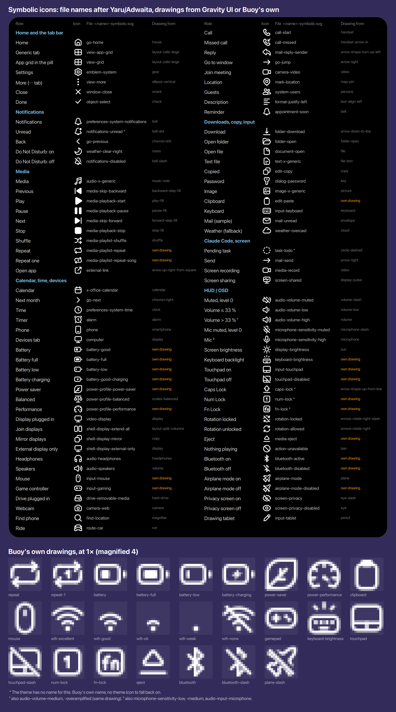
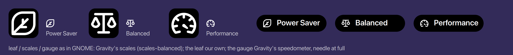
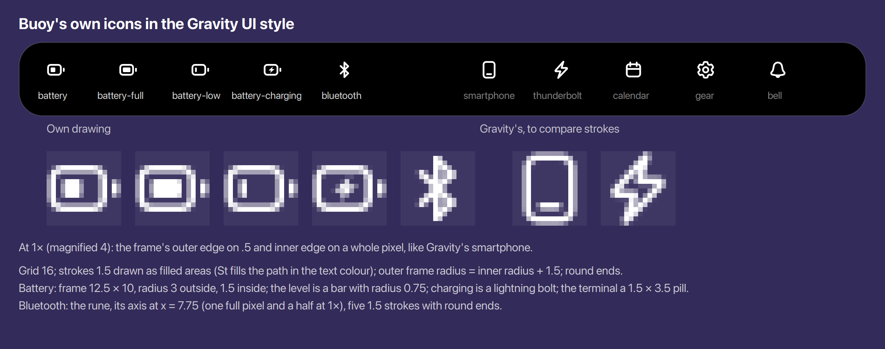

# Icons

Daypart and weather icons: 19 colour SVGs, one family; `scripts/icons.js` is the source and draws
[docs/icons.png](../../icons.png) (palette A, light blue clouds; Ethan, 2026-11-06).

## Decisions

- Redrawn on a **24** grid (`viewBox="0 0 24 24"`; today a 16 grid shown at 20) and **filling the
  pill's 24 leading slot**. Still vector SVG, not a pixel style. At 24 px each unit is exactly 1 px,
  at 48 exactly 2 px; at 40 (the compact's leading) a little soft, since 40 / 24 is not whole.
  **Decided** (Ethan, 2026-11-11) (replaces the 20 grid in a 24 slot of 2026-11-10)
- With large text the slot goes to 30: the icon is vector so it grows with the em, 24 at 1em, 30 at
  1.25; crisp only at 1em, a little soft at other sizes but never broken. **Decided** (Ethan,
  2026-11-10)
- Keep palette A and the id of each part (sun, moon, cloud, rain…), so a tab can split an icon into
  layers and animate them. **Decided** (2026-11-06)
- Current brief: 24 px in the pill, 40 px in the hover card, always on black; flat solid shapes, no
  gradient, no outline, no text. The horizon at y 11 of the 16 grid (not at the bottom), so at
  20 px it sits on the baseline of the time's digits. **Decided** (Ethan, 2026-11-06)

- **Horizon** (daypart icons): exactly one pixel row, **row 16** of the 24 grid (y 16–17), x 1–23;
  in the 32 pill that is row 20 (the content box is 4 from the top). 1 px at 24, 2 px (rows 32–33)
  at 48. This is the bottom row of the time's digits with 1em text (SF Pro Display 11, 1×, measured
  2026-11-12). Not on an odd half-pixel row as converting from the 16 grid gives (a 1.5 px stroke
  across two rows, soft lower edge). **Decided** (Ethan, 2026-11-11; the whole scene down 1 px from
  row 15, 2026-11-12, since 1em text sits lower than 13 px text)
- **Dotted arc** (the sun's path): single solid pixels in `#6B737C` instead of round 1-unit dots at
  60 %, symmetric, on an arc around the centre (12, 16) with a radius of about 8.4; at 48 each pixel
  becomes a 2 × 2 cell. The spacing need not be exactly even: the pixels are small enough not to
  show it. 10 cells [column, row], symmetric about x = 12: (3, 13) (4, 11) (6, 9) (8, 8) (10, 7) |
  (13, 7) (15, 8) (17, 9) (19, 11) (20, 13); each cell's centre is 8.28 to 8.86 from (12, 16); rows
  14 and 15 left empty above the horizon. **Decided** (Ethan, 2026-11-11; down 1 row with the
  horizon, 2026-11-12)
- The sun on the arc (morning, noon, afternoon): a disc of radius 3, eight rays as 2 px dots at
  radius 5, the first ray at 0° (was 22.5°), so at 24 px the vertical and horizontal rays land on
  whole pixels. Centres: morning (7, 9), noon (12, 8), afternoon (17, 9) (down 1 row, 2026-11-12). The
  standalone sun (weather) keeps line rays. **Decided** (Ethan,
  2026-11-11)
- Sunrise and sunset: a half disc of radius 5 standing on row 16, centre x 9 (sunrise) and x 15
  (sunset; sunset is sunrise flipped about x = 12). **Five rays** 35° apart (20°, 55°, 90°, 125°,
  160° above the horizon), 2 px wide; the three upper rays 4 px long, the two outer ones 3 px.
  **Decided** (Ethan, 2026-11-11)
- The drawings: branch `feat/m4-icons-24` (commit 5d07965, not pushed), merged with the branch that
  moves the pill's leading to 24.

## Symbolic icons

- Symbolic icons (tabs, buttons, rows, the leading of kinds without an image) are the **Gravity UI**
  set (`@gravity-ui/icons` 2.23.0, MIT, 16 grid), shipped with Buoy. Drawn straight on the 16 grid,
  so the strokes are crisp at 1×; soft rounding that suits the text in the pill. **Decided** (Ethan,
  2026-11-11)
- Music buttons (back, pause/play, forward) and ▶ in rows use the `-fill` version; the rest the
  plain one. **Decided** (Ethan, 2026-11-11)
- The notifications tab with unread messages: `bell-dot` instead of `bell` (replacing the CSS dot
  on the bell). **Decided** (Ethan, 2026-11-11)
- **File names follow the theme**: each shipped icon is `<name>-symbolic.svg` with the exact name
  Yaru/Adwaita give that icon (`window-close`, `media-playback-pause`, `audio-volume-high`,
  `go-home`…), so any missing file makes St use the theme's icon of the same name. Gravity names
  remain only as the drawing's source in `render/gravity-ui/`. An idea the theme has no name for
  gets a Buoy name, with no fallback icon: `notifications-unread` (bell-dot), `task-todo`
  (circle-dashed), `caps-lock`, `num-lock`, `fn-lock`. **Decided** (Ethan, 2026-11-12)
- **Every symbolic icon Buoy draws** (tabs, buttons, rows, HUD/OSD, media, calendar, downloads,
  copied) is a Gravity drawing or Buoy's own, HUD and the buttons that used theme icons included.
  GNOME's stay: `prefs.js` (an Adwaita app), the system cluster (SPEC §1), app logos, the colour
  daypart and weather icons. **Decided** (Ethan, 2026-11-12)
- Icons by role (table in `render/symbolic-map.js`, image below): **Decided** (Ethan, 2026-11-12;
  the roles Home, tabs, music buttons, close, settings, done, pending task, send, battery,
  Bluetooth from 2026-11-11)

  | Role | File (`<name>-symbolic.svg`) | Drawing |
  |---|---|---|
  | Home, general tab, app grid, settings, ⋯ tab | `go-home`, `view-app-grid`, `view-grid`, `emblem-system`, `view-more` | `house`, `layout-cells-large` (×2), `gear`, `ellipsis-vertical` |
  | Close, done | `window-close`, `object-select` | `xmark`, `check` |
  | Notifications, unread, back | `preferences-system-notifications`, `notifications-unread`, `go-previous` | `bell`, `bell-dot`, `chevron-left` |
  | Do Not Disturb on, off | `weather-clear-night`, `notifications-disabled` | `moon`, `bell-slash` |
  | Media; back, play, pause, forward, stop | `audio-x-generic`; `media-skip-backward`, `media-playback-start`, `-pause`, `media-skip-forward`, `media-playback-stop` | `music-note`; `backward-step-fill`, `play-fill`, `pause-fill`, `forward-step-fill`, `stop-fill` |
  | Shuffle, repeat, repeat one track, open app | `media-playlist-shuffle`, `media-playlist-repeat`, `-repeat-song`, `external-link` | `shuffle`, own, own, `arrow-up-right-from-square` |
  | Calendar, next month, time, alarm, phone, Devices tab | `x-office-calendar`, `go-next`, `preferences-system-time`, `alarm`, `phone`, `computer` | `calendar`, `chevron-right`, `clock`, `alarm`, `smartphone`, `display` |
  | Battery, full, low, charging | `battery-good`, `battery-full`, `battery-low`, `battery-good-charging` | own |
  | Power mode: power saver, balanced, performance | `power-profile-power-saver`, `-balanced`, `-performance` | own, `scales-balanced`, own (`speedometer`, needle at full) |
  | Download, open folder, open file, text file | `folder-download`, `folder-open`, `document-open`, `text-x-generic` | `arrow-down-to-line`, `folder-open`, `file`, `file-text` |
  | Copied, password, image, clipboard | `edit-copy`, `dialog-password`, `image-x-generic`, `edit-paste` | `copy`, `key`, `picture`, own |
  | Keyboard, mail (sample), weather (fallback) | `input-keyboard`, `mail-unread`, `weather-overcast` | `keyboard`, `envelope`, `cloud` |
  | Pending task, send, screen recording, screen sharing | `task-todo`, `mail-send`, `media-record`, `screen-shared` | `circle-dashed`, `arrow-right`, `video`, `display-pulse` |
  | Volume: muted or 0, ≤ 33 %, the rest | `audio-volume-muted`, `-low`, `-medium` / `-high` / `-overamplified` | `volume-slash`, `volume-low`, `volume` |
  | Mic: muted or 0, every level | `microphone-sensitivity-muted`, `-low` / `-medium` / `-high`, `audio-input-microphone` | `microphone-slash`, `microphone` |
  | Screen brightness, keyboard backlight | `display-brightness`, `keyboard-brightness` | `sun`, own |
  | Touchpad on, off | `input-touchpad`, `touchpad-disabled` | own |
  | Caps Lock, Num Lock, Fn Lock | `caps-lock`, `num-lock`, `fn-lock` | `arrow-shape-up-from-line`, own, own |
  | Rotation locked, rotation unlocked, eject, nothing playing | `rotation-locked`, `rotation-allowed`, `media-eject`, `action-unavailable` | `arrows-rotate-right-slash`, `arrows-rotate-right`, own, `ban` |
  | Bluetooth on, off; airplane on, off | `bluetooth-active`, `bluetooth-disabled`; `airplane-mode`, `airplane-mode-disabled` | own, own; `plane`, own |
  | Privacy screen on, off; drawing tablet | `screen-privacy`, `screen-privacy-disabled`; `input-tablet` | `eye-slash`, `eye`; `pencil` |
  | Mouse, game controller | `input-mouse`, `input-gaming` | own |
  | Drive plugged in, webcam, find phone | `drive-removable-media`, `camera-web`, `find-location` | `hard-drive`, `camera`, `magnifier` |
  | Ride on the phone (Grab, Be) | `route-car` (Buoy's name) | `car` |
  | Call, missed call, reply | `call-start`, `call-missed`, `mail-reply-sender` | `handset`, `handset-arrow-in`, `arrow-shape-turn-up-left` |
  | Switch to window | `go-jump` | `arrow-right` |
  | Terminal (when the app has no logo) | `utilities-terminal` | `terminal` |
  | Network: Wi-Fi four levels, no signal; wired; VPN on, off; error | `network-wireless-signal-*`, `network-offline`; `network-wired`; `network-vpn`, `network-vpn-disabled`; `network-error` | own (`own/wifi-*`); `plug-connection`; `shield-check`, `shield`; `circle-exclamation` |
  | Print job | `printer` | `printer` |
  | Timer: −/+ one minute, restart, delete | `list-remove`, `list-add`, `view-refresh`, `user-trash` | `minus`, `plus`, `arrow-rotate-left`, `trash-bin` |
  | Join meeting | `camera-video` | `video` |
  | Location, guests, description, reminder (event page) | `mark-location`, `system-users`, `format-justify-left`, `appointment-soon` | `map-pin`, `persons`, `text-align-left`, `bell` |

- Claude Code's pending task: Gravity's `circle-dashed` instead of `circle`. **Decided** (Ethan,
  2026-11-12)
- Volume and mic at level 0 use the muted icon as Shell does (`ui/status/volume.js` `getIcon`),
  even though gsd sends `-low`. **Decided** (Ethan, 2026-11-12)
- The HUD says Bluetooth and airplane mode in Buoy's words, like Caps Lock: "Bluetooth on / off",
  "Airplane Mode on / off", instead of gsd's ("Bluetooth Enabled"…). **Decided** (Ethan, 2026-11-12)
- Icons are one solid colour, with no dim parts in the file: St sets the whole icon's opacity from
  the text colour, so an icon is dim only when Buoy's CSS gives it a dim colour (unselected tab:
  `fg-muted`); the .5 dim parts are Yaru's way, not Buoy's. **Decided** (Ethan, 2026-11-12)
- **Size 16 everywhere**: tab strip, 32 button, pill, 16 rows (Claude Code, missed). **Decided**
  (Ethan, 2026-11-11)
- **Tab strip**: 32 high, radius 16. Selected tab: `fill-3` background 24 high (4 from the edge),
  icon 16 and the name at 1em 600. Other tabs: icon 16 only, `fg-muted`, each tile 36 wide; the
  name is the accessible name. **Decided** (Ethan, 2026-11-11)
- **Round button**: 32, icon 16 in the middle (8 from the edge). The main action cream
  (`fill-inverse`), black icon; the rest `fill-2`, white icon; hover `fill-3`, press `fill-4`.
  **Decided** (Ethan, 2026-11-11)

*The icons in the image are Gravity UI's; SVGs and LICENSE are in `render/gravity-ui/`.*

### Own icons

- When Gravity UI lacks an icon, Buoy **draws its own in Gravity's style**, to complete the set;
  never from another set. From now on, any missing icon is drawn the same way. **Decided** (Ethan,
  2026-11-11, 2026-11-12)
- How: 16 grid; 1.5 strokes drawn as filled areas (St fills `path` with the text colour); outer
  frame radius = inner radius + 1.5, outer edge on .5, inner edge on whole numbers as Gravity's
  `smartphone`; round caps. SVGs in `render/own/`. **Decided** (Ethan, 2026-11-11)
- First: battery (four levels) and Bluetooth, as in the image below. **Decided** (Ethan, 2026-11-12)
- **Gravity first**: look for every icon in Gravity UI first; if it is not there, propose a drawing
  in Gravity's style; only then decide with Ethan whether to let the theme's icon of the same name
  be the fallback. Never let the theme stand in without anyone knowing (`tests/icons.test.js`
  requires a Buoy file for every icon name in the code). **Decided** (Ethan, 2026-11-12)
- **Slashed versions** in Gravity's style (`volume-slash`, `microphone-slash`): a 1.5 slash from
  (2.5, 2.5) to (13.5, 13.5); the drawing touches the stroke on the lower-left side, leaves a 1.5
  gap on the upper-right, cut with a `clipPath` (no mask: St forces every path's `fill` to the text
  colour). **Decided** (Ethan, 2026-11-12)
- Second batch (OSD and buttons): keyboard backlight (a low keyboard with three rays), touchpad on /
  off, eject (a rounded triangle like `triangle-up` over a bar), Num Lock (the `square-hashtag`
  frame with the 1 from `circle-number-1`), Fn Lock (that frame with the letters fn), repeat and
  repeat one track, clipboard, Bluetooth off, airplane off (`plane` slashed). Script:
  `render/draw-own.js`. **Decided** (Ethan, 2026-11-12)
- Third batch (wireless devices, the "Bluetooth device" item): mouse (a capsule with a wheel), game
  controller (a rounded body, a plus on the left, two buttons on the right). Gravity has neither.
  (2026-11-17)

- **Power modes** (Power Saver / Balanced / Performance): drawings as GNOME's (Adwaita
  `power-profile-*`) — leaf, scales, gauge. The scales are Gravity's `scales-balanced`. The gauge
  is Gravity's `speedometer` with the needle turned all the way (the original needle points at
  about 40 %, not "performance"). Gravity has no leaf, so Buoy draws its own in Gravity's style
  (1.5 stroke, round caps, a leaf rounded at two corners, r 7). Both in `render/draw-own.js`. File
  names follow GNOME: `power-profile-{power-saver,balanced,performance}-symbolic`. **Decided**
  (Ethan, 2026-11-14)

## In the code

- `scripts/icons.js` — redraws the 19 icons on the 24 grid; run it again to write
  `src/buoy@murilegus/icons/color/{daypart,weather}-*.svg` and `docs/icons.png`.
- The icon size in the pill is in em, so it grows with large text.
- `src/buoy@murilegus/icons/symbolic/` — `<theme name>-symbolic.svg`, with Gravity UI's LICENSE;
  `scripts/symbolic-icons.js` rewrites the whole folder from the table in `render/symbolic-map.js`
  (Gravity drawings in `render/gravity-ui/`, Buoy's own in `render/own/`, drawn by
  `render/draw-own.js`). The `-symbolic.svg` suffix makes St fill them with the text colour like
  the theme's icons (`st-icon-theme.c` `st_icon_info_load_symbolic_svg`).
- `kit/ui/present/elements.js` `iconProps(name)` — Buoy's file of the same name first, then the
  theme icon; every Buoy `St.Icon` goes through it (or `fallbackIcon` for a fallback icon).

`docs/icons.png` and `scripts/icons.js` stay where they are until the root docs in `docs/` are
tidied (Ethan, 2026-11-10).
