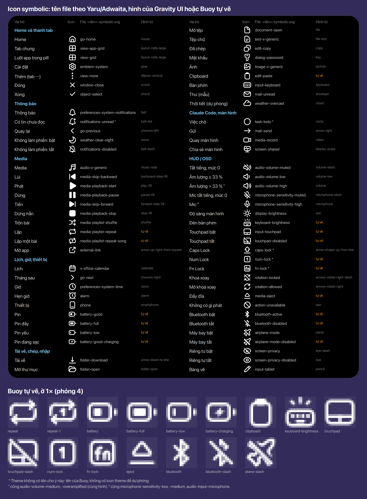
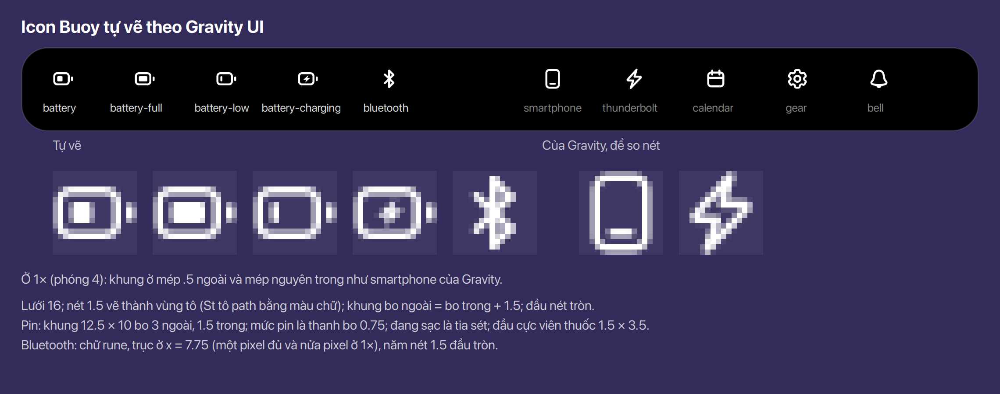

# Icon

Icon buổi trong ngày và thời tiết: 19 SVG màu, một họ, `scripts/icons.js` là nguồn và vẽ ra
[docs/icons.png](../../icons.png) (bảng màu A, mây xanh nhạt; Ethan, 2026-11-06).

## Quyết định

- Vẽ lại trên lưới **24** (`viewBox="0 0 24 24"`; hiện là lưới 16 hiện ở 20) và **đầy ô leading 24**
  của pill. Vẫn là SVG vector, không đổi sang kiểu pixel. Ở 24 px mỗi đơn vị đúng 1 px, ở
  48 đúng 2 px; ở 40 (leading của compact) hơi mềm vì 40 / 24 không nguyên. **Chốt** (Ethan, 2026-11-11)
  (thay lưới 20 trong ô 24 của 2026-11-10)
- Khi bật chữ lớn, ô lên 30: icon là vector nên lớn theo em, 24 ở 1em, 30 ở 1.25; chỉ nét tuyệt
  đối ở 1em, ở cỡ khác hơi mềm nhưng không vỡ. **Chốt** (Ethan, 2026-11-10)
- Giữ bảng màu A và id từng phần (sun, moon, cloud, rain…), để một tab có thể tách icon thành lớp
  mà chuyển động. **Chốt** (2026-11-06)
- Brief hiện tại: 24 px trong pill, 40 px trong card hover, luôn trên nền đen; khối phẳng tô
  đặc, không gradient, không viền, không chữ. Đường chân trời ở y 11 của lưới 16 (không ở đáy),
  để ở 20 px nó nằm đúng hàng chân chữ của giờ. **Chốt** (Ethan, 2026-11-06)

- **Đường chân trời** (icon buổi): đúng một hàng pixel, **hàng 16** của lưới 24 (y 16–17), x 1–23;
  trong pill 32 là hàng 20 (khung nội dung cách đỉnh 4). 1 px ở 24, 2 px (hàng 32–33) ở 48. Đây là
  hàng đáy của chữ số giờ khi chữ 1em (SF Pro Display 11, 1×, đo 2026-11-12). Không đặt ở hàng lẻ
  nửa pixel như cách quy đổi từ lưới 16 (nét 1.5 px vắt qua hai hàng, mờ mép dưới). **Chốt**
  (Ethan, 2026-11-11; cả cảnh hạ 1 px từ hàng 15, 2026-11-12, vì chữ 1em có chân thấp hơn chữ 13 px)
- **Cung chấm** (đường mặt trời đi): từng pixel đặc màu `#6B737C` thay cho chấm tròn 1 đơn vị mờ
  60 %, đối xứng, trên cung quanh tâm (12, 16) bán kính khoảng 8.4; ở 48 mỗi pixel thành ô 2 × 2.
  Khoảng cách không cần đều hẳn: pixel nhỏ nên không thấy. 10 ô [cột, hàng], đối xứng qua x = 12:
  (3, 13) (4, 11) (6, 9) (8, 8) (10, 7) | (13, 7) (15, 8) (17, 9) (19, 11) (20, 13); tâm mỗi ô cách
  (12, 16) từ 8.28 đến 8.86; hàng 14 và 15 để trống trên đường chân trời. **Chốt** (Ethan, 2026-11-11;
  hạ 1 hàng cùng đường chân trời, 2026-11-12)
- Mặt trời trên cung (sáng, trưa, chiều): đĩa bán kính 3, tám tia là chấm 2 px ở bán kính 5, tia
  đầu ở 0° (trước là 22.5°), để ở 24 px tia đứng và tia ngang rơi đúng pixel. Tâm: sáng (7, 9), trưa
  (12, 8), chiều (17, 9) (hạ 1 hàng, 2026-11-12). Mặt trời đứng riêng (thời tiết) giữ tia dạng vạch. **Chốt** (Ethan,
  2026-11-11)
- Bình minh và hoàng hôn: nửa đĩa bán kính 5 đứng trên hàng 16, tâm x 9 (bình minh) và x 15 (hoàng
  hôn; hoàng hôn là bình minh lật qua x = 12). **Năm tia** cách nhau 35° (20°, 55°, 90°, 125°, 160°
  trên đường chân trời), rộng 2 px; ba tia trên dài 4 px, hai tia ngoài 3 px. **Chốt** (Ethan,
  2026-11-11)
- Bản vẽ: nhánh `feat/m4-icons-24` (commit 5d07965, chưa push), merge cùng nhánh đổi leading của
  pill sang 24.

## Icon symbolic

- Icon symbolic (tab, nút, hàng, leading của các loại không có ảnh) là bộ **Gravity UI**
  (`@gravity-ui/icons` 2.23.0, MIT, lưới 16), ship cùng Buoy. Vẽ thẳng trên lưới 16 nên nét ở 1×;
  bo mềm, hợp chữ trong pill. **Chốt** (Ethan, 2026-11-11)
- Nút nhạc (lùi, dừng/phát, tiến) và ▶ trong hàng dùng bản `-fill`; còn lại bản thường. **Chốt** (Ethan,
  2026-11-11)
- Tab thông báo khi có tin chưa đọc: `bell-dot` thay `bell` (thay chấm CSS trên chuông). **Chốt**
  (Ethan, 2026-11-11)
- **Tên file theo theme**: mỗi icon ship là `<tên>-symbolic.svg` với đúng tên Yaru/Adwaita đặt
  cho icon đó (`window-close`, `media-playback-pause`, `audio-volume-high`, `go-home`…), để thiếu
  file nào thì St tự dùng icon cùng tên của theme. Tên Gravity chỉ còn là nguồn hình trong
  `render/gravity-ui/`. Ý nào theme không có tên thì Buoy đặt tên riêng, không có icon dự phòng:
  `notifications-unread` (bell-dot), `task-todo` (circle-dashed), `caps-lock`, `num-lock`, `fn-lock`.
  **Chốt** (Ethan, 2026-11-12)
- **Mọi icon symbolic Buoy vẽ** (tab, nút, hàng, HUD/OSD, media, lịch, tải về, đã chép) là hình
  Gravity hoặc Buoy tự vẽ, kể cả HUD và các nút trước đây lấy icon theme. Giữ của GNOME: `prefs.js`
  (một app Adwaita), cụm hệ thống (SPEC §1), logo app, icon màu buổi và thời tiết. **Chốt**
  (Ethan, 2026-11-12)
- Icon theo vai trò (bảng ở `render/symbolic-map.js`, hình dưới): **Chốt** (Ethan, 2026-11-12;
  vai trò Home, tab, nút nhạc, đóng, cài đặt, xong, việc chờ, gửi, pin, Bluetooth từ 2026-11-11)

  | Vai trò | File (`<tên>-symbolic.svg`) | Hình |
  |---|---|---|
  | Home, tab chung, lưới app, cài đặt, tab ⋯ | `go-home`, `view-app-grid`, `view-grid`, `emblem-system`, `view-more` | `house`, `layout-cells-large` (×2), `gear`, `ellipsis-vertical` |
  | Đóng, xong | `window-close`, `object-select` | `xmark`, `check` |
  | Thông báo, có tin chưa đọc, quay lại | `preferences-system-notifications`, `notifications-unread`, `go-previous` | `bell`, `bell-dot`, `chevron-left` |
  | Không làm phiền bật, tắt | `weather-clear-night`, `notifications-disabled` | `moon`, `bell-slash` |
  | Media; lùi, phát, dừng, tiến, dừng hẳn | `audio-x-generic`; `media-skip-backward`, `media-playback-start`, `-pause`, `media-skip-forward`, `media-playback-stop` | `music-note`; `backward-step-fill`, `play-fill`, `pause-fill`, `forward-step-fill`, `stop-fill` |
  | Trộn bài, lặp, lặp một bài, mở app | `media-playlist-shuffle`, `media-playlist-repeat`, `-repeat-song`, `external-link` | `shuffle`, tự vẽ, tự vẽ, `arrow-up-right-from-square` |
  | Lịch, tháng sau, giờ, hẹn giờ, điện thoại, tab Thiết bị | `x-office-calendar`, `go-next`, `preferences-system-time`, `alarm`, `phone`, `computer` | `calendar`, `chevron-right`, `clock`, `alarm`, `smartphone`, `display` |
  | Pin, đầy, yếu, đang sạc | `battery-good`, `battery-full`, `battery-low`, `battery-good-charging` | tự vẽ |
  | Tải về, mở thư mục, mở tệp, tệp chữ | `folder-download`, `folder-open`, `document-open`, `text-x-generic` | `arrow-down-to-line`, `folder-open`, `file`, `file-text` |
  | Đã chép, mật khẩu, ảnh, clipboard | `edit-copy`, `dialog-password`, `image-x-generic`, `edit-paste` | `copy`, `key`, `picture`, tự vẽ |
  | Bàn phím, thư (mẫu), thời tiết (dự phòng) | `input-keyboard`, `mail-unread`, `weather-overcast` | `keyboard`, `envelope`, `cloud` |
  | Việc chờ, gửi, quay màn hình, chia sẻ màn hình | `task-todo`, `mail-send`, `media-record`, `screen-shared` | `circle-dashed`, `arrow-right`, `video`, `display-pulse` |
  | Âm lượng: tắt tiếng hoặc 0, ≤ 33 %, còn lại | `audio-volume-muted`, `-low`, `-medium` / `-high` / `-overamplified` | `volume-slash`, `volume-low`, `volume` |
  | Mic: tắt tiếng hoặc 0, mọi mức | `microphone-sensitivity-muted`, `-low` / `-medium` / `-high`, `audio-input-microphone` | `microphone-slash`, `microphone` |
  | Độ sáng màn hình, đèn bàn phím | `display-brightness`, `keyboard-brightness` | `sun`, tự vẽ |
  | Touchpad bật, tắt | `input-touchpad`, `touchpad-disabled` | tự vẽ |
  | Caps Lock, Num Lock, Fn Lock | `caps-lock`, `num-lock`, `fn-lock` | `arrow-shape-up-from-line`, tự vẽ, tự vẽ |
  | Khoá xoay, mở khoá xoay, đẩy đĩa, không có gì phát | `rotation-locked`, `rotation-allowed`, `media-eject`, `action-unavailable` | `arrows-rotate-right-slash`, `arrows-rotate-right`, tự vẽ, `ban` |
  | Bluetooth bật, tắt; máy bay bật, tắt | `bluetooth-active`, `bluetooth-disabled`; `airplane-mode`, `airplane-mode-disabled` | tự vẽ, tự vẽ; `plane`, tự vẽ |
  | Màn hình riêng tư bật, tắt; bảng vẽ | `screen-privacy`, `screen-privacy-disabled`; `input-tablet` | `eye-slash`, `eye`; `pencil` |

- Việc chờ của Claude Code: `circle-dashed` của Gravity thay `circle`. **Chốt** (Ethan, 2026-11-12)
- Âm lượng và mic ở mức 0 dùng icon tắt tiếng như Shell (`ui/status/volume.js` `getIcon`), dù gsd
  gửi `-low`. **Chốt** (Ethan, 2026-11-12)
- HUD nói Bluetooth và chế độ máy bay bằng chữ của Buoy, như Caps Lock: "Bluetooth on / off",
  "Airplane Mode on / off", thay chữ của gsd ("Bluetooth Enabled"…). **Chốt** (Ethan, 2026-11-12)
- Icon một màu đặc, không có phần mờ trong file: St đặt độ mờ của cả icon theo màu chữ, nên icon
  chỉ mờ khi CSS của Buoy cho nó màu mờ (tab không chọn: `fg-muted`); phần mờ .5 là cách của Yaru,
  không phải của Buoy. **Chốt** (Ethan, 2026-11-12)
- **Cỡ 16 ở mọi chỗ**: thanh tab, nút 32, pill, hàng 16 (Claude Code, bị nhỡ). **Chốt** (Ethan,
  2026-11-11)
- **Thanh tab**: cao 32, bo 16. Tab đang chọn: nền `fill-3` cao 24 (cách mép 4), icon 16 và tên
  1em 600. Tab khác: chỉ icon 16, `fg-muted`, mỗi ô rộng 36; tên là accessible name. **Chốt**
  (Ethan, 2026-11-11)
- **Nút tròn**: 32, icon 16 ở giữa (cách mép 8). Hành động chính màu kem (`fill-inverse`), icon đen;
  còn lại `fill-2`, icon trắng; hover `fill-3`, nhấn `fill-4`. **Chốt** (Ethan, 2026-11-11)

*Icon trong hình là của Gravity UI; SVG và LICENSE ở `render/gravity-ui/`.*

### Icon tự vẽ

- Gravity UI thiếu icon nào thì Buoy **tự vẽ theo cách của Gravity**, cho đủ bộ; không lấy từ bộ
  khác. Từ nay về sau, thiếu icon nào cũng vẽ thêm như vậy. **Chốt** (Ethan, 2026-11-11, 2026-11-12)
- Cách vẽ: lưới 16; nét 1.5 vẽ thành vùng tô (St tô `path` bằng màu chữ); khung bo ngoài = bo trong
  + 1.5, mép ngoài ở .5, mép trong ở số nguyên như `smartphone` của Gravity; đầu nét tròn. SVG ở
  `render/own/`. **Chốt** (Ethan, 2026-11-11)
- Đầu tiên: pin (bốn mức) và Bluetooth, như hình dưới. **Chốt** (Ethan, 2026-11-12)
- **Gravity trước**: icon nào cũng tìm trong Gravity UI trước; không có thì đề xuất một hình vẽ
  theo cách của Gravity; chỉ sau đó mới cùng Ethan quyết có để icon theme cùng tên dự phòng hay
  không. Không bao giờ để theme thế chỗ mà không ai biết (`tests/icons.test.js` đòi mọi tên icon
  trong code có file của Buoy). **Chốt** (Ethan, 2026-11-12)
- **Bản gạch chéo** theo cách của Gravity (`volume-slash`, `microphone-slash`): nét gạch 1.5 từ
  (2.5, 2.5) tới (13.5, 13.5); hình chạm nét ở phía dưới-trái, chừa khe 1.5 ở phía trên-phải, cắt
  bằng `clipPath` (không dùng mask: St ép `fill` của mọi path theo màu chữ). **Chốt** (Ethan,
  2026-11-12)
- Đợt hai (OSD và các nút): đèn bàn phím (bàn phím thấp với ba tia), touchpad bật / tắt, đẩy đĩa
  (tam giác bo như `triangle-up` trên một thanh), Num Lock (khung `square-hashtag` với số 1 của
  `circle-number-1`), Fn Lock (khung đó với chữ fn), lặp và lặp một bài, clipboard, Bluetooth tắt,
  máy bay tắt (`plane` gạch chéo). Script: `render/draw-own.js`. **Chốt** (Ethan, 2026-11-12)

## Chỗ trong code

- `scripts/icons.js` — vẽ lại 19 icon trên lưới 24; chạy lại để ghi
  `src/buoy@murilegus/icons/color/{daypart,weather}-*.svg` và `docs/icons.png`.
- Cỡ icon trong pill tính bằng em để lớn theo chữ lớn.
- `src/buoy@murilegus/icons/symbolic/` — `<tên theme>-symbolic.svg`, kèm LICENSE của Gravity UI;
  `scripts/symbolic-icons.js` ghi lại cả thư mục từ bảng `render/symbolic-map.js` (hình Gravity
  ở `render/gravity-ui/`, hình Buoy tự vẽ ở `render/own/`, vẽ bởi `render/draw-own.js`). Tên đuôi
  `-symbolic.svg` để St tô bằng màu chữ như icon của theme (`st-icon-theme.c`
  `st_icon_info_load_symbolic_svg`).
- `kit/ui/present/elements.js` `iconProps(name)` — file của Buoy cùng tên trước, rồi icon theme;
  mọi `St.Icon` của Buoy đi qua nó (hoặc `fallbackIcon` cho icon dự phòng).

`docs/icons.png` và `scripts/icons.js` ở nguyên chỗ cũ cho tới khi các docs ở gốc `docs/` được làm
gọn lại (Ethan, 2026-11-10).
