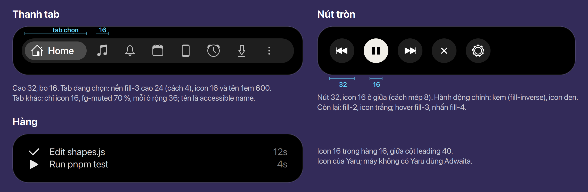

# Icon

Icon buổi trong ngày và thời tiết: 19 SVG màu, một họ, `scripts/icons.js` là nguồn và vẽ ra
[docs/icons.png](../../icons.png) (bảng màu A, mây xanh nhạt; Ethan, 2026-11-06).

## Quyết định

- Vẽ lại trên lưới **24** (`viewBox="0 0 24 24"`; hiện là lưới 16 hiện ở 20) và **đầy ô leading 24**
  của pill. Vẫn là SVG vector, không đổi sang kiểu pixel. Ở 24 px mỗi đơn vị đúng 1 px, ở
  48 đúng 2 px; ở 40 (leading của compact) hơi mềm vì 40 / 24 không nguyên. **Chốt** (Ethan, 2026-11-11)
  (thay lưới 20 trong ô 24 của 2026-11-10)
- Khi bật chữ lớn, ô lên 30: icon là vector nên lớn theo em, 24 ở 1em, 30 ở 1.25; chỉ nét tuyệt
  đối ở 1em, ở cỡ khác hơi mềm nhưng không vỡ. **Chốt** (Ethan, 2026-11-10)
- Giữ bảng màu A và id từng phần (sun, moon, cloud, rain…), để một tab có thể tách icon thành lớp
  mà chuyển động. **Chốt** (2026-11-06)
- Brief hiện tại: 24 px trong pill, 40 px trong card hover, luôn trên nền đen; khối phẳng tô
  đặc, không gradient, không viền, không chữ. Đường chân trời ở y 11 của lưới 16 (không ở đáy),
  để ở 20 px nó nằm đúng hàng chân chữ của giờ. **Chốt** (Ethan, 2026-11-06)

- **Đường chân trời** (icon buổi): đúng một hàng pixel, **hàng 15** của lưới 24 (y 15–16), x 1–23;
  trong pill 32 là hàng 19 (khung nội dung cách đỉnh 4). 1 px ở 24, 2 px (hàng 30–31) ở 48. Đây là
  hàng chân chữ của giờ (đo 2026-11-06). Không đặt ở hàng lẻ nửa pixel như cách quy đổi từ lưới 16
  (nét 1.5 px vắt qua hai hàng, mờ mép dưới). **Chốt** (Ethan, 2026-11-11)
- **Cung chấm** (đường mặt trời đi): từng pixel đặc màu `#6B737C` thay cho chấm tròn 1 đơn vị mờ
  60 %, đối xứng, trên cung quanh tâm (12, 15) bán kính khoảng 8.4; ở 48 mỗi pixel thành ô 2 × 2.
  Khoảng cách không cần đều hẳn: pixel nhỏ nên không thấy. 10 ô [cột, hàng], đối xứng qua x = 12:
  (3, 12) (4, 10) (6, 8) (8, 7) (10, 6) | (13, 6) (15, 7) (17, 8) (19, 10) (20, 12); tâm mỗi ô cách
  (12, 15) từ 8.28 đến 8.86; hàng 13 và 14 để trống trên đường chân trời. **Chốt** (Ethan, 2026-11-11)
- Mặt trời trên cung (sáng, trưa, chiều): đĩa bán kính 3, tám tia là chấm 2 px ở bán kính 5, tia
  đầu ở 0° (trước là 22.5°), để ở 24 px tia đứng và tia ngang rơi đúng pixel. Tâm: sáng (7, 8), trưa
  (12, 7), chiều (17, 8). Mặt trời đứng riêng (thời tiết) giữ tia dạng vạch. **Chốt** (Ethan,
  2026-11-11)
- Bình minh và hoàng hôn: nửa đĩa bán kính 5 đứng trên hàng 15, tâm x 9 (bình minh) và x 15 (hoàng
  hôn; hoàng hôn là bình minh lật qua x = 12). **Năm tia** cách nhau 35° (20°, 55°, 90°, 125°, 160°
  trên đường chân trời), rộng 2 px; ba tia trên dài 4 px, hai tia ngoài 3 px. **Chốt** (Ethan,
  2026-11-11)
- Bản vẽ: nhánh `feat/m4-icons-24` (commit 5d07965, chưa push), merge cùng nhánh đổi leading của
  pill sang 24.

## Icon symbolic

- Icon symbolic (tab, nút, hàng, leading của các loại không có ảnh) là bộ **Gravity UI**
  (`@gravity-ui/icons` 2.23.0, MIT, lưới 16), ship cùng Buoy. Vẽ thẳng trên lưới 16 nên nét ở 1×;
  bo mềm, hợp chữ trong pill. **Chốt** (Ethan, 2026-11-11)
- Nút nhạc (lùi, dừng/phát, tiến) và ▶ trong hàng dùng bản `-fill`; còn lại bản thường. **Chốt** (Ethan,
  2026-11-11)
- Tab thông báo khi có tin chưa đọc: `bell-dot` thay `bell`. **Chốt** (Ethan, 2026-11-11)
- Icon theo vai trò:

  | Vai trò | Icon |
  |---|---|
  | Home, Media, Thông báo, Lịch | `house`, `music-note`, `bell` / `bell-dot`, `calendar` |
  | Thiết bị, Hẹn giờ, Tải về, Thêm | `smartphone`, `alarm`, `arrow-down-to-line`, `ellipsis-vertical` |
  | Lùi, dừng, tiến, phát | `backward-step-fill`, `pause-fill`, `forward-step-fill`, `play-fill` |
  | Đóng, cài đặt, xong | `xmark`, `gear`, `check` |
  | Dừng, việc chờ, gửi | `stop-fill`, `circle`, `arrow-right` |
  | Quay màn hình, chia sẻ màn hình | `video`, `display-pulse` |
- **Cỡ 16 ở mọi chỗ**: thanh tab, nút 32, pill, hàng 16 (Claude Code, bị lỡ). **Chốt** (Ethan,
  2026-11-11)
- **Thanh tab**: cao 32, bo 16. Tab đang chọn: nền `fill-3` cao 24 (cách mép 4), icon 16 và tên
  1em 600. Tab khác: chỉ icon 16, `fg-muted`, mỗi ô rộng 36; tên là accessible name. **Chốt**
  (Ethan, 2026-11-11)
- **Nút tròn**: 32, icon 16 ở giữa (cách mép 8). Hành động chính màu kem (`fill-inverse`), icon đen;
  còn lại `fill-2`, icon trắng; hover `fill-3`, nhấn `fill-4`. **Chốt** (Ethan, 2026-11-11)

*Icon trong hình là của Gravity UI; SVG và LICENSE ở `render/gravity-ui/`.*

## Chỗ trong code

- `scripts/icons.js` — vẽ lại 19 icon trên lưới 24; chạy lại để ghi
  `src/buoy@murilegus/icons/{daypart,weather}-*.svg` và `docs/icons.png`.
- Cỡ icon trong pill tính bằng em để lớn theo chữ lớn.
- `src/buoy@murilegus/icons/` — chép các SVG Gravity UI đang dùng, đổi tên `<tên>-symbolic.svg`, kèm
  LICENSE của Gravity UI. Tên đuôi `-symbolic.svg` để St tô bằng màu chữ như icon của theme
  (`st-icon-theme.c` `st_icon_info_load_symbolic_svg`), như `caps-lock-symbolic.svg` đã có.

`docs/icons.png` và `scripts/icons.js` ở nguyên chỗ cũ cho tới khi các docs ở gốc `docs/` được làm
gọn lại (Ethan, 2026-11-10).
