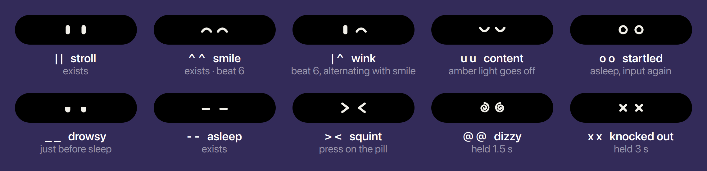
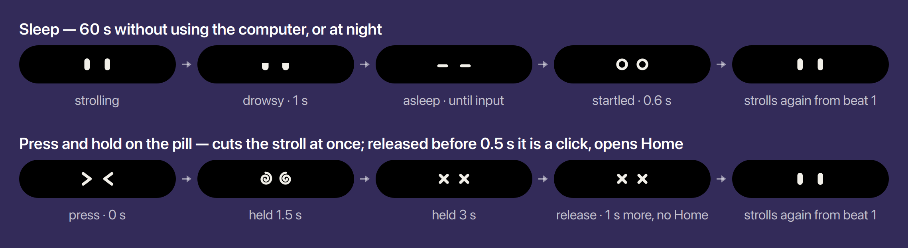

# Bu

Bu, Buoy's mascot: a 10 × 10 grid, 13 poses, a light on its head. The source is
[MASCOT.md](../../MASCOT.md) (English): `kit/model/mascot.js` and `tests/mascot.test.js` read the
grid from it, the previews live in `docs/mascot/`. MASCOT.md stays where it is until the docs at
the root of `docs/` are tidied up (Ethan, 2026-11-10).

## Size in each shape

- Bu is drawn in code from the 10 × 10 grid (`kit/ui/present/motion.js` `mascot()`, each cell
  `w / 10`, antialiasing off), so it is sharp only at multiples of 10: **20** in the pill (2 px per
  cell), **40** in compact and ask, **50** in expanded, **40** in prefs. **Decided**
- In the pill, Bu 20 sits centred in the 24 leading slot ([Pill](../pill/index.md)). **Decided**
- With large text on (the slot grows to 30), Bu stays 20: the 10 grid needs a multiple of 10.
  **Decided** (Ethan, 2026-11-10)
- At fractional scales (1.25×, 1.5×), St draws Bu at the scale rounded up and Mutter then shrinks
  the whole screen, so Bu is a little soft, like text (`st-drawing-area.c`: the surface is
  `ceilf(width × scale_factor)` wide). Every pixel shape is subject to this.

## Eye expressions

*Ethan, 2026-11-14.* Bu's eyes in the idle pill (plan `mascot`, [MASCOT.md](../../MASCOT.md)
§ Eyes) get seven more expressions. Every expression is drawn from three kinds of stroke: a rounded
dash, an arc, a polyline. The spiral is a polyline too. No images, no frame clock. **Decided**

| Expression | When | How long |
|---|---|---|
| `\| ^` wink | beat 6 of the stroll, alternating with the `^ ^` smile | 1.25 s, like the smile |
| `u u` content | the yellow light goes out: everything missed has been seen | 1.25 s |
| `_ _` drowsy | just before sleep (60 s without using the computer, or night) | 1 s, then `- -` |
| `o o` startled | asleep after 60 s without using the computer, input comes back | 0.6 s |
| `> <` squint | mouse pressed on the pill | while held |
| `@ @` dizzy | mouse held 1.5 s | until 3 s |
| `x x` knocked out | mouse held 3 s ("poked too much") | until release, then 1 s more |

- **Asleep is `- -`, drowsy is `_ _`.** `- -` is eyes fully shut, one thin dash; `_ _` is the lids
  drooping over half the eye, so it reads "about to sleep". **Decided**
- **A reaction interrupts the stroll at once** (Ethan), without waiting for the running beat to
  end. Afterwards the stroll starts again from beat 1. **Decided**
- The yellow and red lights still win over every expression. Asleep because of night, power saving
  or animations turned off, or with `idle-mascot-stroll` off: no reaction at all, startled
  included. **Decided**

### Press and hold

- The idle pill opens Home the moment the mouse goes down (`kit/ui/pill.js`, `button-press-event` →
  `island._onPillPress`), so there is no "hold" yet. **While the eyes are shown, Home opens on
  release.** Released before 0.5 s is a click, opening Home as before. Held past 0.5 s is poking Bu:
  releasing does not open Home. **Decided** (Ethan, 2026-11-14: try it with the eyes first, then
  make it so for every idle pill)
- Holding only plays while the eyes are in `idle` mode. In other modes (light, asleep) releasing
  still opens Home.
- `x x` stays 1 s after release, then back to the stroll from beat 1. Released during `> <` or
  `@ @` (after 0.5 s): back to the stroll at once.
- Cost: one or two frames per reaction; holding the mouse adds one timer, alive only while held and
  for 1 s after release.
- Releasing the mouse outside the pill is not a click, as with St.Button. **Decided** (2026-11-14,
  while writing the code)
- Code: `kit/model/mascot.js` (shapes, reactions, mouse hold), `kit/ui/present/motion.js` `eyes()`,
  `kit/ui/island.js` `_onPillPress`; see [MASCOT.md](../../MASCOT.md) § Expressions.
