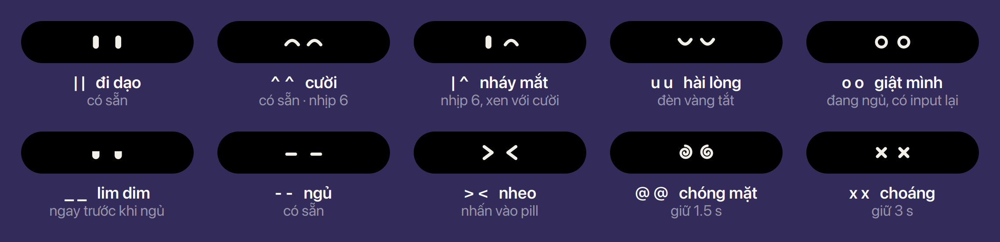
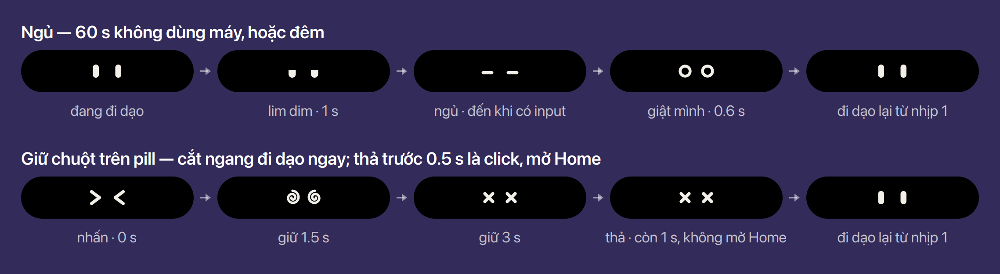

# Bu

Bu, linh vật của Buoy: lưới 10 × 10 ô, 13 dáng, đèn trên đầu. Nguồn là [MASCOT.md](../../MASCOT.md)
(tiếng Anh): `kit/model/mascot.js` và `tests/mascot.test.js` đọc lưới từ đó, ảnh xem trước nằm trong
`docs/mascot/`. MASCOT.md ở nguyên chỗ cũ cho tới khi các docs ở gốc `docs/` được làm gọn lại
(Ethan, 2026-11-10).

## Cỡ trong từng dạng

- Bu vẽ bằng code từ lưới 10 × 10 (`kit/ui/present/motion.js` `mascot()`, mỗi ô `w / 10`, tắt khử răng cưa), nên
  chỉ nét ở bội số của 10: **20** trong pill (mỗi ô 2 px), **40** trong compact và ask, **50** trong
  expanded, **40** trong prefs. **Chốt**
- Trong pill, Bu 20 nằm giữa ô leading 24 ([Pill](../pill/index.vi.md)). **Chốt**
- Khi bật chữ lớn (ô lên 30), Bu giữ 20: lưới 10 cần bội số của 10. **Chốt** (Ethan, 2026-11-10)
- Ở tỷ lệ lẻ (1.25×, 1.5×), St vẽ Bu ở tỷ lệ làm tròn lên rồi Mutter thu nhỏ cả màn hình, nên Bu hơi
  mềm như chữ (`st-drawing-area.c`: bề mặt rộng `ceilf(width × scale_factor)`). Mọi hình pixel đều
  chịu điều này.

## Biểu cảm của mắt

*Ethan, 2026-11-14.* Mắt Bu trong pill idle (plan `mascot`, [MASCOT.md](../../MASCOT.md) § Eyes) có thêm
bảy biểu cảm. Biểu cảm nào cũng vẽ từ ba loại nét: vạch bo tròn, cung, đường gấp khúc. Nét xoắn ốc
cũng là một đường gấp khúc. Không có ảnh, không có frame clock. **Chốt**

| Biểu cảm | Khi nào | Bao lâu |
|---|---|---|
| `\| ^` nháy mắt | nhịp 6 của đi dạo, xen kẽ với `^ ^` cười | 1.25 s, như cười |
| `u u` hài lòng | đèn vàng tắt: những gì lỡ đã xem hết | 1.25 s |
| `_ _` lim dim | ngay trước khi ngủ (60 s không dùng máy, hoặc đêm) | 1 s, rồi `- -` |
| `o o` giật mình | đang ngủ vì 60 s không dùng máy, có input lại | 0.6 s |
| `> <` nheo | nhấn chuột vào pill | trong lúc giữ |
| `@ @` chóng mặt | giữ chuột 1.5 s | đến 3 s |
| `x x` choáng | giữ chuột 3 s ("chọc nhiều quá") | đến khi thả, rồi thêm 1 s |

- **Ngủ là `- -`, lim dim là `_ _`.** `- -` là mắt nhắm hẳn, một vạch mảnh; `_ _` là mí sụp còn nửa
  tròng, nên đọc ra "sắp ngủ". **Chốt**
- **Phản ứng cắt ngang đi dạo ngay** (Ethan), không đợi hết nhịp đang chạy. Xong thì đi dạo lại từ
  nhịp 1. **Chốt**
- Đèn vàng, đỏ vẫn thắng mọi biểu cảm. Ngủ vì đêm, vì tiết kiệm pin hay vì tắt hiệu ứng động, hoặc
  tắt `idle-mascot-stroll`: không có phản ứng nào, kể cả giật mình. **Chốt**

### Nhấn và giữ

- Pill idle mở Home ngay lúc nhấn chuột xuống (`kit/ui/pill.js`, `button-press-event` →
  `island._onPillPress`), nên chưa có "giữ". **Khi mắt đang hiện, Home mở lúc thả chuột.** Thả trước
  0.5 s là click, mở Home như cũ. Giữ quá 0.5 s là đang chọc Bu: thả ra không mở Home. **Chốt**
  (Ethan, 2026-11-14: thử với mắt trước, rồi làm cho mọi pill idle)
- Giữ chỉ chơi được khi mắt đang ở chế độ `idle`. Ở chế độ khác (đèn, ngủ) thả ra vẫn mở Home.
- `x x` còn 1 s sau khi thả, rồi về đi dạo từ nhịp 1. Thả lúc đang `> <` hay `@ @` (sau 0.5 s): về
  đi dạo ngay.
- Chi phí: mỗi phản ứng một hai khung hình; giữ chuột thêm một timer, chỉ sống trong lúc giữ và 1 s
  sau khi thả.
