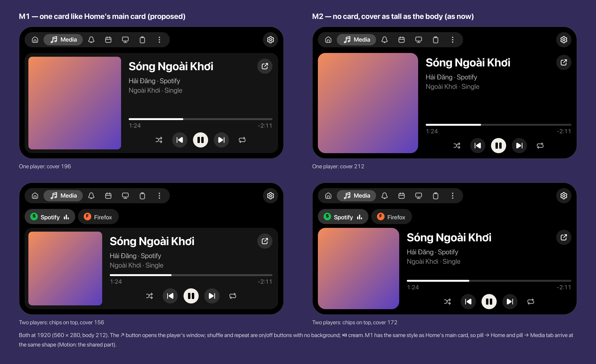
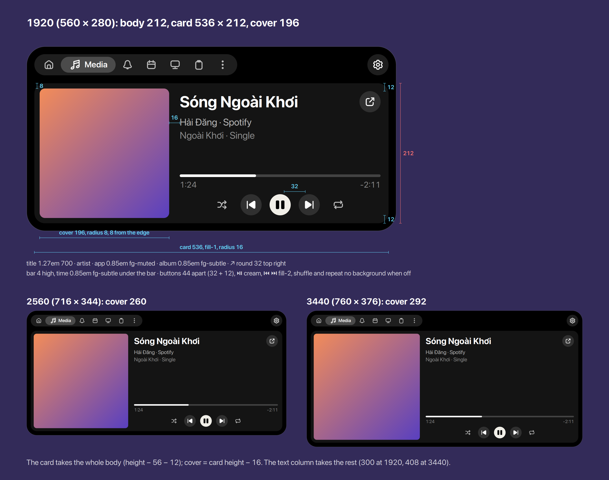
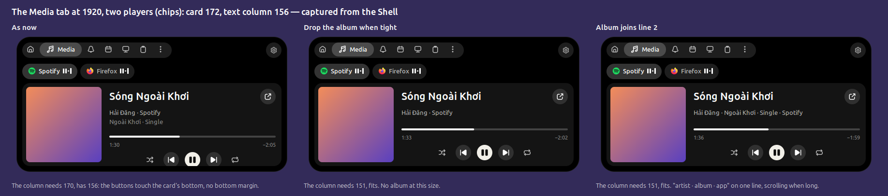
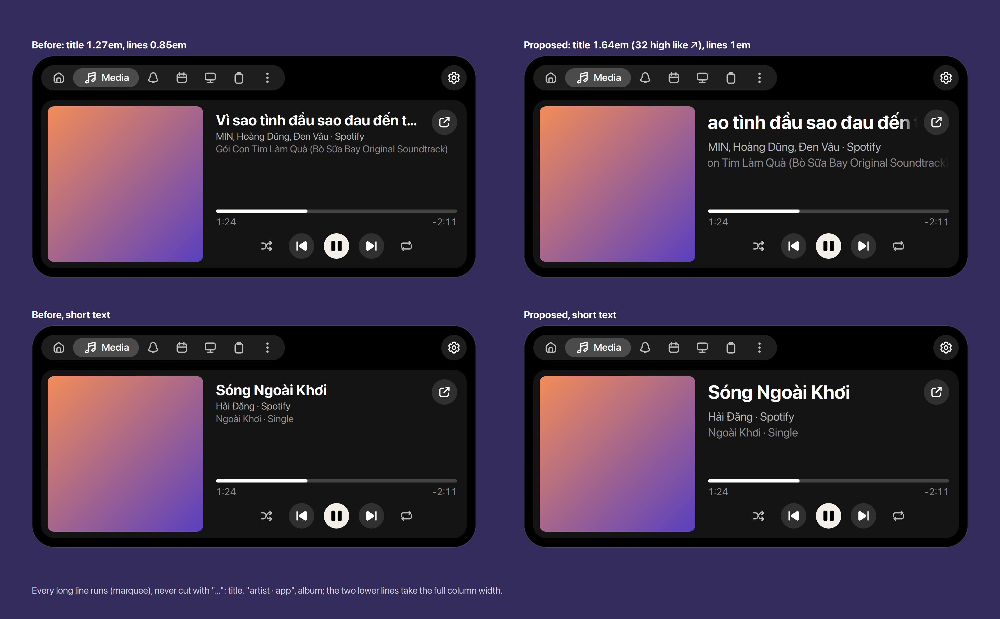
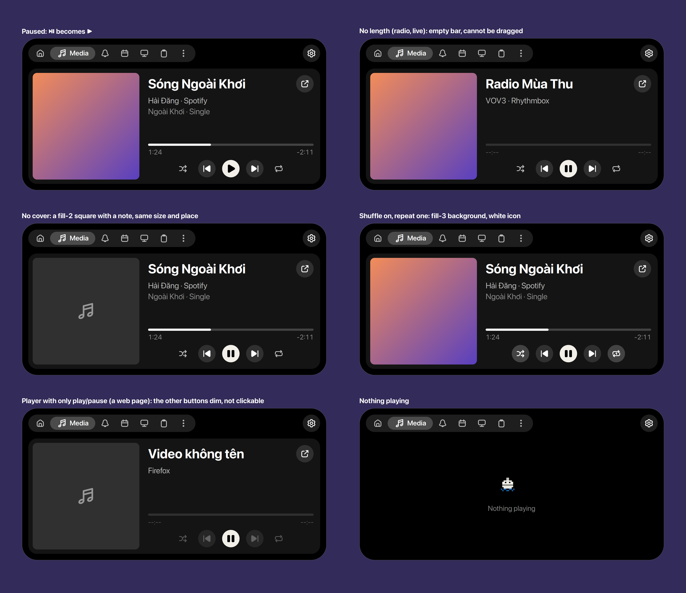
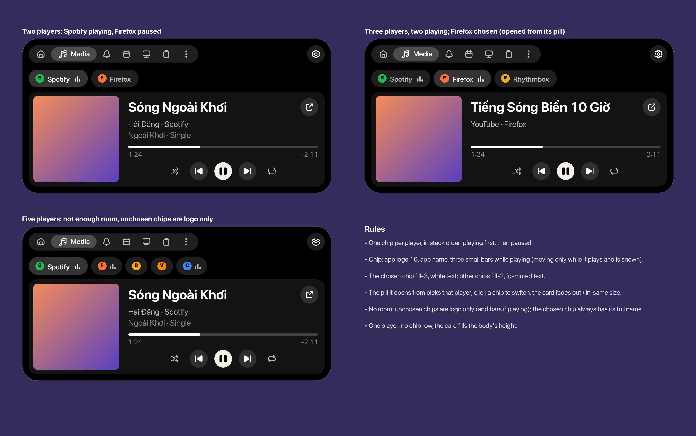
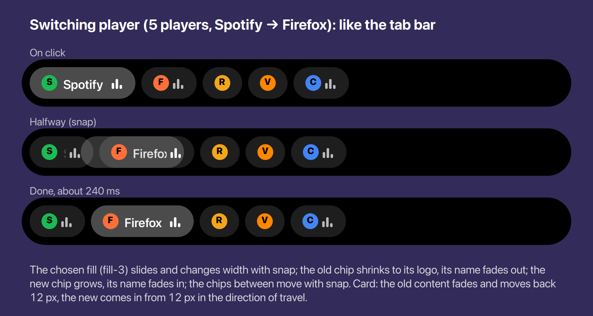
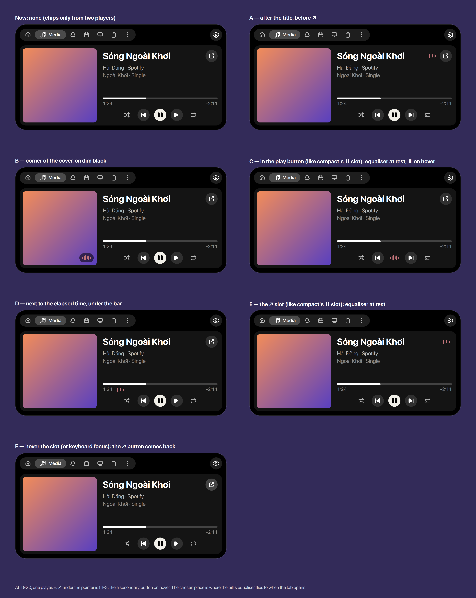

# Media

The Media tab ([Tabs](../tabs/index.md)) opens on a click on the music pill or its compact (SPEC §2b: pill
→ the tab of its kind). It holds what the compact cannot: other players, seek, shuffle, repeat, opening the
player's window. Shared numbers are in [Tokens](../tokens.md).

## Decisions

- **M1: the body is one card** `fill-1` radius 16, like Home's main card ([Home](../home/index.md)):
  cover art 8 from the edge, radius 8; text column and buttons on the right. Chosen between M1 and M2 (no
  card, art as tall as the body, as the tab was before). The same style as Home, so when
  [Motion](../motion/index.md) "Shared parts" is built, pill → Home and pill → Media tab fly to the same
  shape (M4 "Motion: shared parts").
  **Decided** (Ethan, 2026-11-13)
- **Several players: a row of chips on top**, one chip per player (app icon 16, app name), the chosen chip
  `fill-3`, the others `fill-2`; the card is 40 shorter (chip 32 + 8). **Decided** (Ethan, 2026-11-13)
- **Clicking a player's pill or compact opens the tab on that player's chip**, keeping the old logic
  (2026-11-07: Home takes the clicked pill's activity, the Media tab's `from`). Opened from elsewhere (Home's
  main card, the tab strip): the player at the top of the stack. **Decided** (Ethan, 2026-11-13)
- **Always every button and the seek bar**: ⇄ ⏮ ⏯ ⏭ ↻ and the bar are always there; what the player
  cannot do (no seek, no previous/next track, no shuffle, no repeat) is **dimmed** (`fg-disabled`), with no
  hover response, and cannot be clicked or dragged. The layout doesn't change with the player. **Decided** (Ethan, 2026-11-13)
- No volume here (the mixer will have its own place: FEATURES "Sound tab"). **Decided** (2026-11-08)

## Sizes

- The card takes the whole body: width 536 / 692 / 736, height 212 / 276 / 308 at 1920 / 2560 / 3440
  (the tallest expanded minus the 56 head and the 12 bottom padding). **Decided** (Ethan, 2026-11-13)
- Square cover art, side = card height − 16: **196 / 260 / 292**; 8 from the edge, radius 8 (16 − 8, concentric).
  **Decided** (Ethan, 2026-11-13)
- The text column is 16 from the art, 12 from the right edge, 12 top and bottom. First row 32 tall: the title
  **1.64em 700** (as tall as ↗), ↗ round 32 `fill-2` on the right, on the same row. Below it, each line the
  full column width: "artist · app" **1em** `fg-muted`, album **1em** `fg-subtle`. **Decided** (Ethan, 2026-11-13:
  the old 1.27em / 0.85em text left the column too empty)
- Every long line **scrolls** like the track title in the compact (marquee), no "…" cut: title, "artist ·
  app", album. **Decided** (Ethan, 2026-11-13)
- Long lines scroll **in turn**, one at a time: title first, then "artist · app", then album, then the title
  again; short lines are skipped, a single long line repeats on its own. A waiting line stands still at the
  start of its text, the overflow hidden past the column edge. **Decided** (Ethan, 2026-11-13: three lines
  scrolling together was too busy)
- A card without room for three lines (two players or more at 1920: card 172, column 156, while three lines
  need 170): the album **merges into line 2**: "artist · album · app", one `fg-muted` line. Measured for real
  before drawing, not by a fixed size, so larger system text merges too; 2560 and 3440 keep three lines.
  **Decided** (Ethan, 2026-11-13, chosen between keeping as is, dropping the album and merging the album)

- At the bottom: a bar 4 tall (`fill-3`, the played part white), elapsed and remaining time 0.85em `fg-subtle`
  right under the bar; then the row of 32 buttons centred in the column, centres 44 apart: ⇄ no background,
  ⏮ `fill-2`, ⏯ cream (`fill-inverse`, black icon), ⏭ `fill-2`, ↻ no background. **Decided** (Ethan, 2026-11-13)

## States

- **Paused**: ⏯ becomes ▶. **Decided** (Ethan, 2026-11-13)
- **No duration** (radio, live streams): an empty `fill-2` bar, time "--:--" `fg-disabled`, cannot be
  dragged. **Decided** (Ethan, 2026-11-13)
- **No cover art**: a `fill-2` tile of the same size and place, a music note 32 `fg-subtle` in the middle. **Decided** (Ethan, 2026-11-13)
- **Shuffle / repeat on**: the button has a `fill-3` background, white icon; repeat one track uses `repeat-1`.
  Clicking repeat cycles off → all → one track. **Decided** (Ethan, 2026-11-13)
- **A player with only play/pause** (a web page): ⏯ can be clicked, the other buttons and the bar are dimmed. **Decided** (Ethan, 2026-11-13)
- **Nothing playing**: Bu resting and "Nothing playing" in the middle of the body, no card (EmptyState).
  **Decided** (Ethan, 2026-11-13)

## Several players

- One chip per player, in stack order: playing first, then paused. **Decided** (Ethan, 2026-11-13)
- Chip: app logo 16, app name, the pill's equaliser while playing (running only while playing and on screen,
  ARCHITECTURE rule 8), in that player's cover colour ([Pill](../pill/index.md), "Equaliser", 2026-11-13). The chosen chip `fill-3` with white text; the others `fill-2` with `fg-muted` text.
  **Decided** (Ethan, 2026-11-13)
- Not enough room on one row: unchosen chips shrink to their logo (and the equaliser while playing); the chosen
  chip always keeps its full name. **Decided** (Ethan, 2026-11-13)
- One player: no chip row, the card fills the body. **Decided** (Ethan, 2026-11-13)
- **Switching players moves like the tab strip** ([Motion](../motion/index.md) "Switching tabs"): the chosen
  `fill-3` background is its own layer behind the chip row, sliding and resizing to the new chip with `snap`;
  the old chip shrinks to its logo, its name fading; the new chip grows, its name fading in; the chips between
  move with `snap`. Card: the old content fades and moves back 12 px, the new content comes in from 12 px in
  the direction of travel; the card doesn't change size. **Decided** (Ethan,
  2026-11-13)

- **One player: where the equaliser goes.** With no chip row the tab doesn't show which player is playing.
  Five places: **A** after the track title, before ↗; **B** on the art's corner, on a dim black background;
  **C** in the play button, the equaliser at rest, ⏸ on hover (in the tab, the place for controls, the main
  button is hidden); **D** beside the elapsed time; **E** the ↗ tile, as the compact's ⏸ tile: at rest just
  the equaliser, on hover or keyboard focus ↗ comes back (`fill-3`). E (Ethan, 2026-11-13: "the same open-external
  button as the pause button in the compact") keeps one rule for the compact and the tab, the tile is in the
  same corner so the compact's equaliser only moves a short way when the tab opens, and the tab's ⏸ is still
  always shown. The chosen place is where the pill's equaliser flies to. **Decided: E**
  (Ethan, 2026-11-13), also with several players (the ↗ tile is the chosen player's; chips keep their own
  equaliser)

## Interaction

- Clicking a chip: switches player, moving like the tab strip (in "Several players"). **Decided** (Ethan, 2026-11-13)
- Dragging the bar: seeks on release; while dragging, the elapsed time follows the pointer. Clicking a spot on
  the bar: goes there. **Decided** (Ethan, 2026-11-13)
- Buttons, chips, ↗: change colour with `state` (120 ms) on hover and press; dimmed buttons don't. **Decided** (Ethan, 2026-11-13)
- Clicking ↗: opens the player's window and closes the island. **Decided** (Ethan, 2026-11-13)

## In the code

**Done** (2026-11-13, FEATURES M4 "Media tab").

- `lib/modules/media/tab.js` — redrawn as M1: card, chips, text column, the bar and the full button row,
  what cannot be done gets `reactive = false` and the dimmed class.
- `lib/modules/media/layout.js` — art side = card height − 16 (`ART_SHARE`, `ART_MIN`, `ART_MAX` removed).
- `lib/modules/media/stylesheet.css` — card, chips, dimmed buttons.
- `lib/modules/media/adapter.js` — each activity says what the player can do (MPRIS `canSeek`, `canGoPrevious`,
  `canGoNext`, `shuffle`, `loopStatus`), so the tab knows which buttons to dim.
- `lib/kit/ui/home.js` — the tab strip's selection bar and moving (`_stripPlaces`, `_slideStrip`)
  split into a shared part for the chip row to reuse.
- Redraw: `render/media.js` (`options`, `anatomy`, `states`, `players`, `switch`, `text`).
