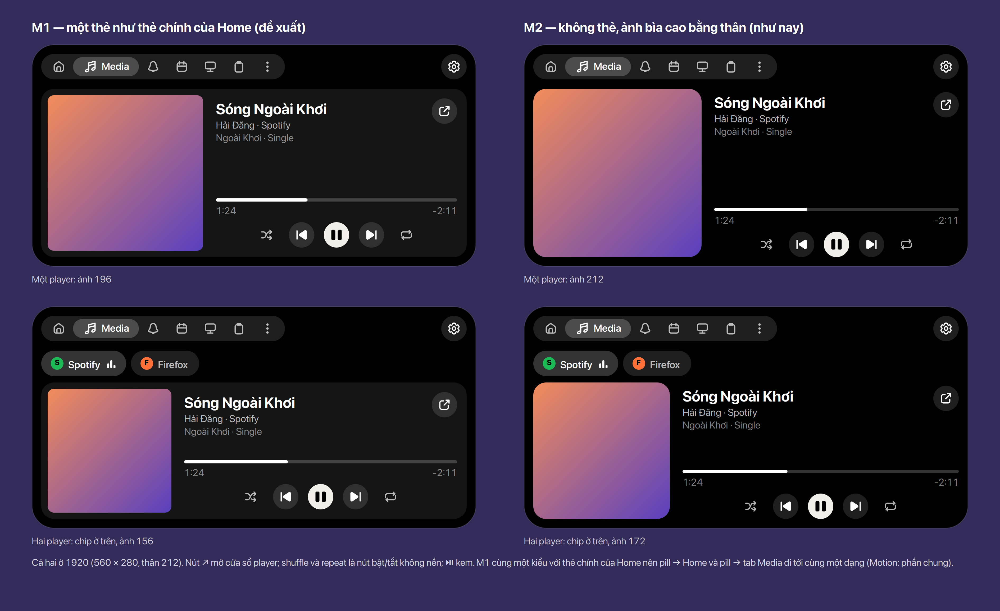
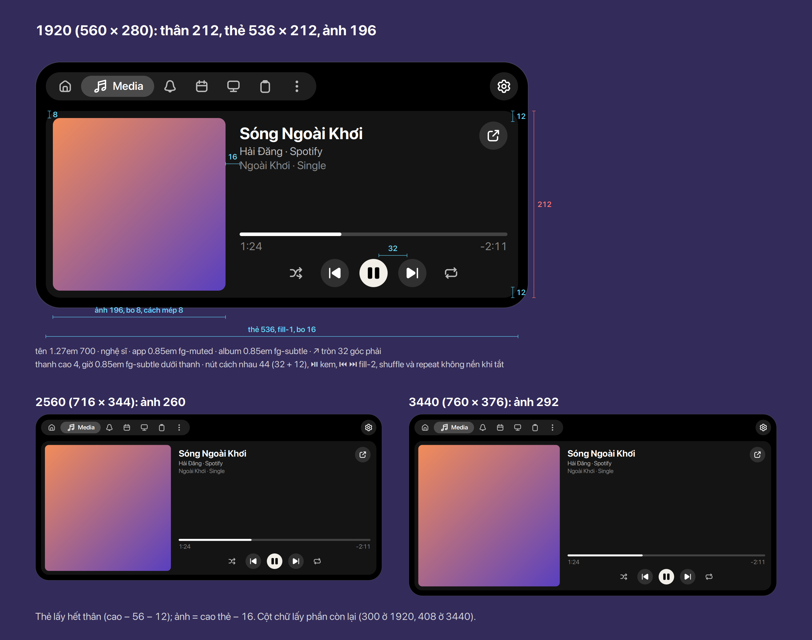
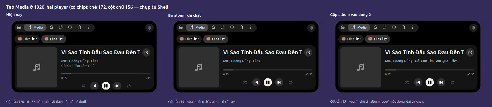
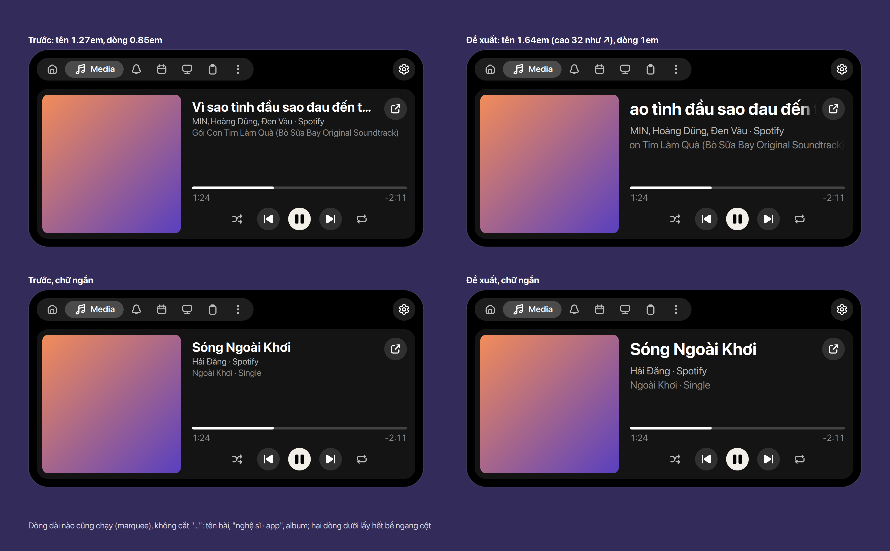
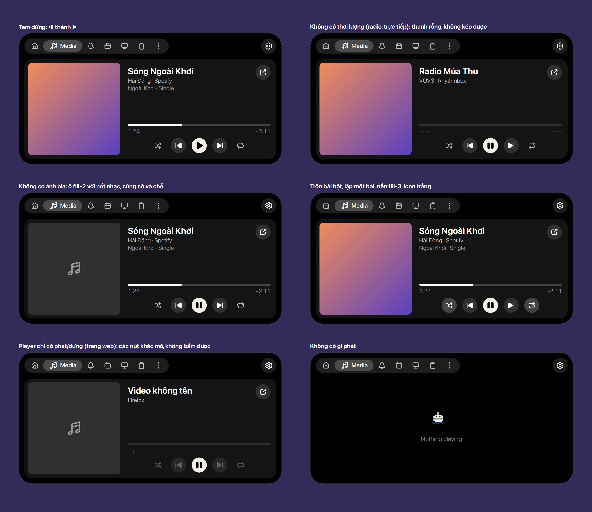
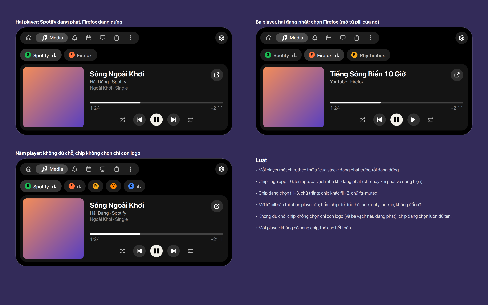
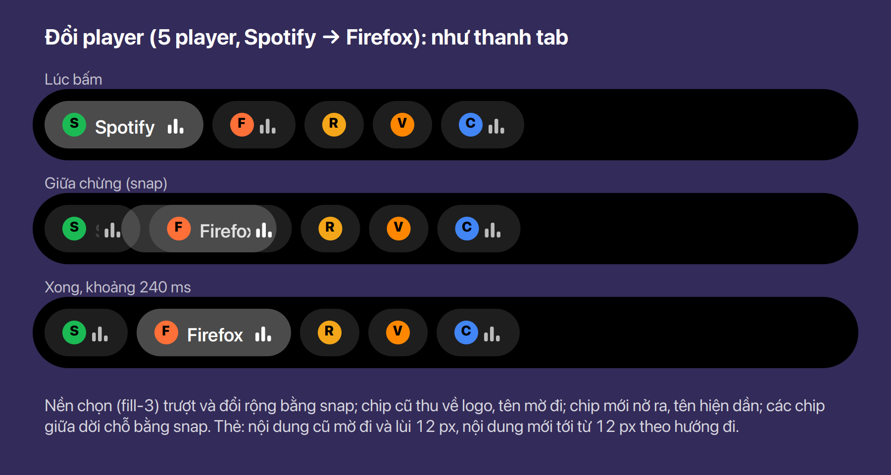
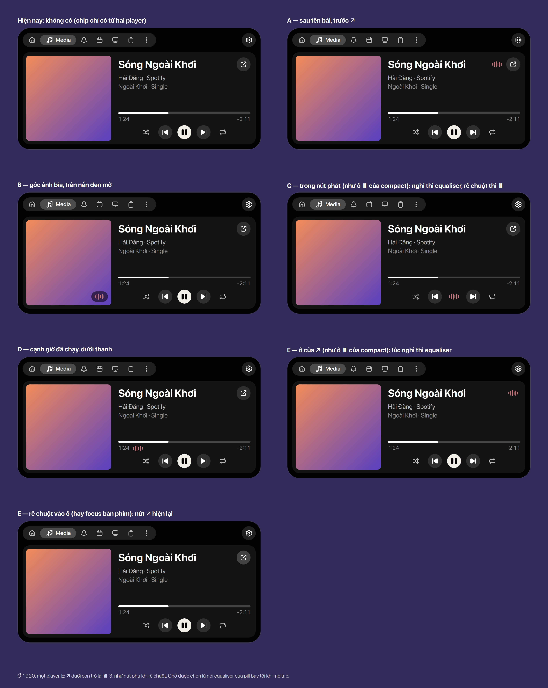

# Media

Tab Media ([Tab](../tabs/index.vi.md)) mở ra khi bấm pill nhạc hay compact của nó (SPEC §2b: pill
→ tab của loại nó). Nó có những gì compact không chứa được: player khác, seek, trộn bài, lặp, mở cửa
sổ player. Số dùng chung ở [Bảng số](../tokens.vi.md).

## Quyết định

- **M1: thân là một thẻ** `fill-1` bo 16, giống thẻ chính của Home ([Home](../home/index.vi.md)):
  ảnh bìa cách mép 8, bo 8; cột chữ và nút bên phải. Chọn giữa M1 và M2 (không thẻ, ảnh cao bằng
  thân như tab trước đây). Cùng một kiểu với Home nên khi làm [Chuyển động](../motion/index.vi.md)
  "Phần chung", pill → Home và pill → tab Media bay tới cùng một dạng (M4 "Motion: shared parts").
  **Chốt** (Ethan, 2026-11-13)
- **Nhiều player: một hàng chip ở trên**, mỗi player một chip (icon app 16, tên app), chip đang chọn
  `fill-3`, chip khác `fill-2`; thẻ thấp đi 40 (chip 32 + 8). **Chốt** (Ethan, 2026-11-13)
- **Bấm pill hoặc compact của player nào thì tab mở với chip của player đó**, giữ logic cũ
  (2026-11-07: Home nhận activity của pill đã bấm, `from` của tab Media). Mở từ chỗ khác (thẻ chính
  của Home, thanh tab): player đứng đầu stack. **Chốt** (Ethan, 2026-11-13)
- **Luôn đủ nút và thanh seek**: ⇄ ⏮ ⏯ ⏭ ↻ và thanh luôn có mặt; player không làm được (không
  seek, không có bài trước/sau, không trộn, không lặp) thì phần đó **mờ** (`fg-disabled`), không
  phản hồi hover, không bấm hay kéo được. Bố cục không đổi theo player. **Chốt** (Ethan, 2026-11-13)
- Không có âm lượng ở đây (mixer sẽ có chỗ riêng: FEATURES "Sound tab"). **Chốt** (2026-11-08)

## Kích thước

- Thẻ lấy hết thân: rộng 536 / 692 / 736, cao 212 / 276 / 308 ở 1920 / 2560 / 3440 (expanded cao
  nhất trừ phần đầu 56 và lề dưới 12). **Chốt** (Ethan, 2026-11-13)
- Ảnh bìa vuông, cạnh = cao thẻ − 16: **196 / 260 / 292**; cách mép 8, bo 8 (16 − 8, đồng tâm).
  **Chốt** (Ethan, 2026-11-13)
- Cột chữ cách ảnh 16, cách mép phải 12, trên và dưới 12. Hàng đầu cao 32: tên **1.64em 700**
  (cao bằng ↗), ↗ tròn 32 `fill-2` bên phải, cùng một hàng. Dưới đó, mỗi dòng hết bề ngang cột:
  "nghệ sĩ · app" **1em** `fg-muted`, album **1em** `fg-subtle`. **Chốt** (Ethan, 2026-11-13: chữ
  cũ 1.27em / 0.85em để cột trống nhiều)
- Dòng dài nào cũng **chạy** như tên bài trong compact (marquee), không cắt "…": tên, "nghệ sĩ ·
  app", album. **Chốt** (Ethan, 2026-11-13)
- Các dòng dài chạy **lần lượt**, mỗi lúc một dòng: tên trước, rồi "nghệ sĩ · app", rồi album, rồi
  lại tên; dòng ngắn bị bỏ qua, một dòng dài duy nhất thì tự lặp. Dòng đang chờ đứng yên ở đầu chữ,
  phần thừa khuất sau mép cột. **Chốt** (Ethan, 2026-11-13: ba dòng cùng chạy rối mắt)
- Thẻ không đủ chỗ cho ba dòng (hai player trở lên ở 1920: thẻ 172, cột 156 mà ba dòng cần 170) thì
  album **gộp vào dòng 2**: "nghệ sĩ · album · app", một dòng `fg-muted`. Đo thật trước khi vẽ, không
  theo một cỡ cố định, nên chữ hệ thống lớn hơn cũng được gộp; 2560 và 3440 vẫn ba dòng. **Chốt**
  (Ethan, 2026-11-13, chọn giữa giữ nguyên, bỏ album và gộp album)

- Dưới cùng: thanh cao 4 (`fill-3`, phần đã phát trắng), giờ đã phát và còn lại 0.85em `fg-subtle`
  ngay dưới thanh; rồi hàng nút 32 ở giữa cột, tâm cách nhau 44: ⇄ không nền, ⏮ `fill-2`, ⏯ kem
  (`fill-inverse`, icon đen), ⏭ `fill-2`, ↻ không nền. **Chốt** (Ethan, 2026-11-13)

## Các trạng thái

- **Tạm dừng**: ⏯ thành ▶. **Chốt** (Ethan, 2026-11-13)
- **Không có thời lượng** (radio, phát trực tiếp): thanh rỗng `fill-2`, giờ "--:--" `fg-disabled`,
  không kéo được. **Chốt** (Ethan, 2026-11-13)
- **Không có ảnh bìa**: ô `fill-2` cùng cỡ và chỗ, nốt nhạc 32 `fg-subtle` ở giữa. **Chốt** (Ethan, 2026-11-13)
- **Trộn bài / lặp bật**: nút có nền `fill-3`, icon trắng; lặp một bài dùng `repeat-1`. Bấm lặp đi
  vòng tắt → tất cả → một bài. **Chốt** (Ethan, 2026-11-13)
- **Player chỉ có phát/dừng** (một trang web): ⏯ bấm được, các nút khác và thanh mờ. **Chốt** (Ethan, 2026-11-13)
- **Không có gì phát**: Bu nghỉ và "Nothing playing" giữa thân, không có thẻ (EmptyState).
  **Chốt** (Ethan, 2026-11-13)

## Nhiều player

- Mỗi player một chip, theo thứ tự của stack: đang phát trước, rồi đang dừng. **Chốt** (Ethan, 2026-11-13)
- Chip: logo app 16, tên app, equaliser của pill khi đang phát (chỉ chạy khi đang phát và đang hiện, luật
  8 của ARCHITECTURE), theo màu bìa của player đó ([Pill](../pill/index.vi.md), "Equaliser", 2026-11-13). Chip đang chọn `fill-3` chữ trắng; chip khác `fill-2` chữ `fg-muted`.
  **Chốt** (Ethan, 2026-11-13)
- Không đủ chỗ trên một hàng: chip không chọn chỉ còn logo (và equaliser nếu đang phát); chip đang
  chọn luôn đủ tên. **Chốt** (Ethan, 2026-11-13)
- Một player: không có hàng chip, thẻ cao hết thân. **Chốt** (Ethan, 2026-11-13)
- **Đổi player chuyển động như thanh tab** ([Chuyển động](../motion/index.vi.md) "Đổi tab"): nền chọn
  `fill-3` là một lớp riêng sau hàng chip, trượt và đổi rộng sang chip mới bằng `snap`; chip cũ thu
  về logo, tên mờ đi; chip mới nở ra, tên hiện dần; các chip giữa dời chỗ bằng `snap`. Thẻ: nội dung
  cũ mờ đi và lùi 12 px, nội dung mới tới từ 12 px theo hướng đi; thẻ không đổi cỡ. **Chốt** (Ethan,
  2026-11-13)

- **Một player: equaliser ở đâu.** Không có hàng chip nên tab không cho biết player đang phát.
  Năm chỗ: **A** sau tên bài, trước ↗; **B** góc ảnh bìa, trên nền đen mờ; **C** trong nút phát,
  nghỉ thì equaliser, rê chuột thì ⏸ (ở tab, nơi để điều khiển, nút chính bị giấu); **D** cạnh giờ đã
  chạy; **E** ô của ↗, như ô ⏸ của compact: lúc nghỉ chỉ equaliser, rê chuột hay focus bàn phím thì
  ↗ hiện lại (`fill-3`). E (Ethan, 2026-11-13: "cùng nút mở external như nút pause ở compact") giữ
  một luật cho compact và tab, ô cùng góc nên equaliser của compact chỉ dời một đoạn ngắn khi mở
  tab, và ⏸ của tab vẫn luôn hiện. Chỗ được chọn là nơi equaliser của pill bay tới. **Đề xuất**
  (2026-11-13)

## Tương tác

- Bấm chip: đổi player, chuyển động như thanh tab (ở "Nhiều player"). **Chốt** (Ethan, 2026-11-13)
- Kéo thanh: seek khi thả; trong lúc kéo, giờ đã phát đi theo tay. Bấm một chỗ trên thanh: tới đó.
  **Chốt** (Ethan, 2026-11-13)
- Nút, chip, ↗: đổi màu theo `state` (120 ms) khi hover và nhấn; nút mờ không đổi. **Chốt** (Ethan, 2026-11-13)
- Bấm ↗: mở cửa sổ player và đóng island. **Chốt** (Ethan, 2026-11-13)

## Chỗ trong code

**Đã làm** (2026-11-13, FEATURES M4 "Media tab").

- `lib/modules/media/tab.js` — vẽ lại theo M1: thẻ, chip, cột chữ, thanh và hàng nút luôn đủ, phần
  không làm được thì `reactive = false` và class mờ.
- `lib/modules/media/layout.js` — cạnh ảnh = cao thẻ − 16 (bỏ `ART_SHARE`, `ART_MIN`, `ART_MAX`).
- `lib/modules/media/stylesheet.css` — thẻ, chip, nút mờ.
- `lib/modules/media/adapter.js` — mỗi activity nói player làm được gì (`canSeek`, `canGoPrevious`,
  `canGoNext`, `shuffle`, `loopStatus` của MPRIS), để tab biết nút nào mờ.
- `lib/kit/ui/home.js` — vạch chọn và cách dời chỗ của thanh tab (`_stripPlaces`, `_slideStrip`)
  tách thành một phần dùng chung để hàng chip dùng lại.
- Vẽ lại: `render/media.js` (`options`, `anatomy`, `states`, `players`, `switch`, `text`).
