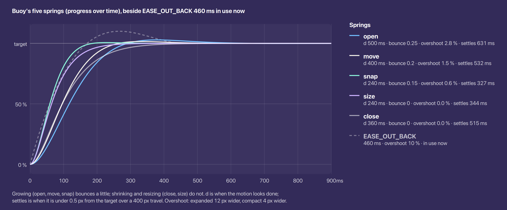
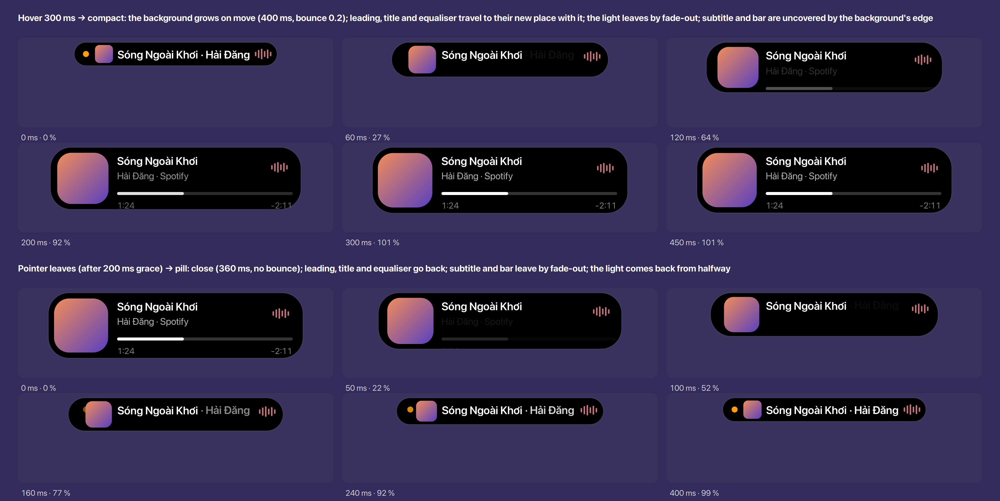
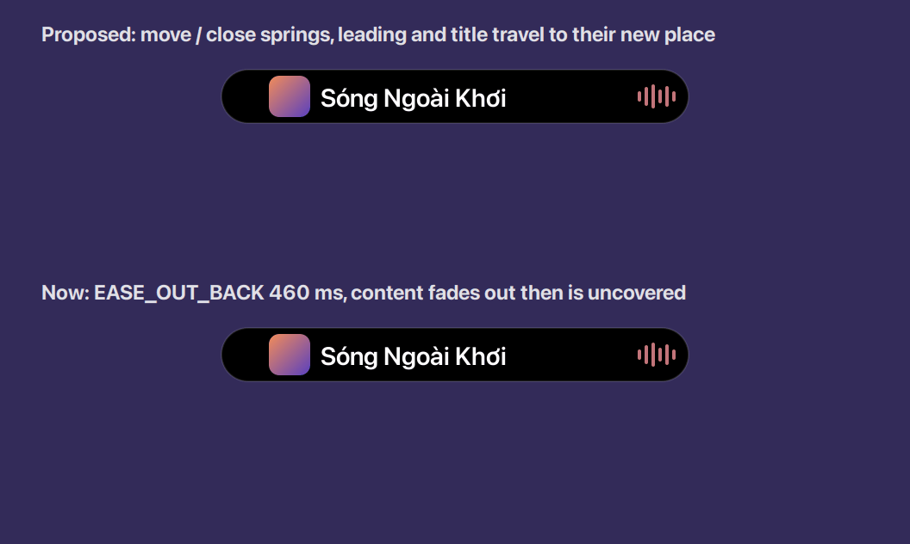
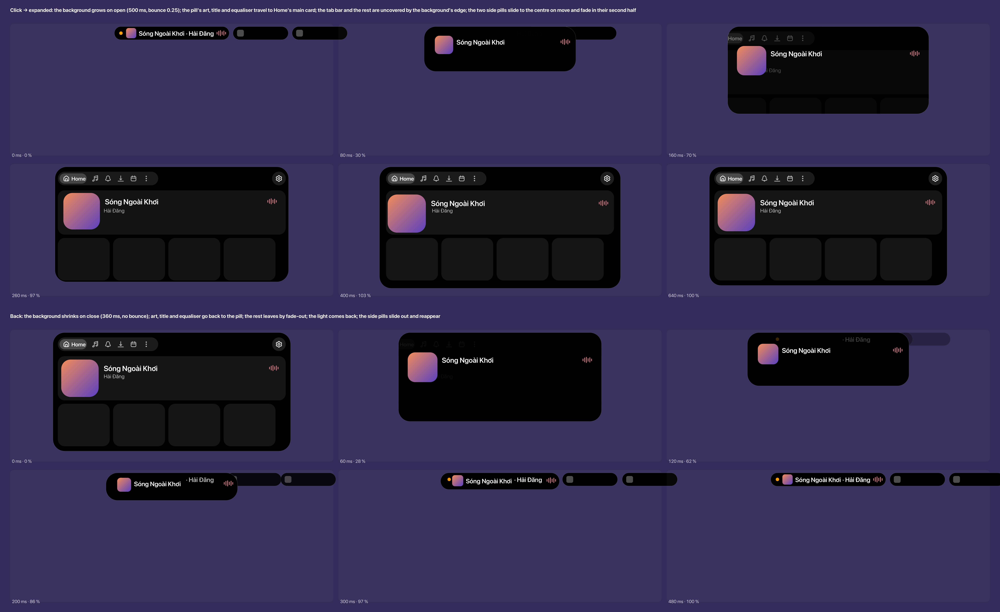
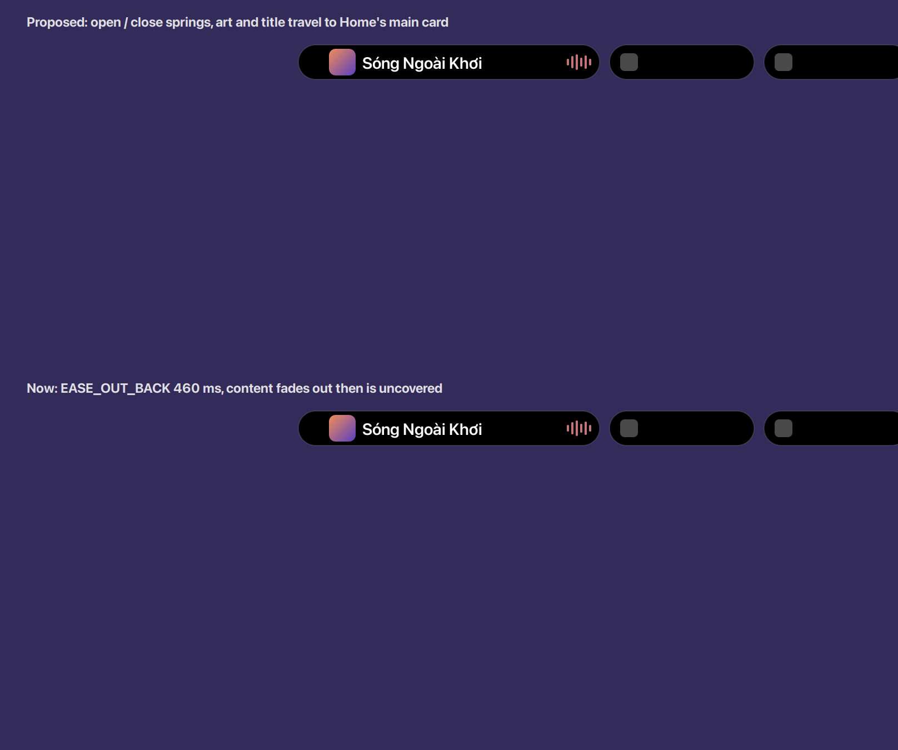
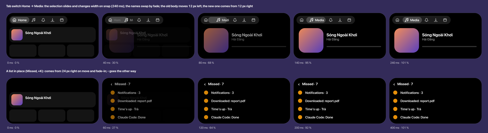
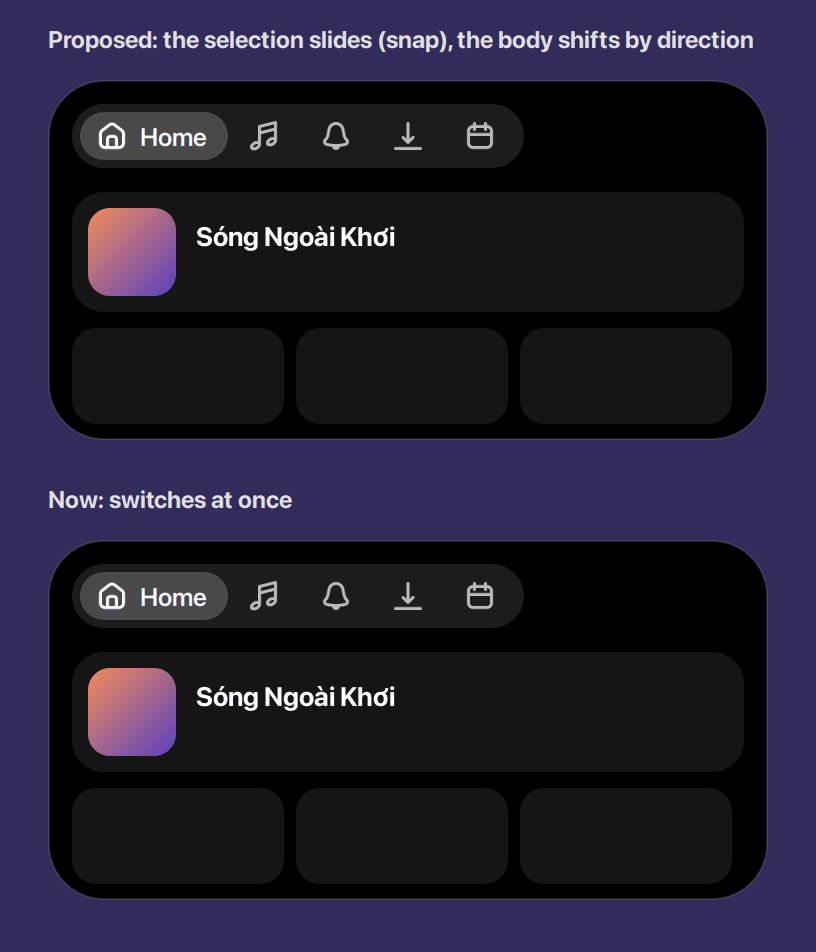

# Motion

Buoy moves the **Dynamic Island** way: the shape grows out of itself on a spring, bounces a little
as it opens, not as it closes, and content shows along the shape's edge. This page is the time
scale, the curves and how each transition plays; the shared numbers are in
[Tokens](../tokens.md#motion). Background motion (Bu, equaliser, scrolling text) follows
ARCHITECTURE rule 8, at the end of the page.

## Decisions

- **Dynamic Island style**: every change of position, size or shape is a spring; effects (opacity,
  colour) do not bounce. Chosen between Dynamic Island, Material 3 Expressive and GNOME
  (libadwaita). **Decided** (Ethan, 2026-11-12)
- **A spring is two numbers**: perceived duration `d` and `bounce`, as Apple does (WWDC23
  "Animate with springs"): mass 1, stiffness (2π / d)², damping (1 − bounce) · 4π / d, so the
  damping ratio ζ = 1 − bounce. `d` is when the motion *looks* done, not when the spring fully
  stops (settles), a little later. **Proposed**
- **Bounce only when opening**, at most bounce 0.25 (Apple: above 0.4 is too much for UI). Closing
  and size changes from content do not bounce, so the shape's edge no longer cuts into text while
  closing (`shrinkStop` goes). **Proposed**
- **Interrupted keeps its velocity**: when a running transition changes target (hover in then out
  at once, an alert arrives mid-open), the new spring starts from the current position and
  velocity, not from 0. This is why springs replace fixed curves. **Proposed**
- **Radius follows height**: radius = min(height / 2, the target shape's radius), not switched at
  the start of the transition as today. **Proposed**
- **No blur** (rule 8). Where Apple blurs while content changes, Buoy uses opacity and the shape's
  edge. **Decided**
- **Shared parts move to their new place**, as the HIG (Live Activities) says: "animating existing
  elements to their new positions rather than removing and animating them back in". Parts in both
  shapes (leading, name) move with the background on the same spring: the pill's leading 24 grows
  and moves to the compact's leading (40 in the 56 head, 72 album art in the 88 music compact), the
  name to the name. Parts in only one shape (light, subtitle,
  bar, time) stay as today: leaving parts
  `fade-out`, arriving parts show along the background's edge. Replaces SPEC §5's rule "content
  never moves or scales during a morph" (2026-11-02); that rule came about because expanded's text
  once showed full width while the background was still small; the background's edge still clips
  everything, so that bug does not come back. Moves only by `translation` and scales by `scale`
  (no relayout); the leading is drawn at its target size and scaled down, so it is not soft at the
  end size. **Proposed**
  (Ethan, 2026-11-12: "change it back if needed")
  The same when clicking a tile or the main card in Home opens its tab: the tile's leading and name
  fly to their place in the tab (music tile → art and name in the Media tab), with `move`; back to
  Home the other way. Applies to all: the kit's builders label the parts themselves; a module that
  draws its own (the music card in Home, the Media tab) adds one `markShared` line. Done in M4
  (2026-11-13). **Proposed** (Ethan, 2026-11-13: "the widgets move to their own tab with an
  animation")
- Music: **the equaliser is a shared part too**. The music compact has the equaliser where the
  round button is ([Compact](../compact/index.md), "Music"), so it moves from the pill's trailing
  there by `translation`, at the same size (22 × 14), no longer `fade-out`. **Decided** (Ethan,
  2026-11-13)

## Springs and opacity

Each token's numbers are in [Tokens](../tokens.md#motion); here is where each is used.

| Token | Kind | Used for |
|---|---|---|
| `snap` | spring, very slight bounce | press, the tab selection, the pill's hover |
| `size` | spring, no bounce | size change from content: longer text, an added line, a card changing its line count |
| `move` | spring, slight bounce | pill → compact, pill appearing, sliding to fill a gap, merge and split |
| `open` | spring, the most bounce | opening expanded, alert, ask |
| `close` | spring, no bounce | every close: compact → pill, expanded → pill, alert closing |
| `fade-out` | opacity | old content leaving |
| `fade-in` | opacity | new content arriving |
| `state` | opacity, CSS `transition-duration` | hover, press, selection of buttons, rows, chips, tabs |
| `idle` | opacity | idle changing content (the minute, plan `auto`), once, then still |

All are **Proposed**. Against today: the `EASE_OUT_BACK` shape (10 % overshoot) becomes `open` /
`move`; leaving compact keeps its old duration as `close`; size changes keep their old duration as
`size`; fading out and back in stay as they are.

## The transitions

**Pill ↔ compact** (drawn with the 88 music compact). Hover 300 ms: the background grows with
`move` out of the pill itself (the top stays put, it grows down and out to both sides around the
centre; height 32 → 88, radius following height 16 → 28). The leading 24 grows into the 72 album art
(× 3, radius 6 → 20) and moves from (28, 4) to (8, 8); the name moves to the name, 12 after the
art; the equaliser moves to the round button; all three with the background. The light and
" · Hải Đăng" leave with `fade-out` at once; subtitle, bar and time wait at their end place, show
along the background's edge, their opacity going from 0 at halfway to full at the end. The album
art always keeps at least 4 from the background's top and bottom edges, so it is never clipped.
The pill beside it fades in place (`fade-out`). Pointer leaves: wait 200 ms, then `close`; art,
name and equaliser move back, subtitle, bar and time `fade-out`, the light `fade-in` from halfway.
**Proposed**

**Pill → expanded.** Click: the background grows with `open`. When the tab that opens has the same
activity (Home's main card, the Media tab), the pill's leading moves to its art there (24 → 88)
and the name to the name; the rest (tab strip, tab body) waits at its end place, showing along the
background's edge. Another tab: everything shows along the edge, the pill's content `fade-out`.
Side pills slide to the middle with `move` and fade in the second half (merge). **Closing:** the
reverse: art and name move back to the pill with `close`, the rest `fade-out`; side pills slide
out with `move` and show again. **Proposed**

**Alert and ask.** Like opening expanded, but to a compact or card size, with the same `open`; when
time is up, like the pointer leaving (`close`). A card within a burst of messages stays: the
content `fade-out` / `fade-in`, the height `size` ([Alerts and asks](../alerts-and-asks/index.md)).
**Proposed**

**Switching tabs.** The selection (`fill-3` background, 24 high) slides and changes width to the
new tab with `snap`; the icons move with `snap` too, since the selected tab is wider (it has a
name). The old tab's name `fade-out`, the new one's `fade-in`. Body: the old tab `fade-out` and
backs off 12 px against the direction of travel; the new tab `fade-in` and arrives from 12 px along
it (a tab on the right comes from the right), both with `snap`. A body of another height changes
the background with `size`. **Proposed**

**Lists in place** (Missed, +K): like pushing a page, arriving 24 px from the right with `move` and
`fade-in`; ‹ (or Esc) goes back the other way. **Proposed**

**Pill appearing and leaving.** A new activity without an alert: the pill grows out of its place
(out of idle if idle is showing) with `move`, content `fade-in` from halfway. Leaving: content
`fade-out`, the background shrinks back to idle or to width 0 (a side pill) with `close`. Sliding
to fill a gap: `move`, content moving with the background. **Proposed**

**Size change from content** (longer text, an added row): `size`, no bounce; content changes with
`fade-out` / `fade-in`. **Proposed**

## Interaction

- **The pill's hover**: width plus 12, height plus 2 with `snap`; leaving, `snap` too. **Proposed**
- **Hover, press, selection** of buttons, rows, chips, tabs: the background colour changes with
  `state` (120 ms, St's CSS `transition-duration`), both in and out. **Proposed**
- **Pressing the pill**: the background shrinks 4 px each way with `snap` on press, grows back with
  `snap` on release (instead of 120 + 300 ms). Round buttons: colour only (`state`). **Proposed**
- **Thresholds stay**: compact after 300 ms of hover, a 200 ms grace on leaving, alert 5 s, one
  step per 400 ms when scrolling on idle. **Decided**

## Interrupted

- Each change of position or size is a spring that can change target: the new spring starts from
  the current position and velocity (Apple: springs are the only kind of motion that stays smooth
  when interrupted). **Proposed**
- A new target that is smaller uses `close`, a larger one the new transition's token (`move`,
  `open`): hover in then out at once and the compact goes back to the pill from wherever it had
  grown to, without a jump. **Proposed**
- Interrupted opacity carries on from the current opacity, its duration scaled to what is left.
  **Proposed**
- Hovering another pill while one is compact: the old pill `close`, the new one `move`, at the same
  time. **Proposed**

## Background motion

Unchanged, per ARCHITECTURE rule 8: Bu changes frame every 500 ms only while showing, and stops
after `mascot-rest-after`; the equaliser only while playing; scrolling text only when longer than
its space; typed text once. Nothing moves at idle; idle changing content is one `idle`, then
still. **Decided**

## Performance and accessibility

- **Animations off** (`enable-animations` false): every transition jumps to its target, as Shell's
  `ease()` does (`misc/animationUtils.js` `adjustAnimationTime` returns 0); `slow-down-factor`
  multiplies every duration. Buoy's springs follow both keys. **Proposed**
- **Only cheap changes**: the background's position and size (one widget with no children),
  `translation`, `opacity`; content does not relayout per frame, only gets clipped by the
  background's edge (as today). **Decided**
- **One timeline on the frame clock per actor**, stopped when settled; no timeline at idle.
  **Proposed**
- The island's container leaves at least 12 px around the shape for overshoot (`OVERSHOOT` 20 as
  today). **Proposed**

## Sources

- WWDC23 "Animate with springs": a spring described by perceived duration and bounce, the formula
  to stiffness and damping; springs keep their velocity when retargeted; bounce 0 is the most
  versatile spring, above about 0.4 is too much for UI.
- HIG, Live Activities: compact, minimal, expanded; an alert opens expanded then closes; "Animate
  layout changes"; avoid overlapping elements during a transition, in a list only the elements
  that move animate, the rest fade out and back in; a Live Activity's motion lasts at most 2 s;
  concentric radii, even padding. The page gives no durations or curves for the Dynamic Island.
- HIG, Motion: motion with a purpose, short and precise; little motion for actions repeated often;
  "Let people cancel motion": never make people wait for motion to finish; never rely on motion
  alone to convey information.

## In the code

**Done** (2026-11-13, FEATURES M4 "Motion"): springs, the runner, morph, hover, press, radius,
switching tabs (old body fades and backs off 12 px in place, new body arrives), lists in place, CSS
state, animations off. **Not yet**: shared parts moving to their new place (M4 "Motion: shared
parts").

- `lib/kit/model/motion.js` (new, pure): the tokens; `spring({d, bounce})` → position and velocity
  over time, the settle time; retargeting keeps velocity. Tests: ζ = 1 − bounce, overshoot, settle
  time, retargeting.
- `lib/kit/ui/` (new, beside `pill.js`): a spring runner on a `Clutter.Timeline` (frame clock),
  reading `St.Settings` `enable-animations` and `slow-down-factor`; Clutter takes a custom curve
  through `clutter_timeline_set_progress_func` (`clutter-timeline.c`).
- `lib/kit/ui/pill.js` — `_morph`, `_followBg`, press, hover use springs instead of `ease()` and
  `EASE_OUT_BACK`; `SHAPE_MS`, `SIZE_MS`, `COMPACT_OUT_MS`, `PRESS_MS`, `MERGE_MS` go; radius
  follows height. `lib/kit/model/shapes.js` — `shrinkStop`, `SHRINK_TURN` go.
- `lib/kit/ui/home.js` — switching tabs: the selection is its own actor behind the tabs; the body
  changes with direction; lists in place push in from the right.
- `stylesheet.css` and the modules' CSS — `transition-duration: 120ms` for buttons, rows, chips,
  tabs.
- SPEC §5 rewritten, pointing to this page: drop "content never moves or scales during a morph",
  replaced by shared parts moving to their new place.
- `lib/kit/ui/present/` — compact and Home mark shared parts (leading, name) so the pill finds
  their target place; shared parts are drawn at their target size and move by `translation` and
  `scale`.
