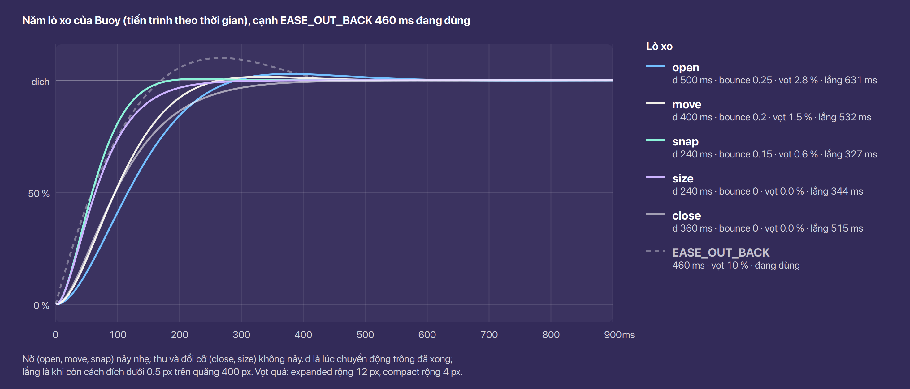
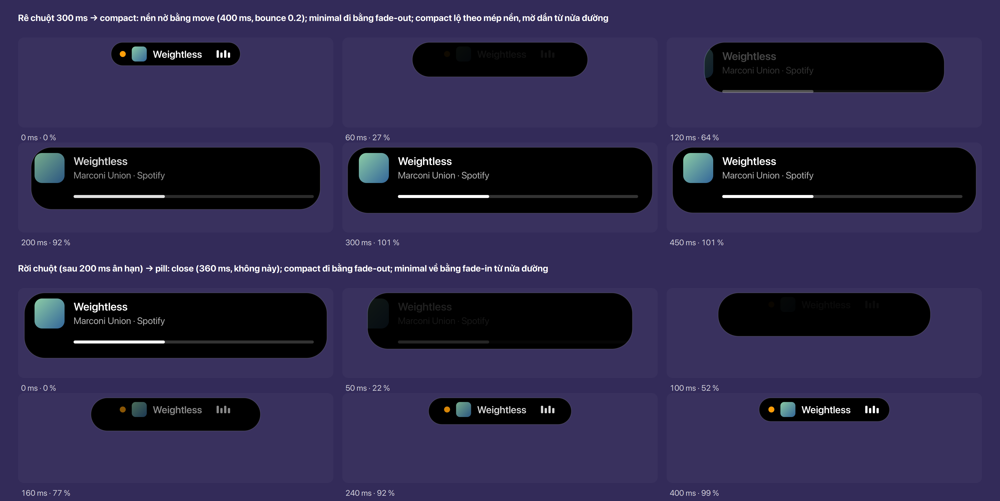
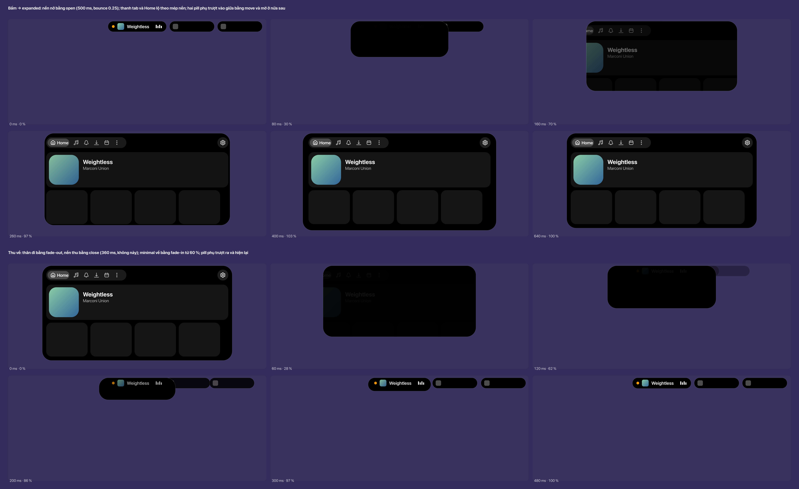
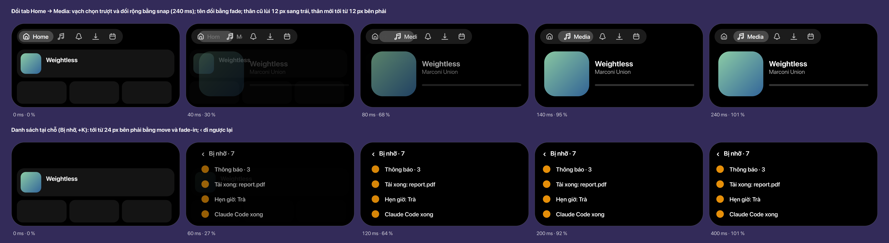

# Chuyển động

Buoy chuyển động theo kiểu **Dynamic Island**: hình nở ra từ chính nó bằng lò xo (spring), nảy nhẹ
khi nở, không nảy khi thu, nội dung hiện theo mép hình. Trang này là thang thời gian, đường cong
và cách từng chuyển diễn ra; số dùng chung ở [Bảng số](../tokens.vi.md#chuyển-động). Chuyển động nền
(Bu, equaliser, chữ chạy) theo luật 8 của ARCHITECTURE, ở cuối trang.

## Quyết định

- **Phong cách Dynamic Island**: mọi chuyển về chỗ, cỡ, hình là lò xo; hiệu ứng (độ mờ, màu) không
  nảy. Chọn giữa Dynamic Island, Material 3 Expressive và GNOME (libadwaita). **Chốt** (Ethan,
  2026-11-12)
- **Lò xo tả bằng hai số**: thời gian cảm nhận `d` và độ nảy `bounce`, như Apple (WWDC23
  "Animate with springs"): khối lượng 1, độ cứng (2π / d)², giảm chấn (1 − bounce) · 4π / d, nên
  tỷ số giảm chấn ζ = 1 − bounce. `d` là lúc chuyển động *trông* đã xong, không phải lúc lò xo
  dừng hẳn (lắng), muộn hơn một chút. **Đề xuất**
- **Nảy chỉ khi nở**, tối đa bounce 0.25 (Apple: trên 0.4 là quá đà cho giao diện). Thu nhỏ và đổi
  cỡ do nội dung không nảy, nên không còn cảnh mép hình cắt vào chữ khi thu (bỏ `shrinkStop`). **Đề
  xuất**
- **Bị cắt ngang thì giữ vận tốc**: một chuyển đang chạy mà đổi đích (rê vào rồi ra ngay, alert tới
  giữa lúc nở) thì lò xo mới đi từ chỗ và vận tốc hiện tại, không bắt đầu lại từ 0. Đây là lý do
  chọn lò xo thay đường cong cố định. **Đề xuất**
- **Bo góc đi theo chiều cao**: bo = min(cao / 2, bo của dạng đích), không đổi ngay ở đầu chuyển như
  nay. **Đề xuất**
- **Không blur** (luật 8). Chỗ Apple dùng blur khi đổi nội dung, Buoy dùng độ mờ và mép hình. **Chốt**

## Lò xo và độ mờ

Số của từng token ở [Bảng số](../tokens.vi.md#chuyển-động); ở đây là chỗ dùng.

| Token | Loại | Dùng cho |
|---|---|---|
| `snap` | lò xo, nảy rất nhẹ | nhấn, vạch chọn tab, hover của pill |
| `size` | lò xo, không nảy | đổi cỡ do nội dung: chữ dài hơn, thêm dòng, card đổi số dòng |
| `move` | lò xo, nảy nhẹ | pill → compact, pill hiện ra, trượt lấp chỗ, gộp và tách |
| `open` | lò xo, nảy rõ nhất | mở expanded, alert, ask |
| `close` | lò xo, không nảy | mọi lần thu: compact → pill, expanded → pill, alert đóng |
| `fade-out` | độ mờ | nội dung cũ đi |
| `fade-in` | độ mờ | nội dung mới đến |
| `state` | độ mờ, CSS `transition-duration` | hover, nhấn, chọn của nút, hàng, chip, tab |
| `idle` | độ mờ | idle đổi nội dung (phút, plan `auto`), một lần rồi đứng yên |

Tất cả là **Đề xuất**. So với nay: shape `EASE_OUT_BACK` (vọt 10 %) thành `open` / `move`; ra khỏi
compact giữ thời gian cũ làm `close`; đổi cỡ giữ thời gian cũ làm `size`; mờ đi và hiện lại giữ
nguyên.

## Các chuyển

**Pill ↔ compact.** Rê chuột 300 ms: nền nở bằng `move` từ chính pill (đỉnh đứng yên, nở xuống và
sang hai bên quanh tâm). Nội dung minimal đi bằng `fade-out` ngay; nội dung compact đứng sẵn ở chỗ
cuối, lộ theo mép nền, độ mờ đi từ 0 ở nửa đường tới đủ ở cuối (như nay). Pill bên cạnh mờ tại chỗ
(`fade-out`). Rời chuột: đợi 200 ms, rồi `close`; compact đi bằng `fade-out`, minimal về bằng
`fade-in` từ nửa đường. **Đề xuất**

**Pill → expanded.** Bấm: nền nở bằng `open`. Thanh tab và thân tab đứng sẵn ở chỗ cuối, lộ theo
mép nền. Pill phụ trượt vào giữa bằng `move` và mờ đi ở nửa sau (gộp). **Thu về:** thân đi bằng
`fade-out`, nền thu bằng `close` cùng lúc, minimal về bằng `fade-in` từ 60 %; pill phụ trượt ra
bằng `move` và hiện lại. **Đề xuất**

**Alert và ask.** Như mở expanded nhưng tới cỡ compact hay card, cùng `open`; hết giờ thì như rời
chuột (`close`). Card trong một đợt tin giữ nguyên: nội dung `fade-out` / `fade-in`, chiều cao
`size` ([Alert và ask](../alerts-and-asks/index.vi.md)). **Đề xuất**

**Đổi tab.** Vạch chọn (nền `fill-3` cao 24) trượt và đổi rộng sang tab mới bằng `snap`; các icon
dời chỗ cũng bằng `snap` vì tab được chọn rộng hơn (có tên). Tên tab cũ `fade-out`, tên tab mới
`fade-in`. Thân: tab cũ `fade-out` và lùi 12 px ngược hướng đi; tab mới `fade-in` và tới từ 12 px
theo hướng đi (tab bên phải tới từ phải), cùng `snap`. Thân khác chiều cao thì nền đổi bằng `size`.
**Đề xuất**

**Danh sách tại chỗ** (Bị nhỡ, +K): như đẩy một trang, tới từ phải 24 px với `move` và `fade-in`;
‹ (hoặc Esc) đi ngược lại. **Đề xuất**

**Pill hiện ra và mất đi.** Một activity mới không alert: pill nở từ chỗ của nó (từ idle nếu idle
đang hiện) bằng `move`, nội dung `fade-in` từ nửa đường. Mất đi: nội dung `fade-out`, nền thu về
idle hoặc về rộng 0 (pill phụ) bằng `close`. Trượt lấp chỗ: `move`, nội dung đi cùng nền. **Đề xuất**

**Đổi cỡ do nội dung** (chữ dài hơn, thêm hàng): `size`, không nảy; nội dung đổi bằng `fade-out` /
`fade-in`. **Đề xuất**

## Tương tác

- **Hover của pill**: rộng cộng 12, cao cộng 2 bằng `snap`; rời ra cũng `snap`. **Đề xuất**
- **Hover, nhấn, chọn** của nút, hàng, chip, tab: màu nền đổi bằng `state` (120 ms, CSS
  `transition-duration` của St), cả khi vào lẫn khi ra. **Đề xuất**
- **Nhấn pill**: nền co 4 px mỗi chiều bằng `snap` khi nhấn, nở lại bằng `snap` khi thả (thay 120 +
  300 ms). Nút tròn: chỉ đổi màu (`state`). **Đề xuất**
- **Ngưỡng giữ nguyên**: compact sau 300 ms rê chuột, ân hạn 200 ms khi rời, alert 5 s, một bước
  mỗi 400 ms khi cuộn trên idle. **Chốt**

## Bị cắt ngang

- Mỗi chuyển về chỗ hay cỡ là một lò xo có thể đổi đích: lò xo mới bắt đầu từ chỗ và vận tốc hiện
  tại (Apple: lò xo là loại chuyển duy nhất giữ liền mạch khi bị cắt ngang). **Đề xuất**
- Đổi đích sang nhỏ hơn dùng `close`, sang lớn hơn dùng token của chuyển mới (`move`, `open`): rê
  vào rồi ra ngay thì compact quay về pill từ chỗ đang nở tới, không giật. **Đề xuất**
- Độ mờ bị cắt ngang đi tiếp từ độ mờ hiện tại, thời gian theo phần còn lại. **Đề xuất**
- Rê sang pill khác khi một pill đang compact: pill cũ `close`, pill mới `move`, cùng lúc. **Đề xuất**

## Chuyển động nền

Không đổi, theo luật 8 của ARCHITECTURE: Bu đổi khung mỗi 500 ms chỉ khi đang hiện và đứng yên sau
`mascot-rest-after`; equaliser chỉ khi đang phát; chữ chạy chỉ khi dài hơn chỗ; chữ gõ một lần.
Idle không có gì chuyển động; idle đổi nội dung là một lần `idle` rồi đứng yên. **Chốt**

## Hiệu năng và trợ năng

- **Tắt animation** (`enable-animations` false): mọi chuyển nhảy tới đích, như `ease()` của Shell
  (`misc/animationUtils.js` `adjustAnimationTime` trả 0); `slow-down-factor` nhân mọi thời gian.
  Lò xo của Buoy theo đúng hai khoá này. **Đề xuất**
- **Chỉ đổi thứ rẻ**: chỗ và cỡ của nền (một widget không con), `translation`, `opacity`; nội dung
  không xếp lại theo từng khung, chỉ bị cắt theo mép nền (như nay). **Chốt**
- **Một timeline trên frame clock mỗi actor**, dừng khi lắng; không có timeline nào khi idle. **Đề
  xuất**
- Khung chứa island chừa ít nhất 12 px quanh hình cho phần vọt quá (`OVERSHOOT` 20 như nay). **Đề
  xuất**

## Chỗ trong code

- `lib/kit/model/motion.js` (mới, thuần): các token; `spring({d, bounce})` → vị trí và vận tốc theo
  thời gian, lúc lắng; đổi đích giữ vận tốc. Test: ζ = 1 − bounce, vọt quá, lúc lắng, đổi đích.
- `lib/kit/ui/` (mới, cạnh `pill.js`): một bộ chạy lò xo trên `Clutter.Timeline` (frame clock),
  đọc `St.Settings` `enable-animations` và `slow-down-factor`; Clutter cho đường riêng qua
  `clutter_timeline_set_progress_func` (`clutter-timeline.c`).
- `lib/kit/ui/pill.js` — `_morph`, `_followBg`, press, hover dùng lò xo thay `ease()` và
  `EASE_OUT_BACK`; bỏ `SHAPE_MS`, `SIZE_MS`, `COMPACT_OUT_MS`, `PRESS_MS`, `MERGE_MS`; bo góc theo
  chiều cao. `lib/kit/model/shapes.js` — bỏ `shrinkStop`, `SHRINK_TURN`.
- `lib/kit/ui/home.js` — đổi tab: vạch chọn là một actor riêng sau các tab; thân đổi theo hướng;
  danh sách tại chỗ đẩy từ phải.
- `stylesheet.css` và CSS của module — `transition-duration: 120ms` cho nút, hàng, chip, tab.
- SPEC §5 viết lại, dẫn về trang này.
