# Pill

The pill sits in the middle of the bar: **idle** with no activity, **minimal** with one (pill 1 in
the middle), and at most two **side pills** on the right. Shared numbers are in [Tokens](../tokens.md).

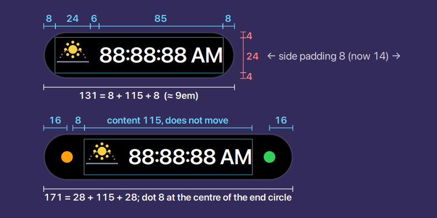

## Sizes

- The pill is 32 tall, radius 16; content box 24, 4 above and below (pill = bar − 2 × 0.25em,
  content = pill − 2 × 0.25em). **Decided**
- Horizontal padding 8, from the pill's edge to the content box (was 14: `PAD` in `pill.js`). **Decided**
- The 1 px border (`.buoy-island`, white 12 %) lies **inside** the pill and counts toward the
  padding: St draws the border inside the actor's box, and the content is a separate actor placed
  by `pill.js`, so the border does not push the content. The pill stays 32 tall; from the border's
  inner edge to the content box is 7 horizontal, 3 vertical. A capture of the current pill gives
  exactly 13 + 1 = 14. **Decided**
- The border stays white 12 % (15 % considered): GNOME uses 10 % for borders in dark mode and for
  the OSD border (gnome-shell-sass `_default-colors.scss` `$border_opacity: .9`, `_colors.scss`);
  15 % on black differs from 12 % by only 7 grey levels (#262626 against #1f1f1f), and on a light
  wallpaper it is the black background that sets the pill apart. **Decided** (Ethan, 2026-11-10)
- Gap **6** between the 24 leading tile → text and text → trailing; **8** between trailing → button.
  The pill's end is a half circle of radius 16 hugging the leading tile's corner, so padding 8 looks
  narrower than 8, while a gap of 8 between two straight edges (tile and text) looks wider; 6 makes
  the three gaps look even. An icon fills the 24 tile, so it sits 8 from the pill's edge and 6 from
  the text; Bu 20 sits centred in the 24 tile, so 8. **Decided** (Ethan, 2026-11-12; replaces one
  value of 8 everywhere from 2026-11-10). Since 2026-11-12 (M4 "Sizes in em") the code uses exactly
  these gaps for both idle and minimal, in em (`kit/model/shapes.js` `pillMetrics`); before that idle
  used 7 plus `padding-left: 2px`, minimal used 8.

- Leading: the time-of-day icon and the weather icon at **24**, filling the 24 tile ([Icons](../icons/index.md));
  Bu stays **20** in the 24 tile, because its 10 × 10 grid is sharp only at multiples of 10 ([Bu](../mascot/index.md)).
  **Decided** (Ethan, 2026-11-11; icons replace 20 in a 24 tile)

## Text

- Text at 1em like GNOME's text on the bar (size 11pt inherited from `stage`, gnome-shell-sass
  `_common.scss`); before 2026-11-12 Buoy used a fixed 13 px. **Decided**
- **600** bold, tabular figures, set by Buoy itself: the island is added with `addTopChrome`, not
  inside `#panel`, so it inherits only `stage` (the system font, regular 400), not the bar's
  `font-weight: bold` (700) and `%numeric` (`_panel.scss`). 600 rather than 700: white text on
  black is tighter and sharper, yet close to the weight of the text on either side. Not for width:
  700 is only 1 px wider than 600 at 1× and equal at 2×; 400 is 1 px narrower at 1× and 4 px at 2×
  but looks clearly faint beside the bar's 700 text. **Decided** (Ethan, 2026-11-09; 600 kept after
  comparing with 400 and 700, 2026-11-10)

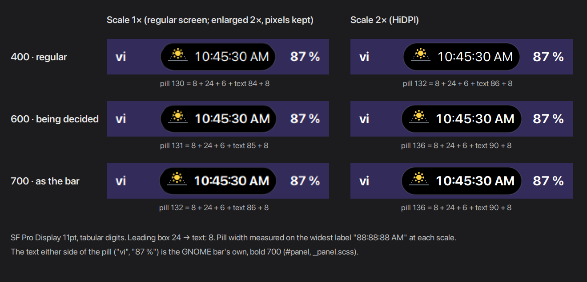

## Equaliser

At the trailing end of the music pill and on the Media tab's chip. Measurements in [Tokens](../tokens.md).

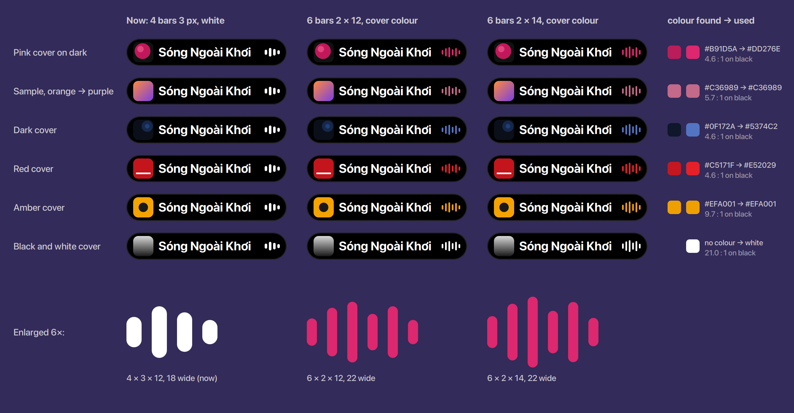

- **6 bars 2 × 14**, gap 2, instead of 4 bars 3 × 12: thinner, taller bars, closer to the Dynamic
  Island's wave. Chosen between 2 × 12 and 2 × 14: a 2 px bar needs more height to hold its colour.
  **Decided** (Ethan, 2026-11-13)
- **The cover art's dominant colour**, one colour, no gradient: the hue shared by most of the
  cover's coloured pixels. Grey, black and white pixels do not count; dark pixels count like light
  ones, so a navy cover gives blue. **Decided** (Ethan, 2026-11-13)
- **Brightened to 4.5:1** on the island's black ([Colours](../colours/index.md), "Contrast"):
  hue and saturation kept, only the lightness raised. A colour already bright enough stays.
  **Decided** (Ethan, 2026-11-13)
- **No colour, then white** (`fg`): a black, grey or black-and-white cover, no cover, or a cover not
  read yet. **Decided** (Ethan, 2026-11-13)
- Paused: the bars **drop over 200 ms** from where they stand to the low paused shape (2026-11-07),
  keeping the cover colour. They drop only once, at the pause; a pill rebuilt while paused is low
  already. Animations off: low at once. **Decided** (Ethan, 2026-11-13)
- Stale: `fg-subtle`, no colour. GNOME's high contrast: always `fg`. **Proposed**
- An amber or red cover makes the equaliser close to or the same as a light colour (`light-missed`,
  `light-waiting`): **keep the cover's colour**, no hue shift and no fall back to white. The light
  is one dot at the left end, the equaliser six bars on the right: shape and place already tell
  them apart. **Decided** (Ethan, 2026-11-13)
- Not synced to the real sound: MPRIS gives no audio level, and an "audio visualizer" is out of scope
  (SPEC §0). The bars run on a formula, each on its own cycle.

## Idle

- Idle keeps room for the widest plan (the clock `88∶88∶88 AM`), so the pill does not jump when the
  hour goes from 1 digit to 2: 8 + 24 + 6 + 85 + 8 = **131 ≈ 9em**. The width is **measured from
  the real text label at runtime**, not hard-coded. **Decided**
  - In a nested GNOME Shell 50 (Ubuntu mode, SF Pro Display 11), the same `St.Label` is 85 px wide
    at 1× scale, **90** at 1.25× / 1.5× / 2× (fractional scales lay text out at the scale rounded up)
    and 88 at 3×. Hard-coded 131 cuts the clock to "12∶59∶59 A…" on a HiDPI screen; measured at
    runtime, idle grows to 136 by itself.
  - The Shell's clock uses the character U+2236 `∶`, not a colon: measure with the real clock string.

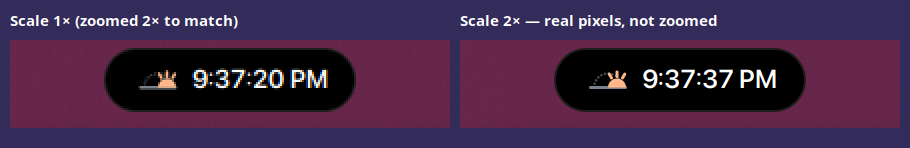

## Battery idle plan

*Ethan, 2026-11-27 (M4 item "Idle plan `power`", option A + Y).* GNOME's battery and power mode in
the idle pill. Read from the same two objects Quick Settings holds, as the Power item does
(design/compact "Battery and power mode"): no proxy of its own, no polling.

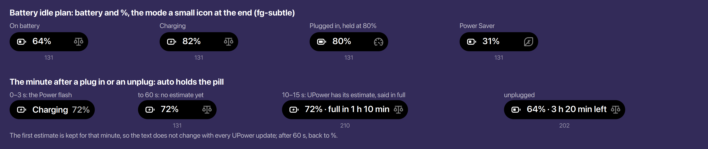

- **Pill**: Buoy's battery icon, the percentage, the mode a 16 icon at the end in `fg-subtle`. It
  always fits 131, the idle's room, so switching plans does not jump. Without power-profiles-daemon:
  no mode icon. A machine without a battery: the plan shows nothing and `auto` passes it by.
  **Decided** (Ethan, 2026-11-27)
- **The minute after a plug in or an unplug**: after the Power item's 3 s flash, `auto` holds the
  pill for this plan until 60 s are up, as "Up next" holds it before an event. Once UPower has its
  estimate (10–15 s later), the pill says it in full: "72% · full in 1 h 10 min", "64% · 3 h 20 min
  left". The first estimate is kept for that minute, so the text does not change with every UPower
  update; after 60 s, back to the percentage. **Decided** (Ethan's idea, 2026-11-14; decided
  2026-11-27)
- **`auto`**: the minute after a plug in or an unplug 80 (holds the pill); on battery under 30% 60,
  on battery 30; charging 25; full or held at a limit 15; no battery, nothing. A low battery (under
  20%) is already an activity at priority 70 that stays until plugged in, so it needs no score of
  its own. In the default `idle-auto-plans`, after the weather. **Decided** (2026-11-27)

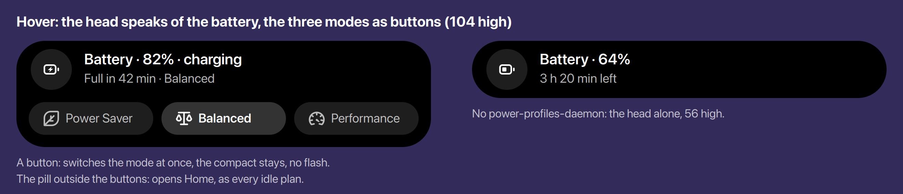

- **Compact** (hover): the head speaks of the battery, "Battery · 82% · charging" over "Full in 42
  min · Balanced"; the three modes as buttons, laid out as the power-mode compact (design/compact),
  104 high. A button switches at once, the compact stays, no flash. Without the daemon: the head
  alone, 56 high. A click on the pill outside the buttons opens Home, as for every idle plan.
  **Decided** (Ethan, 2026-11-27)

## Fonts and display scale

- Em only makes text **size** follow the system; it does not change the text's **shape**. At 1em
  the clock is 82 px (Ubuntu Sans) to 103 px (DejaVu Sans) wide, the line 18–21 px tall. The layout
  does not break, because widths are measured from real text and heights (tile, pill, bar) are in
  em. Idle at 1em: 130–151; with large text (1.25): 163–190 × 40.
- Keep room for the font's widest digit, measured, not assumed to be "8": not every font has
  tabular figures (for example Liberation Sans: a bold "1" is 0.4 px narrower). **Decided** (Ethan, 2026-11-11)

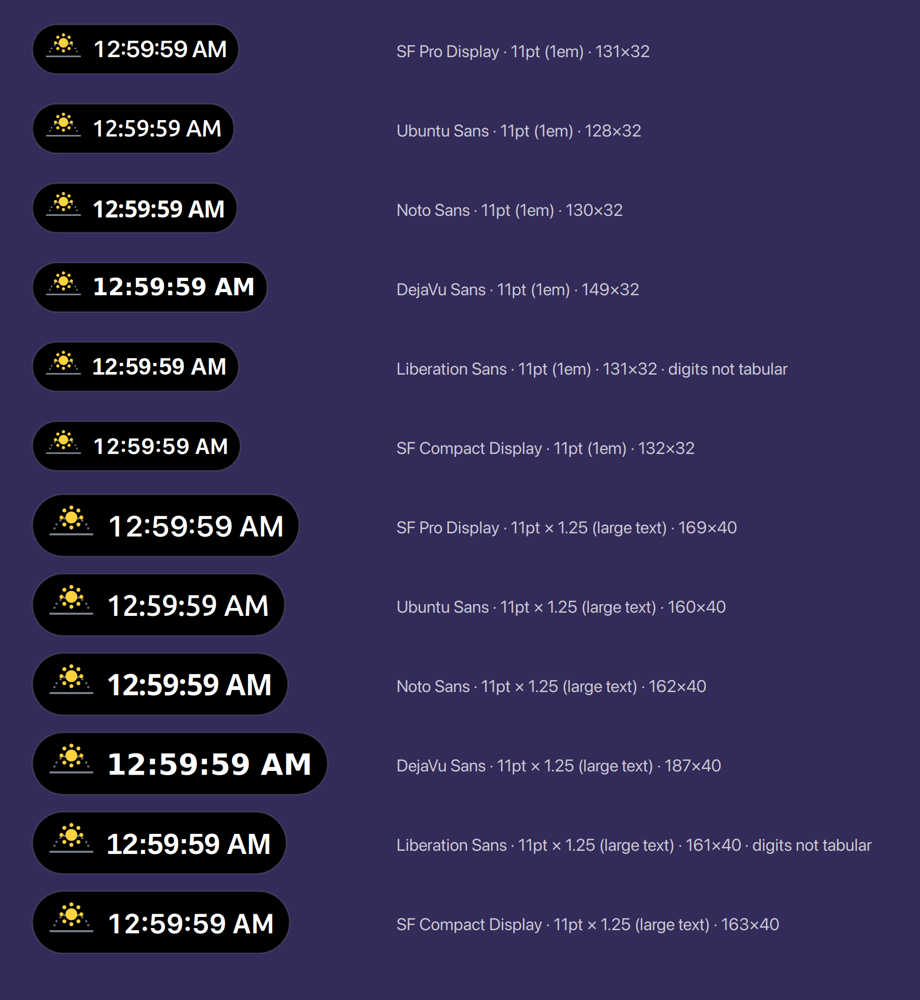

## Lights at both ends: buoy light (left), privacy dot (right)

- Lights are only on **pill 1**: not on side pills (the light tells a shared state, not one
  activity's), not in the compact, card or expanded. The compact shows only after a 300 ms hover
  and goes when the pointer leaves, so it needs no light; the light is back as soon as the pill
  shrinks back. **Decided** (Ethan, 2026-11-10)
- A light never pushes the content: the pill grows at both ends, the content stays put, within the
  maximum width. **Decided**
- Dot 8, right at the centre of the end circle (Ø32), 16 from the edge (an even number, so it
  covers whole pixels). **Decided**
- Each end grows by **end radius + half a dot** = 16 + 4 = **20**; the content goes from 8 → 28, so
  from the dot's edge to the content is exactly the padding of 8. Idle 131 → 171. **Decided** (2026-11-10)
- With only one light both ends still grow, so the content always stays centred. **Decided** (Ethan, 2026-11-10)
- Hovering pill 1 with the **red light** (an unanswered question, hidden): the compact is **that
  ask card itself**, with its buttons, in place of the activity's compact; answer right there.
  Several waiting: the newest. When the pointer leaves the card shrinks back, the light stays red.
  With the amber light it is still the Missed list. **Decided** (Ethan, 2026-11-13)

  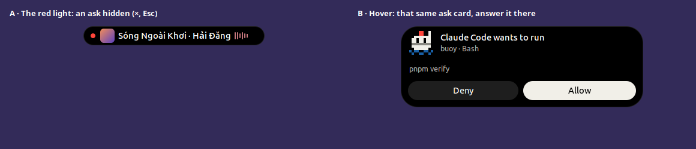
- The maximum width is for **the whole pill, lights included**, no exception for the lights: once at
  the maximum, long text is cut with "…" like any other long text. Pill 1 at 1920 is still at most
  336, light or not. **Decided** (Ethan, 2026-11-10)

## Width and the pills on the bar

- The maximum width is the smallest of three limits: by em (text does not grow on a wider screen),
  by a share of expanded (so minimal < compact < expanded), and by the free space between the two
  clusters ([Tokens](../tokens.md#maximum-width-on-the-bar)). **Decided**
- At most **2 side pills, on the right** of pill 1 (as SPEC §2c). Both sides was considered: more
  balanced and at 1366 fits 2 side pills, but the priority order no longer reads in one direction.
  **Decided** (Ethan, 2026-11-11)
- Side pills 2–3 fixed at 131, like idle (leading, one short value, `+N`). **Decided** (Ethan, 2026-11-11)
- Hover: every pill grows by a fixed 0.75em (12 px), instead of +10 % (a 336 pill would grow by 34);
  the height still adds 2 as now (32 → 34, `kit/model/shapes.js`). **Decided** (Ethan, 2026-11-11)
- The two clusters on Ethan's machine, measured in Looking Glass: `Main.panel._leftBox` 93,
  `_rightBox` 293. At 1920 the free space is never pill 1's limit — the em and expanded limits are.
  Side pills on the right only leave 215 before `_rightBox`; on both sides, 555 / 355. Buoy
  measures the clusters again whenever they resize (`island.js`).

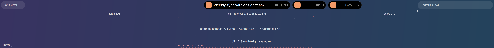
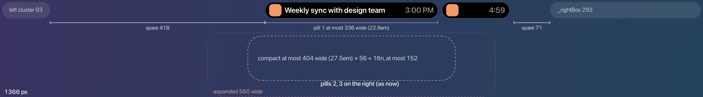

## Side pills: leading, trailing and +N

A side pill is fixed at 132, so its content does not fill it; before, the whole group (leading,
trailing, `+N`) was centred, at a different place in each pill. **B** chosen. **Decided** (Ethan, 2026-11-12)

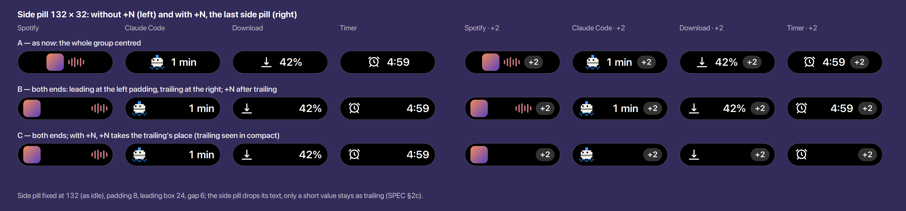

- **A** — current: the whole group centred.
- **B** (chosen) — both ends: leading against the left padding, trailing against the right padding
  as in every pill; with `+N`, `+N` is at the right padding and trailing moves in before it (gap 6).
  Every pill has the same layout.
- **C** — as B, but with `+N`, `+N` replaces trailing (that value is seen in the compact).

## Claude Code in pill 1

**C** chosen, and **D** when Claude has a task list. **Decided** (Ethan, 2026-11-12)

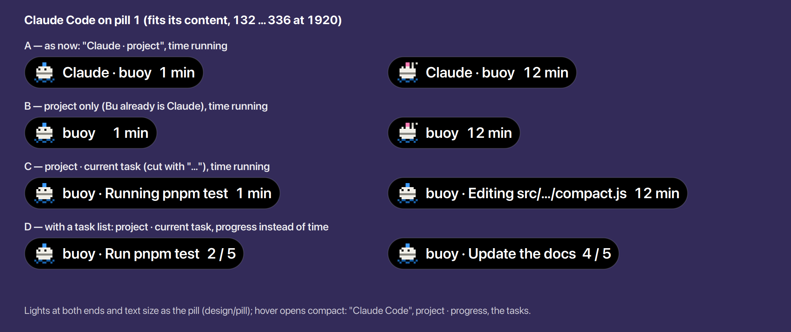

- **A** — current: "Claude · project", running time.
- **B** — project only: Bu already says it is Claude.
- **C** (chosen) — project · current task (like the compact's second line, cut with "…" at the
  maximum width), running time: "buoy · Running pnpm test · 1 min", "buoy · Waiting for you",
  "buoy · Done in 12 min" (when done the time is in the text).
- **D** (chosen, with a task list) — project · the current task in the list (▶), and progress `2 / 5`
  in place of the time.
- **The project** is the git repo's name (the folder with `.git`, walking up from `cwd`; for a
  worktree, the main repo), not the folder Claude is in: running in `buoy/src` is still "buoy". No
  repo: the folder name. **Decided** (Ethan, 2026-11-12)
- **The session name** (Claude Code's `/rename`, Claude Desktop's session name) does not go on the
  pill, only in the compact's title: a long name (4–44 characters) would push the current task out
  to "…". **Decided** (Ethan, 2026-11-12)

## Options considered

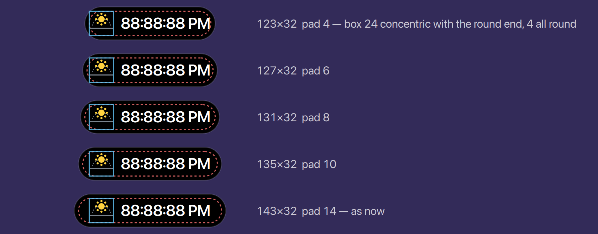

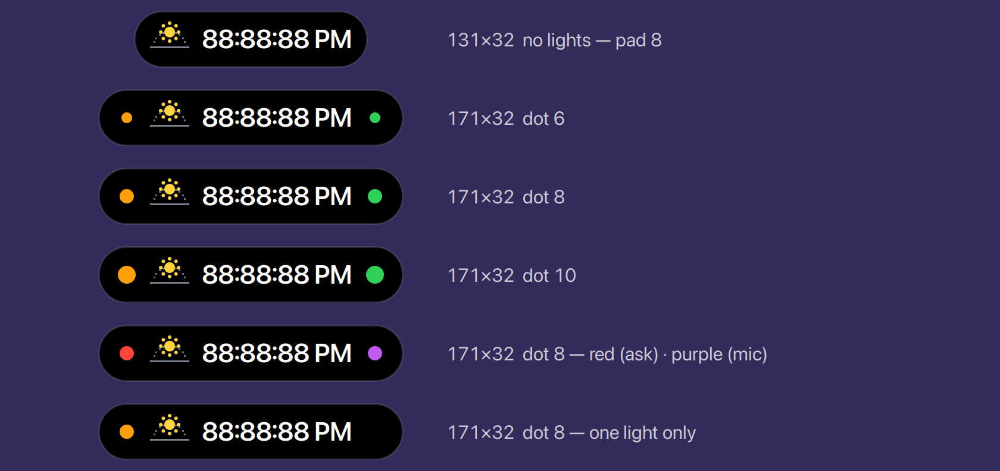
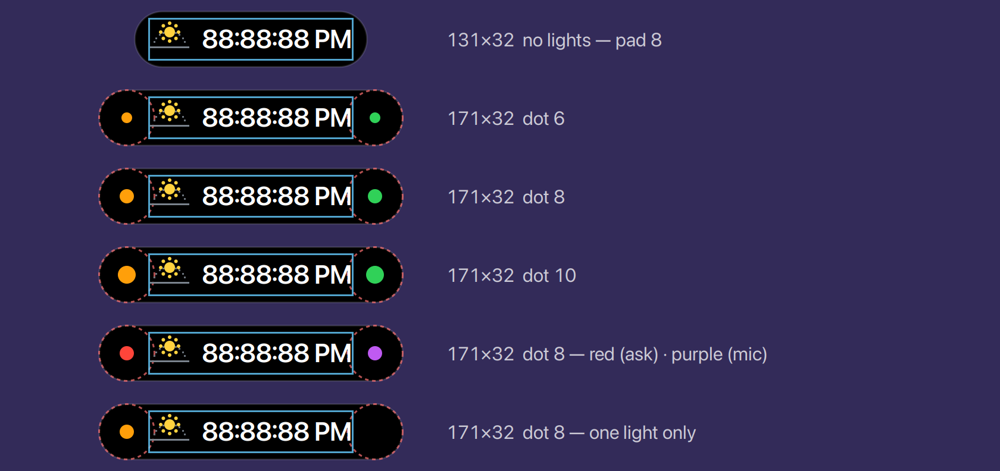

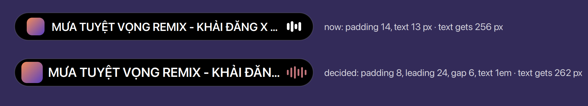

Rejected: idle 146 with padding 14; the light growing one end against growing both ends.

## In the code

- `lib/kit/model/cover.js` — the cover's dominant colour and brightening (pure, `tests/cover.test.js`);
  `lib/kit/ui/present/motion.js` `eqGlyph` — the 6 bars and colour; `lib/modules/media/source.js`
  `_readTint` — reads the cover once per track.

- `lib/kit/ui/pill.js` — `PAD` 14 → 8; hover and press add in em instead of × 1.10 / × 1.16.
- `lib/kit/model/shapes.js` — `idleW = even(h × 3.75)` → measured from the widest plan; width limits
  in em.
- `stylesheet.css` — `#panel.buoy` height 40px → 2.75em; pill text 13px → 1em; `.buoy-light`
  7 → 8, at the centre of the end circle; `.buoy-idle-zones` spacing 7 → 6 and `padding-left: 2px`
  dropped from `.buoy-idle`; `.buoy-minimal` spacing 8 → 6, the button keeps 8 after trailing (`margin-left: 2px`); `.buoy-text` bold 600 and tabular figures like `.buoy-idle-text`.
- `lib/modules/power/idle.js` (pure, `tests/idle-power.test.js`), `feed.js` — the battery idle plan;
  the `subtle` icon in `lib/kit/model/presentation.js`; an idle compact's buttons go through
  `lib/kit/services/idle.js` to the feed.
- SPEC §2 pill structure ("that zone nudges inward" → the pill grows at both ends), §2a-i/ii (lights), §2c
  (at most 2 side pills on the right, side pill 131), the size table §4.
