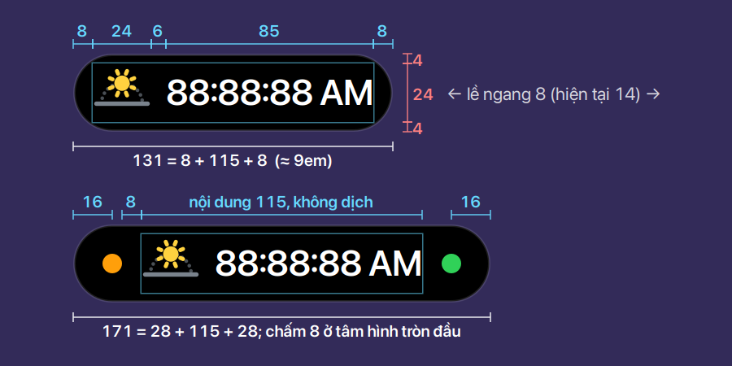
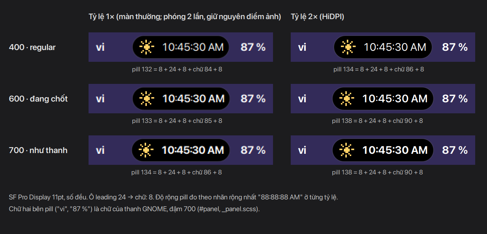
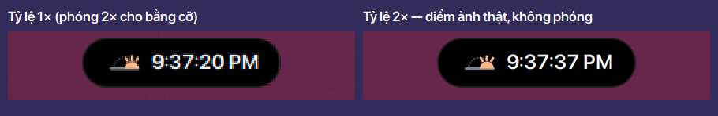
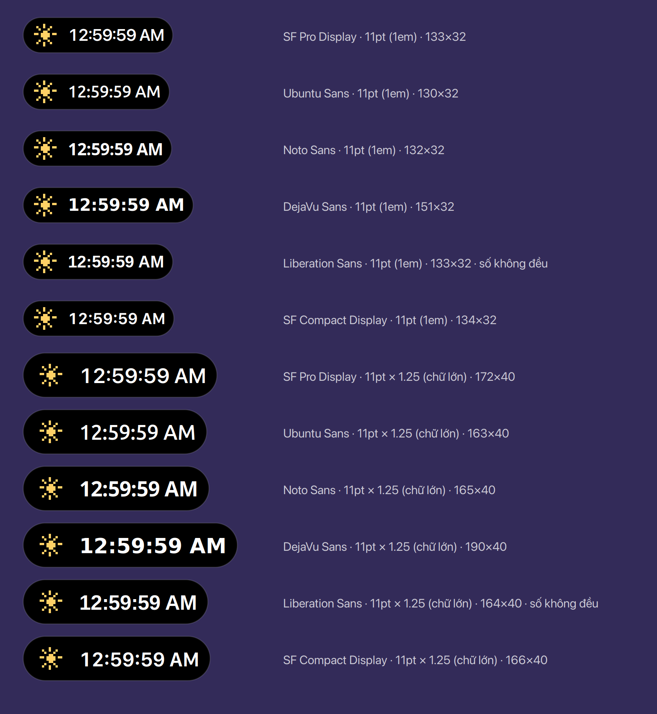
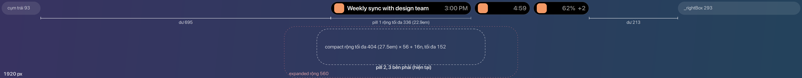
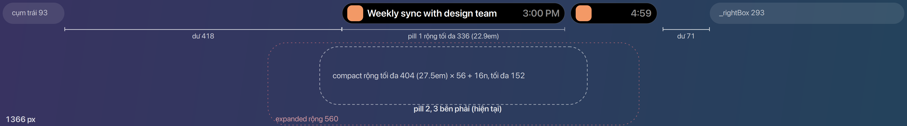
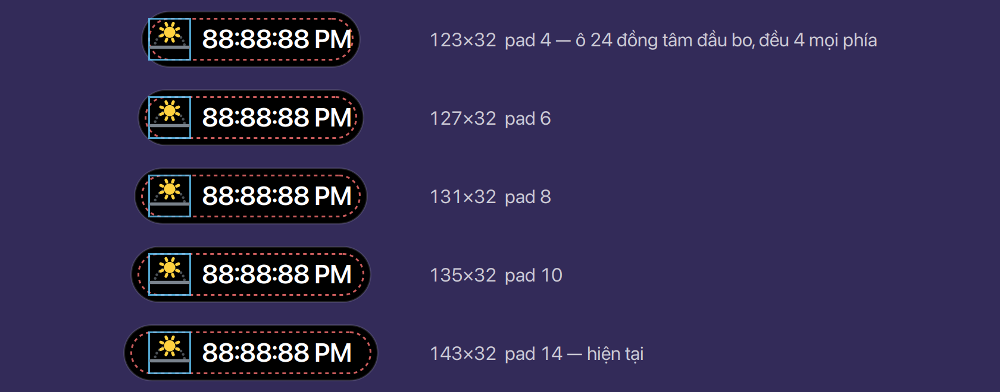
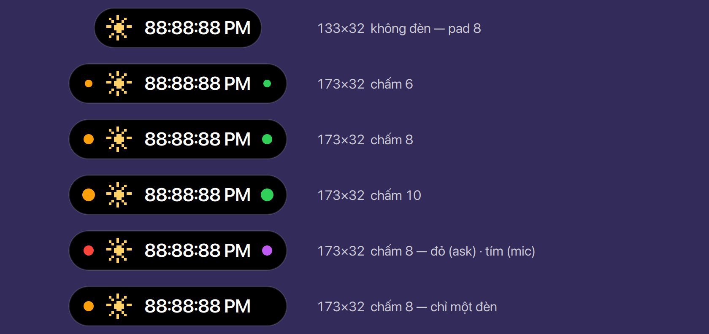
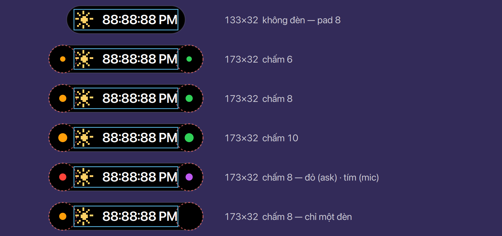
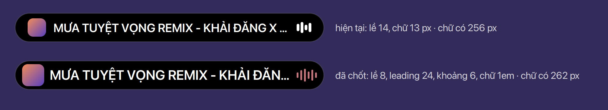

# Pill

Pill nằm giữa thanh: **idle** khi không có activity, **minimal** khi có (pill 1 ở giữa), và tối
đa hai **pill phụ** bên phải. Số dùng chung ở [Bảng số](../tokens.vi.md).

## Kích thước

- Pill cao 32, bo 16; khung nội dung 24, trên và dưới mỗi bên 4 (pill = thanh − 2 × 0.25em, nội
  dung = pill − 2 × 0.25em). **Chốt**
- Lề ngang 8, tính từ mép pill đến khung nội dung (trước là 14: `PAD` trong `pill.js`). **Chốt**
- Viền 1 px (`.buoy-island`, trắng 12 %) nằm **bên trong** pill và được tính vào lề: St vẽ viền
  bên trong khung của actor, còn nội dung là một actor riêng do `pill.js` đặt vị trí, nên viền
  không đẩy nội dung. Pill vẫn cao 32; từ mép trong của viền đến khung nội dung là 7 ngang, 3
  dọc. Ảnh chụp pill hiện tại cho đúng 13 + 1 = 14. **Chốt**
- Viền giữ trắng 12 % (đã cân nhắc 15 %): GNOME dùng 10 % cho viền ở chế độ tối và viền OSD
  (gnome-shell-sass `_default-colors.scss` `$border_opacity: .9`, `_colors.scss`); 15 % trên nền
  đen chỉ khác 12 % có 7 mức xám (#262626 so với #1f1f1f), và trên hình nền sáng thì nền đen mới
  là thứ tách pill ra. **Chốt** (Ethan, 2026-11-10)
- Khoảng **6** giữa ô leading 24 → chữ và chữ → trailing; **8** giữa trailing → nút. Mép pill là nửa
  hình tròn bán kính 16 ôm sát góc ô leading, nên lề 8 trông hẹp hơn 8, còn khoảng 8 giữa hai cạnh
  thẳng (ô và chữ) trông xa hơn; 6 làm ba khoảng trông đều. Icon đầy ô 24 nên cách mép pill 8 và
  cách chữ 6; Bu 20 nằm giữa ô 24 nên cách 8. **Chốt** (Ethan, 2026-11-12; thay một giá trị 8 cho
  mọi chỗ của 2026-11-10). Từ 2026-11-12 (M4 "Sizes in em") code dùng đúng các khoảng này cho cả idle
  và minimal, tính theo em (`kit/model/shapes.js` `pillMetrics`); trước đó idle dùng 7 cộng
  `padding-left: 2px`, minimal dùng 8.

- Leading: icon buổi trong ngày và icon thời tiết **24**, đầy ô 24 ([Icon](../icons/index.vi.md));
  Bu giữ **20** giữa ô 24, vì lưới 10 × 10 chỉ nét ở bội số của 10 ([Bu](../mascot/index.vi.md)).
  **Chốt** (Ethan, 2026-11-11; icon thay 20 trong ô 24)

## Chữ

- Chữ 1em như chữ trên thanh của GNOME (cỡ 11pt kế thừa từ `stage`, gnome-shell-sass
  `_common.scss`); trước 2026-11-12 Buoy dùng cố định 13 px. **Chốt**
- Đậm **600**, số đều, do Buoy tự đặt: island được gắn bằng `addTopChrome`, không nằm trong
  `#panel`, nên chỉ kế thừa `stage` (font hệ thống, chữ thường 400), không có `font-weight: bold`
  (700) và `%numeric` của thanh (`_panel.scss`). 600 thay vì 700: chữ trắng trên nền đen gọn và
  sắc hơn mà vẫn gần độ đậm của chữ hai bên. Không phải vì độ rộng: 700 chỉ rộng hơn 600 có 1 px
  ở 1× và bằng nhau ở 2×; 400 hẹp hơn 1 px ở 1× và 4 px ở 2× nhưng trông nhạt hẳn so với chữ 700
  của thanh. **Chốt** (Ethan, 2026-11-09; giữ 600 sau khi so với 400 và 700, 2026-11-10)

## Idle

- Idle chừa sẵn chỗ cho plan rộng nhất (đồng hồ `88∶88∶88 AM`), để pill không giật khi giờ đổi
  từ 1 chữ số sang 2: 8 + 24 + 6 + 85 + 8 = **131 ≈ 9em**. Độ rộng **đo từ nhãn chữ thật khi
  chạy**, không viết cứng. **Chốt**
  - Trong GNOME Shell 50 ảo (chế độ Ubuntu, SF Pro Display 11), cùng một `St.Label` rộng 85 px ở
    tỷ lệ 1×, **90** ở 1.25× / 1.5× / 2× (tỷ lệ lẻ dàn chữ ở tỷ lệ làm tròn lên) và 88 ở 3×. Viết
    cứng 131 thì ở màn HiDPI đồng hồ bị cắt thành "12∶59∶59 A…"; đo khi chạy thì idle tự lên 136.
  - Đồng hồ của Shell dùng ký tự U+2236 `∶`, không phải dấu hai chấm: phải đo bằng đúng chuỗi
    đồng hồ thật.

## Font và tỷ lệ màn hình

- Em chỉ làm **cỡ** chữ lớn nhỏ theo hệ thống, không đổi **hình dạng** chữ. Ở 1em, đồng hồ rộng
  từ 82 px (Ubuntu Sans) đến 103 px (DejaVu Sans), dòng chữ cao 18–21 px. Bố cục không vỡ vì độ
  rộng đo từ chữ thật, còn chiều cao (ô, pill, thanh) tính bằng em. Idle ở 1em: 130–151; khi bật
  chữ lớn (1.25): 163–190 × 40.
- Chừa chỗ theo chữ số rộng nhất của font, đo thật, không mặc định số "8": không phải font nào
  cũng có số đều (ví dụ Liberation Sans: số "1" đậm hẹp hơn 0.4 px). **Chốt** (Ethan, 2026-11-11)

## Đèn ở hai đầu: buoy light (trái), privacy dot (phải)

- Đèn chỉ có trên **pill 1**: không có trên pill phụ (đèn báo trạng thái chung, không thuộc
  activity nào), không có trong compact, card hay expanded. Compact chỉ hiện sau 300 ms rê chuột
  và mất khi chuột rời, nên không cần đèn ở đó; đèn trở lại ngay khi pill thu về. **Chốt**
  (Ethan, 2026-11-10)
- Đèn không bao giờ đẩy nội dung: pill nở ra ở hai đầu, nội dung đứng yên, trong giới hạn độ rộng
  tối đa. **Chốt**
- Chấm 8, đúng tâm hình tròn đầu (Ø32), cách mép 16 (số chẵn nên phủ trọn pixel). **Chốt**
- Mỗi đầu nở thêm **bán kính đầu bo + nửa chấm** = 16 + 4 = **20**; nội dung từ 8 → 28, nên từ mép
  chấm đến nội dung đúng bằng lề 8. Idle 131 → 171. **Chốt** (2026-11-10)
- Chỉ có một đèn thì vẫn nở cả hai đầu, để nội dung luôn ở giữa. **Chốt** (Ethan, 2026-11-10)
- Độ rộng tối đa là của **cả pill, tính cả đèn**, không ngoại lệ cho đèn: khi đã chạm tối đa, chữ
  dài cắt bằng "…" như mọi chữ dài khác. Pill 1 ở 1920 vẫn tối đa 336, có đèn hay không. **Chốt**
  (Ethan, 2026-11-10)

## Độ rộng và các pill trên thanh

- Độ rộng tối đa lấy số nhỏ nhất trong ba giới hạn: theo em (chữ không lớn lên khi màn hình rộng
  hơn), theo một tỷ lệ của expanded (để minimal < compact < expanded), và theo khoảng trống giữa
  hai cụm ([Bảng số](../tokens.vi.md#độ-rộng-tối-đa-trên-thanh)). **Chốt**
- Tối đa **2 pill phụ, bên phải** pill 1 (như SPEC §2c). Đặt hai bên đã cân nhắc: cân hơn và ở 1366
  vừa 2 pill phụ, nhưng thứ tự ưu tiên không còn đọc theo một chiều. **Chốt** (Ethan, 2026-11-11)
- Pill phụ 2–3 cố định 131, bằng idle (leading, một giá trị ngắn, `+N`). **Chốt** (Ethan, 2026-11-11)
- Hover: mọi pill rộng thêm cố định 0.75em (12 px), thay cho +10 % (pill 336 sẽ nở tới 34); chiều
  cao vẫn cộng 2 như nay (32 → 34, `kit/model/shapes.js`). **Chốt** (Ethan, 2026-11-11)
- Hai cụm trên máy Ethan, đo bằng Looking Glass: `Main.panel._leftBox` 93, `_rightBox` 293. Ở
  1920, khoảng trống không bao giờ là giới hạn của pill 1 — giới hạn em và expanded mới là. Pill
  phụ chỉ bên phải còn dư 215 trước `_rightBox`; đặt hai bên thì dư 555 / 355. Buoy đo lại cụm
  mỗi khi nó đổi kích thước (`island.js`).

## Phương án đã cân nhắc

Đã bỏ: idle 146 với lề 14; đèn nở một đầu so với nở cả hai đầu.

## Chỗ trong code

- `lib/kit/ui/pill.js` — `PAD` 14 → 8; hover và nhấn cộng theo em thay cho × 1.10 / × 1.16.
- `lib/kit/model/shapes.js` — `idleW = even(h × 3.75)` → đo từ plan rộng nhất; giới hạn độ rộng tính
  bằng em.
- `stylesheet.css` — `#panel.buoy` cao 40px → 2.75em; chữ trong pill 13px → 1em; `.buoy-light`
  7 → 8, ở tâm hình tròn đầu; `.buoy-idle-zones` spacing 7 → 6 và bỏ `padding-left: 2px` của
  `.buoy-idle`; `.buoy-minimal` spacing 8 → 6, nút giữ 8 sau trailing (`margin-left: 2px`); `.buoy-text` đậm 600 và số đều như `.buoy-idle-text`.
- SPEC §2 cấu trúc pill ("that zone nudges inward" → pill nở ra ở hai đầu), §2a-i/ii (đèn), §2c
  (tối đa 2 pill phụ bên phải, pill phụ 131), bảng kích thước §4.
