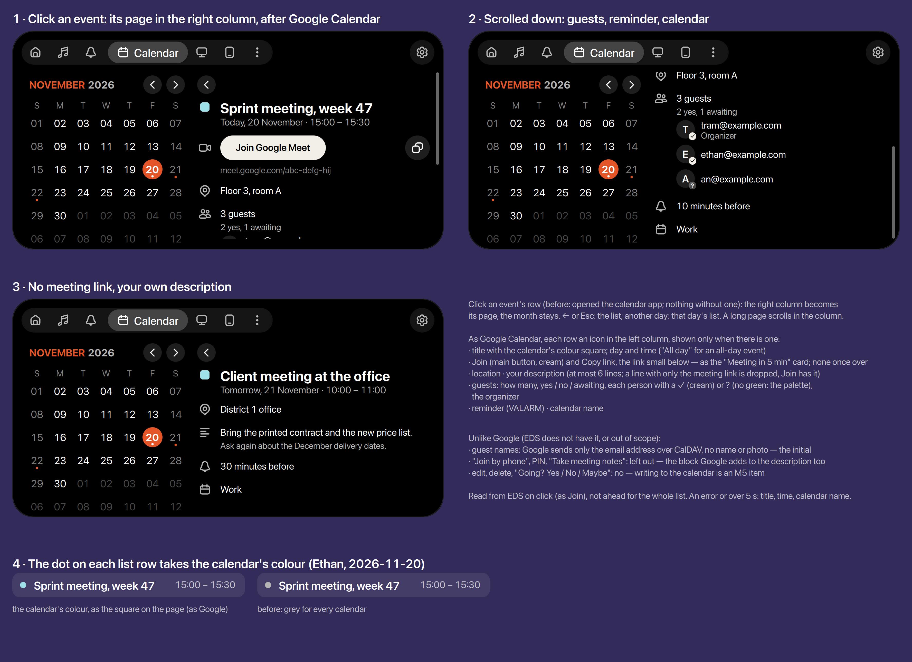

# Tabs

**Open.** This page has the tab strip and the shared rules; each tab has its own page. This page
will have the tab strip, each tab by kind (Media, Notifications, Transfers, Timer, Calendar…) and
the standalone tabs (Clipboard), each on its own page in the same mould as the other parts.

Decided so far (in [Expanded](../expanded/index.md)): the tab strip is 32 tall, 12 from the top
edge, radius 16 concentric with the 28 corner. Home is on [its own page](../home/index.md). How the
tab strip behaves (which tabs there are, where it opens) is in SPEC §2b.

**Tab strip** (Ethan, 2026-11-13, **Decided**): Home · Media · Notifications · Calendar · Device,
then the tabs that show only while they have an activity (Claude Code, Transfers…) in the
second-to-last place; the last slot is always the tab picked from ⋯ (Clipboard until one is
picked), Timer in ⋯. Device is its own M4 item, only designing and showing the tab (each part has
its own implementation item): three groups This Computer (battery, power mode), Wireless
(Bluetooth, the phone as a device: battery, find the phone; calls, messages, Grab… in a separate
Phone tab), Plugged In (USB, displays, headphones). **Decided**

**Phone tab** (Ethan, 2026-11-18, **Decided**): in ⋯ like Timer, moves onto the tab strip by itself
(before the slot) while a call is on; clicking the phone tile on Home opens it. Its content is in
[Device](../device/index.md) "Calls and the Phone tab".

## Each tab

- [Media](../media/index.md) — a card like Home's, chips for several players, buttons and bar
  always complete.
- [Device](../device/index.md) — one column per group (This Computer, Wireless, Plugged In), "+N"
  when there are many.

## Event details

*Ethan, 2026-11-20 (M4 item "Event details in the Calendar tab"), after Google Calendar's event page.*

- **Opening**: clicking an event in the Calendar tab turns the right column into its page, the month
  stays on the left. ‹ or Esc: back to the list; picking another day: that day's list. A long page
  scrolls inside the column. **Decided**
- **The page** (as in Google Calendar, each row with a 16 `fg-muted` icon in the left column, shown
  only when there is something): the calendar's 12 colour square and the title (16, 700), the date
  and time (`fg-muted`); **Join …** (main button `fill-inverse`) and "Copy link" (32, `fill-2`), the
  small link in `fg-subtle` below, until 10 minutes after the start time; the place; guests — the
  number of people, yes / no / no answer, each person: initial in a 28 circle, a cream ✓ or a
  `fill-4` ? (not green: the palette), address, "Organizer"; the event's own description (at most 6
  lines; the block Google adds itself and lines holding only the meeting link are dropped);
  reminders; the calendar's name. **Decided**
- **Data**: read from EDS on click, that event only (as Join); the head shows at once. Google sends
  only the guests' email addresses over CalDAV, no names or pictures. On error: the head only. View
  only: no editing, deleting or replying to invitations (writing to the calendar is an M5 item).
  **Decided**
- **Colour dot**: the dot on each row of the list takes the calendar's colour (the source's `Color`
  in EDS) instead of grey. **Decided**
