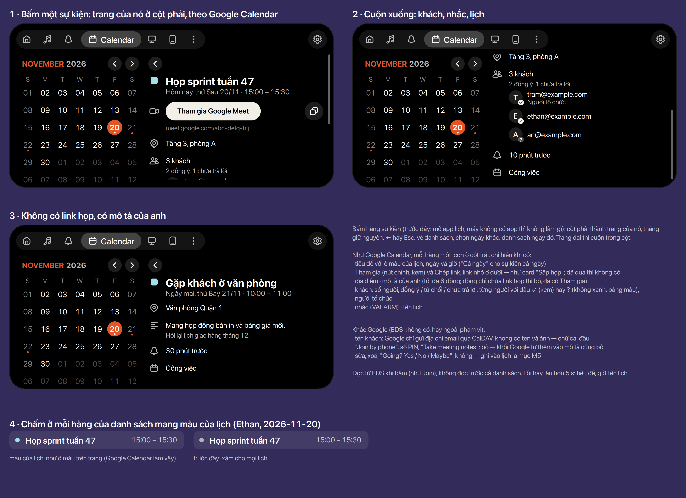

# Tab

**Mở.** Trang này có thanh tab và luật chung; mỗi tab có trang riêng. Trang này sẽ có thanh tab,
mỗi tab theo loại (Media, Notifications, Transfers, Timer, Calendar…) và các tab standalone
(Clipboard), mỗi cái một trang theo cùng khuôn với các phần khác.

Đã chốt đến giờ (ở [Expanded](../expanded/index.vi.md)): thanh tab cao 32, cách mép trên 12, bo 16
đồng tâm với góc 28. Home ở [trang riêng](../home/index.vi.md). Hành vi của thanh tab (tab nào có, mở ở đâu) ở SPEC §2b.

**Thanh tab** (Ethan, 2026-11-13, **Chốt**): Home · Media · Notifications · Calendar · Device, rồi
các tab chỉ hiện khi có activity (Claude Code, Transfers…) ở chỗ kế cuối, slot cuối luôn là tab
chọn từ ⋯ (Clipboard khi chưa chọn), Timer trong ⋯. Device là mục M4 riêng, chỉ thiết kế và hiển thị tab (từng phần có mục implement riêng): ba nhóm Máy này (pin,
chế độ nguồn), Không dây (Bluetooth, điện thoại như một thiết bị: pin, tìm máy; cuộc gọi, tin nhắn, Grab… ở tab Phone riêng), Đang cắm (USB, màn hình, tai nghe). **Chốt**

**Tab Điện thoại** (Ethan, 2026-11-18, **Chốt**): trong ⋯ như Hẹn giờ, tự lên thanh tab (trước slot)
khi đang có cuộc gọi; bấm ô điện thoại ở Home mở nó. Nội dung ở [Thiết bị](../device/index.vi.md)
"Cuộc gọi và tab Điện thoại".

## Từng tab

- [Media](../media/index.vi.md) — thẻ như Home, chip cho nhiều player, nút và thanh luôn đủ.
- [Thiết bị](../device/index.vi.md) — mỗi nhóm một cột (Máy này, Không dây, Đang cắm), "+N" khi nhiều.

## Chi tiết sự kiện

*Ethan, 2026-11-20 (mục M4 "Event details in the Calendar tab"), theo trang sự kiện của Google Calendar.*

- **Mở**: bấm một sự kiện trong tab Lịch thì cột phải thành trang của nó, tháng vẫn ở trái. ‹ hay Esc: về
  danh sách; chọn ngày khác: danh sách ngày đó. Trang dài thì cuộn trong cột. **Chốt**
- **Trang** (như Google Calendar, mỗi hàng một icon 16 `fg-muted` ở cột trái, chỉ hiện khi có): ô màu 12 của
  lịch và tiêu đề (16, 700), ngày giờ (`fg-muted`); **Join …** (nút chính `fill-inverse`) và Chép link (32,
  `fill-2`), link nhỏ `fg-subtle` dưới, đến 10 phút sau giờ bắt đầu; địa điểm; khách — số người, đồng ý / từ
  chối / chưa trả lời, từng người: chữ cái đầu trong vòng 28, dấu ✓ kem hay ? `fill-4` (không xanh: bảng màu),
  địa chỉ, "Organizer"; mô tả của chính sự kiện (tối đa 6 dòng; khối Google tự thêm và dòng chỉ chứa link họp
  bị bỏ); nhắc; tên lịch. **Chốt**
- **Dữ liệu**: đọc từ EDS khi bấm, chỉ sự kiện đó (như Join); phần đầu hiện ngay. Google chỉ gửi địa chỉ email
  của khách qua CalDAV, không có tên hay ảnh. Lỗi: chỉ phần đầu. Chỉ xem: không sửa, xoá hay trả lời lời mời (ghi
  vào lịch là mục M5). **Chốt**
- **Chấm màu**: chấm ở mỗi hàng của danh sách mang màu của lịch (`Color` của nguồn trong EDS), thay màu xám.
  **Chốt**

