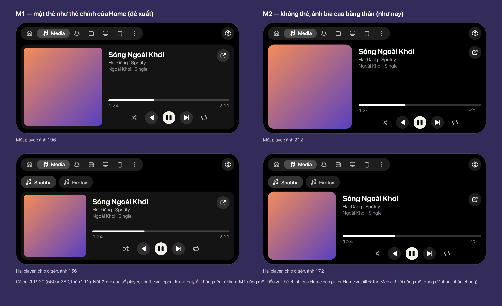
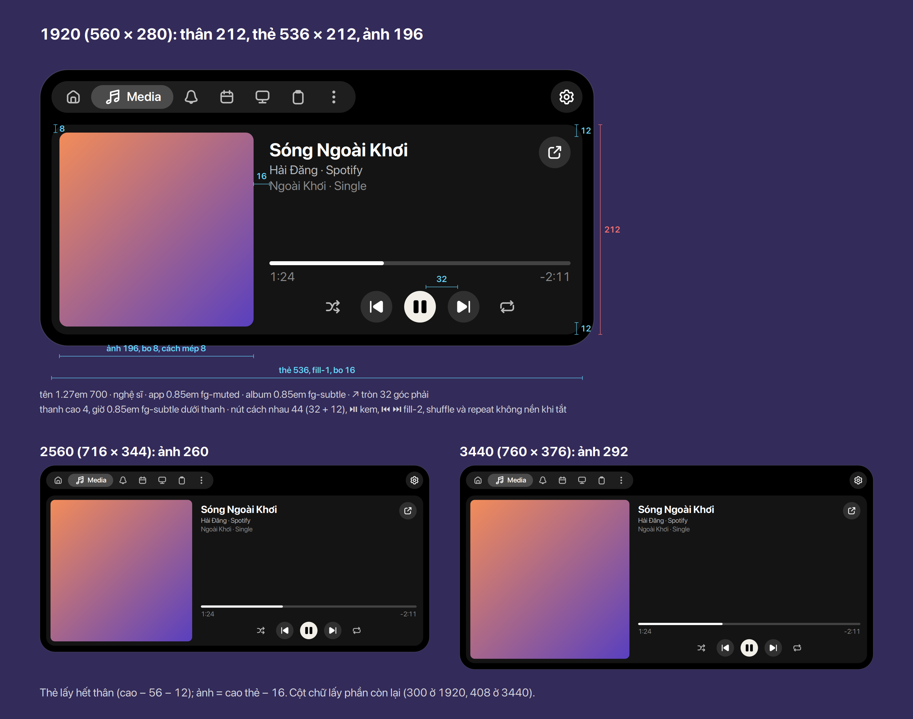
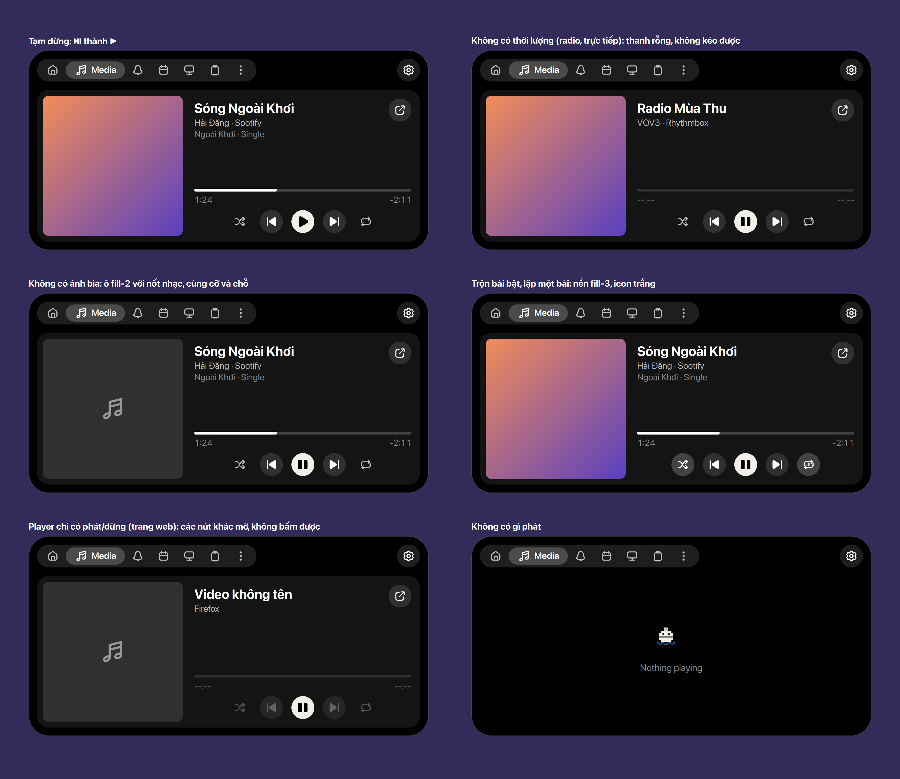

# Tab

**Mở.** Thiết kế chi tiết của thanh tab và từng tab đang làm dần: Media ở dưới. Trang này sẽ có thanh tab,
mỗi tab theo loại (Media, Notifications, Transfers, Timer, Calendar…) và các tab standalone
(Clipboard), mỗi cái một trang theo cùng khuôn với các phần khác.

Đã chốt đến giờ (ở [Expanded](../expanded/index.vi.md)): thanh tab cao 32, cách mép trên 12, bo 16
đồng tâm với góc 28. Home ở [trang riêng](../home/index.vi.md). Hành vi của thanh tab (tab nào có, mở ở đâu) ở SPEC §2b.

**Thanh tab** (Ethan, 2026-11-13, **Chốt**): Home · Media · Notifications · Calendar · Device, rồi
các tab chỉ hiện khi có activity (Claude Code, Transfers…) ở chỗ kế cuối, slot cuối luôn là tab
chọn từ ⋯ (Clipboard khi chưa chọn), Timer trong ⋯. Device là mục M4 riêng, chỉ thiết kế và hiển thị tab (từng phần có mục implement riêng): ba nhóm Máy này (pin,
chế độ nguồn), Không dây (Bluetooth, điện thoại như một thiết bị: pin, tìm máy; cuộc gọi, tin nhắn, Grab… ở tab Phone riêng), Đang cắm (USB, màn hình, tai nghe). **Chốt**

## Media

Tab mở ra khi bấm pill nhạc hay compact của nó (SPEC §2b: pill → tab của loại nó). Nó có những gì
compact không chứa được: player khác, seek, trộn bài, lặp, mở cửa sổ player. Số dùng chung ở
[Bảng số](../tokens.vi.md).

### Quyết định

- **M1: thân là một thẻ** `fill-1` bo 16, giống thẻ chính của Home ([Home](../home/index.vi.md)):
  ảnh bìa cách mép 8, bo 8; cột chữ và nút bên phải. Chọn giữa M1 và M2 (không thẻ, ảnh cao bằng
  thân như tab trước đây). Cùng một kiểu với Home nên khi làm [Chuyển động](../motion/index.vi.md)
  "Phần chung", pill → Home và pill → tab Media bay tới cùng một dạng (M4 "Motion: shared parts").
  **Chốt** (Ethan, 2026-11-13)
- **Nhiều player: một hàng chip ở trên**, mỗi player một chip (icon app 16, tên app), chip đang chọn
  `fill-3`, chip khác `fill-2`; thẻ thấp đi 40 (chip 32 + 8). Mở từ pill nào thì chọn player đó.
  **Chốt** (Ethan, 2026-11-13)
- **Luôn đủ nút và thanh seek**: ⇄ ⏮ ⏯ ⏭ ↻ và thanh luôn có mặt; player không làm được (không
  seek, không có bài trước/sau, không trộn, không lặp) thì phần đó **mờ** (`fg-disabled`), không
  phản hồi hover, không bấm hay kéo được. Bố cục không đổi theo player. **Chốt** (Ethan, 2026-11-13)
- Không có âm lượng ở đây (mixer sẽ có chỗ riêng: FEATURES "Sound tab"). **Chốt** (2026-11-08)

### Kích thước

- Thẻ lấy hết thân: rộng 536 / 692 / 736, cao 212 / 276 / 308 ở 1920 / 2560 / 3440 (expanded cao
  nhất trừ phần đầu 56 và lề dưới 12). **Đề xuất**
- Ảnh bìa vuông, cạnh = cao thẻ − 16: **196 / 260 / 292**; cách mép 8, bo 8 (16 − 8, đồng tâm).
  **Đề xuất**
- Cột chữ cách ảnh 16, cách mép phải 12, trên và dưới 12. Từ trên: tên 1.27em 700 (dài thì chạy
  như compact), "nghệ sĩ · app" 0.85em `fg-muted`, album 0.85em `fg-subtle`; ↗ tròn 32 `fill-2` ở
  góc phải trên, mở cửa sổ player. **Đề xuất**
- Dưới cùng: thanh cao 4 (`fill-3`, phần đã phát trắng), giờ đã phát và còn lại 0.85em `fg-subtle`
  ngay dưới thanh; rồi hàng nút 32 ở giữa cột, tâm cách nhau 44: ⇄ không nền, ⏮ `fill-2`, ⏯ kem
  (`fill-inverse`, icon đen), ⏭ `fill-2`, ↻ không nền. **Đề xuất**

### Các trạng thái

- **Tạm dừng**: ⏯ thành ▶. **Đề xuất**
- **Không có thời lượng** (radio, phát trực tiếp): thanh rỗng `fill-2`, giờ "--:--" `fg-disabled`,
  không kéo được. **Đề xuất**
- **Không có ảnh bìa**: ô `fill-2` cùng cỡ và chỗ, nốt nhạc 32 `fg-subtle` ở giữa. **Đề xuất**
- **Trộn bài / lặp bật**: nút có nền `fill-3`, icon trắng; lặp một bài dùng `repeat-1`. Bấm lặp đi
  vòng tắt → tất cả → một bài. **Đề xuất**
- **Player chỉ có phát/dừng** (một trang web): ⏯ bấm được, các nút khác và thanh mờ. **Đề xuất**
- **Không có gì phát**: Bu nghỉ và "Nothing playing" giữa thân, không có thẻ (EmptyState).
  **Đề xuất**

### Tương tác

- Bấm chip: đổi player, thẻ đổi nội dung bằng `fade-out` / `fade-in`, không đổi cỡ. **Đề xuất**
- Kéo thanh: seek khi thả; trong lúc kéo, giờ đã phát đi theo tay. Bấm một chỗ trên thanh: tới đó.
  **Đề xuất**
- Nút, chip, ↗: đổi màu theo `state` (120 ms) khi hover và nhấn; nút mờ không đổi. **Đề xuất**
- Bấm ↗: mở cửa sổ player và đóng island. **Đề xuất**

### Chỗ trong code

- `lib/modules/media/tab.js` — vẽ lại theo M1: thẻ, chip, cột chữ, thanh và hàng nút luôn đủ, phần
  không làm được thì `reactive = false` và class mờ.
- `lib/modules/media/layout.js` — cạnh ảnh = cao thẻ − 16 (bỏ `ART_SHARE`, `ART_MIN`, `ART_MAX`).
- `lib/modules/media/stylesheet.css` — thẻ, chip, nút mờ.
- `lib/modules/media/adapter.js` — mỗi activity nói player làm được gì (`canSeek`, `canGoPrevious`,
  `canGoNext`, `shuffle`, `loopStatus` của MPRIS), để tab biết nút nào mờ.
- Vẽ lại: `render/media.js` (`options`, `anatomy`, `states`).
